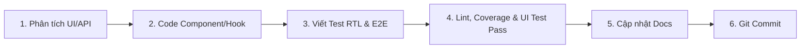

# 06 - Quy Trình Phát Triển & Definition of Done (Client)

## 1. Quy Trình 6 Bước Phát Triển Tính Năng



1. **Phân tích**: Kiểm tra `docs/`, tìm component sẵn có trong `components/ui`.
2. **Triển khai**: Code UI + logic hook + đa ngôn ngữ trong `vi.json` & `en.json`.
3. **Viết test**: Tạo file unit test `*.test.tsx`, mock API bằng MSW nếu cần; viết e2e test trong `e2e/` cho luồng người dùng chính.
4. **Kiểm tra chất lượng**: Chạy đầy đủ các lệnh kiểm tra trước khi commit (lint, typecheck, vitest coverage >= 80%, playwright e2e).
5. **Cập nhật docs**: Cập nhật `docs/` nếu thay đổi luồng hoặc thêm màn hình.
6. **Commit**: Tạo commit theo Conventional Commits.

---

## 2. Các Lệnh Bắt Buộc Trước Khi Commit

```bash
npm run lint          # Kiểm tra lỗi cú pháp và convention
npm run typecheck     # Kiểm tra kiểu dữ liệu TypeScript strict
npm run test          # Chạy toàn bộ unit & integration tests
npm run test:coverage # Đảm bảo Line Coverage & Branch Coverage >= 80%
npm run test:e2e      # Chạy kiểm thử giao diện người dùng Playwright E2E
```

---

## 3. Quy Ước Commit (Conventional Commits)

- Định dạng: `<type>(<scope>): <mô tả ngắn bằng tiếng Việt hoặc tiếng Anh>`
- Các type hợp lệ: `feat`, `fix`, `test`, `refactor`, `style`, `docs`, `chore`.

```text
// ❌ SAI: Commit chung chung, không rõ phạm vi
git commit -m "fix bug va sua giao dien"

// ✅ ĐÚNG: Conventional commit rõ ràng, tách bạch
git commit -m "feat(booking): bổ sung date picker chọn ngày thuê váy"
git commit -m "test(booking): thêm test kiểm tra validate ngày thuê trong quá khứ"
```
