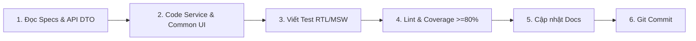

# 06 - Quy Trình Phát Triển & Definition of Done (CRM)

## 1. Quy Trình 6 Bước Phát Triển Màn Hình/Tính Năng



1. **Phân tích**: Đọc tài liệu `docs/` để nắm rõ DTO API và yêu cầu quyền hạn (roles).
2. **Triển khai**: Tạo API service, TanStack Query hook, ghép nối các component từ `components/common`.
3. **Đa ngôn ngữ**: Bổ sung toàn bộ text vào cả 2 file `vi.json` và `en.json`.
4. **Viết test tự động**: Tạo file test, mock response với MSW, đảm bảo test cả trường hợp lỗi.
5. **Kiểm tra chất lượng**: Chạy lệnh kiểm tra nghiêm ngặt trước khi commit.
6. **Commit**: Tạo commit theo Conventional Commits.

---

## 2. Các Lệnh Bắt Buộc Trước Khi Commit

```bash
npm run lint          # Kiểm tra code style và quy tắc lint
npm run typecheck     # Kiểm tra TypeScript type safety
npm run test          # Chạy toàn bộ test suite
npm run test:coverage # Kiểm tra độ phủ (bắt buộc Line & Branch >= 80%)
```

---

## 3. Quy Ước Commit (Conventional Commits)

```text
// ❌ SAI: Không đúng chuẩn Conventional Commit
git commit -m "them chuc nang quan ly trang phuc"

// ✅ ĐÚNG: Đúng định dạng type(scope): description
git commit -m "feat(dress-management): thêm màn hình danh sách và lọc váy dạ hội"
git commit -m "fix(auth): sửa lỗi không tự refresh token khi nhận 401 từ server"
```
