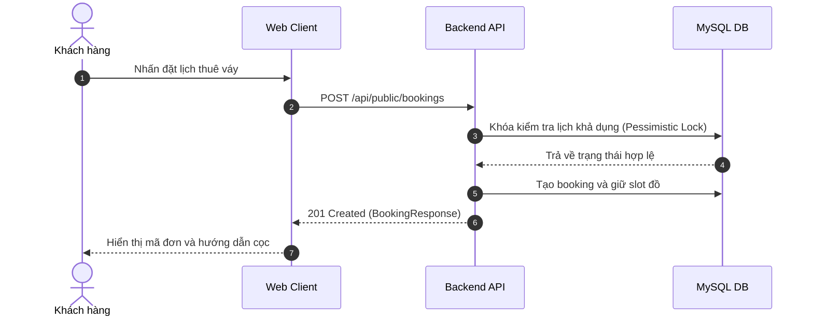

# 01 - Quy Chuẩn Soạn Thảo Tài Liệu & Mermaid (Docs)

## 1. Quy Định Bắt Buộc

- **PHẢI** viết tài liệu bằng **tiếng Việt**, văn phong kỹ thuật chính xác, trực diện và dùng thuật ngữ chuẩn.
- **PHẢI** tạo bảng mục lục (Table of Contents) ở đầu file đối với các tài liệu dài trên 50 dòng.
- **PHẢI** mô tả luồng nghiệp vụ, tương tác hệ thống và trạng thái bằng sơ đồ **Mermaid** (`flowchart`, `sequenceDiagram`, `stateDiagram-v2`).
- **TUYỆT ĐỐI CẤM** dùng ảnh chụp màn hình vẽ tay hay file nhị phân thay thế sơ đồ Mermaid.
- Mọi khối code **PHẢI** chỉ định rõ ngôn ngữ (ví dụ: ```` ```json ````, ```` ```java ````, ```` ```bash ````).
- Sử dụng GitHub Markdown callouts (`> [!NOTE]`, `> [!IMPORTANT]`, `> [!WARNING]`) khi cần nhấn mạnh.

---

## 2. Ví Dụ Cụ Thể

### Sơ Đồ Mermaid Thay Vì Mô Tả Rời Rạc Hoặc Ảnh
```markdown
<!-- ✅ ĐÚNG: Trực quan hóa luồng bằng Mermaid sequenceDiagram -->

```

### Callout Nhấn Mạnh Nghiệp Vụ
```markdown
> [!WARNING]
> Thời gian giữ trang phục tối đa là 15 phút nếu khách hàng chưa hoàn tất bước đặt cọc.
```
