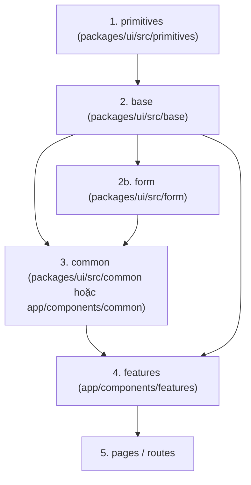

# Kiến Trúc Thư Viện UI & Danh Mục Component Chickie (@chickie/ui)

Tài liệu hướng dẫn kiến trúc component và hướng dẫn phát triển giao diện cho toàn bộ hệ thống **Chickie Studio** (Client Next.js và CRM React Vite).

---

## 1. Triết Lý & Kiến Trúc 4 Lớp

Giao diện cả `client` và `crm` được xây dựng từ **bộ component riêng của Chickie**, không gọi trực tiếp component shadcn/ui trong các màn hình hay tính năng nghiệp vụ.

shadcn/ui đóng vai trò **nguyên liệu nền (primitive)**. Mỗi component của Chickie (`Button`, `TextField`, `Select`, `Modal`...) **bọc và mở rộng** primitive tương ứng.



### Chi tiết 4 lớp:

| Lớp | Thư mục | Nội dung | Phạm vi truy cập / Được import |
|---|---|---|---|
| **1. primitives** | `packages/ui/src/primitives` | Mã nguồn sinh ra bởi shadcn (Radix primitives), hầu như không sửa. | **Chỉ lớp `base`** được phép import. Không export ra ngoài package. |
| **2. base** | `packages/ui/src/base` | `Button`, `TextField`, `TextArea`, `Select`, `Checkbox`, `RadioGroup`, `Switch`, `Modal`, `ConfirmModal`, `Drawer`, `Menu`, `Popover`, `Tooltip`, `Tabs`, `Badge`, `Card`, `notify`... | Tất cả các tầng trên (mọi nơi). |
| **2b. form** | `packages/ui/src/form` | Bản tích hợp `react-hook-form`: `FormTextField`, `FormSelect`, `FormCheckbox`, `FormDatePicker`... | Mọi nơi. |
| **3. common** | `packages/ui/src/common` (dùng chung) & `<app>/src/components/common` (riêng app) | Component ghép từ base: `StatusBadge`, `ProductCard`, `SectionHeading`, `Rating`, `FilterBar`, `DataTable`... | `features`, `pages`. |
| **4. features** | `<app>/src/components/features` | Gắn nghiệp vụ đặc thù: form đặt thuê, bảng duyệt đơn, giỏ đồ... | `pages`. |

> **Quy tắc phụ thuộc một chiều**: `pages → features → common → form/base → primitives`. Lớp dưới tuyệt đối không bao giờ import lớp trên.

---

## 2. Quy Chuẩn Kỹ Thuật Khi Bọc shadcn/ui

1. **Mở rộng props của primitive**: Type props = Props primitive + Props riêng của Chickie. Truyền `...rest` xuống để giữ nguyên tính năng (aria, data-*, onClick, accessibility).
2. **Luôn nhận `className`**: Gộp bằng `cn(defaultClass, className)`. Đặt `className` ở cuối để nơi sử dụng có thể tinh chỉnh khi cần.
3. **Từ vựng variant hẹp theo Design System**: Ví dụ `Button` chỉ có `primary | secondary | tertiary` và `md | sm`. Không để lộ vocabulary của shadcn (`default | outline | ghost | destructive`). Ánh xạ nội bộ qua variant map.
4. **Không sửa trực tiếp file trong `primitives/`**: Tuỳ biến thông qua token (`shadcn-theme.css`) hoặc tại lớp base. Nếu bắt buộc sửa đổi primitive, phải ghi nhận vào `primitives/CHANGES.md`.
5. **Bổ sung trợ năng và trạng thái**: Nhãn (`label`), gợi ý (`hint`), thông báo lỗi (`error`), dấu bắt buộc (`required`), trạng thái loading (`loading`, `aria-busy`), icon đầu/cuối, tự động sinh ID và liên kết `aria-describedby`, `aria-invalid`.
6. **Không chứa chuỗi cố định**: Chuỗi văn bản hiển thị phải truyền qua props để đảm bảo tính độc lập đa ngôn ngữ (`next-intl` hoặc `react-i18next`).
7. **Kiểm thử tự động & Accessibility**: Mỗi component base/form/common có test render, variant, tương tác, trạng thái lỗi/disabled/loading và kiểm thử tự động với `vitest-axe`. Độ bao phủ (coverage) package $\ge 80\%$.

---

## 3. Cấu Trúc Workspace `@chickie/ui`

```
chickie-studio/
├── package.json             # workspaces: ["packages/*", "client", "crm"]
├── packages/
│   └── ui/
│       ├── package.json     # name: @chickie/ui, exports: { ".": "./src/index.ts", "./theme": ... }
│       ├── components.json  # Cấu hình shadcn CLI
│       ├── tsconfig.json
│       ├── vitest.config.ts
│       └── src/
│           ├── primitives/  # Radix / shadcn primitives (KHÔNG export)
│           ├── base/        # Component Chickie bọc primitive
│           ├── form/        # Component gắn react-hook-form
│           ├── common/      # Component ghép dùng chung cả hai app
│           ├── lib/         # cn(), formatters (VND, SĐT)
│           ├── styles/      # shadcn-theme.css, tokens.css
│           └── index.ts     # Export duy nhất cho base, form, common
├── client/                  # Ứng dụng Next.js khách hàng
└── crm/                     # Ứng dụng React Vite quản trị
```

---

## 4. Kế Hoạch Triển Khai 6 Giai Đoạn (UI-000 đến UI-005)

| Mã | Giai đoạn | Nội dung thực hiện | Tiêu chí hoàn thành (DoD) |
|---|---|---|---|
| `UI-000` | **UI-0 Nền tảng** | Workspace monorepo, package `@chickie/ui`, exports, theme tokens, `cn`, Vitest, ESLint rules chặn import primitive, trang `/dev/components` ở cả hai app. | Cả Client và CRM import được `Button` từ `@chickie/ui`, ESLint chặn primitive thành công, `test:coverage` $\ge 80\%$. |
| `UI-001` | **UI-1 Nhập liệu cơ bản** | `Button`, `TextField` (+Password, Search), `TextArea`, `Select`, `Checkbox`, `RadioGroup`, `Switch`, `Badge`, `Card`, `Spinner`, `Skeleton`. | Test + axe pass 100%, tích hợp trang xem trước. |
| `UI-002` | **UI-2 Lớp phủ** | `Modal`, `ConfirmModal`, `Drawer`, `Menu`, `Popover`, `Tooltip`, `notify` (sonner wrapper). | Focus trap chuẩn, Esc đóng, trả focus đúng, test pass 100%. |
| `UI-003` | **UI-3 Ngày và form** | `DatePicker`, `DateRangePicker`, bộ `Form*` (`FormTextField`, `FormSelect`...), `CurrencyField` (VND), `PhoneField`, `ChipGroup`, `SizeSelector`, `ColorSwatchGroup`. | Form mẫu hoàn chỉnh với React Hook Form + Zod validation. |
| `UI-004` | **UI-4 Hiển thị dữ liệu** | `Tabs`, `Accordion`, `Pagination`, `Breadcrumbs`, `EmptyState`, `ErrorState`, `Gallery`, `DataTable`. | `DataTable` đáp ứng danh sách sản phẩm và đơn thuê. |
| `UI-005` | **UI-5 Common nghiệp vụ** | `StatusBadge`, `ProductCard`, `SectionHeading`, `Rating`, `FilterBar`, `ImageUploader`, `StatCard`. | Trang chủ và danh sách sản phẩm Client chỉ dùng component Chickie. |
