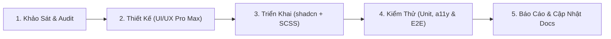

# Quy Chuẩn Kỹ Thuật UI/UX Toàn Dự Án (Global UI/UX Engineering Rules)
**Dự Án:** Chickie Studio (Boutique Cho Thuê Trang Phục Thiết Kế & Combo Máy Ảnh)  
**Tác giả:** Senior Frontend Architect & Design System Architect  
**Áp dụng:** Toàn bộ phân vùng Frontend (Client Next.js 14, CRM React Vite, Mobile nếu có) và mọi AI Agents/Developers tham gia phát triển.

---

## 1. Tuyên Ngôn Kiến Trúc & Nguyên Tắc Bắt Buộc

### 1.1. Thư Viện UI Tiêu Chuẩn: `shadcn/ui`
Toàn bộ dự án thống nhất chọn **`shadcn/ui` (Radix UI primitives + Tailwind CSS + CVA)** làm bộ thư viện UI tiêu chuẩn duy nhất:
1. **Ưu tiên component có sẵn của shadcn/ui**: Tái sử dụng `Button`, `Input`, `Dialog`, `Sheet`, `DropdownMenu`, `Select`, `Table`, `Badge`, `Tabs`, `Toast`, `Skeleton`, v.v.
2. **Không tự viết lại component** nếu chức năng đó đã được shadcn/ui cung cấp.
3. **Wrapper Component có kiểm soát**: Chỉ tạo wrapper component (như `DataTable`, `FormField`, `ConfirmModal`) khi nó mang lại giá trị thực tế về chuẩn hóa validation, đa ngôn ngữ, hoặc nghiệp vụ dùng chung.
4. **Không tự ý cài đặt UI library khác** (như MUI, Chakra UI, Ant Design mới) khi chưa có sự phê duyệt kiến trúc. Các màn hình hiện tại dùng Ant Design trên CRM sẽ được chuyển đổi theo lộ trình chuẩn hóa sang shadcn/ui.
5. **Không sửa trực tiếp source code shadcn/ui** theo cách phá vỡ khả năng đồng bộ; tùy biến thông qua variant, props, SCSS/CSS class và design tokens.

### 1.2. Quy Định Cấm Tuyệt Đối Inline CSS & Quản Lý Qua File SCSS/CSS
**Tuyệt đối cấm viết inline CSS (`style={{ ... }}`) trong component.** Mọi CSS tùy chỉnh phải được quản lý trong file SCSS/CSS có phạm vi và cấu trúc rõ ràng.

#### Quy tắc cấm:
- ❌ **CẤM**: `<div style={{ marginTop: 16, color: "#641D2B" }}>...</div>`
- ❌ **CẤM**: Dùng inline style để giải quyết nhanh khoảng cách, màu sắc, responsive.
- ❌ **CẤM**: Gán thuộc tính style qua JavaScript runtime khi có thể giải quyết bằng class / variant.
- ❌ **CẤM**: Tự tiện dùng `!important` hoặc selector quá sâu (`div > div > span:first-child`).

#### Cách triển khai chuẩn:
- ✅ **Cách 1 (Ưu tiên với shadcn/Tailwind)**: Sử dụng utility classes của Tailwind đã ánh xạ token semantic:
  ```tsx
  <div className="mt-4 text-primary font-medium">...</div>
  ```
- ✅ **Cách 2 (Với CSS tùy chỉnh / hiệu ứng phức tạp)**: Đặt trong file SCSS tương ứng:
  ```tsx
  <div className="order-summary-card__header">...</div>
  ```
  *File SCSS tương ứng:*
  ```scss
  .order-summary-card {
    &__header {
      margin-top: var(--space-4);
      color: var(--color-primary);
      border-bottom: 1px solid var(--color-line);
    }
  }
  ```

#### Ngoại lệ có kiểm soát:
Chỉ cho phép inline style khi giá trị phụ thuộc vào **tính toán toán học động tại runtime** (ví dụ: tọa độ kéo thả chuột, render SVG path động, canvas, tỉ lệ progress thanh tải động). Mọi ngoại lệ bắt buộc phải có comment giải thích lý do kỹ thuật.

---

## 2. Hệ Thống Design Tokens Chuẩn (Design Tokens Specification)

Được kế thừa từ bản sắc thương hiệu Chickie Studio và tối ưu qua bộ tiêu chí của **UI/UX Pro Max**:

### 2.1. Bảng Màu (Color Tokens)
| Tên Token (CSS Variable) | Giá Trị Hex | Mục Đích Sử Dụng | Yêu Cầu Tương Phản (WCAG 2.1) |
| :--- | :--- | :--- | :--- |
| `--color-primary` / `--primary` | `#641D2B` | Màu đỏ Burgundy sang trọng, nút bấm chính, brand highlight | 7.1:1 trên nền trắng (Đạt AAA) |
| `--color-primary-hover` | `#4D1621` | Trạng thái hover của nút bấm chính | Tối hơn 15% |
| `--color-accent` | `#B8914F` | Vàng Champagne Gold, ngôi sao đánh giá, viền thẻ nổi bật | Điểm xuyết (Accent/Focus) |
| `--color-ink` / `--foreground` | `#302528` | Chữ chính (Body text, Heading) | 11.2:1 trên nền trắng (Đạt AAA) |
| `--color-ink-muted` / `--muted-foreground` | `#6B5D60` | Chữ phụ, placeholder, nhãn hướng dẫn | 4.6:1 trên nền trắng (Đạt AA) |
| `--color-warm-white` / `--background` | `#FFFCF8` | Nền trang tổng thể, thẻ bài viết | Nền trắng ngà ấm áp |
| `--color-ivory` / `--muted` | `#F8F1E8` | Nền section phụ, bảng biểu, dropdown menu | Nền phân biệt nhịp đọc |
| `--color-line` / `--border` | `#EADFD6` | Đường kẻ viền, ngăn cách nội dung | Viền tinh tế |
| `--color-destructive` | `#D9383A` | Trạng thái lỗi, nút xóa dữ liệu, cảnh báo quá hạn | 4.8:1 trên nền trắng (Đạt AA) |
| `--color-success` | `#1B8755` | Trạng thái hoàn tất, xác nhận đơn thành công | 4.5:1 trên nền trắng (Đạt AA) |
| `--color-sidebar-dark` | `#302528` | Nền Sidebar CRM Dark Ink cao cấp | Độ tương phản cao với chữ trắng |

### 2.2. Typography (Quy Chuẩn Font Chữ)
- **Display & Heading**: Font Serif thanh lịch `Playfair Display`, font-weight 600, 700. Áp dụng cho: Tiêu đề trang (H1, H2), Tên sản phẩm, Chỉ số số liệu lớn trên KPI Dashboard, Tagline.
- **Body & UI**: Font Sans-serif hiện đại `Inter`, font-weight 400 (regular), 500 (medium), 600 (semibold). Áp dụng cho: Nút bấm, Nhãn form, Văn bản mô tả, Bảng dữ liệu, Tooltip, Menu.
- **Thang kích thước & Line Height**:
  - `H1`: 32px / 40px (Desktop), 26px / 34px (Mobile).
  - `H2`: 24px / 32px (Desktop), 20px / 28px (Mobile).
  - `H3`: 20px / 28px (Desktop), 18px / 24px (Mobile).
  - `Body Base`: 16px / 24px (tuyệt đối không dùng chữ nhỏ hơn 14px cho nội dung đọc chính).
  - `Caption/Small`: 12px-13px / 18px (chỉ dùng cho helper text, tag trạng thái nhỏ).

### 2.3. Spacing & Radius
- **Thang khoảng cách**: 4px (`--space-1`), 8px (`--space-2`), 12px (`--space-3`), 16px (`--space-4`), 24px (`--space-6`), 32px (`--space-8`), 48px (`--space-12`), 64px (`--space-16`).
- **Bo góc (Border Radius)**:
  - Nút bấm, Ô nhập liệu (`Input`): `8px` (`rounded-btn`).
  - Thẻ card, Bảng (`Card`, `DataTable`): `12px - 16px` (`rounded-card`).
  - Badge, Chip: `9999px` (`rounded-full`).

---

## 3. Quy Chuẩn Tổ Chức SCSS / CSS Cho Toàn Dự Án

Cấu trúc thư mục SCSS khuyến nghị cho các phân vùng:

```text
src/
├── styles/
│   ├── _tokens.scss          # CSS Custom Properties (:root variables)
│   ├── _typography.scss      # Khai báo font-face và kiểu chữ
│   ├── _mixins.scss          # Responsive mixins (@include respond-to('md')), flex helpers
│   ├── _reset.scss           # CSS reset và box-sizing
│   ├── _utilities.scss       # Utility classes dùng chung không thuộc Tailwind
│   └── globals.scss          # File import tổng hợp duy nhất
│
├── components/
│   ├── ui/                   # Các component shadcn/ui nguyên bản hoặc tinh chỉnh
│   └── common/               # Wrapper components hoặc component mở rộng (kèm file .module.scss nếu cần)
```

### Nguyên tắc viết SCSS:
1. **Không lồng quá 3 cấp (Nesting $\le 3$)**: Tránh tạo selector quá dài gây phình to CSS và khó ghi đè.
2. **Quy ước đặt tên BEM đơn giản**: `.block__element--modifier` cho các thành phần phức tạp.
3. **Responsive Mobile-First**: Viết style cho mobile trước, sử dụng media query `@media (min-width: 768px)` cho tablet và desktop.

---

## 4. Chuẩn Hóa Các Nhóm Component Trọng Tâm

### 4.1. Button & Interactive Elements
- **Vùng bấm tối thiểu (Touch Target)**: $\ge 44 \times 44\text{px}$ trên màn hình cảm ứng / mobile.
- **Trạng thái bắt buộc**: `default`, `hover` (transition 150-250ms), `focus-visible` (ring 2px màu Burgundy `#641D2B` cách viền 2px), `disabled` (opacity 0.5, cursor not-allowed), `loading` (hiển thị Spinner, disabled pointer events để chống double click).
- **Icon Buttons**: Bắt buộc có thuộc tính `aria-label` mô tả rõ hành động (ví dụ: `aria-label="Đóng hộp thoại"`).

### 4.2. Form, Validation & Feedback (Theo UX/UI Pro Max)
1. **Nhãn rõ ràng (Explicit Label)**: Mọi ô nhập liệu bắt buộc có `<label>` gắn liên kết qua `htmlFor` / `id`. Tuyệt đối không dùng `placeholder` thay thế cho label.
2. **Hiển thị lỗi ngữ nghĩa (Semantic Error)**:
   - Thẻ hiển thị lỗi phải có `role="alert"` hoặc `aria-live="polite"`.
   - Thuộc tính `aria-invalid="true"` và `aria-describedby="{id}_error"` phải được gán vào thẻ `<input>`.
   - Đổi viền input sang màu đỏ `--color-destructive` `#D9383A`.
3. **Chống submit nhiều lần**: Khi form đang xử lý (`isSubmitting` / `loading`), nút submit phải bị vô hiệu hóa và hiển thị trạng thái đang tải.

### 4.3. Dialog, Modal & Overlay
1. **Quản lý Focus (Focus Trap)**: Khi mở modal/dialog, focus tự động chuyển vào phần tử đầu tiên bên trong modal; phím `Tab` không được lọt ra ngoài nền.
2. **Đóng bằng bàn phím**: Phím `Esc` phải luôn đóng được modal (trừ trường hợp đang xử lý tác vụ không thể hủy).
3. **Xác nhận thao tác nguy hiểm**: Thao tác xóa dữ liệu, hủy đơn đặt lịch bắt buộc phải dùng `ConfirmModal` / `AlertDialog` với nút xác nhận màu đỏ Destructive.

### 4.4. Bảng Dữ Liệu (Data Display & Tables)
1. **Cột & Phân trang**: Phân trang rõ ràng (10, 20, 50 dòng/trang). Bảng có trạng thái tải `Loading`, trạng thái không có dữ liệu `EmptyState` và trạng thái lỗi `ErrorState`.
2. **Responsive Table**: Trên màn hình nhỏ (mobile), bảng phải hỗ trợ cuộn ngang mượt mà (`overflow-x: auto`) hoặc chuyển đổi sang dạng thẻ danh sách (Card list) để dễ đọc.

---

## 5. Quy Trình 5 Bước Phát Triển Giao Diện Dành Cho AI Agent & Developer

Trước khi bắt đầu viết code cho bất kỳ trang hoặc component nào:



1. **Bước 1 - Khảo sát**: Kiểm tra `src/components/ui` và `src/components/common`. Tuyệt đối không viết lại component đã có.
2. **Bước 2 - Thiết kế**: Đối chiếu tiêu chí UX/UI Pro Max (bảng màu, font chữ, touch target $\ge 44$px, a11y contrast $\ge 4.5:1$).
3. **Bước 3 - Triển khai**: Sử dụng component của shadcn/ui. **Không viết inline style `style={{ ... }}`**. CSS tùy biến viết vào file SCSS hoặc class Tailwind.
4. **Bước 4 - Kiểm thử**:
   - Chạy test unit và accessibility với `vitest-axe` (không có lỗi vi phạm WCAG).
   - Kiểm tra trạng thái Loading, Empty, Error, Success.
   - Đo lường coverage đạt $\ge 80\%$.
   - Viết và chạy kiểm thử giao diện E2E với Playwright (`npm run test:e2e`) cho các luồng tương tác người dùng quan trọng trên trình duyệt thật.
   - Chạy `npm run typecheck` và `npm run lint`.
5. **Bước 5 - Báo cáo & Cập nhật Docs**: Ghi nhận component mới vào [docs/COMPONENTS.md](COMPONENTS.md) và cập nhật tiến độ vào [docs/FEATURES.md](FEATURES.md).

---

## 6. Lộ Trình Chuyển Đổi (Migration Plan) Cho CRM

Hiện tại ứng dụng CRM đang sử dụng Ant Design 5 đi kèm nhiều inline style để tùy biến. Kế hoạch chuyển đổi sang chuẩn chung như sau:

- **Giai đoạn 1 (Ngay lập tức)**: Ban hành bộ quy chuẩn UI/UX và thiết lập cấu hình SCSS/Tailwind cho toàn hệ thống. Cấm toàn bộ lập trình viên/AI Agent viết thêm bất kỳ inline style nào mới.
- **Giai đoạn 2 (Chuẩn hóa Wrappers CRM)**: Refactor 13 component dùng chung của CRM (`crm/src/components/common/`), chuyển đổi toàn bộ `style={{ ... }}` sang class SCSS/CSS Module chuẩn.
- **Giai đoạn 3 (Chuyển đổi hoàn toàn sang shadcn/ui)**: Tích hợp đầy đủ bộ component shadcn/ui (Radix primitives) vào CRM, thay thế dần các dependency của Ant Design để đồng bộ 100% công nghệ với Client.
