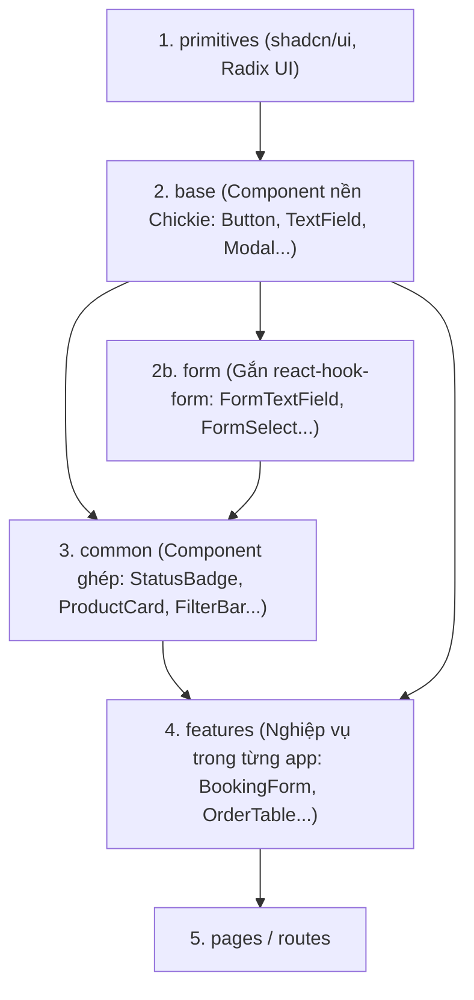

# ADR 0002: Kiến Trúc Component Bọc shadcn/ui Qua Package @chickie/ui

- **Trạng thái**: Đã chấp thuận (`Accepted`)
- **Ngày**: 2026-10-24
- **Tác giả**: Senior Frontend Architect & Tech Lead

---

## 1. Bối Cảnh (Context)

Dự án **Chickie Studio** bao gồm hai ứng dụng giao diện người dùng:
1. `client`: Website khách hàng (Next.js 14 App Router, SSR, tối ưu SEO, mobile-first).
2. `crm`: Hệ thống quản trị nội bộ cửa hàng (React 18, Vite, SPA quản lý đơn hàng & sản phẩm).

Cả hai ứng dụng đều thống nhất sử dụng **shadcn/ui** (dựa trên Radix UI primitives và Tailwind CSS). Tuy nhiên, nếu gọi trực tiếp component của shadcn/ui trong các trang (`pages`) và tính năng (`features`), hệ thống gặp các vấn đề lớn:
- **Lặp code & phân mảnh trải nghiệm**: Mỗi trang tự lắp ghép `Label` + `Input` + thông báo lỗi, xử lý trợ năng WAI-ARIA thiếu đồng bộ.
- **Khó tùy biến toàn diện**: Khi thay đổi kiểu dáng nút bấm (Button) hoặc hành vi modal, phải chỉnh sửa hàng chục vị trí rải rác.
- **Rò rỉ API primitive**: Các prop cấp thấp của Radix/shadcn (như `variant="ghost"`, `asChild`) bị lộ khắp nơi, làm tăng chi phí bảo trì và cản trở việc nâng cấp thư viện nền tảng.
- **Trùng lặp logic định dạng Việt Nam**: Tiền tệ VND, số điện thoại Việt Nam, định dạng ngày tháng bị viết đi viết lại ở cả Client và CRM.
- **Kiểm soát chất lượng khó khăn**: Bộ kiểm thử và kiểm tra accessibility (axe) bị lặp lại ở cả hai ứng dụng.

---

## 2. Quyết Định (Decision)

Quyết định triển khai kiến trúc **4 lớp (4-Tier Layered Architecture)** và đóng gói các tầng dùng chung vào workspace monorepo **`packages/ui`** (tên package: **`@chickie/ui`**):

### 2.1. Sơ Đồ Kiến Trúc 4 Lớp

### 2.2. Phân Cấp Thư Mục & Giới Hạn Truy Xuất

| Lớp | Thư mục | Trách nhiệm | Quyền Import |
|---|---|---|---|
| **1. primitives** | `packages/ui/src/primitives` | Code do shadcn sinh ra (gốc Radix), hầu như không sửa đổi. | **Chỉ lớp `base`** được import. Không export ra ngoài package. |
| **2. base** | `packages/ui/src/base` | Component nền của Chickie (`Button`, `TextField`, `Select`, `Modal`, `ConfirmModal`, `Card`, `Badge`...). Bọc primitive, chuẩn hóa nhãn, trợ năng, trạng thái loading/disabled. | Mọi nơi. |
| **2b. form** | `packages/ui/src/form` | Bản tích hợp `react-hook-form` (`FormTextField`, `FormSelect`...). | Mọi nơi. |
| **3. common** | `packages/ui/src/common` (dùng chung) & `<app>/src/components/common` (riêng app) | Ghép từ `base`: `StatusBadge`, `ProductCard`, `FilterBar`, `DataTable`... | `features`, `pages`. |
| **4. features** | `<app>/src/components/features` | Gắn nghiệp vụ theo từng màn hình cụ thể. | `pages`. |

### 2.3. Quy Chuẩn Đóng Gói `@chickie/ui`
1. **Không cần bước build bundle**: File `package.json` của `@chickie/ui` trỏ `exports` thẳng tới mã nguồn TypeScript. Next.js dùng `transpilePackages: ['@chickie/ui']`; Vite xử lý trực tiếp.
2. **Cưỡng chế giới hạn truy xuất**: `exports` của package chỉ mở `"."` và file theme. Không export thư mục `primitives`, ngăn chặn tuyệt đối việc Client hay CRM import trực tiếp Radix/shadcn.
3. **Từ vựng variant hẹp theo Design System**: Ví dụ `Button` chỉ nhận `variant="primary" | "secondary" | "tertiary"` và `size="md" | "sm"`, không để lộ vocabulary của shadcn (`default | outline | ghost | destructive`).
4. **Không chứa chuỗi i18n cố định**: Mọi văn bản hiển thị nhận qua props để tôn trọng đa ngôn ngữ (`next-intl` ở Client, `react-i18next` ở CRM).
5. **Cưỡng chế qua ESLint**: Thiết lập rule `no-restricted-imports` và `react/forbid-elements` ngăn chặn dùng thẻ HTML thô và thư viện ngoài trái quy định.

---

## 3. Hệ Quả (Consequences)

### Tích cực
- **Tính nhất quán tuyệt đối**: Thay đổi giao diện hay sửa lỗi accessibility (a11y) một lần tại `@chickie/ui` là cả Client và CRM cùng được cập nhật ngay lập tức.
- **Tiết kiệm mã nguồn**: Giảm hơn 60% code trùng lặp giữa Client và CRM cho các component cơ bản và form fields.
- **Chất lượng được bảo đảm**: Mỗi component được test render, trạng thái lỗi, loading và kiểm tra tự động `vitest-axe` với độ bao phủ coverage $\ge 80\%$.
- **Dễ dàng nâng cấp shadcn**: Do `primitives` không bị sửa đổi trực tiếp, việc chạy lệnh nâng cấp của shadcn (`shadcn add --overwrite`) không làm xung đột code tùy biến của dự án.

### Tiêu cực & Biện pháp giảm thiểu
- **Cấu hình Monorepo Workspace**: Cần quản lý cấu hình npm workspaces ở thư mục gốc và transpile của Next.js $\rightarrow$ **Biện pháp**: Khởi tạo `package.json` gốc với workspace chuẩn, thiết lập `transpilePackages` trong `next.config.mjs` và cấu hình đường dẫn Tailwind content.
- **Quản lý Client Component trong Next.js**: Một số component dùng hook cần khai báo `"use client"` $\rightarrow$ **Biện pháp**: Thêm chỉ thị `"use client"` ở đầu các component có tương tác state hoặc event handler trước khi export.
