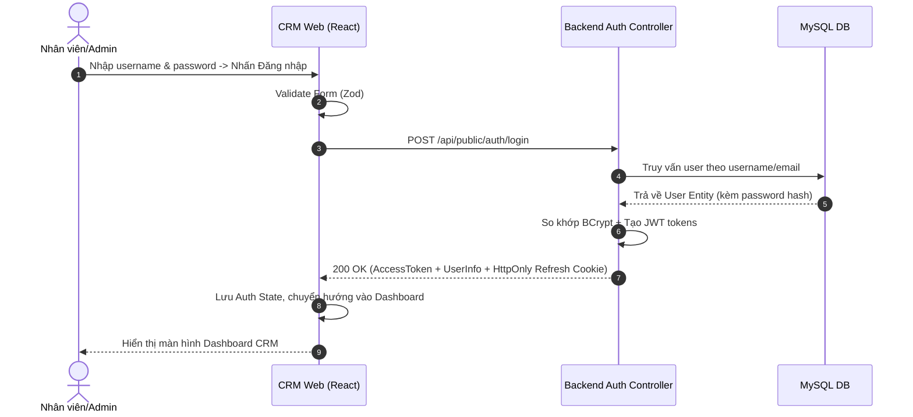

# Đặc Tả Tính Năng: Đăng Nhập CRM

| Thuộc tính | Giá trị |
|---|---|
| **ID** | `AUTH-001` |
| **Tên tính năng** | Đăng nhập hệ thống quản trị CRM |
| **Module** | AUTH |
| **Phạm vi** | CRM, SERVER |
| **Ưu tiên** | P0 - MVP |
| **Trạng thái** | ✅ DONE |
| **Người phụ trách** | Tech Lead / Fullstack Dev |
| **Ngày bắt đầu** | 2026-10-24 |
| **Ngày hoàn thành** | 2026-10-24 |
| **Phụ thuộc** | Không |

---

## 1. Mục Tiêu và Giá Trị Mang Lại
Cung cấp cổng đăng nhập an toàn cho chủ shop (Admin) và nhân viên vào hệ thống CRM thông qua email/username và mật khẩu, cấp Access Token (JWT) để xác thực các thao tác nghiệp vụ tiếp theo.

## 2. Người Dùng Liên Quan
- [x] **Nhân viên cửa hàng**: Đăng nhập để xem danh sách đơn, cập nhật trạng thái đồ thuê.
- [x] **Admin (Chủ shop)**: Đăng nhập với quyền tối cao quản lý cấu hình, người dùng và báo cáo.

## 3. Luồng Chính (Happy Path)
1. Người dùng truy cập đường dẫn CRM `/login`.
2. Nhập thông tin tài khoản (username/email và mật khẩu) rồi nhấn "Đăng nhập".
3. CRM validate form bằng Zod và gửi `POST /api/public/auth/login`.
4. Server kiểm tra thông tin, mã hóa mật khẩu đối chiếu bằng `BCryptPasswordEncoder`.
5. Server tạo Access Token (hạn 15 phút) và Refresh Token (hạn 7 ngày).
6. Server trả về thông tin user (id, name, role) và token (Access Token trong body, Refresh Token trong HttpOnly Cookie).
7. CRM lưu Access Token vào bộ nhớ/state, điều hướng người dùng vào trang Dashboard.



## 4. Luồng Ngoại Lệ và Trường Hợp Biên
- **Sai thông tin đăng nhập**: Server trả về `401 Unauthorized` với thông điệp chung "Tên đăng nhập hoặc mật khẩu không chính xác" (tránh lộ thông tin tài khoản tồn tại).
- **Tài khoản bị khóa (`status = INACTIVE`)**: Server trả về `403 Forbidden` với thông báo "Tài khoản của bạn đã bị tạm khóa, vui lòng liên hệ quản trị viên".
- **Hệ thống mất kết nối Database**: Trả về `500 Internal Server Error`, CRM hiển thị thông báo lỗi hệ thống.

## 5. Quy Tắc Nghiệp Vụ
- **BR-01**: Mật khẩu lưu trữ trong DB bắt buộc phải mã hóa bằng BCrypt với cost factor tối thiểu 10.
- **BR-02**: Access Token có thời hạn sống tối đa 15 phút.
- **BR-03**: Khóa đăng nhập tạm thời 15 phút nếu người dùng nhập sai mật khẩu quá 5 lần liên tiếp (chống Brute-force).

## 6. Giao Diện & Đa Ngôn Ngữ (UI & i18n)
- **Màn hình**: Trang đăng nhập tối giản, logo Chickie Studio, form gồm Input Username, Input Password (có icon ẩn/hiện), nút Đăng nhập.
- **Component dùng chung**: `FormField`, `Button` từ `crm/src/components/common`.
- **Keys i18n (`vi.json` / `en.json`)**:
```json
{
  "auth": {
    "loginTitle": "Đăng Nhập Quản Trị Chickie Studio",
    "usernameLabel": "Tên đăng nhập hoặc Email",
    "passwordLabel": "Mật khẩu",
    "loginButton": "Đăng Nhập",
    "loginSuccess": "Đăng nhập thành công!",
    "invalidCredentials": "Tên đăng nhập hoặc mật khẩu không chính xác",
    "accountLocked": "Tài khoản của bạn đã bị khóa"
  }
}
```

## 7. Đặc Tả API
| Method | Endpoint | Quyền truy cập | Request Body | Response Body (200) | Mã lỗi |
|---|---|---|---|---|---|
| `POST` | `/api/public/auth/login` | Public | `LoginRequest` | `ApiResponse<LoginResponse>` | 400, 401, 403 |

- **Request Body**:
```json
{
  "username": "admin@chickiestudio.vn",
  "password": "SecurePassword123@"
}
```
- **Response Body (200 OK)**:
```json
{
  "code": 200,
  "message": "SUCCESS",
  "data": {
    "accessToken": "eyJhbGciOiJIUzI1Ni...",
    "tokenType": "Bearer",
    "expiresIn": 900,
    "user": {
      "id": 1,
      "username": "admin",
      "fullName": "Chủ Shop Chickie",
      "role": "ROLE_ADMIN"
    }
  }
}
```

## 8. Thay Đổi Cơ Sở Dữ Liệu
- **File Migration Flyway**: `V1__init_auth_and_users.sql`
```sql
CREATE TABLE `users` (
    `id` BIGINT AUTO_INCREMENT PRIMARY KEY,
    `username` VARCHAR(50) NOT NULL UNIQUE,
    `email` VARCHAR(100) NOT NULL UNIQUE,
    `password_hash` VARCHAR(255) NOT NULL,
    `full_name` VARCHAR(100) NOT NULL,
    `phone` VARCHAR(20),
    `role` VARCHAR(30) NOT NULL DEFAULT 'ROLE_STAFF',
    `status` VARCHAR(20) NOT NULL DEFAULT 'ACTIVE',
    `failed_attempts` INT NOT NULL DEFAULT 0,
    `locked_until` TIMESTAMP NULL,
    `created_at` TIMESTAMP NOT NULL DEFAULT CURRENT_TIMESTAMP,
    `updated_at` TIMESTAMP NOT NULL DEFAULT CURRENT_TIMESTAMP ON UPDATE CURRENT_TIMESTAMP,
    INDEX `idx_users_username` (`username`),
    INDEX `idx_users_email` (`email`)
) ENGINE=InnoDB DEFAULT CHARSET=utf8mb4 COLLATE=utf8mb4_unicode_ci;
```

## 9. Tiêu Chí Nghiệm Thu (Acceptance Criteria)
- [ ] **Kịch bản 1 - Đăng nhập đúng thông tin**:
  - **Given**: Tài khoản `admin` tồn tại với trạng thái `ACTIVE`.
  - **When**: Nhập đúng username và mật khẩu rồi bấm Đăng nhập.
  - **Then**: Nhận được Access Token và được chuyển hướng vào Dashboard.
- [ ] **Kịch bản 2 - Đăng nhập sai mật khẩu**:
  - **Given**: Tài khoản `admin` tồn tại.
  - **When**: Nhập sai mật khẩu.
  - **Then**: Hệ thống trả về mã 401 và thông báo lỗi rõ ràng trên UI.

## 10. Kế Hoạch Test
- **Unit Test**: Test `AuthService.login()` kiểm tra so khớp mật khẩu, sinh JWT, xử lý tài khoản bị khóa.
- **Integration Test**: Test API `@WebMvcTest` và Testcontainers MySQL kiểm tra toàn bộ luồng request/response.
- **UI Test**: Test Form Zod validation, kiểm tra sự kiện bấm submit và lưu state auth.
- **Mục tiêu Coverage**: $\ge 80\%$.

## 11. Checklist Hoàn Thành (Definition of Done)
- [ ] Code backend sạch, phân tầng Controller-Service-Repo, không log password.
- [ ] UI CRM sử dụng component common, validate Zod, không dùng `any`.
- [ ] Cả 2 file `vi.json` và `en.json` đầy đủ các key của màn login.
- [ ] Unit test backend & frontend đầy đủ, JaCoCo & Vitest coverage $\ge 80\%$.
- [ ] Lint & build pass không lỗi.
- [ ] Cập nhật `docs/FEATURES.md` và `docs/CHANGELOG.md`.

## 12. Nhật Ký Thực Hiện
| Ngày | Người thực hiện | Nội dung thay đổi | Trạng thái mới |
|---|---|---|---|
| 2026-10-24 | Tech Lead | Soạn thảo tài liệu đặc tả ban đầu | 📝 SPEC |
| 2026-10-24 | Fullstack Dev | Triển khai API Server Spring Boot 3 & UI CRM React, test coverage > 80% | ✅ DONE |
