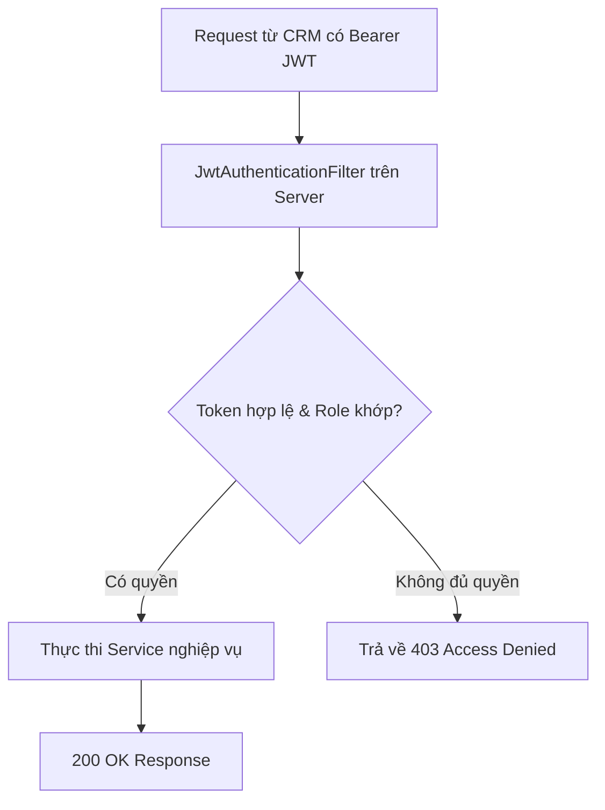

# Đặc Tả Tính Năng: Phân Quyền Admin & Nhân Viên

| Thuộc tính | Giá trị |
|---|---|
| **ID** | `AUTH-002` |
| **Tên tính năng** | Phân quyền truy cập vai trò Admin và Nhân viên |
| **Module** | AUTH |
| **Phạm vi** | CRM, SERVER |
| **Ưu tiên** | P0 - MVP |
| **Trạng thái** | 📝 SPEC |
| **Người phụ trách** | Tech Lead / Security Engineer |
| **Ngày bắt đầu** | - |
| **Ngày hoàn thành** | - |
| **Phụ thuộc** | `AUTH-001` |

---

## 1. Mục Tiêu và Giá Trị Mang Lại
Thiết lập cơ chế kiểm soát truy cập dựa trên vai trò (RBAC) trên cả Backend và Frontend CRM. Phân định rõ quyền hạn giữa Quản trị viên (Chủ shop) và Nhân viên vận hành nhằm bảo vệ dữ liệu doanh thu, cấu hình giá và tránh thao tác nhầm lẫn.

## 2. Người Dùng Liên Quan
- [x] **Nhân viên (ROLE_STAFF)**: Vận hành giao nhận váy/máy ảnh, cập nhật trạng thái giặt ủi, tạo đơn trực tiếp tại quầy. Bị giới hạn không xem báo cáo tài chính và không chỉnh sửa cài đặt shop.
- [x] **Chủ shop (ROLE_ADMIN)**: Toàn quyền quản trị: cấu hình tỉ lệ cọc, ngày đệm giặt ủi, quản lý nhân sự, xem báo cáo doanh thu lãi lỗ.

## 3. Luồng Chính (Happy Path)
1. Khi đăng nhập thành công, payload JWT chứa claim `role: "ROLE_ADMIN"` hoặc `role: "ROLE_STAFF"`.
2. CRM lưu thông tin vai trò vào User Auth Context.
3. Khi người dùng điều hướng qua các route trên CRM:
   - Các route nhạy cảm (Cài đặt, Báo cáo tài chính, Quản lý tài khoản) được bọc bởi `RoleGuard(allowedRoles=['ROLE_ADMIN'])`.
   - Nếu role không thỏa mãn, CRM tự động chuyển hướng về trang `403 Forbidden` hoặc trang mặc định (Đơn thuê).
4. Các nút thao tác đặc quyền (ví dụ: Xóa sản phẩm, Sửa cấu hình chiết khấu) được bọc bởi `<PermissionGate allowedRoles={['ROLE_ADMIN']}>`.
5. Khi CRM gọi API Backend, Spring Security lọc JWT, nạp `GrantedAuthority`. Các method nhạy cảm được bảo vệ bởi `@PreAuthorize("hasRole('ADMIN')")`.



## 4. Luồng Ngoại Lệ và Trường Hợp Biên
- **Nhân viên cố tình gọi API của Admin qua Postman/Script**: Server chặn ngay tại tầng lọc bảo mật và trả về `403 Forbidden` với cấu trúc `ApiResponse` chuẩn.
- **Token bị giả mạo quyền hạn**: Chữ ký HMAC/RSA của JWT không khớp, server từ chối ngay lập tức với mã `401 Unauthorized`.

## 5. Quy Tắc Nghiệp Vụ (Business Rules)
- **BR-01**: Nhân viên (`ROLE_STAFF`) không được phép xem các màn hình và API báo cáo doanh thu (`/api/admin/reports/**`).
- **BR-02**: Mọi thao tác xóa vĩnh viễn (Hard delete) dữ liệu sản phẩm hoặc khách hàng chỉ có `ROLE_ADMIN` mới được phép.
- **BR-03**: Giao diện chỉ ẩn nút bấm để tối ưu trải nghiệm; Server **BẮT BUỘC** kiểm tra quyền độc lập, tuyệt đối không tin tưởng client.

## 6. Giao Diện & Đa Ngôn Ngữ (UI & i18n)
- **Màn hình**: Trang lỗi 403 thân thiện với nút "Quay lại trang chủ", menu Sidebar tự động ẩn các mục không có quyền truy cập.
- **Component dùng chung**: `RoleGuard`, `PermissionGate` từ `crm/src/routes`.
- **Keys i18n (`vi.json` / `en.json`)**:
```json
{
  "permission": {
    "accessDeniedTitle": "Truy Cập Bị Từ Chối",
    "accessDeniedMessage": "Bạn không có quyền truy cập vào chức năng hoặc trang này.",
    "backHome": "Về trang chủ"
  }
}
```

## 7. Đặc Tả API
| Method | Endpoint | Quyền truy cập | Mục đích | Mã lỗi |
|---|---|---|---|---|
| `GET` | `/api/admin/system-settings` | `ROLE_ADMIN` | Lấy cấu hình hệ thống | 401, 403 |
| `GET` | `/api/admin/reports/**` | `ROLE_ADMIN` | Lấy dữ liệu báo cáo | 401, 403 |
| `GET` | `/api/admin/bookings/**` | `ROLE_ADMIN`, `ROLE_STAFF` | Quản lý đơn thuê đồ | 401, 403 |

## 8. Thay Đổi Cơ Sở Dữ Liệu
- Sử dụng trường `role` trong bảng `users` đã tạo ở `AUTH-001`.
- Giá trị hỗ trợ: `ROLE_ADMIN`, `ROLE_STAFF`.

## 9. Tiêu Chí Nghiệm Thu (Acceptance Criteria)
- [ ] **Kịch bản 1 - Nhân viên truy cập trang Cài đặt**:
  - **Given**: Tài khoản đăng nhập có vai trò `ROLE_STAFF`.
  - **When**: Cố tình truy cập trực tiếp url `/settings`.
  - **Then**: Hệ thống hiển thị trang 403 Không có quyền truy cập và Sidebar không có menu Cài đặt.
- [ ] **Kịch bản 2 - Nhân viên gọi API báo cáo**:
  - **Given**: Token mang quyền `ROLE_STAFF`.
  - **When**: Gửi GET `/api/admin/reports/revenue`.
  - **Then**: Server phản hồi mã HTTP 403 Forbidden.

## 10. Kế Hoạch Test
- **Unit Test**: Test Spring Security `@WithMockUser(roles = "STAFF")` gọi method `@PreAuthorize` bị `AccessDeniedException`.
- **UI Test**: Test `PermissionGate` ẩn component khi user role không nằm trong danh sách được phép.
- **Mục tiêu Coverage**: $\ge 80\%$.

## 11. Checklist Hoàn Thành (Definition of Done)
- [ ] Cấu hình Spring Security `@EnableMethodSecurity` và `SecurityFilterChain` chặt chẽ.
- [ ] Route Guard và PermissionGate phía CRM hoạt động trơn tru.
- [ ] Đầy đủ i18n cho trang 403.
- [ ] Test quyền hạn pass 100%, coverage $\ge 80\%$.
- [ ] Cập nhật `docs/FEATURES.md` và `docs/CHANGELOG.md`.

## 12. Nhật Ký Thực Hiện
| Ngày | Người thực hiện | Nội dung thay đổi | Trạng thái mới |
|---|---|---|---|
| 2026-10-24 | Tech Lead | Soạn thảo tài liệu đặc tả ban đầu | 📝 SPEC |
