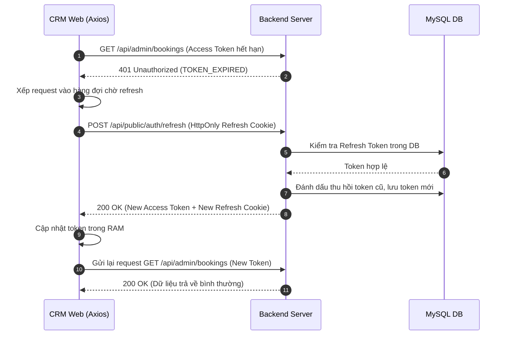

# Đặc Tả Tính Năng: Refresh Token & Quản Lý Phiên Làm Việc

| Thuộc tính | Giá trị |
|---|---|
| **ID** | `AUTH-003` |
| **Tên tính năng** | Cơ chế Refresh Token & Tự động gia hạn phiên làm việc |
| **Module** | AUTH |
| **Phạm vi** | CRM, SERVER |
| **Ưu tiên** | P0 - MVP |
| **Trạng thái** | ✅ DONE |
| **Người phụ trách** | Tech Lead / Fullstack Dev |
| **Ngày bắt đầu** | 2026-10-24 |
| **Ngày hoàn thành** | 2026-10-24 |
| **Phụ thuộc** | `AUTH-001` |

---

## 1. Mục Tiêu và Giá Trị Mang Lại
Đảm bảo tính bảo mật cao nhờ Access Token có thời hạn sống ngắn (15 phút), đồng thời mang lại trải nghiệm liền mạch cho nhân viên quản trị không bị gián đoạn công việc khi đang nhập đơn bằng cơ chế tự động gia hạn phiên ngầm (Silent Refresh).

## 2. Người Dùng Liên Quan
- [x] **Nhân viên & Admin**: Không bị văng khỏi hệ thống đột ngột khi phiên làm việc chưa hết hạn thực tế (Refresh Token còn hạn 7 ngày).

## 3. Luồng Chính (Happy Path)
1. CRM gửi request API mang Access Token đã hết hạn (>15 phút).
2. Server trả về HTTP 401 Unauthorized.
3. Axios Interceptor phía CRM chặn lỗi 401, tạm dừng các request khác vào hàng đợi (Queue).
4. CRM tự động gửi request `POST /api/public/auth/refresh` kèm Refresh Token (tự động đính kèm qua HttpOnly Cookie hoặc header).
5. Server kiểm tra Refresh Token trong DB (chưa thu hồi, chưa hết hạn).
6. Server thực hiện **Refresh Token Rotation**:
   - Vô hiệu hóa (revoke) Refresh Token cũ.
   - Tạo Access Token mới (15 phút) và Refresh Token mới (7 ngày).
7. Server trả về Access Token mới và set HttpOnly Cookie Refresh Token mới.
8. Axios Interceptor cập nhật Access Token trong RAM và tự động phát lại các request trong hàng đợi.



## 4. Luồng Ngoại Lệ và Trường Hợp Biên
- **Refresh Token hết hạn hoặc bị thu hồi**: Server trả về `401 Unauthorized`. Axios Interceptor xóa sạch state xác thực và điều hướng người dùng về `/login`.
- **Phát hiện tái sử dụng Token cũ (Token Reuse Detection)**: Nếu một Refresh Token đã thu hồi bị gửi lại, hệ thống cảnh báo nghi vấn đánh cắp và lập tức thu hồi toàn bộ phiên của người dùng đó.

## 5. Quy Tắc Nghiệp Vụ
- **BR-01**: Access Token có hạn 15 phút; Refresh Token có hạn 7 ngày.
- **BR-02**: Bắt buộc áp dụng cơ chế Refresh Token Rotation (1 lần dùng là hủy).
- **BR-03**: Khi người dùng nhấn "Đăng xuất" (`POST /api/admin/auth/logout`), Refresh Token tương ứng phải bị thu hồi ngay lập tức trong DB.

## 6. Giao Diện & Đa Ngôn Ngữ (UI & i18n)
- **Màn hình**: Không có màn hình riêng. Hiển thị thông báo toast khi phiên làm việc hết hạn và cần đăng nhập lại.
- **Keys i18n (`vi.json` / `en.json`)**:
```json
{
  "auth": {
    "sessionExpired": "Phiên đăng nhập đã hết hạn. Vui lòng đăng nhập lại.",
    "logoutSuccess": "Đã đăng xuất an toàn."
  }
}
```

## 7. Đặc Tả API
| Method | Endpoint | Quyền truy cập | Request Body | Response Body (200) | Mã lỗi |
|---|---|---|---|---|---|
| `POST` | `/api/public/auth/refresh` | Public (kèm Refresh Token) | Rỗng (lấy cookie) | `ApiResponse<TokenResponse>` | 400, 401 |
| `POST` | `/api/admin/auth/logout` | Authenticated | Rỗng | `ApiResponse<Void>` | 401 |

## 8. Thay Đổi Cơ Sở Dữ Liệu
- **File Migration Flyway**: `V1_1__create_refresh_tokens.sql`
```sql
CREATE TABLE `refresh_tokens` (
    `id` BIGINT AUTO_INCREMENT PRIMARY KEY,
    `user_id` BIGINT NOT NULL,
    `token_hash` VARCHAR(255) NOT NULL UNIQUE,
    `expires_at` TIMESTAMP NOT NULL,
    `revoked` BOOLEAN NOT NULL DEFAULT FALSE,
    `created_at` TIMESTAMP NOT NULL DEFAULT CURRENT_TIMESTAMP,
    CONSTRAINT `fk_refresh_tokens_user` FOREIGN KEY (`user_id`) REFERENCES `users` (`id`) ON DELETE CASCADE,
    INDEX `idx_refresh_tokens_hash` (`token_hash`)
) ENGINE=InnoDB DEFAULT CHARSET=utf8mb4 COLLATE=utf8mb4_unicode_ci;
```

## 9. Tiêu Chí Nghiệm Thu (Acceptance Criteria)
- [ ] **Kịch bản 1 - Tự động gia hạn thành công**:
  - **Given**: Nhân viên đang ở CRM, Access Token hết hạn, Refresh Token còn hạn.
  - **When**: Thực hiện tải trang danh sách đơn.
  - **Then**: Request tự động chạy ngầm lấy token mới và dữ liệu đơn hiển thị bình thường, người dùng không bị văng ra.
- [ ] **Kịch bản 2 - Refresh Token hết hạn**:
  - **Given**: Người dùng không mở CRM quá 7 ngày.
  - **When**: Mở lại CRM.
  - **Then**: Hệ thống nhận 401 từ API refresh và chuyển hướng ngay về `/login`.

## 10. Kế Hoạch Test
- **Unit Test**: Test xoay vòng Refresh Token trong `AuthService`, test thu hồi token cũ.
- **Integration Test**: Giả lập kịch bản gửi token hết hạn -> nhận token mới -> gửi token cũ bị từ chối.
- **Mục tiêu Coverage**: $\ge 80\%$.

## 11. Checklist Hoàn Thành (Definition of Done)
- [ ] Backend xử lý an toàn HttpOnly Cookie và lưu trữ token hash trong DB.
- [ ] Axios Interceptor CRM xử lý hàng đợi (mutex/queue) chống gọi refresh trùng lặp.
- [ ] Unit & Integration test pass 100%, coverage $\ge 80\%$.
- [ ] Cập nhật `docs/FEATURES.md` và `docs/CHANGELOG.md`.

## 12. Nhật Ký Thực Hiện
| Ngày | Người thực hiện | Nội dung thay đổi | Trạng thái mới |
|---|---|---|---|
| 2026-10-24 | Tech Lead | Soạn thảo tài liệu đặc tả ban đầu | 📝 SPEC |
| 2026-10-24 | Fullstack Dev | Triển khai Refresh Token Rotation, Cookie HttpOnly & Silent Refresh Interceptor | ✅ DONE |
