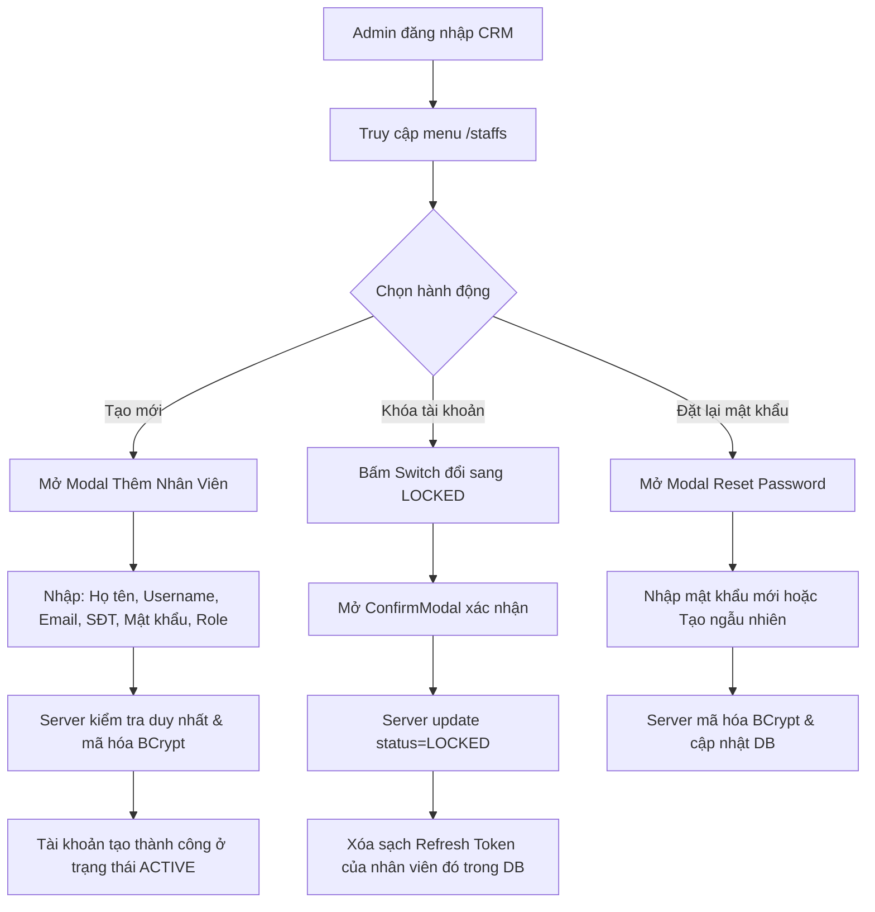
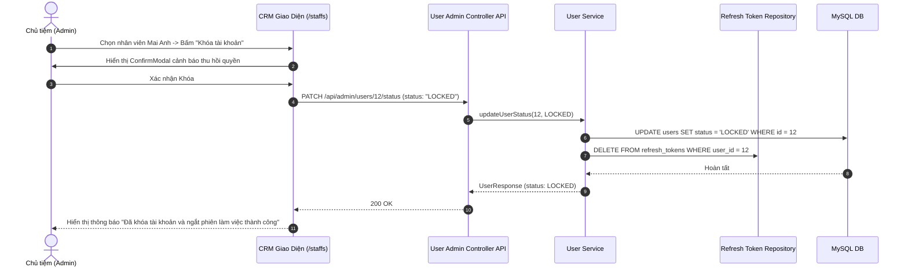

# Đặc Tả Tính Năng: Quản Lý Danh Sách Tài Khoản Nhân Viên CRM

| Thuộc tính | Giá trị |
|---|---|
| **ID** | `AUTH-004` |
| **Tên tính năng** | Quản lý danh sách tài khoản nhân viên CRM (Tạo mới, Phân quyền, Khóa/Mở khóa, Đặt lại mật khẩu) |
| **Module** | AUTH (Xác Thực & Phân Quyền) |
| **Phạm vi** | CRM, SERVER |
| **Ưu tiên** | P1 - Vận hành cốt lõi |
| **Trạng thái** | ✅ DONE (Backend) |
| **Người phụ trách** | Fullstack Dev & Tech Lead |
| **Ngày bắt đầu** | 2026-10-25 |
| **Ngày hoàn thành** | 2026-10-27 |
| **Phụ thuộc** | `AUTH-001`, `AUTH-002`, `AUTH-003` |

---

## Mục Lục
1. [Mục Tiêu và Giá Trị Mang Lại](#1-mục-tiêu-và-giá-trị-mang-lại)
2. [Người Dùng Liên Quan](#2-người-dùng-liên-quan)
3. [Luồng Nghiệp Vụ Chính (Happy Path)](#3-luồng-nghiệp-vụ-chính-happy-path)
4. [Luồng Ngoại Lệ và Trường Hợp Biên](#4-luồng-ngoại-lệ-và-trường-hợp-biên)
5. [Quy Tắc Nghiệp Vụ (Business Rules)](#5-quy-tắc-nghiệp-vụ-business-rules)
6. [Giao Diện & Đa Ngôn Ngữ (UI & i18n)](#6-giao-diện--đa-ngôn-ngữ-ui--i18n)
7. [Đặc Tả API Backend](#7-đặc-tả-api-backend)
8. [Thay Đổi Cơ Sở Dữ Liệu](#8-thay-đổi-cơ-sở-dữ-liệu)
9. [Tiêu Chí Nghiệm Thu (Acceptance Criteria)](#9-tiêu-chí-nghiệm-thu-acceptance-criteria)
10. [Kế Hoạch Kiểm Thử](#10-kế-hoạch-kiểm-thử)
11. [Checklist Hoàn Thành (Definition of Done)](#11-checklist-hoàn-thành-definition-of-done)

---

## 1. Mục Tiêu và Giá Trị Mang Lại
- **Chủ động quản trị nhân sự trên giao diện CRM**: Chủ tiệm (Admin) có thể dễ dàng cấp tài khoản cho nhân viên mới vào làm, điều chỉnh vai trò hoặc thu hồi quyền truy cập khi nhân viên thôi việc mà không cần nhờ lập trình viên can thiệp vào cơ sở dữ liệu.
- **Bảo mật tức thì khi khóa tài khoản (Immediate Session Invalidation)**: Khi tài khoản nhân viên bị chuyển sang trạng thái `LOCKED`, toàn bộ phiên làm việc (Refresh Token) của nhân viên đó trên mọi thiết bị sẽ bị thu hồi ngay lập tức, ngăn ngừa rủi ro rò rỉ dữ liệu khách hàng hoặc đơn hàng.
- **Hỗ trợ khôi phục mật khẩu an toàn**: Cho phép Admin thiết lập lại mật khẩu mới cho nhân viên khi quên mật khẩu hoặc hỗ trợ kích hoạt mật khẩu tạm thời yêu cầu đổi mật khẩu ở lần đăng nhập kế tiếp.

---

## 2. Người Dùng Liên Quan
- [x] **Admin (Chủ shop)**: Toàn quyền truy cập màn hình `/staffs`: tạo mới nhân viên, chỉnh sửa thông tin liên hệ, phân quyền (`ROLE_STAFF` hoặc `ROLE_ADMIN`), khóa/mở khóa tài khoản và đặt lại mật khẩu.
- [x] **Nhân viên (ROLE_STAFF)**: Bị chặn tuyệt đối không được truy cập trang `/staffs` hoặc gọi các API quản lý nhân sự của Admin; chỉ được phép tự xem và chỉnh sửa thông tin cá nhân của chính mình.

---

## 3. Luồng Nghiệp Vụ Chính (Happy Path)

### 3.1. Sơ Đồ Quy Trình Quản Trị Nhân Sự



### 3.2. Sơ Đồ Trình Tự Khóa Tài Khoản & Thu Hồi Phiên



---

## 4. Luồng Ngoại Lệ và Trường Hợp Biên

| Tình huống ngoại lệ | Xử lý của hệ thống | Phản hồi giao diện |
|---|---|---|
| **Trùng lặp Username hoặc Email** | Trùng với tài khoản đã tồn tại trong bảng `users` | Server trả về mã lỗi `409 CONFLICT` kèm thông điệp: *"Tên đăng nhập hoặc Email này đã được sử dụng bởi người khác"* |
| **Admin tự khóa tài khoản của chính mình** | Admin đang đăng nhập bằng tài khoản `admin` cố tình bấm khóa chính mình | Server chặn với lỗi `400 BAD_REQUEST`: *"Bạn không thể tự khóa tài khoản của chính mình"* |
| **Khóa hoặc xóa tài khoản Root Admin** | Thao tác đổi vai trò hoặc khóa tài khoản gốc hệ thống (`username = 'admin'`) | Server bảo vệ tuyệt đối: Cấm sửa đổi role hoặc khóa tài khoản root admin |
| **Nhân viên cố tình gọi API quản trị** | Tài khoản có vai trò `ROLE_STAFF` gửi request tới `/api/admin/users/**` | Spring Security chặn ngay tại filter với mã `403 FORBIDDEN` |

---

## 5. Quy Tắc Nghiệp Vụ (Business Rules)

- **BR-01 (Đặc quyền Quản trị viên)**: Toàn bộ controller quản lý nhân sự `/api/admin/users/**` phải được bảo vệ bởi `@PreAuthorize("hasRole('ADMIN')")`.
- **BR-02 (Chính sách Mật khẩu)**:
  - Độ dài tối thiểu: **8 ký tự**.
  - Bắt buộc chứa ít nhất: 1 chữ hoa, 1 chữ thường, 1 chữ số.
  - Được mã hóa bằng `BCryptPasswordEncoder` với hệ số làm chậm $strength = 10$.
- **BR-03 (Thu hồi phiên triệt để khi khóa)**: Khi chuyển trạng thái sang `LOCKED`, phương thức cập nhật bắt buộc phải gọi xóa toàn bộ các bản ghi `refresh_tokens` của user đó để cấm hoàn toàn việc xin cấp lại Access Token mới.
- **BR-04 (Bảo tồn Admin tối thiểu)**: Hệ thống luôn duy trì ít nhất 1 tài khoản `ROLE_ADMIN` ở trạng thái `ACTIVE` để bảo đảm tiệm luôn có người quản trị.

---

## 6. Giao Diện & Đa Ngôn Ngữ (UI & i18n)

### 6.1. Thiết Kế Màn Hình Danh Sách Nhân Viên CRM (`crm/src/pages/staffs/StaffsPage.tsx`)
- **Page Header**:
  - Tiêu đề: "Quản Lý Nhân Viên".
  - Nút hành động: `[ + Thêm Nhân Viên ]` (nút Primary Luxury).
- **Bộ Thẻ Thống Kê Nhanh (`StatCard`)**:
  - Tổng số nhân viên.
  - Đang hoạt động (`ACTIVE`).
  - Đã khóa (`LOCKED`).
- **Thanh Lọc (`FilterBar`)**:
  - `SearchField`: Tìm kiếm theo Họ tên, Username, Email, Số điện thoại.
  - `Select`: Lọc theo Vai trò (Tất cả, Quản trị viên, Nhân viên).
  - `Select`: Lọc theo Trạng thái (Tất cả, Hoạt động, Đã khóa).
- **Bảng Dữ Liệu (`DataTable`)**:
  - Cột: Nhân viên (Avatar + Họ tên + Username), Liên hệ (Email + SĐT), Vai trò (`StatusBadge` màu xanh cho Admin, màu xám cho Staff), Trạng thái (`Switch` kích hoạt/khóa nhanh), Ngày tham gia, Thao tác (`ActionsDropdown`: Chỉnh sửa, Đặt lại mật khẩu).
- **Modals**:
  - `CreateStaffModal`: Form thêm mới nhân viên.
  - `EditStaffModal`: Form cập nhật thông tin và vai trò.
  - `ResetPasswordModal`: Form đổi mật khẩu mới cho nhân viên.

### 6.2. Bộ Từ Điển Đa Ngôn Ngữ (`vi.json` / `en.json`)

```json
{
  "staff": {
    "title": "Quản Lý Nhân Viên",
    "subtitle": "Danh sách tài khoản nhân sự và phân quyền truy cập hệ thống",
    "addBtn": "Thêm nhân viên",
    "totalStaff": "Tổng nhân viên",
    "activeStaff": "Đang hoạt động",
    "lockedStaff": "Đã khóa tài khoản",
    "colName": "Nhân viên",
    "colContact": "Liên hệ",
    "colRole": "Vai trò",
    "colStatus": "Trạng thái",
    "colCreatedAt": "Ngày tham gia",
    "roleAdmin": "Quản trị viên (Admin)",
    "roleStaff": "Nhân viên vận hành",
    "statusActive": "Hoạt động",
    "statusLocked": "Đã khóa",
    "createModalTitle": "Thêm Tài Khoản Nhân Viên Mới",
    "editModalTitle": "Cập Nhật Thông Tin Nhân Viên",
    "resetPasswordTitle": "Đặt Lại Mật Khẩu",
    "usernameLabel": "Tên đăng nhập",
    "fullNameLabel": "Họ và tên",
    "emailLabel": "Email làm việc",
    "phoneLabel": "Số điện thoại",
    "passwordLabel": "Mật khẩu khởi tạo",
    "newPasswordLabel": "Mật khẩu mới",
    "generatePasswordBtn": "Tạo mật khẩu ngẫu nhiên",
    "confirmLockMessage": "Bạn có chắc chắn muốn khóa tài khoản {name}? Nhân viên này sẽ bị đăng xuất ngay lập tức khỏi hệ thống.",
    "createSuccess": "Tạo tài khoản nhân viên thành công",
    "updateSuccess": "Cập nhật thông tin nhân viên thành công",
    "lockSuccess": "Khóa tài khoản thành công",
    "unlockSuccess": "Mở khóa tài khoản thành công",
    "resetPasswordSuccess": "Đặt lại mật khẩu mới thành công"
  }
}
```

---

## 7. Đặc Tả API Backend

### 7.1. Danh Sách Endpoint

| Method | Endpoint | Quyền hạn | Mục đích |
|---|---|---|---|
| `GET` | `/api/admin/users` | `ROLE_ADMIN` | Lấy danh sách nhân viên có phân trang, tìm kiếm & lọc |
| `GET` | `/api/admin/users/{id}` | `ROLE_ADMIN` | Lấy chi tiết thông tin một nhân viên |
| `POST` | `/api/admin/users` | `ROLE_ADMIN` | Tạo mới tài khoản nhân viên |
| `PUT` | `/api/admin/users/{id}` | `ROLE_ADMIN` | Cập nhật thông tin cá nhân và vai trò |
| `PATCH` | `/api/admin/users/{id}/status` | `ROLE_ADMIN` | Đổi trạng thái `ACTIVE` hoặc `LOCKED` |
| `POST` | `/api/admin/users/{id}/reset-password` | `ROLE_ADMIN` | Admin đặt lại mật khẩu mới cho nhân viên |

### 7.2. Chi Tiết Request & Response DTOs

#### A. POST `/api/admin/users`
- **Request Body**:
```json
{
  "username": "maianh",
  "fullName": "Nguyễn Mai Anh",
  "email": "maianh@chickiestudio.vn",
  "phone": "0987654321",
  "password": "Staff@Chickie2026",
  "role": "ROLE_STAFF"
}
```
- **Response Success (201 Created)**:
```json
{
  "code": 201,
  "message": "Tạo tài khoản nhân viên thành công",
  "data": {
    "id": 5,
    "username": "maianh",
    "fullName": "Nguyễn Mai Anh",
    "email": "maianh@chickiestudio.vn",
    "phone": "0987654321",
    "role": "ROLE_STAFF",
    "status": "ACTIVE",
    "createdAt": "2026-10-25T21:50:00"
  }
}
```

#### B. PATCH `/api/admin/users/{id}/status`
- **Request Body**:
```json
{
  "status": "LOCKED"
}
```
- **Response Success (200 OK)**:
```json
{
  "code": 200,
  "message": "Khóa tài khoản thành công",
  "data": {
    "id": 5,
    "username": "maianh",
    "status": "LOCKED"
  }
}
```

#### C. POST `/api/admin/users/{id}/reset-password`
- **Request Body**:
```json
{
  "newPassword": "NewPassword@2026"
}
```
- **Response Success (200 OK)**:
```json
{
  "code": 200,
  "message": "Đặt lại mật khẩu thành công"
}
```

---

## 8. Thay Đổi Cơ Sở Dữ Liệu
- Hệ thống tận dụng trọn vẹn bảng `users` được khởi tạo tại migration `V1__init_auth_and_users.sql` và `V4__sync_admin_and_staff_accounts.sql`:
  - `username` (VARCHAR 50, UNIQUE)
  - `email` (VARCHAR 100, UNIQUE)
  - `password_hash` (VARCHAR 255)
  - `full_name` (VARCHAR 100)
  - `phone` (VARCHAR 20)
  - `role` (VARCHAR 30: `ROLE_ADMIN`, `ROLE_STAFF`)
  - `status` (VARCHAR 20: `ACTIVE`, `LOCKED`)
  - Đã có đầy đủ index: `idx_users_username`, `idx_users_email`, `idx_users_role`, `idx_users_status`.

---

## 9. Tiêu Chí Nghiệm Thu (Acceptance Criteria)

### Kịch bản 1: Tạo nhân viên mới thành công
- **Given**: Admin đăng nhập vào CRM và mở modal thêm nhân viên.
- **When**: Nhập đầy đủ thông tin hợp lệ (username duy nhất, mật khẩu đủ mạnh) và bấm Lưu.
- **Then**: Server tạo bản ghi mới với mật khẩu mã hóa BCrypt, danh sách trên CRM cập nhật hiển thị nhân viên mới với huy hiệu `ROLE_STAFF` và trạng thái `ACTIVE`.

### Kịch bản 2: Khóa tài khoản và ngắt phiên ngay lập tức
- **Given**: Nhân viên `maianh` đang đăng nhập trên máy tính quầy với Refresh Token hợp lệ.
- **When**: Admin bấm chuyển trạng thái của `maianh` sang `LOCKED`.
- **Then**: Bản ghi của `maianh` đổi sang `LOCKED`, toàn bộ Refresh Token của `maianh` bị xóa khỏi DB; khi nhân viên `maianh` thực hiện thao tác tiếp theo, hệ thống từ chối refresh token và đẩy về màn hình đăng nhập.

### Kịch bản 3: Chặn Admin tự khóa chính mình
- **Given**: Admin đang đăng nhập với tài khoản `admin`.
- **When**: Cố tình bấm khóa chính tài khoản `admin`.
- **Then**: Hệ thống hiển thị thông báo lỗi và từ chối cập nhật trạng thái.

---

## 10. Kế Hoạch Kiểm Thử
- **Unit Test Backend**:
  - `AdminUserServiceTest`: Kiểm tra logic tạo nhân viên, kiểm tra trùng username/email ném `ConflictException`, kiểm tra không cho tự khóa chính mình, kiểm tra xóa refresh tokens khi khóa user.
  - `AdminUserControllerTest`: Kiểm tra `@PreAuthorize("hasRole('ADMIN')")`, mock user role `STAFF` bị chặn 403 Forbidden.
- **Frontend Test (Vitest)**:
  - `StaffsPage.test.tsx`: Render bảng danh sách, test tìm kiếm và lọc trạng thái.
  - `CreateStaffModal.test.tsx`: Validation form họ tên, email, mật khẩu mạnh.
  - `ResetPasswordModal.test.tsx`: Form đổi mật khẩu mới.
- **Playwright E2E**:
  - Đăng nhập tài khoản Admin, mở trang `/staffs`, tạo nhân viên mới `test_staff`, sau đó thử đăng nhập bằng tài khoản mới này thành công.
- **Mục tiêu Coverage**: $\ge 85\%$.

---

## 11. Checklist Hoàn Thành (Definition of Done)
- [ ] Soạn thảo và phê duyệt tài liệu đặc tả `AUTH-004` (đã xong).
- [ ] Cập nhật bảng theo dõi trong [docs/FEATURES.md](../../FEATURES.md).
- [ ] Tái sử dụng các UI components chuẩn: `DataTable`, `Modal`, `StatusBadge`, `StatCard`, `FilterBar`.
- [ ] Không sử dụng inline CSS, 100% tuân thủ CSS Modules / SCSS / Tailwind.
- [ ] Kiểm thử tự động đạt độ bao phủ $\ge 80\%$.
- [ ] Ghi nhận thay đổi vào `CHANGELOG.md`.
