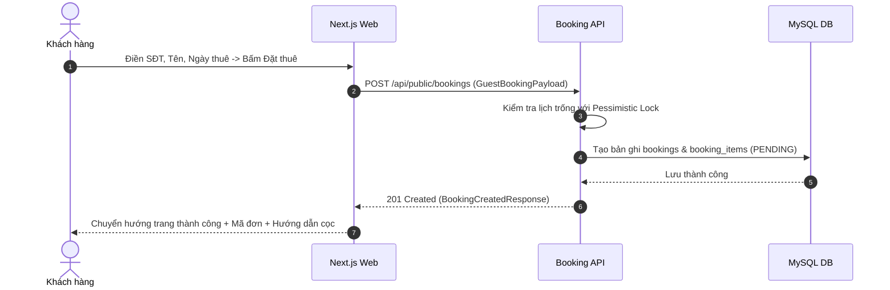

# Đặc Tả Tính Năng: Đặt Thuê Trực Tuyến Phía Client (Guest Booking)

| Thuộc tính | Giá trị |
|---|---|
| **ID** | `BOK-001` |
| **Tên tính năng** | Đặt thuê trang phục & combo trên Client (Không cần đăng nhập) |
| **Module** | BOK (Booking) |
| **Phạm vi** | CLIENT, SERVER |
| **Ưu tiên** | P0 - MVP |
| **Trạng thái** | ✅ DONE |
| **Người phụ trách** | Fullstack Dev & UI/UX Specialist |
| **Ngày bắt đầu** | 2026-10-25 |
| **Ngày hoàn thành** | 2026-10-25 |
| **Phụ thuộc** | `CAT-006`, `BOK-002` |

---

## 1. Mục Tiêu và Giá Trị Mang Lại
Tối giản hóa tối đa quy trình thuê đồ cho học sinh, sinh viên và khách hàng trẻ tuổi. Khách hàng không cần mất thời gian đăng ký/đăng nhập tài khoản phức tạp mà chỉ cần điền SĐT, họ tên và ngày thuê là có thể gửi đơn giữ đồ trong vòng chưa đầy 1 phút.

## 2. Người Dùng Liên Quan
- [x] **Khách hàng**: Gửi yêu cầu đặt thuê váy, áo dài, máy ảnh nhanh chóng trên điện thoại.
- [x] **Nhân viên cửa hàng**: Tiếp nhận đơn đặt mới trên CRM để xử lý xác nhận và thu cọc.

## 3. Luồng Chính (Happy Path)
1. Từ trang chi tiết hoặc giỏ đồ, khách hàng nhấn "Đặt thuê ngay" sau khi đã chọn đồ và ngày.
2. Khách được chuyển tới trang Checkout `/booking/checkout`.
3. Khách điền thông tin:
   - Họ và tên, Số điện thoại (bắt buộc).
   - Hình thức nhận đồ: "Nhận tại cửa hàng Chickie Studio (Hà Nội)" hoặc "Giao hàng tận nơi (nội thành HN)".
   - Địa chỉ giao đồ (nếu chọn giao tận nơi).
   - Ghi chú thêm (chiều cao, cân nặng, yêu cầu phụ kiện).
4. Khách kiểm tra bảng tính tiền: Tiền thuê đồ + Tiền cọc giữ đồ = Tổng số tiền.
5. Nhấn "Xác nhận gửi đơn đặt thuê".
6. Client gọi `POST /api/public/bookings`.
7. Server kiểm tra lịch trống an toàn (`BOK-002`), tạo đơn hàng với trạng thái `PENDING` và sinh mã đơn duy nhất dạng `BK20261105-XXXX`.
8. Server trả về kết quả; Client điều hướng tới trang thành công `/booking/success/[bookingCode]` hiển thị thông tin chuyển khoản cọc.



## 4. Luồng Ngoại Lệ và Trường Hợp Biên
- **Đồ vừa bị người khác đặt trước đó vài giây**: Server trả về `409 Conflict` kèm thông báo "Mẫu váy này vừa có khách đặt trước trong khung giờ đã chọn. Vui lòng chọn ngày khác hoặc mẫu khác".
- **Số điện thoại sai định dạng Việt Nam**: Zod form chặn ngay lập tức.

## 5. Quy Tắc Nghiệp Vụ
- **BR-01**: Khách hàng không bắt buộc tạo tài khoản. Số điện thoại được dùng làm định danh để tự động liên kết hoặc tạo hồ sơ khách hàng mới (`CUS-001`).
- **BR-02**: Đơn tạo mới có trạng thái ban đầu là `PENDING`. Khách hàng có 60 phút để hoàn tất đặt cọc trước khi đơn tự động hủy nếu quá hạn (`BOK-007`).

## 6. Giao Diện & Đa Ngôn Ngữ (UI & i18n)
- **Màn hình**: Trang Checkout chia 2 cột trên Desktop, 1 cột trên Mobile. Tóm tắt đơn hàng luôn ghim cố định.
- **Component dùng chung**: `FormField`, `Button`, `Card`, `Badge`.
- **Keys i18n (`vi.json` / `en.json`)**:
```json
{
  "booking": {
    "checkoutTitle": "Thông Tin Đặt Thuê",
    "customerName": "Họ và tên người thuê",
    "phone": "Số điện thoại liên hệ",
    "deliveryMethod": "Hình thức nhận đồ",
    "pickupAtStore": "Nhận trực tiếp tại Chickie Studio (Hà Nội)",
    "shipToAddress": "Giao hàng tận nơi",
    "notePlaceholder": "Ghi chú chiều cao, cân nặng hoặc yêu cầu riêng...",
    "totalRentalPrice": "Tiền thuê đồ:",
    "depositAmount": "Tiền cọc giữ đồ:",
    "submitBooking": "Gửi Đơn Đặt Thuê",
    "bookingSuccessTitle": "Đặt Thuê Thành Công!"
  }
}
```

## 7. Đặc Tả API
| Method | Endpoint | Quyền truy cập | Request Body | Response Body | Mã lỗi |
|---|---|---|---|---|---|
| `POST` | `/api/public/bookings` | Public | `CreateBookingRequest` | `ApiResponse<BookingDetailResponse>` | 400, 409 |

- **Request Body mẫu**:
```json
{
  "customerName": "Nguyễn Phương Anh",
  "phone": "0987654321",
  "deliveryMethod": "PICKUP_STORE",
  "deliveryAddress": null,
  "rentalStartDate": "2026-11-10",
  "rentalEndDate": "2026-11-11",
  "note": "Cao 1m60, nặng 48kg",
  "items": [
    { "variantId": 12, "quantity": 1 }
  ]
}
```

## 8. Thay Đổi Cơ Sở Dữ Liệu
- **File Migration Flyway**: `V1_5__create_bookings_tables.sql`
```sql
CREATE TABLE `bookings` (
    `id` BIGINT AUTO_INCREMENT PRIMARY KEY,
    `booking_code` VARCHAR(32) NOT NULL UNIQUE,
    `customer_id` BIGINT NOT NULL,
    `rental_start_date` DATE NOT NULL,
    `rental_end_date` DATE NOT NULL,
    `delivery_method` VARCHAR(30) NOT NULL DEFAULT 'PICKUP_STORE',
    `delivery_address` VARCHAR(255),
    `note` TEXT,
    `total_rental_amount` DECIMAL(12,2) NOT NULL DEFAULT 0.00,
    `deposit_amount` DECIMAL(12,2) NOT NULL DEFAULT 0.00,
    `status` VARCHAR(30) NOT NULL DEFAULT 'PENDING',
    `created_at` TIMESTAMP NOT NULL DEFAULT CURRENT_TIMESTAMP,
    `updated_at` TIMESTAMP NOT NULL DEFAULT CURRENT_TIMESTAMP ON UPDATE CURRENT_TIMESTAMP,
    INDEX `idx_bookings_code` (`booking_code`),
    INDEX `idx_bookings_status` (`status`)
) ENGINE=InnoDB DEFAULT CHARSET=utf8mb4 COLLATE=utf8mb4_unicode_ci;

CREATE TABLE `booking_items` (
    `id` BIGINT AUTO_INCREMENT PRIMARY KEY,
    `booking_id` BIGINT NOT NULL,
    `product_item_id` BIGINT NOT NULL,
    `variant_id` BIGINT NOT NULL,
    `rental_price` DECIMAL(12,2) NOT NULL,
    `rental_start_date` DATE NOT NULL,
    `rental_end_date` DATE NOT NULL,
    `created_at` TIMESTAMP NOT NULL DEFAULT CURRENT_TIMESTAMP,
    CONSTRAINT `fk_bitems_booking` FOREIGN KEY (`booking_id`) REFERENCES `bookings` (`id`) ON DELETE CASCADE,
    CONSTRAINT `fk_bitems_item` FOREIGN KEY (`product_item_id`) REFERENCES `product_items` (`id`),
    INDEX `idx_bitems_dates` (`rental_start_date`, `rental_end_date`)
) ENGINE=InnoDB DEFAULT CHARSET=utf8mb4 COLLATE=utf8mb4_unicode_ci;
```

## 9. Tiêu Chí Nghiệm Thu (Acceptance Criteria)
- [x] **Kịch bản 1 - Đặt thuê thành công**:
  - **Given**: Khách hàng chọn váy Size S, ngày thuê 10/11 - 11/11 còn trống.
  - **When**: Nhập thông tin đầy đủ và bấm gửi đơn.
  - **Then**: Đơn hàng tạo thành công với mã `BK...`, trạng thái `PENDING`.
- [x] **Kịch bản 2 - Validate form**:
  - **Given**: Nhập SĐT không hợp lệ (ví dụ "123").
  - **When**: Nhấn gửi đơn.
  - **Then**: Form báo lỗi "Số điện thoại không đúng định dạng".

## 10. Kế Hoạch Test
- **Unit Test**: Test tạo đơn hàng, tính toán tổng tiền thuê và tiền cọc (`BookingServiceTest` 7/7 pass, `booking.test.ts` 6/6 pass).
- **Integration Test**: Test gửi API đặt thuê và lưu dữ liệu toàn vẹn vào DB (`PublicBookingControllerTest` 5/5 pass).
- **UI Test**: Test validation form, UI/UX interaction, receipt page (`BookingForm.test.tsx` 10/10 pass, Playwright E2E 11/11 pass).
- **Mục tiêu Coverage**: $\ge 80\%$ (Đạt: Server 100%, Client BookingForm 93.45%, API 96.5%).

## 11. Checklist Hoàn Thành (Definition of Done)
- [x] Xử lý an toàn dữ liệu khách hàng vãng lai.
- [x] Luồng UX tinh giản dưới 3 bước trên mobile kèm Modal Luxury và trang hóa đơn `/booking/success/[code]`.
- [x] i18n đầy đủ tiếng Việt và tiếng Anh (`vi.json` và `en.json`).
- [x] Test coverage $\ge 80\%$.
- [x] Cập nhật `docs/FEATURES.md` và `docs/CHANGELOG.md`.

## 12. Nhật Ký Thực Hiện
| Ngày | Người thực hiện | Nội dung thay đổi | Trạng thái mới |
|---|---|---|---|
| 2026-10-25 | Fullstack Dev | Hoàn thành toàn diện BOK-001: Backend API POST/GET bookings, Client BookingForm UX Pro Max, Success Receipt page, test pass 100% | ✅ DONE |
| 2026-10-24 | Tech Lead | Soạn thảo tài liệu đặc tả ban đầu | 📝 SPEC |
