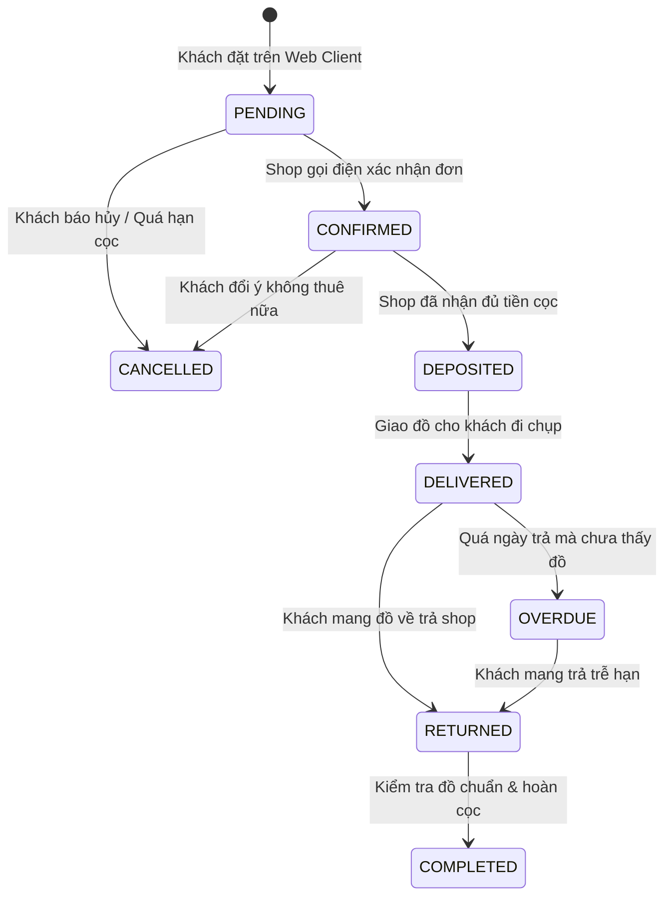

# Đặc Tả Tính Năng: State Machine Quản Lý Vòng Đời Đơn Thuê

| Thuộc tính | Giá trị |
|---|---|
| **ID** | `BOK-003` |
| **Tên tính năng** | State Machine & Ma trận chuyển đổi trạng thái đơn thuê đồ |
| **Module** | BOK (Booking) |
| **Phạm vi** | SERVER, CRM, CLIENT |
| **Ưu tiên** | P0 - MVP |
| **Trạng thái** | 📝 SPEC |
| **Người phụ trách** | Tech Lead / Backend Engineer |
| **Ngày bắt đầu** | - |
| **Ngày hoàn thành** | - |
| **Phụ thuộc** | `BOK-001`, `BOK-002` |

---

## 1. Mục Tiêu và Giá Trị Mang Lại
Xây dựng một cỗ máy trạng thái (State Machine) chuẩn hóa toàn bộ vòng đời của đơn thuê trang phục tại Chickie Studio: từ lúc khách gửi yêu cầu trên mạng, thu cọc, giao đồ đi chụp, nhận đồ về, hoàn cọc và xử lý quá hạn trả đồ. Giúp toàn bộ nhân viên vận hành đồng nhất, không bao giờ bỏ sót bước kiểm tra đồ hay hoàn cọc.

## 2. Người Dùng Liên Quan
- [x] **Nhân viên & Admin**: Cập nhật trạng thái từng bước trên CRM.
- [x] **Khách hàng**: Theo dõi tiến độ đơn hàng trên website client theo thời gian thực.

## 3. Luồng Chuyển Đổi Trạng Thái (State Transitions)



### Chi Tiết Từng Trạng Thái:
1. **`PENDING` (Chờ xử lý)**: Đơn mới tạo trên website khách, chờ nhân viên check hoặc khách chuyển khoản cọc.
2. **`CONFIRMED` (Đã xác nhận)**: Shop đã liên hệ khách qua Zalo/Điện thoại chốt mẫu váy và ngày giờ.
3. **`DEPOSITED` (Đã đặt cọc)**: Tiền cọc đã vào tài khoản shop, đơn chắc chắn được giữ lịch 100%.
4. **`DELIVERED` (Đang thuê / Đã giao)**: Khách đã nhận váy/máy ảnh rời khỏi cửa hàng.
5. **`RETURNED` (Đã trả đồ)**: Khách mang đồ hoàn trả tại quầy, nhân viên tiếp nhận và treo vào khu giặt kiểm tra.
6. **`COMPLETED` (Hoàn tất)**: Đồ nguyên vẹn, nhân viên hoàn cọc thành công, kết thúc đơn.
7. **`CANCELLED` (Đã hủy)**: Đơn bị hủy; toàn bộ lịch đồ được giải phóng ngay lập tức.
8. **`OVERDUE` (Quá hạn trả)**: Hệ thống tự động đánh dấu khi ngày hiện tại vượt quá `rental_end_date` mà đơn vẫn ở trạng thái `DELIVERED`.

---

## 4. Ma Trận Chuyển Đổi Hợp Lệ (State Transition Matrix)
| Từ Trạng Thái | Có thể chuyển sang | Không được phép chuyển sang |
|---|---|---|
| `PENDING` | `CONFIRMED`, `CANCELLED` | `DELIVERED`, `RETURNED`, `COMPLETED` |
| `CONFIRMED`| `DEPOSITED`, `CANCELLED` | `RETURNED`, `COMPLETED` |
| `DEPOSITED`| `DELIVERED`, `CANCELLED` (hoàn cọc nếu báo trước) | `PENDING`, `COMPLETED` |
| `DELIVERED`| `RETURNED`, `OVERDUE` | `PENDING`, `CONFIRMED`, `CANCELLED` |
| `OVERDUE`  | `RETURNED` | `PENDING`, `CONFIRMED` |
| `RETURNED` | `COMPLETED` | `PENDING`, `DELIVERED` |
| `COMPLETED`| Không (Trạng thái kết thúc) | Mọi trạng thái khác |
| `CANCELLED`| Không (Trạng thái kết thúc) | Mọi trạng thái khác |

---

## 5. Quy Tắc Nghiệp Vụ
- **BR-01**: Cấm tuyệt đối việc nhảy cóc trạng thái (ví dụ: đang `PENDING` nhảy thẳng sang `DELIVERED` mà chưa qua bước xác nhận cọc).
- **BR-02**: Khi đơn chuyển sang `CANCELLED`, hệ thống tự động giải phóng toàn bộ món đồ thực tế (`product_items`) liên kết với đơn đó.
- **BR-03**: Khi đơn chuyển sang `RETURNED`, trạng thái của món đồ thực tế tự động chuyển sang `LAUNDRY` (`CAT-003`).

## 6. Giao Diện & Đa Ngôn Ngữ (UI & i18n)
- **Màn hình**: Steps tracker trên trang tra cứu đơn Client; Badge màu sắc trên CRM DataTable.
- **Keys i18n (`vi.json` / `en.json`)**:
```json
{
  "bookingStatus": {
    "PENDING": "Chờ xác nhận",
    "CONFIRMED": "Đã xác nhận",
    "DEPOSITED": "Đã đặt cọc",
    "DELIVERED": "Đang cho thuê",
    "RETURNED": "Đã trả đồ",
    "COMPLETED": "Hoàn tất",
    "CANCELLED": "Đã hủy",
    "OVERDUE": "Quá hạn trả"
  }
}
```

## 7. Đặc Tả API
| Method | Endpoint | Quyền truy cập | Request Body | Response Body | Mã lỗi |
|---|---|---|---|---|---|
| `PATCH` | `/api/admin/bookings/{id}/status` | `STAFF`, `ADMIN` | `{"newStatus": "...", "note": "..."}` | `ApiResponse<BookingDetailResponse>` | 400, 404 |

## 8. Thay Đổi Cơ Sở Dữ Liệu
- Tạo bảng ghi nhận nhật ký chuyển trạng thái (Audit Trail):
```sql
CREATE TABLE `booking_status_histories` (
    `id` BIGINT AUTO_INCREMENT PRIMARY KEY,
    `booking_id` BIGINT NOT NULL,
    `from_status` VARCHAR(30),
    `to_status` VARCHAR(30) NOT NULL,
    `changed_by_user_id` BIGINT,
    `note` VARCHAR(255),
    `created_at` TIMESTAMP NOT NULL DEFAULT CURRENT_TIMESTAMP,
    CONSTRAINT `fk_bsh_booking` FOREIGN KEY (`booking_id`) REFERENCES `bookings` (`id`) ON DELETE CASCADE
) ENGINE=InnoDB DEFAULT CHARSET=utf8mb4 COLLATE=utf8mb4_unicode_ci;
```

## 9. Tiêu Chí Nghiệm Thu (Acceptance Criteria)
- [ ] **Kịch bản 1 - Chuyển trạng thái hợp lệ**: Đơn đang `PENDING` chuyển sang `CONFIRMED` thành công, lưu bản ghi vào `booking_status_histories`.
- [ ] **Kịch bản 2 - Chuyển trạng thái bất hợp lệ**: Đơn đang `PENDING` cố chuyển sang `COMPLETED` bị server ném lỗi `400 Bad Request: Chuyển đổi trạng thái không hợp lệ`.

## 10. Kế Hoạch Test
- **Unit Test**: Test toàn bộ các trường hợp chuyển đổi của State Machine bằng bảng ma trận kiểm thử (State Transition Testing).
- **Mục tiêu Coverage**: $\ge 85\%$.

## 11. Checklist Hoàn Thành (Definition of Done)
- [ ] Xây dựng State Pattern hoặc Enum Transition Guard trên backend Java.
- [ ] UI CRM chỉ hiển thị các nút hành động hợp lệ theo trạng thái hiện tại.
- [ ] i18n đầy đủ cho 8 trạng thái.
- [ ] Test coverage $\ge 80\%$.
- [ ] Cập nhật `docs/FEATURES.md` và `docs/CHANGELOG.md`.

## 12. Nhật Ký Thực Hiện
| Ngày | Người thực hiện | Nội dung thay đổi | Trạng thái mới |
|---|---|---|---|
| 2026-10-24 | Tech Lead | Soạn thảo tài liệu đặc tả ban đầu | 📝 SPEC |
