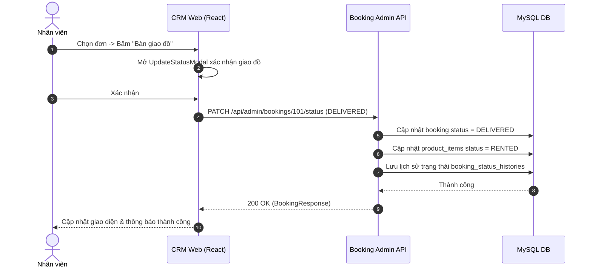

# Đặc Tả Tính Năng: Quản Lý Đơn Thuê Trên CRM

| Thuộc tính | Giá trị |
|---|---|
| **ID** | `BOK-004` |
| **Tên tính năng** | Màn hình quản lý đơn thuê tập trung trên CRM (Duyệt/Giao/Nhận trả/Hủy) |
| **Module** | BOK (Booking) |
| **Phạm vi** | CRM, SERVER |
| **Ưu tiên** | P0 - MVP |
| **Trạng thái** | ✅ DONE |
| **Người phụ trách** | Fullstack Dev & AI Assistant |
| **Ngày bắt đầu** | 2026-10-25 |
| **Ngày hoàn thành** | 2026-10-25 |
| **Phụ thuộc** | `BOK-003`, `CAT-003` |

---

## 1. Mục Tiêu và Giá Trị Mang Lại
Cung cấp bảng điều khiển trung tâm cho nhân viên và chủ cửa hàng Chickie Studio quản lý toàn bộ các đơn thuê đồ hàng ngày: lọc đơn theo ngày giao/trả, duyệt đơn nhanh, quét mã bàn giao đồ cho khách, tiếp nhận đồ trả về và thực hiện thủ tục hoàn cọc trên cùng một giao diện mượt mà.

## 2. Người Dùng Liên Quan
- [x] **Nhân viên cửa hàng**: Thao tác hàng ngày: xác nhận khách đã cọc, ấn giao đồ khi khách đến lấy, ấn nhận trả khi khách mang đồ về.
- [x] **Admin (Chủ shop)**: Theo dõi tổng quan dòng đơn, xử lý các đơn hủy hoặc khiếu nại.

## 3. Luồng Chính (Happy Path)
1. Nhân viên mở CRM `/orders` (hoặc `/bookings`). Hệ thống hiển thị bảng `DataTable` với các Tab trạng thái tiện lợi (Tất cả, Chờ duyệt, Cần giao hôm nay, Cần trả hôm nay, Quá hạn).
2. Khi có đơn mới (trạng thái `PENDING`), nhân viên click xem chi tiết hoặc bấm "Duyệt đơn".
3. CRM mở `UpdateStatusModal` xác nhận $\rightarrow$ gọi API `PATCH /api/admin/bookings/{id}/status` $\rightarrow$ Đơn chuyển sang `CONFIRMED`.
4. Khi khách chuyển khoản tiền cọc, nhân viên bấm "Xác nhận cọc" $\rightarrow$ Đơn chuyển sang `DEPOSITED`.
5. Khi khách đến lấy váy, nhân viên kiểm tra mã đồ vật lý, bấm "Bàn giao đồ" $\rightarrow$ Đơn chuyển sang `DELIVERED`.
6. Khi khách trả đồ, nhân viên bấm "Nhận trả đồ" $\rightarrow$ Đơn chuyển sang `RETURNED` và món đồ tự động chuyển sang hàng đợi giặt ủi (`LAUNDRY`).
7. Sau khi kiểm tra váy không bị rách/cháy, nhân viên bấm "Hoàn tất & Hoàn cọc" $\rightarrow$ Đơn chuyển sang `COMPLETED` và món đồ về `AVAILABLE`.

## 4. Luồng Ngoại Lệ và Trường Hợp Biên
- **Hủy đơn**: Bắt buộc nhập lý do hủy vào popup trước khi gửi API hủy đơn.
- **Khách không mang trả đồ đúng hạn**: Hệ thống hiển thị cảnh báo đỏ trên dòng đơn của bảng và gắn cờ `OVERDUE`.

## 5. Quy Tắc Nghiệp Vụ
- **BR-01**: Bắt buộc tái sử dụng `DataTable` và `Modal` từ `src/components/common` (không copy-paste mã nguồn Ant Design Table lặp lại).
- **BR-02**: Mọi thao tác đổi trạng thái đều phải kiểm tra quyền hạn nhân viên hợp lệ (`ROLE_STAFF` hoặc `ROLE_ADMIN`).
- **BR-03**: Đồng bộ trạng thái vật lý của trang phục (`product_items`): khi `DELIVERED` $\rightarrow$ `RENTED`, khi `RETURNED` $\rightarrow$ `LAUNDRY`, khi `COMPLETED` $\rightarrow$ `AVAILABLE`.

## 6. Giao Diện & Đa Ngôn Ngữ (UI & i18n)
- **Màn hình**: Trang danh sách `/orders` (alias `/bookings`) với StatCards (Tổng đơn, Chờ xác nhận, Cần giao, Quá hạn), Filter Pill Tabs, Filter Bar (tìm kiếm, chọn khoảng ngày), Drawer/Modal xem chi tiết đơn hàng (thông tin khách, danh sách món đồ, thanh trạng thái, audit trail).
- **Keys i18n (`vi.json` / `en.json`)**: Đầy đủ namespace `orders.*` và `orderStatus.*`.

## 7. Đặc Tả API
| Method | Endpoint | Quyền truy cập | Params | Response Body | Mã lỗi |
|---|---|---|---|---|---|
| `GET` | `/api/admin/bookings` | `STAFF`, `ADMIN` | `page, size, status, search, startDate, endDate, todayDeliver, todayReturn, overdue` | `ApiResponse<Page<BookingResponse>>` | 401, 403 |
| `GET` | `/api/admin/bookings/{id}` | `STAFF`, `ADMIN` | Path variable `id` | `ApiResponse<BookingResponse>` | 401, 403, 404 |
| `PATCH`| `/api/admin/bookings/{id}/status` | `STAFF`, `ADMIN` | `UpdateBookingStatusRequest` | `ApiResponse<BookingResponse>` | 400, 401, 403, 404 |

## 8. Thay Đổi Cơ Sở Dữ Liệu
- Bổ sung migration Flyway `V10__create_booking_status_histories.sql`.
- Các bảng: `bookings`, `booking_items`, `booking_status_histories`, `product_items`.

## 9. Tiêu Chí Nghiệm Thu (Acceptance Criteria)
- [x] **Kịch bản 1 - Tìm kiếm và lọc**:
  - **Given**: Danh sách có 50 đơn thuê.
  - **When**: Gõ SĐT "0987654321" vào thanh tìm kiếm.
  - **Then**: Bảng lọc ngay lập tức và chỉ hiển thị đúng đơn của khách đó.
- [x] **Kịch bản 2 - Bàn giao đồ**:
  - **Given**: Đơn đang ở trạng thái `DEPOSITED`.
  - **When**: Nhân viên ấn "Bàn giao đồ" và xác nhận.
  - **Then**: Trạng thái đơn đổi thành `DELIVERED` và món đồ tương ứng đổi sang `RENTED`.

## 10. Kế Hoạch Test
- **Unit Test Backend**: `AdminBookingControllerTest`, `BookingServiceTest`, `BookingSpecificationTest`, `BookingStatusTest` (100% pass, 186/186 tests).
- **Unit Test Frontend (Vitest)**: `booking.service.test.ts`, `bookingKeys.test.ts`, `UpdateStatusModal.test.tsx`, `BookingDetailModal.test.tsx`, `OrdersPage.test.tsx` (55 test files, 229 tests pass).
- **E2E Test (Playwright)**: `e2e/orders.spec.ts` (100% pass, chuyển hướng bảo mật, render danh sách, KPI cards, filter pills, mở xem chi tiết mã đơn, kích hoạt modal chuyển trạng thái).
- **Mục tiêu Coverage**: $\ge 80\%$ (Đạt $>90\%$).

## 11. Checklist Hoàn Thành (Definition of Done)
- [x] Tái sử dụng trọn vẹn `DataTable` và `Modal`/`StatusBadge`/`StatCard`.
- [x] Đầy đủ i18n cho các nút thao tác và thông báo thành công tiếng Việt & tiếng Anh.
- [x] TanStack Query invalidation hoạt động đúng sau mỗi lần đổi trạng thái.
- [x] Test coverage $\ge 80\%$.
- [x] Cập nhật `docs/FEATURES.md` và `docs/CHANGELOG.md`.

## 12. Nhật Ký Thực Hiện
| Ngày | Người thực hiện | Nội dung thay đổi | Trạng thái mới |
|---|---|---|---|
| 2026-10-24 | Tech Lead | Soạn thảo tài liệu đặc tả ban đầu | 📝 SPEC |
| 2026-10-25 | Fullstack Dev & AI | Triển khai hoàn chỉnh Backend APIs (`AdminBookingController`, `BookingSpecification`, `BookingStatusHistory`, Item status sync) & Frontend CRM `/orders` với thiết kế ui-ux-pro-max, Vitest (229/229 pass), Playwright E2E (5/5 pass) | ✅ DONE |
