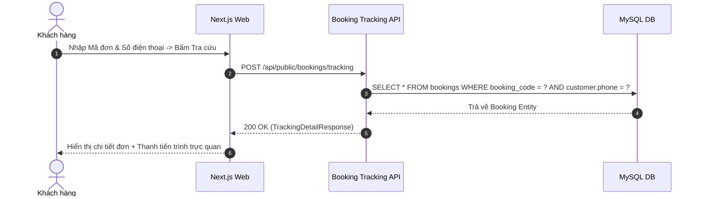

# Đặc Tả Tính Năng: Tra Cứu Đơn Thuê Bằng Mã Đơn & Số Điện Thoại Trên Client

| Thuộc tính | Giá trị |
|---|---|
| **ID** | `BOK-005` |
| **Tên tính năng** | Tra cứu trạng thái đơn thuê trực tuyến bằng Mã đơn và Số điện thoại |
| **Module** | BOK (Booking) |
| **Phạm vi** | CLIENT, SERVER |
| **Ưu tiên** | P0 - MVP |
| **Trạng thái** | 📝 SPEC |
| **Người phụ trách** | Frontend Dev / Fullstack Dev |
| **Ngày bắt đầu** | - |
| **Ngày hoàn thành** | - |
| **Phụ thuộc** | `BOK-001`, `BOK-003` |

---

## 1. Mục Tiêu và Giá Trị Mang Lại
Cho phép khách hàng vãng lai (không cần đăng nhập tài khoản) tự tra cứu tình trạng đơn thuê của mình bất kỳ lúc nào: xem đơn đã được duyệt chưa, tiệm đã nhận được tiền cọc chưa, ngày giờ cần đến lấy váy và hướng dẫn trả đồ. Giảm thiểu 80% tin nhắn hỏi han thủ công qua fanpage/Zalo.

## 2. Người Dùng Liên Quan
- [x] **Khách hàng**: Tự kiểm tra tiến độ đơn, lấy thông tin tài khoản chuyển khoản cọc nếu lỡ quên.

## 3. Luồng Chính (Happy Path)
1. Khách hàng truy cập vào trang `/tra-cuu-don` trên website Chickie Studio.
2. Nhập Mã đơn (ví dụ: `BK20261105-012`) và Số điện thoại đã dùng để đặt đồ.
3. Nhấn "Tra cứu đơn hàng".
4. Client gọi `POST /api/public/bookings/tracking` với `bookingCode` và `phone`.
5. Server kiểm tra cặp `(booking_code, phone)` trong DB:
   - Nếu khớp: trả về toàn bộ chi tiết đơn và tiến trình trạng thái.
6. Client hiển thị giao diện kết quả:
   - Thanh tiến trình trạng thái (Timeline Steps: Chờ duyệt $\rightarrow$ Đã cọc $\rightarrow$ Đang thuê $\rightarrow$ Đã trả $\rightarrow$ Hoàn tất).
   - Thẻ hiển thị các trang phục đã đặt (ảnh, tên váy, size, ngày nhận, ngày trả).
   - Trạng thái tiền cọc (Đã thu cọc / Chưa nhận cọc - kèm mã QR VietQR chuyển khoản nếu chưa cọc).
   - Nút liên hệ nhanh (Zalo, Hotline).



## 4. Luồng Ngoại Lệ và Trường Hợp Biên
- **Sai mã đơn hoặc SĐT**: Server trả về `404 Not Found` với thông báo "Không tìm thấy đơn thuê phù hợp. Vui lòng kiểm tra lại mã đơn và số điện thoại".
- **Khách không nhớ mã đơn**: Gợi ý khách liên hệ hotline hoặc nhắn qua Zalo với nút bấm một chạm.

## 5. Quy Tắc Nghiệp Vụ
- **BR-01**: Bắt buộc phải cung cấp đúng cả Mã đơn và Số điện thoại mới cho phép xem chi tiết (bảo mật thông tin khách hàng, tránh người ngoài tra cứu bừa bãi).
- **BR-02**: Không hiển thị thông tin nhạy cảm của nhân viên quản trị trong kết quả tra cứu.

## 6. Giao Diện & Đa Ngôn Ngữ (UI & i18n)
- **Màn hình**: Trang tìm kiếm đơn giản, kết quả hiển thị thẻ Card bo tròn phong cách hiện đại, thanh tiến trình màu sắc tương thích thiết bị di động.
- **Component dùng chung**: `FormField`, `Button`, `TimelineSteps`, `Badge`.
- **Keys i18n (`vi.json` / `en.json`)**:
```json
{
  "tracking": {
    "title": "Tra Cứu Đơn Thuê Đồ",
    "bookingCodeLabel": "Mã đơn thuê (Ví dụ: BK20261105-001)",
    "phoneLabel": "Số điện thoại đặt đồ",
    "searchButton": "Tra Cứu Ngay",
    "notFound": "Không tìm thấy đơn hàng. Vui lòng kiểm tra lại thông tin.",
    "depositStatusPending": "Chưa nhận cọc - Vui lòng chuyển khoản giữ đồ",
    "depositStatusPaid": "Đã nhận tiền cọc thành công",
    "contactShop": "Cần hỗ trợ? Nhắn Zalo ngay"
  }
}
```

## 7. Đặc Tả API
| Method | Endpoint | Quyền truy cập | Request Body | Response Body | Mã lỗi |
|---|---|---|---|---|---|
| `POST` | `/api/public/bookings/tracking` | Public | `{"bookingCode": "...", "phone": "..."}` | `ApiResponse<BookingTrackingResponse>` | 400, 404 |

## 8. Thay Đổi Cơ Sở Dữ Liệu
- Đánh chỉ mục kép phục vụ tra cứu nhanh:
```sql
CREATE INDEX `idx_bookings_tracking` ON `bookings` (`booking_code`, `customer_id`);
```

## 9. Tiêu Chí Nghiệm Thu (Acceptance Criteria)
- [ ] **Kịch bản 1 - Tra cứu đúng thông tin**:
  - **Given**: Đơn `BK20261105-001` thuộc về số điện thoại `0987654321`.
  - **When**: Nhập đúng mã và SĐT rồi nhấn tra cứu.
  - **Then**: Hiển thị chính xác tên váy, ngày thuê và trạng thái hiện tại.
- [ ] **Kịch bản 2 - Sai số điện thoại**:
  - **Given**: Đơn có thật nhưng nhập sai số điện thoại.
  - **When**: Nhấn tra cứu.
  - **Then**: Hệ thống báo 404 không tìm thấy, không làm lộ thông tin đơn hàng.

## 10. Kế Hoạch Test
- **Unit Test**: Test BookingService tìm kiếm theo mã đơn và SĐT.
- **UI Test**: Test form tra cứu, loading skeleton và hiển thị timeline kết quả.
- **Mục tiêu Coverage**: $\ge 80\%$.

## 11. Checklist Hoàn Thành (Definition of Done)
- [ ] Bảo mật thông tin đơn hàng khách vãng lai.
- [ ] Timeline hiển thị trực quan trên màn hình nhỏ.
- [ ] i18n đầy đủ cho cả `vi.json` và `en.json`.
- [ ] Test coverage $\ge 80\%$.
- [ ] Cập nhật `docs/FEATURES.md` và `docs/CHANGELOG.md`.

## 12. Nhật Ký Thực Hiện
| Ngày | Người thực hiện | Nội dung thay đổi | Trạng thái mới |
|---|---|---|---|
| 2026-10-24 | Tech Lead | Soạn thảo tài liệu đặc tả ban đầu | 📝 SPEC |
