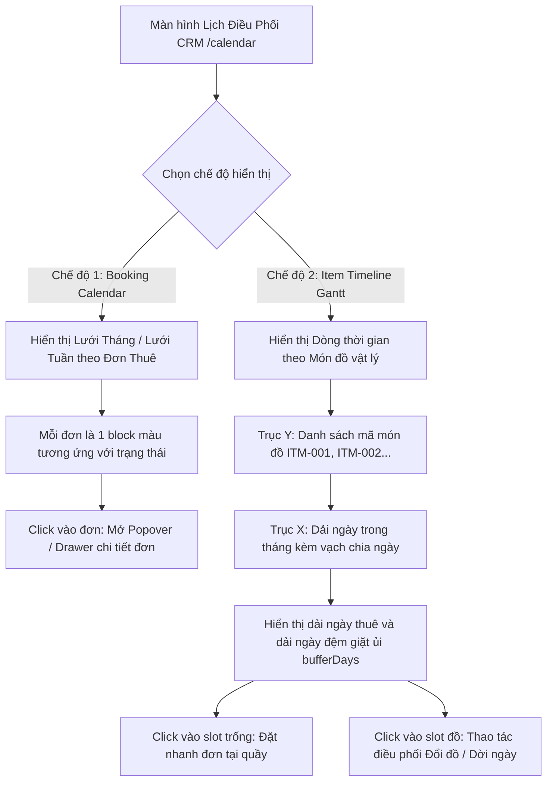
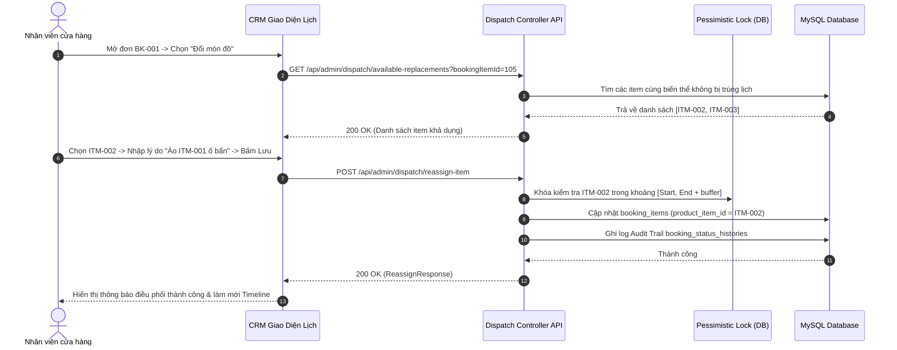

# Đặc Tả Tính Năng: Lịch Thuê Dạng Calendar & Điều Phối Lịch Trên CRM

| Thuộc tính | Giá trị |
|---|---|
| **ID** | `BOK-006` |
| **Tên tính năng** | Lịch thuê dạng Calendar trực quan & Điều phối tài nguyên trang phục trên CRM |
| **Module** | BOK (Booking & Dispatch) |
| **Phạm vi** | CRM, SERVER |
| **Ưu tiên** | P1 - Vận hành cốt lõi |
| **Trạng thái** | 📝 SPEC |
| **Người phụ trách** | Fullstack Dev & Tech Lead |
| **Ngày bắt đầu** | 2026-10-25 |
| **Ngày hoàn thành** | 2026-10-25 |
| **Phụ thuộc** | `BOK-002`, `BOK-003`, `BOK-004`, `CAT-003` |

---

## Mục Lục
1. [Mục Tiêu và Giá Trị Mang Lại](#1-mục-tiêu-và-giá-trị-mang-lại)
2. [Người Dùng Liên Quan](#2-người-dùng-liên-quan)
3. [Luồng Nghiệp Vụ Chính (Happy Path)](#3-luồng-nghiệp-vụ-chính-happy-path)
4. [Luồng Ngoại Lệ và Trường Hợp Biên](#4-luồng-ngoại-lệ-và-trường-hợp-biên)
5. [Quy Tắc Nghiệp Vụ (Business Rules)](#5-quy-tắc-nghiệp-vụ-business-rules)
6. [Giao Diện & Đa Ngôn Ngữ (UI & i18n)](#6-giao-diện--đa-ngôn-ngữ-ui--i18n)
7. [Đặc Tả API Backend](#7-đặc-tả-api-backend)
8. [Thay Đổi Cơ Sở Dữ Liệu](#8-thay-đổi-cơ-sở-dữ-liệu)
9. [Tiêu Chí Nghiệm Thu (Acceptance Criteria)](#9-tiêu-chí-nghiệm-thu-acceptance-criteria)
10. [Kế Hoạch Kiểm Thử](#10-kế-hoạch-kiểm-thử)
11. [Checklist Hoàn Thành (Definition of Done)](#11-checklist-hoàn-thành-definition-of-done)

---

## 1. Mục Tiêu và Giá Trị Mang Lại
- **Trực quan hóa toàn bộ lịch trình thuê đồ**: Thay vì chỉ xem danh sách đơn hàng dạng bảng văn bản (`/orders`), nhân viên và chủ tiệm có cái nhìn không gian - thời gian tổng thể (Gantt timeline & Calendar) về tình trạng kín lịch của từng món đồ vật lý (mã barcode).
- **Điều phối và xử lý sự cố đồ đạc linh hoạt**: Khi một trang phục bị khách trước làm rách nhẹ, dính ố cần tẩy gấp, hoặc khách trước gia hạn thêm ngày, nhân viên có thể điều phối đổi món đồ (`Reassign Item`) sang một item khác cùng size/màu đang trống một cách an toàn.
- **Hỗ trợ dời ngày thuê (Reschedule)**: Cho phép khách dời lịch hẹn mà vẫn đảm bảo khóa chống trùng lịch và tự động tính lại ngày đệm giặt ủi (`bufferDays`) theo `BOK-002`.
- **Tối ưu hóa công suất khai thác kho đồ (Asset Utilization)**: Nhận biết ngay các khe trống ngắn hạn giữa các đợt thuê để nhân viên tư vấn chốt đơn cho khách thuê gấp tại quầy.

---

## 2. Người Dùng Liên Quan
- [x] **Nhân viên cửa hàng**: Theo dõi lịch giao/trả theo tuần, tra cứu nhanh đồ trống khi có khách gọi hotline hỏi thuê gấp, thực hiện đổi món đồ hoặc dời ngày thuê.
- [x] **Admin (Chủ shop)**: Nắm bắt bức tranh tổng thể về tần suất sử dụng kho đồ, nhận biết các mẫu đắt khách để bổ sung thêm số lượng, giám sát các đơn giao/trả trùng thời điểm cao điểm.

---

## 3. Luồng Nghiệp Vụ Chính (Happy Path)

### 3.1. Hai Chế Độ Xem Trực Quan (Dual View)



### 3.2. Luồng Điều Phối Đổi Món Đồ (Reassign Item)
1. Nhân viên phát hiện món đồ `CK-DR-001` thuộc đơn `BK-20261101-001` đang cần giặt gấp do khách trước trả đồ dính bẩn.
2. Nhân viên mở Timeline trên CRM, click vào khối đồ của đơn đó $\rightarrow$ Chọn **"Điều phối lại món đồ" (Reassign Item)**.
3. CRM gọi API lấy danh sách các món đồ cùng biến thể (`variantId`) khả dụng trong toàn bộ khoảng thời gian $[Start, End + bufferDays]$ của đơn.
4. Nhân viên chọn món đồ thay thế `CK-DR-002` (cùng size S, màu Trắng) $\rightarrow$ Bấm Xác nhận.
5. Server thực hiện Transaction với Pessimistic Lock, cập nhật `booking_items.product_item_id = CK-DR-002`, ghi nhận Audit Trail `booking_status_histories`.
6. Timeline trên CRM tự động cập nhật lại dải màu sang hàng của `CK-DR-002`.



---

## 4. Luồng Ngoại Lệ và Trường Hợp Biên

| Tình huống ngoại lệ | Xử lý của hệ thống | Phản hồi giao diện |
|---|---|---|
| **Không còn món đồ nào cùng biến thể trống** | Hệ thống kiểm tra thấy tất cả item cùng size/màu đều đã kín lịch trong dải ngày đó | Hiển thị thông báo Modal cảnh báo: *"Không còn món đồ cùng size/màu khả dụng trong khoảng thời gian này. Vui lòng liên hệ khách để dời ngày hoặc đổi mẫu khác."* |
| **Dời ngày thuê đụng vào lịch của đơn khác** | Nhân viên chọn ngày mới cho đơn nhưng khoảng $[Start_{mới}, End_{mới} + buffer]$ giao thoa với đơn đã cọc | Chặn thao tác, trả về lỗi `409 CONFLICT` kèm mã đơn và dải ngày đang bị chặn |
| **Đơn đã ở trạng thái `DELIVERED` hoặc `RETURNED`** | Khách đã nhận đồ hoặc đã mang về tiệm | Ẩn hoặc vô hiệu hóa nút "Đổi đồ" và "Dời ngày", chỉ cho phép thao tác bàn giao/nhận trả bình thường |
| **Món đồ đang ở trạng thái `MAINTENANCE` hoặc `RETIRED`** | Món đồ đã bị đưa đi sửa chữa lâu dài hoặc hỏng thải loại | Hiển thị dải màu xám sọc chéo trên Timeline, cấm xếp bất kỳ đơn nào vào hàng này |

---

## 5. Quy Tắc Nghiệp Vụ (Business Rules)

- **BR-01 (Bảo toàn ngày đệm giặt ủi)**: Mọi thao tác đổi món đồ hay dời ngày thuê trên Calendar đều bắt buộc áp dụng công thức khoảng chiếm dụng an toàn của `BOK-002`:
  $$\text{Blocked Period} = [D_{start}, D_{end} + \text{bufferDays}]$$
  với `bufferDays` = 1 ngày cho trang phục và 0 ngày cho phụ kiện/máy ảnh.
- **BR-02 (Chuẩn hóa điều phối đồ cùng biến thể)**: Khi đổi món đồ (`Reassign`), món đồ mới bắt buộc phải thuộc cùng `product_variant_id` (cùng mẫu, cùng màu, cùng kích cỡ) để bảo đảm đúng cam kết với khách thuê. Chỉ Admin mới có quyền ghi đè (Override) đổi sang biến thể khác khi có sự thỏa thuận với khách.
- **BR-03 (Audit Trail bắt buộc)**: Bất kỳ hành động điều phối lịch nào (Đổi item, dời ngày, kéo dài hạn thuê) đều phải tạo một bản ghi lịch sử vào `booking_status_histories` với thông tin chi tiết:
  - `action`: `REASSIGN_ITEM` hoặc `RESCHEDULE_DATES`.
  - `note`: Ghi rõ lý do (ví dụ: *"Đổi từ CK-DR-001 sang CK-DR-002 do áo rách cúc"*).
  - `changed_by`: Tên tài khoản nhân viên đăng nhập.
- **BR-04 (Mã màu chuẩn hóa theo trạng thái đơn)**:
  - `PENDING`: Vàng hổ phách (`#F59E0B`) - Chờ cọc / Chờ duyệt.
  - `CONFIRMED`: Xanh dương nhạt (`#38BDF8`) - Đã xác nhận.
  - `DEPOSITED`: Xanh dương đậm (`#2563EB`) - Đã đặt cọc an toàn.
  - `DELIVERED`: Xanh lá cây (`#10B981`) - Đang thuê (khách đang giữ đồ).
  - `RETURNED`: Tím pastel (`#8B5CF6`) - Đã nhận về, đang chờ giặt ủi/kiểm tra.
  - `COMPLETED`: Xám nhạt (`#6B7280`) - Đơn hoàn tất, đã trả cọc.
  - `OVERDUE`: Đỏ cảnh báo (`#EF4444`) - Quá hạn trả đồ.
  - `BUFFER_LAUNDRY`: Xám viền sọc đệm (`#94A3B8`) - Ngày đệm giặt ủi.

---

## 6. Giao Diện & Đa Ngôn Ngữ (UI & i18n)

### 6.1. Thiết Kế Màn Hình Điều Phối (`crm/src/pages/dispatch/CalendarPage.tsx`)
- **Thanh công cụ đỉnh (Header Controls)**:
  - Nút chuyển đổi View: `[ Lịch Đơn Hàng (Calendar) ]` | `[ Dòng Thời Gian Đồ (Timeline) ]`.
  - Bộ điều hướng thời gian: Nút Hôm nay, Mũi tên Trước/Sau, Bộ chọn tháng/năm (`DatePicker`).
  - Lọc đa tiêu chí: Lọc theo Danh mục (Váy thiết kế, Áo dài, Máy ảnh), theo Biến thể (Size S/M/L, Màu), theo Trạng thái đơn.
  - Nút thao tác nhanh: `+ Tạo đơn giữ chỗ tại quầy` (mở modal booking nhanh).
- **Khu vực hiển thị Calendar**:
  - Dạng Calendar tháng: Hiển thị 35 ô ngày với số lượng đơn trong ngày, badge màu từng đơn.
  - Dạng Timeline ngang: Hàng dọc là các món đồ vật lý (kèm barcode, tên váy, size, màu). Trục ngang là 30 ngày của tháng. Các block sự kiện kéo dài liên tục từ ngày nhận đến ngày trả + ngày đệm.
- **Tương tác nhanh**:
  - Hover chuột vào block: Tooltip nổi hiển thị mã đơn, tên khách, số điện thoại, ngày nhận/trả, tiền cọc.
  - Click vào block: Mở Popover thao tác nhanh (Xem chi tiết, Bàn giao đồ, Đổi món đồ, Dời ngày thuê).

### 6.2. Bộ Từ Điển Đa Ngôn Ngữ (`vi.json` / `en.json`)

```json
{
  "dispatch": {
    "title": "Lịch Thuê & Điều Phối Đồ",
    "viewCalendar": "Lịch Đơn Thuê",
    "viewTimeline": "Dòng Thời Gian Kho Đồ",
    "today": "Hôm nay",
    "filterCategory": "Tất cả danh mục",
    "filterStatus": "Tất cả trạng thái",
    "reassignItem": "Điều phối đổi món đồ",
    "reassignSuccess": "Điều phối đổi sang món đồ {barcode} thành công",
    "reschedule": "Dời ngày thuê",
    "rescheduleSuccess": "Dời lịch thuê đơn {code} thành công",
    "currentBarcode": "Món đồ hiện tại",
    "newBarcode": "Món đồ thay thế",
    "reason": "Lý do điều phối",
    "reasonPlaceholder": "Nhập lý do đổi đồ (ví dụ: đồ rách cúc, giặt chưa khô...)",
    "noAvailableItem": "Không còn món đồ nào cùng size/màu trống trong dải ngày này",
    "bufferDayNotice": "Dải ngày đệm giặt ủi: {days} ngày",
    "conflictAlert": "Khoảng thời gian mới bị trùng với đơn khác hoặc ngày đệm giặt đồ."
  }
}
```

---

## 7. Đặc Tả API Backend

### 7.1. Danh Sách Endpoint Điều Phối

| Method | Endpoint | Quyền hạn | Mục đích |
|---|---|---|---|
| `GET` | `/api/admin/dispatch/calendar` | `STAFF`, `ADMIN` | Lấy dữ liệu đơn thuê theo dải ngày cho giao diện Calendar |
| `GET` | `/api/admin/dispatch/timeline` | `STAFF`, `ADMIN` | Lấy dữ liệu tài nguyên món đồ và các block chiếm dụng cho giao diện Timeline |
| `GET` | `/api/admin/dispatch/available-replacements` | `STAFF`, `ADMIN` | Tìm các món đồ cùng biến thể khả dụng để thay thế |
| `POST` | `/api/admin/dispatch/reassign-item` | `STAFF`, `ADMIN` | Thực hiện đổi gán món đồ cho đơn thuê |
| `POST` | `/api/admin/dispatch/reschedule` | `STAFF`, `ADMIN` | Dời ngày nhận và trả của đơn thuê |

### 7.2. Chi Tiết Request & Response DTOs

#### A. GET `/api/admin/dispatch/timeline`
- **Query Params**: `startDate=2026-11-01&endDate=2026-11-30&categoryId=1`
- **Response Success (200 OK)**:
```json
{
  "code": 200,
  "message": "SUCCESS",
  "data": {
    "startDate": "2026-11-01",
    "endDate": "2026-11-30",
    "resources": [
      {
        "itemId": 101,
        "barcode": "CK-DR-001",
        "productName": "Váy Dạ Hội Kim Sa Trắng",
        "variantInfo": "Size S - Trắng",
        "categoryType": "CLOTHING",
        "itemStatus": "AVAILABLE",
        "events": [
          {
            "bookingId": 205,
            "bookingItemId": 310,
            "bookingCode": "BK20261105-001",
            "customerName": "Nguyễn Mai Anh",
            "customerPhone": "0987654321",
            "startDate": "2026-11-05",
            "endDate": "2026-11-07",
            "bufferEndDate": "2026-11-08",
            "status": "DEPOSITED",
            "rentalPrice": 450000.0,
            "depositPrice": 1000000.0
          }
        ]
      }
    ]
  }
}
```

#### B. POST `/api/admin/dispatch/reassign-item`
- **Request Body**:
```json
{
  "bookingItemId": 310,
  "newItemId": 102,
  "reason": "Món CK-DR-001 dính ố rượu vang cần tẩy gấp"
}
```
- **Response Success (200 OK)**:
```json
{
  "code": 200,
  "message": "Điều phối đổi món đồ thành công",
  "data": {
    "bookingItemId": 310,
    "bookingCode": "BK20261105-001",
    "oldBarcode": "CK-DR-001",
    "newBarcode": "CK-DR-002",
    "changedBy": "admin_linh",
    "updatedAt": "2026-10-25T21:40:00"
  }
}
```

#### C. POST `/api/admin/dispatch/reschedule`
- **Request Body**:
```json
{
  "bookingId": 205,
  "newStartDate": "2026-11-10",
  "newEndDate": "2026-11-12",
  "reason": "Khách dời lịch chụp ảnh kỷ yếu do trời mưa"
}
```
- **Response Error (409 CONFLICT)**:
```json
{
  "code": 409,
  "message": "Không thể dời ngày: Món đồ CK-DR-001 đã có người đặt trong khoảng thời gian 2026-11-12 đến 2026-11-14 (kèm ngày đệm giặt ủi).",
  "data": null
}
```

---

## 8. Thay Đổi Cơ Sở Dữ Liệu
- Hệ thống tận dụng trọn vẹn các bảng hiện có: `bookings`, `booking_items`, `product_items`, `booking_status_histories`.
- Bổ sung composite index trên bảng `booking_items` để tối ưu hóa hiệu năng truy vấn dòng thời gian Timeline:

```sql
-- Migration V13: Đánh index cho truy vấn Timeline & Dispatch
CREATE INDEX `idx_booking_items_timeline_lookup` 
ON `booking_items` (`product_item_id`, `rental_start_date`, `rental_end_date`);
```

---

## 9. Tiêu Chí Nghiệm Thu (Acceptance Criteria)

### Kịch bản 1: Xem dòng thời gian trực quan của kho đồ
- **Given**: Tiệm có 10 món đồ vật lý và 5 đơn thuê trong tháng 11/2026.
- **When**: Nhân viên mở trang `/calendar` trên CRM và chọn View "Dòng Thời Gian Kho Đồ".
- **Then**: Màn hình render bảng Timeline với các hàng món đồ, các khối đơn hiển thị đúng dải ngày và màu sắc theo trạng thái; ngày đệm giặt ủi `bufferDays` hiển thị sọc chéo rõ ràng.

### Kịch bản 2: Điều phối đổi món đồ an toàn
- **Given**: Đơn `BK-001` đang giữ món `CK-DR-001`. Chiếc `CK-DR-002` cùng size S đang hoàn toàn trống lịch trong khoảng thuê của đơn.
- **When**: Nhân viên thao tác đổi sang `CK-DR-002` kèm lý do hợp lệ.
- **Then**: Server ghi nhận thành công, `booking_items` cập nhật sang item mới, bảng `booking_status_histories` lưu vết đổi đồ, Timeline cập nhật tức thì mà không cần reload cả trang.

### Kịch bản 3: Chặn dời ngày thuê khi bị xung đột lịch
- **Given**: Đơn `BK-001` muốn dời ngày sang dải [20/11 - 22/11], tuy nhiên cùng món đồ đó đã có đơn `BK-009` đặt ngày 22/11.
- **When**: Nhân viên nhập dải ngày mới và bấm Lưu.
- **Then**: Server trả về `409 CONFLICT`, CRM hiển thị thông báo lỗi rõ ràng và giữ nguyên ngày cũ của đơn.

---

## 10. Kế Hoạch Kiểm Thử
- **Backend Unit & Integration Tests**:
  - `DispatchServiceTest`: Kiểm tra logic tìm item thay thế hợp lệ, kiểm tra overlap khoảng ngày dời lịch kèm buffer.
  - `DispatchControllerTest`: Kiểm tra bảo mật RBAC (`ROLE_STAFF`, `ROLE_ADMIN`), validation input DTO.
  - `DispatchConcurrencyTest`: Khóa bi quan khi 2 nhân viên cùng thao tác đổi đồ cùng một lúc.
- **Frontend Unit Tests (Vitest & RTL)**:
  - `dispatch.service.test.ts`: Mock gọi API dispatch.
  - `CalendarView.test.tsx`, `TimelineView.test.tsx`: Render các khối thời gian, bộ lọc danh mục và trạng thái.
  - `ReassignItemModal.test.tsx`: Form đổi đồ và thông báo xác nhận.
- **E2E Tests (Playwright)**:
  - Kịch bản truy cập trang `/calendar`, chuyển qua lại giữa Calendar và Timeline, mở modal đổi đồ và xác nhận thành công.
- **Mục tiêu Coverage**: $\ge 85\%$ cả dòng lệnh và nhánh điều kiện.

---

## 11. Checklist Hoàn Thành (Definition of Done)
- [ ] Soạn thảo và phê duyệt tài liệu đặc tả `BOK-006` (đã xong).
- [ ] Cập nhật bảng theo dõi trong [docs/FEATURES.md](../../FEATURES.md).
- [ ] Không sử dụng inline CSS, 100% tuân thủ CSS Modules / SCSS / Tailwind.
- [ ] Kiểm thử tự động đạt độ bao phủ $\ge 80\%$.
- [ ] Test E2E Playwright pass 100%.
- [ ] Ghi nhận thay đổi vào `CHANGELOG.md`.
