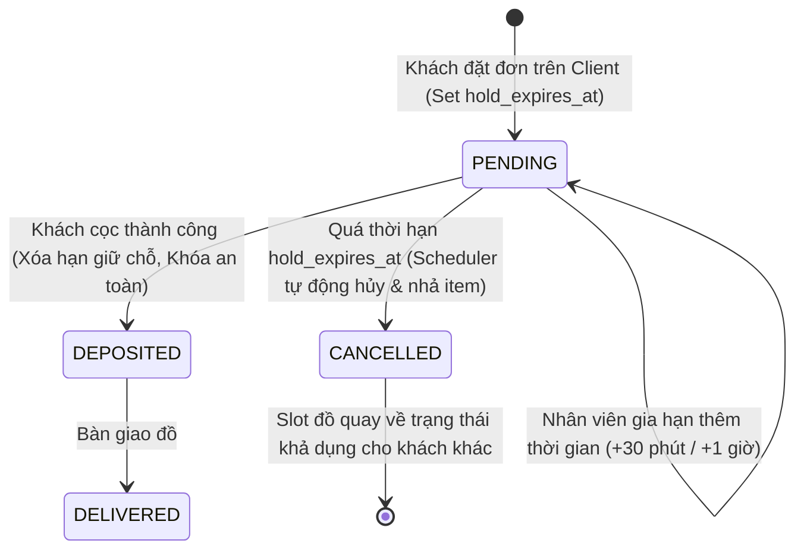
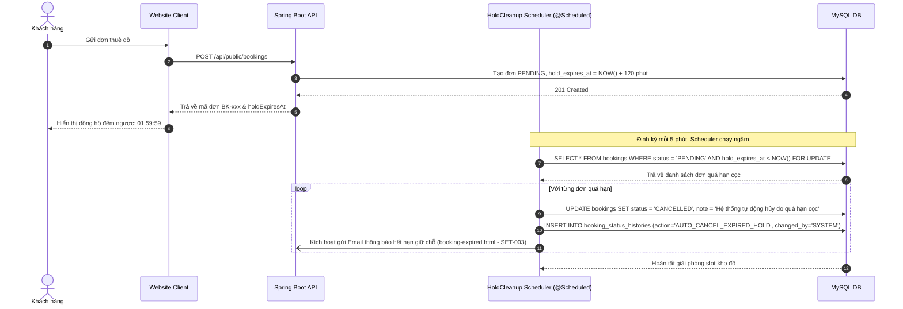

# Đặc Tả Tính Năng: Giữ Chỗ Tạm Thời & Tự Động Nhả Slot Khi Quá Hạn Cọc

| Thuộc tính | Giá trị |
|---|---|
| **ID** | `BOK-007` |
| **Tên tính năng** | Cơ chế giữ chỗ tạm thời & Tự động giải phóng slot khi quá hạn cọc (Auto-Release Expired Holds) |
| **Module** | BOK (Booking & Dispatch) |
| **Phạm vi** | SERVER, CRM, CLIENT |
| **Ưu tiên** | P1 - Vận hành cốt lõi |
| **Trạng thái** | 📝 SPEC |
| **Người phụ trách** | Fullstack Dev & Tech Lead |
| **Ngày bắt đầu** | 2026-10-25 |
| **Ngày hoàn thành** | 2026-10-25 |
| **Phụ thuộc** | `BOK-001`, `BOK-002`, `BOK-003` |

---

## Mục Lục
1. [Mục Tiêu và Giá Trị Mang Lại](#1-mục-tiêu-và-giá-trị-mang-lại)
2. [Người Dùng Liên Quan](#2-người-dùng-liên-quan)
3. [Luồng Nghiệp Vụ Chính (Happy Path)](#3-luồng-nghiệp-vụ-chính-happy-path)
4. [Luồng Ngoại Lệ và Trường Hợp Biên](#4-luồng-ngoại-lệ-và-trường-hợp-biên)
5. [Quy Tắc Nghiệp Vụ (Business Rules)](#5-quy-tắc-nghiệp-vụ-business-rules)
6. [Giao Diện & Đa Ngôn Ngữ (UI & i18n)](#6-giao-diện--đa-ngôn-ngữ-ui--i18n)
7. [Đặc Tả API Backend](#7-đặc-tả-api-backend)
8. [Thay Đổi Cơ Sở Dữ Liệu](#8-thay-đổi-cơ-sở-dữ-liệu)
9. [Tiêu Chí Nghiệm Thu (Acceptance Criteria)](#9-tiêu-chí-nghiệm-thu-acceptance-criteria)
10. [Kế Hoạch Kiểm Thử](#10-kế-hoạch-kiểm-thử)
11. [Checklist Hoàn Thành (Definition of Done)](#11-checklist-hoàn-thành-definition-of-done)

---

## 1. Mục Tiêu và Giá Trị Mang Lại
- **Ngăn chặn tình trạng "đặt ảo giữ đồ" (Ghost Bookings)**: Khi khách hàng đặt đơn trên website nhưng sau đó đổi ý không chuyển khoản cọc, món đồ vật lý sẽ bị khóa lịch khiến các khách hàng thực tế khác không thể đặt được.
- **Tự động hóa hoàn toàn quy trình giải phóng kho (Auto-Release)**: Không cần nhân viên phải ngồi canh từng giờ để lọc tìm đơn chưa cọc rồi bấm hủy thủ công; Background Scheduler tự động quét và thu hồi slot ngay khi hết hạn.
- **Minh bạch và thúc đẩy thanh toán**: Khách hàng nhìn thấy đồng hồ đếm ngược (Countdown Timer) trực quan trên màn hình giữ chỗ và tin nhắn hướng dẫn cọc, tạo động lực chuyển khoản đúng hạn.

---

## 2. Người Dùng Liên Quan
- [x] **Khách hàng thuê đồ**: Biết chính xác thời hạn tối đa để hoàn tất cọc giữ đồ; nhận được thông báo rõ ràng nếu đơn bị hủy do quá hạn.
- [x] **Nhân viên cửa hàng**: Giảm thiểu khối lượng công việc kiểm tra đơn quá hạn; có quyền linh hoạt gia hạn thêm thời gian giữ chỗ (`Extend Hold`) nếu khách liên hệ xin chuyển cọc muộn.
- [x] **Admin (Chủ shop)**: Cấu hình linh hoạt thời lượng giữ chỗ (ví dụ: ngày thường cho giữ 2 tiếng, ngày cao điểm lễ/Tết/kỷ yếu rút ngắn còn 30 phút).

---

## 3. Luồng Nghiệp Vụ Chính (Happy Path)

### 3.1. Vòng Đời Giữ Chỗ & Tự Động Nhả Slot



### 3.2. Sơ Đồ Trình Tự Thực Thi



---

## 4. Luồng Ngoại Lệ và Trường Hợp Biên

| Tình huống ngoại lệ | Xử lý của hệ thống | Phản hồi giao diện |
|---|---|---|
| **Khách chuyển tiền cọc sát nút giờ hết hạn** | Khách chuyển khoản đúng lúc scheduler chuẩn bị chạy. Nếu nhân viên bấm "Xác nhận cọc" trước khi scheduler xử lý: Transaction của nhân viên khóa dòng và chuyển trạng thái sang `DEPOSITED` | Scheduler khi đọc lại sẽ bỏ qua đơn này vì trạng thái không còn là `PENDING`. Khách không bị mất đơn. |
| **Khách gọi hotline xin thêm thời gian cọc** | Nhân viên mở CRM, bấm nút **"Gia hạn cọc" (+30 phút hoặc +1 giờ)** | Hệ thống cập nhật `hold_expires_at = hold_expires_at + duration`, Client tự động cập nhật lại đồng hồ đếm ngược |
| **Khách truy cập đơn đã bị hủy tự động** | Khách vào lại đường link hóa đơn sau khi đơn đã bị hủy | Client hiển thị thông báo: *"Đơn hàng đã hết hạn giữ chỗ do chưa nhận được tiền cọc. Quý khách vui lòng đặt lại đơn mới."* kèm nút "Đặt lại mẫu này" |

---

## 5. Quy Tắc Nghiệp Vụ (Business Rules)

- **BR-01 (Thời gian giữ chỗ mặc định)**: Mặc định thời gian giữ chỗ là **120 phút (2 giờ)** kể từ lúc khách tạo đơn thành công trên Client (hoặc cấu hình động 60 - 120 phút).
- **BR-02 (Cấu hình linh hoạt qua biến môi trường/setting)**:
  `app.booking.hold-duration-minutes=120` (hoặc cấu hình động trong bảng `shop_settings`).
- **BR-03 (Giải phóng tức thì cho lịch khả dụng)**: Ngay khi đơn chuyển sang `CANCELLED`, API tính toán lịch trống `ProductAvailabilityService` (`CAT-006`) lập tức coi dải ngày đó là trống, khách hàng khác có thể đặt ngay mà không cần chờ xóa cache.
- **BR-04 (Giới hạn số lần gia hạn)**: Mỗi đơn thuê chỉ cho phép nhân viên gia hạn cọc tối đa **3 lần**, mỗi lần không quá **120 phút** để tránh việc lạm dụng giữ chỗ vô thời hạn.
- **BR-05 (Ghi nhận Audit Trail chuẩn xác)**: Mọi đơn bị hủy bởi Scheduler đều ghi nhận `changed_by = "SYSTEM"` và lý do rõ ràng `Hệ thống tự động hủy do quá hạn đặt cọc`.
- **BR-06 (Thông báo hủy giữ chỗ qua Email)**: Khi đơn bị tự động hủy do hết hạn giữ chỗ, hệ thống tự động gửi Email thông báo (`booking-expired.html` theo `SET-003`) để khách hàng nắm được tình trạng và có link bấm đặt lại khi có nhu cầu. Chưa thực hiện thông báo qua Zalo hay SMS.

---

## 6. Giao Diện & Đa Ngôn Ngữ (UI & i18n)

### 6.1. Giao Diện Website Client (`client`)
- **Khối đồng hồ đếm ngược**: Hiển thị trên màn hình Popup giữ chỗ (`BookingSuccessModal`) và trang tra cứu đơn (`/tracking`):
  - Định dạng: `Thời gian giữ chỗ còn lại: 01:45:20` (với thanh tiến trình thanh thoát màu đỏ/vàng khi còn dưới 15 phút).
  - Khi đếm về `00:00:00`: Tự động vô hiệu hóa mã VietQR và hiển thị thông báo hết hạn.

### 6.2. Giao Diện CRM (`crm`)
- Trong bảng danh sách đơn `/orders`:
  - Cột trạng thái với đơn `PENDING` có badge thời gian: `Hết hạn sau 35 phút` (màu cam) hoặc `Sắp hết hạn 5 phút` (màu đỏ nhấp nháy nhẹ).
  - Nút hành động nhanh: Nút icon đồng hồ cát `[ Gia hạn cọc ]` mở modal chọn thời gian gia hạn (+30 phút, +1 giờ, +2 giờ).

### 6.3. Bộ Từ Điển Đa Ngôn Ngữ (`vi.json` / `en.json`)

```json
{
  "hold": {
    "countdownLabel": "Thời gian giữ chỗ còn lại",
    "expiredTitle": "Đơn hàng đã hết hạn giữ chỗ",
    "expiredDescription": "Rất tiếc, thời hạn giữ chỗ của đơn hàng đã kết thúc do chưa nhận được chuyển khoản cọc. Món đồ đã được mở lại cho khách hàng khác.",
    "rebookButton": "Đặt lại mẫu này",
    "extendModalTitle": "Gia hạn thời gian cọc",
    "extendDuration": "Thời gian gia hạn thêm",
    "extendSuccess": "Gia hạn thời gian giữ chỗ thành công thêm {minutes} phút",
    "autoCancelledReason": "Hệ thống tự động hủy do quá hạn đặt cọc"
  }
}
```

---

## 7. Đặc Tả API Backend

### 7.1. Danh Sách Endpoint

| Method | Endpoint | Quyền hạn | Mục đích |
|---|---|---|---|
| `POST` | `/api/admin/bookings/{id}/extend-hold` | `STAFF`, `ADMIN` | Gia hạn thêm thời gian giữ cọc cho đơn |
| `POST` | `/api/admin/bookings/release-expired-holds` | `ADMIN` | Kích hoạt quét và giải phóng đơn quá hạn thủ công (Manual Trigger) |

### 7.2. Chi Tiết Request & Response DTOs

#### A. POST `/api/admin/bookings/{id}/extend-hold`
- **Request Body**:
```json
{
  "additionalMinutes": 60,
  "reason": "Khách hàng liên hệ qua hotline hẹn 1 tiếng nữa đi làm về sẽ chuyển khoản"
}
```
- **Response Success (200 OK)**:
```json
{
  "code": 200,
  "message": "Gia hạn thời gian giữ chỗ thành công",
  "data": {
    "bookingId": 105,
    "bookingCode": "BK20261105-001",
    "status": "PENDING",
    "holdExpiresAt": "2026-11-05T16:30:00",
    "extensionCount": 1
  }
}
```

#### B. Background Scheduler Bean (`BookingHoldCleanupTask.java`)
```java
@Component
@Slf4j
@RequiredArgsConstructor
public class BookingHoldCleanupTask {

    private final BookingService bookingService;

    // Chạy ngầm mỗi 5 phút một lần
    @Scheduled(fixedDelayString = "${app.booking.hold-cleanup-interval-ms:300000}")
    public void cleanupExpiredHolds() {
        log.info("Bắt đầu quét và giải phóng các đơn giữ chỗ quá hạn cọc...");
        int releasedCount = bookingService.releaseExpiredHoldBookings(LocalDateTime.now());
        if (releasedCount > 0) {
            log.info("Đã tự động giải phóng {} đơn thuê quá hạn cọc.", releasedCount);
        }
    }
}
```

---

## 8. Thay Đổi Cơ Sở Dữ Liệu

### 8.1. File Migration Flyway: `V12__add_hold_expires_at_to_bookings.sql`

```sql
-- Migration V12: Thêm trường quản lý thời hạn giữ chỗ và gia hạn cọc (BOK-007)
ALTER TABLE `bookings`
    ADD COLUMN `hold_expires_at` DATETIME NULL AFTER `rental_end_date`,
    ADD COLUMN `extension_count` INT NOT NULL DEFAULT 0 AFTER `hold_expires_at`;

-- Index tối ưu cho Background Scheduler quét các đơn quá hạn
CREATE INDEX `idx_bookings_hold_cleanup` 
    ON `bookings` (`status`, `hold_expires_at`);
```

---

## 9. Tiêu Chí Nghiệm Thu (Acceptance Criteria)

### Kịch bản 1: Tạo đơn mới tự động sinh hạn giữ chỗ
- **Given**: Khách hàng chọn đồ và gửi đơn đặt thuê thành công qua API Client.
- **When**: Hệ thống lưu đơn vào database.
- **Then**: Đơn có trạng thái `PENDING`, trường `hold_expires_at` bằng đúng thời điểm tạo đơn cộng thêm 120 phút, `extension_count = 0`. Client nhận được `holdExpiresAt` và hiển thị đồng hồ đếm ngược.

### Kịch bản 2: Scheduler tự động hủy đơn quá hạn và trả lại slot kho
- **Given**: Đơn `BK-001` đang `PENDING` có `hold_expires_at` là 14:00. Thời điểm hiện tại là 14:05.
- **When**: Background Scheduler kích hoạt phương thức quét.
- **Then**: Đơn `BK-001` đổi trạng thái sang `CANCELLED`, ghi log Audit Trail với changed_by = "SYSTEM", món đồ tương ứng lập tức hiển thị màu xanh khả dụng trên trang chi tiết sản phẩm.

### Kịch bản 3: Nhân viên gia hạn thêm thời gian cọc
- **Given**: Đơn `BK-002` còn 10 phút nữa là hết hạn giữ chỗ.
- **When**: Nhân viên ấn gia hạn thêm 60 phút kèm lý do hợp lệ.
- **Then**: `hold_expires_at` được dời thêm 60 phút, `extension_count` tăng lên 1, đồng hồ đếm ngược trên Client của khách tự động kéo dài thêm 1 tiếng.

---

## 10. Kế Hoạch Kiểm Thử
- **Unit Test Backend**:
  - `BookingHoldCleanupTaskTest`: Mock gọi `bookingService.releaseExpiredHoldBookings`.
  - `BookingServiceHoldTest`: Kiểm tra chuyển trạng thái `PENDING` $\rightarrow$ `CANCELLED` khi quá hạn, kiểm tra giới hạn số lần gia hạn (quá 3 lần báo lỗi).
- **Integration Test**:
  - Lưu bản ghi quá hạn vào DB H2/Testcontainers, chạy scheduler và kiểm tra DB sau khi chạy.
- **Frontend Test (Vitest)**:
  - `CountdownTimer.test.tsx`: Kiểm tra đồng hồ đếm ngược hiển thị đúng phút:giây và kích hoạt callback khi chạm mốc 00:00.
  - `ExtendHoldModal.test.tsx`: Form gia hạn và gọi API thành công.
- **Playwright E2E**:
  - Mô phỏng đặt đơn trên Client, tra cứu đơn hiển thị bộ đếm thời gian cọc; kiểm tra trên CRM nhân viên bấm gia hạn thành công.

---

## 11. Checklist Hoàn Thành (Definition of Done)
- [ ] Soạn thảo và phê duyệt tài liệu đặc tả `BOK-007` (đã xong).
- [ ] Cập nhật bảng theo dõi trong [docs/FEATURES.md](../../FEATURES.md).
- [ ] Migration Flyway `V12` được tạo và kiểm thử thành công.
- [ ] Không sử dụng inline CSS, tuân thủ UI/UX guidelines.
- [ ] Kiểm thử tự động đạt độ bao phủ $\ge 80\%$.
- [ ] Ghi nhận thay đổi vào `CHANGELOG.md`.
