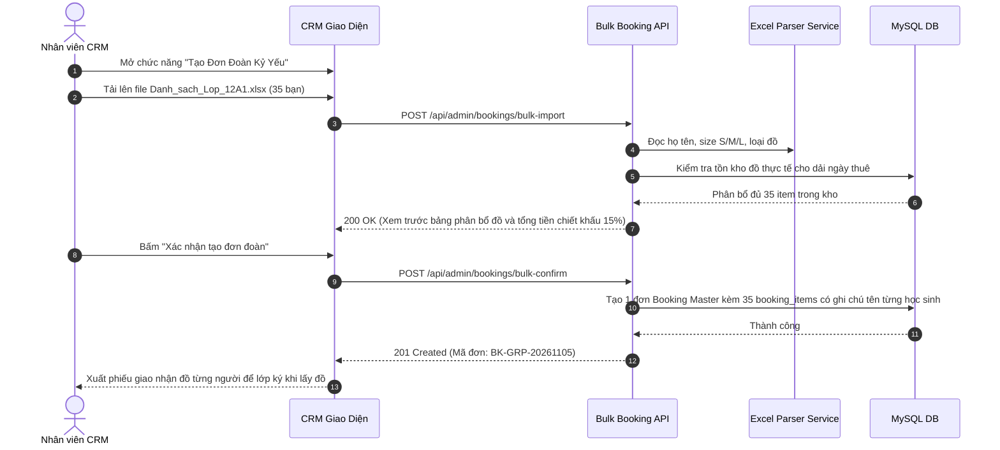

# Đặc Tả Tính Năng: Đơn Thuê Nhóm Kỷ Yếu Số Lượng Lớn

| Thuộc tính | Giá trị |
|---|---|
| **ID** | `BOK-008` |
| **Tên tính năng** | Hỗ trợ quản lý đơn thuê nhóm kỷ yếu, hội khóa số lượng lớn trên CRM |
| **Module** | BOK (Booking & Bulk Orders) |
| **Phạm vi** | CRM, SERVER |
| **Ưu tiên** | P2 - Tăng trưởng & B2B/School |
| **Trạng thái** | 📝 SPEC |
| **Người phụ trách** | Fullstack Dev & Tech Lead |
| **Ngày bắt đầu** | 2026-10-25 |
| **Ngày hoàn thành** | 2026-10-25 |
| **Phụ thuộc** | `BOK-001`, `BOK-002`, `BOK-003`, `BOK-004` |

---

## Mục Lục
1. [Mục Tiêu và Giá Trị Mang Lại](#1-mục-tiêu-và-giá-trị-mang-lại)
2. [Người Dùng Liên Quan](#2-người-dùng-liên-quan)
3. [Luồng Nghiệp Vụ Chính (Happy Path)](#3-luồng-nghiệp-vụ-chính-happy-path)
4. [Luồng Ngoại Lệ và Trường Hợp Biên](#4-luồng-ngoại-lệ-và-trường-hợp-biên)
5. [Quy Tắc Nghiệp Vụ (Business Rules)](#5-quy-tắc-nghiệp-vụ-business-rules)
6. [Giao Diện & Đa Ngôn Ngữ (UI & i18n)](#6-giao-diện--đa-ngôn-ngữ-ui--i18n)
7. [Đặc Tả API Backend](#7-đặc-tả-api-backend)
8. [Thay Đổi Cơ Sở Dữ Liệu](#8-thay-đổi-cơ-sở-dữ-liệu)
9. [Tiêu Chí Nghiệm Thu (Acceptance Criteria)](#9-tiêu-chí-nghiệm-thu-acceptance-criteria)
10. [Kế Hoạch Kiểm Thử](#10-kế-hoạch-kiểm-thử)
11. [Checklist Hoàn Thành (Definition of Done)](#11-checklist-hoàn-thành-definition-of-done)

---

## 1. Mục Tiêu và Giá Trị Mang Lại
- **Giải quyết bài toán đơn đoàn kỷ yếu (20 - 60 bạn học sinh/lớp)**: Vào mùa kỷ yếu (tháng 10 - 12 và tháng 4 - 5), các lớp thường thuê đồng loạt hàng chục bộ áo dài, cử nhân hoặc vest. Việc tạo từng đơn lẻ sẽ mất hàng giờ và dễ nhầm lẫn size.
- **Nhập danh sách nhanh bằng Excel (Bulk Import)**: Cho phép tải file mẫu Excel gồm: Tên học sinh, Giới tính, Chiều cao, Cân nặng, Size đồ đề xuất; hệ thống tự động phân bổ trang phục phù hợp trong kho.
- **Chiết khấu theo số lượng (Volume Discount)**: Tự động áp dụng mức giảm giá bậc thang: $\ge 15$ bộ giảm 10%, $\ge 30$ bộ giảm 15%, $\ge 45$ bộ giảm 20% và tặng kèm phụ kiện/máy ảnh.

---

## 2. Người Dùng Liên Quan
- [x] **Trưởng nhóm / Lớp trưởng**: Đại diện lớp gửi danh sách size đồ và đặt cọc 1 lần cho cả tập thể.
- [x] **Nhân viên CRM**: Tiếp nhận file danh sách lớp, tải lên CRM để hệ thống tự động gán đồ và in bảng danh sách giao nhận đồ theo từng cá nhân trong lớp.

---

## 3. Luồng Nghiệp Vụ Chính (Happy Path)

---

## 4. Luồng Ngoại Lệ và Trường Hợp Biên
- **Kho không đủ số lượng một size cụ thể (ví dụ lớp cần 20 size S nhưng kho chỉ còn 16)**: Hệ thống cảnh báo đỏ các dòng bị thiếu, gợi ý đổi sang size lân cận (Size M vừa vặn) hoặc liên hệ xưởng may đối tác tăng cường.
- **Đổi size cho 1 bạn trong lớp sát ngày chụp**: Hỗ trợ đổi item đơn lẻ của 1 thành viên trong đơn đoàn mà không làm ảnh hưởng đến cả đơn.

---

## 5. Quy Tắc Nghiệp Vụ (Business Rules)
- **BR-01**: Đơn nhóm được định nghĩa là đơn có số lượng trang phục từ **10 bộ trở lên**.
- **BR-02**: Đơn nhóm có 1 người đại diện pháp lý (Lớp trưởng/Đại diện hội đồng cha mẹ học sinh) đứng tên hợp đồng và chịu trách nhiệm tiền cọc.
- **BR-03**: Hỗ trợ xuất bảng Checklist giao nhận (Packing List) có tên từng bạn để tránh thất lạc khi cả lớp thử và nhận đồ.

---

## 6. Giao Diện & Đa Ngôn Ngữ (UI & i18n)
- **Giao diện**: Trang `/bookings/bulk-new` với khung kéo thả file Excel, bảng Preview chỉnh sửa size trực tiếp trên web, thanh tiến trình kho đồ đáp ứng.
- **Keys i18n**: Namespace `bulkBooking.*` (tải file mẫu, kiểm tra kho, xuất checklist).

---

## 7. Đặc Tả API Backend
- `POST /api/admin/bookings/bulk-parse`: Đọc và kiểm tra tính khả dụng của file Excel.
- `POST /api/admin/bookings/bulk-create`: Tạo đơn đoàn chính thức.
- `GET /api/admin/bookings/{id}/packing-list`: Tải file PDF checklist giao nhận từng thành viên.

---

## 8. Thay Đổi Cơ Sở Dữ Liệu
- Thêm trường `is_group_order BOOLEAN DEFAULT FALSE`, `group_name VARCHAR(100)` vào bảng `bookings`.
- Thêm trường `member_name VARCHAR(100)`, `member_phone VARCHAR(20)` vào bảng `booking_items` (Migration Flyway `V20__add_bulk_booking_support.sql`).

---

## 9. Tiêu Chí Nghiệm Thu (Acceptance Criteria)
- **Given**: File Excel 30 bạn lớp 12A.
- **When**: Nhân viên upload lên CRM.
- **Then**: Hệ thống đọc chính xác 30 bạn, tự động áp dụng chiết khấu 15% và gán đúng các item đồ còn trống trong kho.

---

## 10. Kế Hoạch Kiểm Thử
- **Unit Test**: `BulkExcelParserTest`, `BulkBookingServiceTest`.
- **E2E Playwright**: Upload file mock và tạo đơn đoàn thành công.
- **Coverage**: $\ge 85\%$.

---

## 11. Checklist Hoàn Thành (Definition of Done)
- [ ] Tài liệu đặc tả `BOK-008` hoàn thành.
- [ ] Cập nhật `FEATURES.md` và `CHANGELOG.md`.
