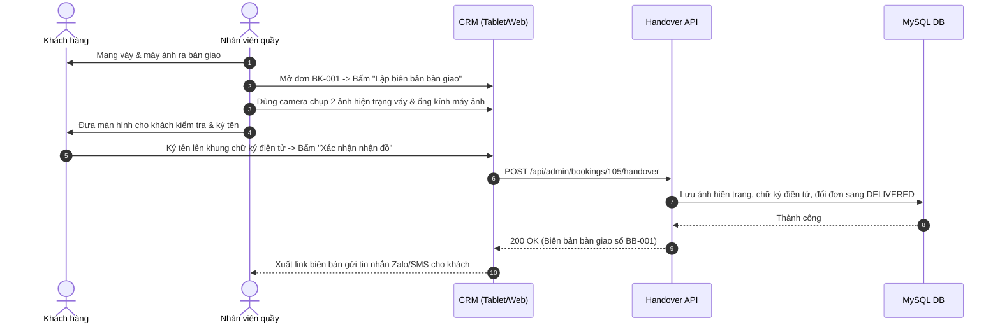

# Đặc Tả Tính Năng: Biên Bản Bàn Giao Đồ Kèm Ảnh Chụp Hiện Trạng

| Thuộc tính | Giá trị |
|---|---|
| **ID** | `BOK-009` |
| **Tên tính năng** | Biên bản bàn giao & tiếp nhận trang phục có chụp ảnh hiện trạng và chữ ký điện tử trên CRM |
| **Module** | BOK (Booking & Handover) |
| **Phạm vi** | CRM |
| **Ưu tiên** | P2 - Nâng cao trải nghiệm & Minh bạch |
| **Trạng thái** | 📝 SPEC |
| **Người phụ trách** | Fullstack Dev & Tech Lead |
| **Ngày bắt đầu** | 2026-10-25 |
| **Ngày hoàn thành** | 2026-10-25 |
| **Phụ thuộc** | `BOK-003`, `BOK-004`, `CAT-003` |

---

## Mục Lục
1. [Mục Tiêu và Giá Trị Mang Lại](#1-mục-tiêu-và-giá-trị-mang-lại)
2. [Người Dùng Liên Quan](#2-người-dùng-liên-quan)
3. [Luồng Nghiệp Vụ Chính (Happy Path)](#3-luồng-nghiệp-vụ-chính-happy-path)
4. [Luồng Ngoại Lệ và Trường Hợp Biên](#4-luồng-ngoại-lệ-và-trường-hợp-biên)
5. [Quy Tắc Nghiệp Vụ (Business Rules)](#5-quy-tắc-nghiệp-vụ-business-rules)
6. [Giao Diện & Đa Ngôn Ngữ (UI & i18n)](#6-giao-diện--đa-ngôn-ngữ-ui--i18n)
7. [Đặc Tả API Backend](#7-đặc-tả-api-backend)
8. [Thay Đổi Cơ Sở Dữ Liệu](#8-thay-đổi-cơ-sở-dữ-liệu)
9. [Tiêu Chí Nghiệm Thu (Acceptance Criteria)](#9-tiêu-chí-nghiệm-thu-acceptance-criteria)
10. [Kế Hoạch Kiểm Thử](#10-kế-hoạch-kiểm-thử)
11. [Checklist Hoàn Thành (Definition of Done)](#11-checklist-hoàn-thành-definition-of-done)

---

## 1. Mục Tiêu và Giá Trị Mang Lại
- **Chấm dứt mọi tranh chấp "lỗi có từ trước hay do khách làm"**: Khi khách thuê váy lụa hoặc máy ảnh đắt tiền, nhân viên chụp nhanh 1 - 3 tấm ảnh hiện trạng lúc khách nhận đồ (mặt trước, tà váy, phụ kiện kèm theo) và lúc khách trả đồ.
- **Ký nhận điện tử trực tiếp trên màn hình cảm ứng (E-Signature Pad)**: Khách hàng ký ngón tay/bút cảm ứng trên máy tính bảng tại quầy để xác nhận đã nhận đồ đúng mẫu, đúng size và nguyên vẹn.
- **Biên nhận gửi qua Zalo / Email**: Khách nhận được biên bản bàn giao điện tử dạng PDF/link web, có thể mở xem lại bất kỳ lúc nào.

---

## 2. Người Dùng Liên Quan
- [x] **Khách hàng**: Yên tâm nhận đồ, có ảnh chứng minh hiện trạng lúc lấy để không bị bắt đền oan khi trả.
- [x] **Nhân viên quầy**: Thao tác chụp ảnh 1 chạm bằng camera máy tính bảng/điện thoại và lưu trữ tập trung vào hồ sơ đơn hàng.

---

## 3. Luồng Nghiệp Vụ Chính (Happy Path)



---

## 4. Luồng Ngoại Lệ và Trường Hợp Biên
- **Khách thuê qua ship xa (không đến tiệm ký trực tiếp)**: Nhân viên chụp ảnh hiện trạng trước khi đóng gói gửi shipper; khách nhận hàng kiểm tra và bấm xác nhận qua link tra cứu đơn (`BOK-005`).

---

## 5. Quy Tắc Nghiệp Vụ (Business Rules)
- **BR-01**: Chữ ký điện tử được lưu trữ dạng ảnh Base64 / PNG vector bảo đảm tính pháp lý xác nhận dân sự.
- **BR-02**: Ảnh hiện trạng được lưu trữ an toàn tối thiểu 30 ngày sau khi đơn hoàn tất để giải quyết các trường hợp khiếu nại phát sinh.

---

## 6. Giao Diện & Đa Ngôn Ngữ (UI & i18n)
- **Component**: `HandoverModal`, `SignaturePad`, `CameraCaptureInput`.
- **Keys i18n**: Namespace `handover.*` (chụp ảnh hiện trạng, ký tên, hoàn tất bàn giao).

---

## 7. Đặc Tả API Backend
- `POST /api/admin/bookings/{id}/handover`: Lưu ảnh và chữ ký bàn giao khi giao đồ.
- `POST /api/admin/bookings/{id}/return-handover`: Lưu ảnh đối chứng khi khách trả đồ.
- `GET /api/public/bookings/{code}/handover-doc`: Khách xem biên bản bàn giao.

---

## 8. Thay Đổi Cơ Sở Dữ Liệu
- Tạo bảng `booking_handovers` (Migration Flyway `V21__create_booking_handovers_table.sql`):
```sql
CREATE TABLE `booking_handovers` (
    `id` BIGINT AUTO_INCREMENT PRIMARY KEY,
    `booking_id` BIGINT NOT NULL,
    `type` VARCHAR(20) NOT NULL, -- DELIVERY, RETURN
    `evidence_images` JSON NULL,
    `customer_signature_url` VARCHAR(255) NULL,
    `staff_note` VARCHAR(255) NULL,
    `created_by` VARCHAR(50) NOT NULL,
    `created_at` TIMESTAMP NOT NULL DEFAULT CURRENT_TIMESTAMP,
    CONSTRAINT `fk_handover_booking` FOREIGN KEY (`booking_id`) REFERENCES `bookings` (`id`)
);
```

---

## 9. Tiêu Chí Nghiệm Thu (Acceptance Criteria)
- **Given**: Đơn cọc chuẩn bị giao đồ.
- **When**: Nhân viên chụp 2 ảnh váy và khách ký tên vào bảng ký điện tử.
- **Then**: Đơn chuyển sang `DELIVERED`, biên bản lưu trữ thành công và hiển thị trong tab Lịch sử đơn hàng.

---

## 10. Kế Hoạch Kiểm Thử
- **Unit Test**: `HandoverServiceTest`.
- **Frontend Test**: `SignaturePad.test.tsx`.
- **Coverage**: $\ge 85\%$.

---

## 11. Checklist Hoàn Thành (Definition of Done)
- [ ] Tài liệu đặc tả `BOK-009` hoàn thành.
- [ ] Cập nhật `FEATURES.md` và `CHANGELOG.md`.
