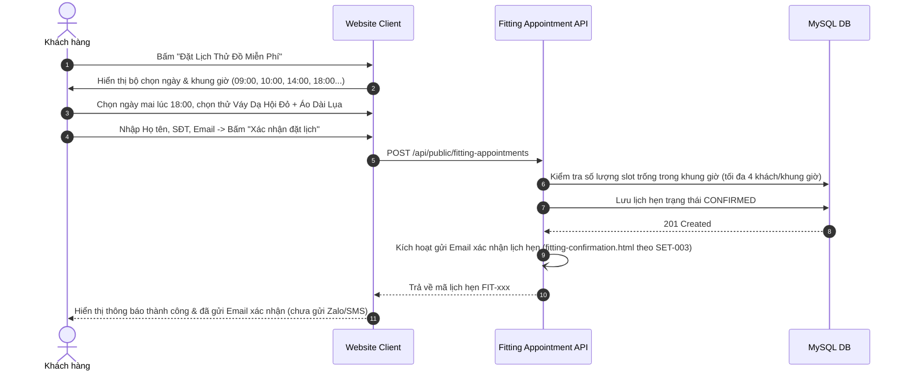

# Đặc Tả Tính Năng: Đặt Lịch Thử Đồ Tại Showroom

| Thuộc tính | Giá trị |
|---|---|
| **ID** | `BOK-010` |
| **Tên tính năng** | Đặt lịch hẹn thử đồ trực tiếp tại showroom trên Client & Điều phối lịch thử trên CRM |
| **Module** | BOK (Booking & Fitting Appointments) |
| **Phạm vi** | CLIENT, CRM, SERVER |
| **Ưu tiên** | P2 - Trải nghiệm khách hàng & Giảm tải tiệm |
| **Trạng thái** | 📝 SPEC |
| **Người phụ trách** | Fullstack Dev & Tech Lead |
| **Ngày bắt đầu** | 2026-10-25 |
| **Ngày hoàn thành** | 2026-10-25 |
| **Phụ thuộc** | `CAT-001`, `SET-001` |

---

## Mục Lục
1. [Mục Tiêu và Giá Trị Mang Lại](#1-mục-tiêu-và-giá-trị-mang-lại)
2. [Người Dùng Liên Quan](#2-người-dùng-liên-quan)
3. [Luồng Nghiệp Vụ Chính (Happy Path)](#3-luồng-nghiệp-vụ-chính-happy-path)
4. [Luồng Ngoại Lệ và Trường Hợp Biên](#4-luồng-ngoại-lệ-và-trường-hợp-biên)
5. [Quy Tắc Nghiệp Vụ (Business Rules)](#5-quy-tắc-nghiệp-vụ-business-rules)
6. [Giao Diện & Đa Ngôn Ngữ (UI & i18n)](#6-giao-diện--đa-ngôn-ngữ-ui--i18n)
7. [Đặc Tả API Backend](#7-đặc-tả-api-backend)
8. [Thay Đổi Cơ Sở Dữ Liệu](#8-thay-đổi-cơ-sở-dữ-liệu)
9. [Tiêu Chí Nghiệm Thu (Acceptance Criteria)](#9-tiêu-chí-nghiệm-thu-acceptance-criteria)
10. [Kế Hoạch Kiểm Thử](#10-kế-hoạch-kiểm-thử)
11. [Checklist Hoàn Thành (Definition of Done)](#11-checklist-hoàn-thành-definition-of-done)

---

## 1. Mục Tiêu và Giá Trị Mang Lại
- **Tránh tình trạng quá tải phòng thử đồ vào giờ cao điểm**: Khách thường dồn đến tiệm thử đồ vào các khung giờ 17h30 - 20h00 các ngày trong tuần và cả ngày Thứ 7 / Chủ Nhật, gây cảnh chen chúc và chờ đợi lâu.
- **Tiếp đón chu đáo (VIP Experience)**: Khi khách đặt hẹn trước và chọn sẵn 2 - 3 mẫu váy muốn thử trên web, nhân viên tiệm sẽ ủi phẳng và chuẩn bị sẵn đồ treo trong phòng thử trước khi khách đến.
- **Tăng tỷ lệ chốt đơn (Conversion Rate)**: Khách đến thử đồ thực tế có tỷ lệ chốt thuê trên 80% so với chỉ xem ảnh trên mạng.

---

## 2. Người Dùng Liên Quan
- [x] **Khách hàng**: Chọn ngày, khung giờ (Time slot 45 phút) và các mẫu váy muốn thử.
- [x] **Nhân viên CRM**: Xem lịch hẹn thử đồ trong ngày để chuẩn bị đồ sẵn sàng.

---

## 3. Luồng Nghiệp Vụ Chính (Happy Path)



---

## 4. Luồng Ngoại Lệ và Trường Hợp Biên
- **Khung giờ đã kín chỗ**: Hệ thống đánh dấu slot màu xám "Đã kín", gợi ý các khung giờ gần nhất còn trống.
- **Khách hủy lịch hẹn**: Khách có thể bấm hủy lịch qua link trong Email xác nhận để nhả slot cho người khác.

---

## 5. Quy Tắc Nghiệp Vụ (Business Rules)
- **BR-01**: Mỗi khung giờ (Time Slot) có thời lượng **45 phút**, tiếp nhận tối đa **4 lượt khách/slot** tương ứng với 4 phòng thử đồ của showroom.
- **BR-02**: Đặt lịch thử đồ là hoàn toàn **miễn phí**, không yêu cầu đặt cọc tiền.
- **BR-03**: Kênh thông báo xác nhận lịch hẹn là **Email** (`SET-003`), chưa thực hiện gửi thông báo qua Zalo hay SMS.

---

## 6. Giao Diện & Đa Ngôn Ngữ (UI & i18n)
- **Client**: Trang `/dat-lich-thu-do` hoặc Modal đặt lịch thử đồ nổi bật trên Header và chi tiết sản phẩm.
- **CRM**: Tab "Lịch Thử Đồ" trong CRM Calendar (`BOK-006`).
- **Keys i18n**: Namespace `fitting.*`.

---

## 7. Đặc Tả API Backend
- `GET /api/public/fitting-appointments/available-slots?date=2026-11-01`: Lấy các khung giờ khả dụng.
- `POST /api/public/fitting-appointments`: Khách gửi đăng ký lịch hẹn.
- `GET /api/admin/fitting-appointments`: Nhân viên xem danh sách hẹn trên CRM.
- `PATCH /api/admin/fitting-appointments/{id}/status`: Cập nhật trạng thái (`ARRIVED`, `CANCELLED`, `COMPLETED`).

---

## 8. Thay Đổi Cơ Sở Dữ Liệu
- Tạo bảng `fitting_appointments` (Migration Flyway `V22__create_fitting_appointments_table.sql`):
```sql
CREATE TABLE `fitting_appointments` (
    `id` BIGINT AUTO_INCREMENT PRIMARY KEY,
    `appointment_code` VARCHAR(50) NOT NULL UNIQUE,
    `customer_name` VARCHAR(100) NOT NULL,
    `customer_phone` VARCHAR(20) NOT NULL,
    `appointment_date` DATE NOT NULL,
    `time_slot` VARCHAR(20) NOT NULL, -- "09:00 - 09:45", "18:00 - 18:45"
    `wishlist_product_ids` JSON NULL,
    `status` VARCHAR(20) NOT NULL DEFAULT 'CONFIRMED', -- CONFIRMED, ARRIVED, CANCELLED, COMPLETED
    `note` VARCHAR(255) NULL,
    `created_at` TIMESTAMP NOT NULL DEFAULT CURRENT_TIMESTAMP,
    INDEX `idx_fitting_date_slot` (`appointment_date`, `time_slot`),
    INDEX `idx_fitting_phone` (`customer_phone`)
);
```

---

## 9. Tiêu Chí Nghiệm Thu (Acceptance Criteria)
- **Given**: Khách hàng truy cập trang đặt lịch thử đồ.
- **When**: Chọn khung giờ 18:00 ngày mai và bấm Đặt lịch.
- **Then**: Nhận được mã lịch hẹn thành công; CRM hiển thị lịch hẹn của khách kèm danh sách váy muốn thử.

---

## 10. Kế Hoạch Kiểm Thử
- **Unit Test**: `FittingAppointmentServiceTest` (kiểm tra giới hạn 4 khách/slot).
- **Frontend Test**: `FittingAppointmentModal.test.tsx`.
- **Coverage**: $\ge 85\%$.

---

## 11. Checklist Hoàn Thành (Definition of Done)
- [ ] Tài liệu đặc tả `BOK-010` hoàn thành.
- [ ] Cập nhật `FEATURES.md` và `CHANGELOG.md`.
