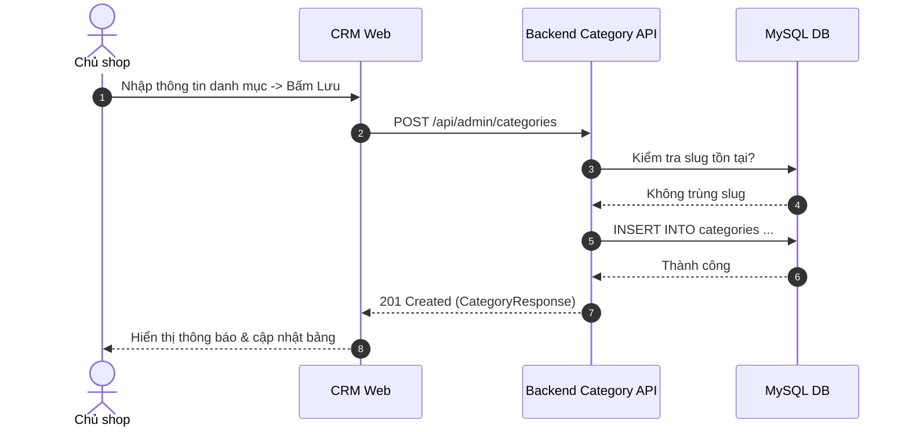

# Đặc Tả Tính Năng: Quản Lý Danh Mục Sản Phẩm

| Thuộc tính | Giá trị |
|---|---|
| **ID** | `CAT-001` |
| **Tên tính năng** | Quản lý danh mục sản phẩm (Category Management) |
| **Module** | CAT (Catalog) |
| **Phạm vi** | CRM, SERVER, CLIENT |
| **Ưu tiên** | P0 - MVP |
| **Trạng thái** | ✅ DONE |
| **Người phụ trách** | Fullstack Dev |
| **Ngày bắt đầu** | 2026-10-24 |
| **Ngày hoàn thành** | 2026-10-24 |
| **Phụ thuộc** | `AUTH-001`, `AUTH-002` |

---

## 1. Mục Tiêu và Giá Trị Mang Lại
Cung cấp khả năng phân loại các dòng sản phẩm cho thuê tại Chickie Studio (Váy thiết kế, Áo dài truyền thống, Áo dài cách tân, Máy ảnh du lịch, Phụ kiện chụp ảnh), giúp cấu trúc hóa menu điều hướng trên Website khách hàng và bộ lọc trên CRM.

## 2. Người Dùng Liên Quan
- [x] **Admin (Chủ shop)**: Thêm mới, chỉnh sửa tên, slug URL, icon, thứ tự hiển thị và kích hoạt/vô hiệu hóa danh mục.
- [x] **Khách hàng**: Lọc sản phẩm theo danh mục quan tâm trên website.

## 3. Luồng Chính (Happy Path)
1. Admin vào CRM `/categories`, hệ thống hiển thị danh sách dạng bảng `DataTable`.
2. Admin bấm "Thêm danh mục", hiển thị modal thêm mới.
3. Nhập tên danh mục (ví dụ: "Váy Thiết Kế"), slug tự động sinh ("vay-thiet-ke"), mô tả, thứ tự hiển thị (`displayOrder`).
4. Bấm "Lưu", CRM gửi `POST /api/admin/categories`.
5. Server kiểm tra tính duy nhất của slug, lưu vào bảng `categories`.
6. Server trả về dữ liệu danh mục mới; CRM đóng modal, invalidate query và hiển thị toast thành công.



## 4. Luồng Ngoại Lệ và Trường Hợp Biên
- **Trùng slug hoặc tên danh mục**: Server trả về `409 Conflict` với thông báo "Tên danh mục hoặc đường dẫn URL đã tồn tại".
- **Xóa danh mục đang có sản phẩm**: Server từ chối xóa và trả về `400 Bad Request` yêu cầu chuyển sản phẩm sang danh mục khác trước.

## 5. Quy Tắc Nghiệp Vụ
- **BR-01**: Mỗi danh mục bắt buộc có tên tiếng Việt, slug duy nhất (chỉ chứa chữ thường, số, dấu gạch ngang).
- **BR-02**: Thứ tự hiển thị (`displayOrder`) quy định vị trí ưu tiên xuất hiện trên Menu Client từ nhỏ đến lớn.

## 6. Giao Diện & Đa Ngôn Ngữ (UI & i18n)
- **Màn hình**: Trang quản lý danh mục gồm `DataTable`, `FilterBar`, nút tạo mới và modal form Zod validation.
- **Component dùng chung**: `DataTable`, `ConfirmModal`, `FormField`.
- **Keys i18n (`vi.json` / `en.json`)**:
```json
{
  "category": {
    "title": "Quản Lý Danh Mục",
    "addCategory": "Thêm danh mục",
    "name": "Tên danh mục",
    "slug": "Đường dẫn URL (slug)",
    "displayOrder": "Thứ tự hiển thị",
    "status": "Trạng thái",
    "deleteConfirm": "Bạn có chắc chắn muốn xóa danh mục này không?"
  }
}
```

## 7. Đặc Tả API
| Method | Endpoint | Quyền truy cập | Request Body | Response Body | Mã lỗi |
|---|---|---|---|---|---|
| `GET` | `/api/public/categories` | Public | Không | `ApiResponse<List<CategoryResponse>>` | 500 |
| `POST` | `/api/admin/categories` | `ROLE_ADMIN` | `CreateCategoryRequest` | `ApiResponse<CategoryResponse>` | 400, 409 |
| `PUT` | `/api/admin/categories/{id}` | `ROLE_ADMIN` | `UpdateCategoryRequest` | `ApiResponse<CategoryResponse>` | 400, 404, 409 |
| `DELETE`| `/api/admin/categories/{id}` | `ROLE_ADMIN` | Không | `ApiResponse<Void>` | 400, 404 |

## 8. Thay Đổi Cơ Sở Dữ Liệu
- **File Migration Flyway**: `V3__create_categories_table.sql`
```sql
CREATE TABLE `categories` (
    `id` BIGINT AUTO_INCREMENT PRIMARY KEY,
    `name` VARCHAR(100) NOT NULL,
    `slug` VARCHAR(120) NOT NULL UNIQUE,
    `description` TEXT,
    `icon_url` VARCHAR(255),
    `display_order` INT NOT NULL DEFAULT 0,
    `is_active` BOOLEAN NOT NULL DEFAULT TRUE,
    `created_at` TIMESTAMP NOT NULL DEFAULT CURRENT_TIMESTAMP,
    `updated_at` TIMESTAMP NOT NULL DEFAULT CURRENT_TIMESTAMP ON UPDATE CURRENT_TIMESTAMP,
    INDEX `idx_categories_slug` (`slug`),
    INDEX `idx_categories_order` (`display_order`)
) ENGINE=InnoDB DEFAULT CHARSET=utf8mb4 COLLATE=utf8mb4_unicode_ci;
```

## 9. Tiêu Chí Nghiệm Thu (Acceptance Criteria)
- [x] **Kịch bản 1**: Thêm mới danh mục "Áo Dài Cách Tân", slug `ao-dai-cach-tan` lưu thành công và xuất hiện trên API public.
- [x] **Kịch bản 2**: Thêm danh mục trùng slug báo lỗi 409 ngay trên modal form.

## 10. Kế Hoạch Test
- **Unit Test**: Test CategoryService tạo, cập nhật, kiểm tra slug trùng lặp.
- **Integration Test**: Test API public lấy danh mục active, API admin thêm/sửa/xóa.
- **UI Test**: Test render DataTable danh mục và submit modal.
- **Mục tiêu Coverage**: $\ge 80\%$.

## 11. Checklist Hoàn Thành (Definition of Done)
- [x] Backend phân tầng Service-Repo-Controller, DTO MapStruct đầy đủ.
- [x] CRM dùng chung `DataTable` và Zod form.
- [x] i18n đầy đủ cho cả `vi.json` và `en.json`.
- [x] Test coverage $\ge 80\%$.
- [x] Cập nhật `docs/FEATURES.md` và `docs/CHANGELOG.md`.

## 12. Nhật Ký Thực Hiện
| Ngày | Người thực hiện | Nội dung thay đổi | Trạng thái mới |
|---|---|---|---|
| 2026-10-24 | Fullstack Dev | Triển khai hoàn chỉnh V3 Migration, API Spring Boot, CRM CategoriesPage, Client dynamic grid, test coverage $\ge 85\%$ | ✅ DONE |
| 2026-10-24 | Tech Lead | Soạn thảo tài liệu đặc tả ban đầu | 📝 SPEC |
