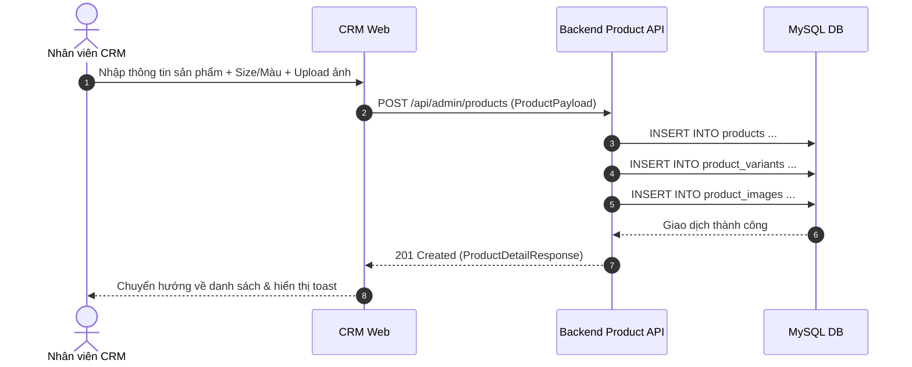

# Đặc Tả Tính Năng: Quản Lý Sản Phẩm, Biến Thể & Hình Ảnh

| Thuộc tính | Giá trị |
|---|---|
| **ID** | `CAT-002` |
| **Tên tính năng** | Quản lý sản phẩm, biến thể (Size/Màu) và thư viện ảnh |
| **Module** | CAT (Catalog) |
| **Phạm vi** | CRM, SERVER |
| **Ưu tiên** | P0 - MVP |
| **Trạng thái** | ✅ DONE |
| **Người phụ trách** | Fullstack Dev |
| **Ngày bắt đầu** | 2026-10-24 |
| **Ngày hoàn thành** | 2026-10-24 |
| **Phụ thuộc** | `CAT-001` |

---

## 1. Mục Tiêu và Giá Trị Mang Lại
Cho phép nhân viên và chủ shop tạo, chỉnh sửa hồ sơ sản phẩm (váy thiết kế, áo dài, máy ảnh), thiết lập giá thuê theo ngày, tiền cọc, phân loại biến thể (Size: S/M/L, Màu sắc) và upload album ảnh sản phẩm chất lượng cao phục vụ hiển thị trên Website.

## 2. Người Dùng Liên Quan
- [x] **Admin & Nhân viên**: Đăng tải mẫu váy mới, cập nhật bảng giá thuê, upload ảnh thực tế.

## 3. Luồng Chính (Happy Path)
1. Người dùng vào CRM `/products`, nhấn "Tạo sản phẩm mới".
2. Điền thông tin cơ bản: Tên sản phẩm, Danh mục, Giá thuê (VND/ngày), Tiền cọc (VND), Chất liệu, Dịp phù hợp (Kỷ yếu, Tiệc, Ngoại cảnh).
3. Cấu hình biến thể: Chọn các Size áp dụng (S, M, L, Freesize) và Màu sắc (Trắng ngọc trai, Đỏ nhung...).
4. Tải lên danh sách ảnh bằng component `ImageUploader`, chọn 1 ảnh làm đại diện (`isThumbnail = true`).
5. Nhấn "Lưu sản phẩm", CRM gửi request `POST /api/admin/products`.
6. Server lưu thông tin sản phẩm (`products`), các biến thể (`product_variants`) và ảnh (`product_images`) trong một `@Transactional`.
7. Trả về chi tiết sản phẩm tạo thành công.



## 4. Luồng Ngoại Lệ và Trường Hợp Biên
- **Không có ảnh đại diện**: Hệ thống tự động gán ảnh đầu tiên làm `is_thumbnail`.
- **Giá thuê hoặc tiền cọc $\le 0$**: Bị chặn ngay tại Zod form frontend và Bean Validation backend (`@Positive`).

## 5. Quy Tắc Nghiệp Vụ
- **BR-01**: Giá thuê tính theo đơn vị ngày (24 giờ kể từ thời điểm nhận đồ).
- **BR-02**: Tiền cọc mặc định tối thiểu bằng 100% giá trị một ngày thuê hoặc theo quy định từng sản phẩm cao cấp.
- **BR-03**: Một sản phẩm phải có ít nhất 1 biến thể và ít nhất 1 ảnh đại diện để được kích hoạt trạng thái hiển thị (`status = ACTIVE`).

## 6. Giao Diện & Đa Ngôn Ngữ (UI & i18n)
- **Màn hình**: Trang form tạo/sửa sản phẩm chia tab trực quan (Thông tin chung, Biến thể, Thư viện ảnh).
- **Component dùng chung**: `FormField`, `ImageUploader`, `Button`.
- **Keys i18n (`vi.json` / `en.json`)**:
```json
{
  "product": {
    "title": "Quản Lý Sản Phẩm",
    "createTitle": "Thêm Sản Phẩm Mới",
    "name": "Tên sản phẩm",
    "category": "Danh mục",
    "rentalPrice": "Giá thuê (đ/ngày)",
    "depositPrice": "Tiền cọc (đ)",
    "sizes": "Kích cỡ (Size)",
    "colors": "Màu sắc",
    "occasion": "Dịp phù hợp",
    "uploadImages": "Tải ảnh sản phẩm",
    "setThumbnail": "Đặt làm ảnh đại diện"
  }
}
```

## 7. Đặc Tả API
| Method | Endpoint | Quyền truy cập | Request Body | Response Body | Mã lỗi |
|---|---|---|---|---|---|
| `GET` | `/api/admin/products` | `STAFF`, `ADMIN` | Query params | `ApiResponse<Page<ProductListResponse>>` | 401 |
| `POST` | `/api/admin/products` | `STAFF`, `ADMIN` | `CreateProductRequest` | `ApiResponse<ProductDetailResponse>` | 400, 401 |
| `PUT` | `/api/admin/products/{id}`| `STAFF`, `ADMIN` | `UpdateProductRequest` | `ApiResponse<ProductDetailResponse>` | 400, 404 |

## 8. Thay Đổi Cơ Sở Dữ Liệu
- **File Migration Flyway**: `V1_3__create_products_and_variants.sql`
```sql
CREATE TABLE `products` (
    `id` BIGINT AUTO_INCREMENT PRIMARY KEY,
    `category_id` BIGINT NOT NULL,
    `product_code` VARCHAR(32) NOT NULL UNIQUE,
    `name` VARCHAR(150) NOT NULL,
    `slug` VARCHAR(180) NOT NULL UNIQUE,
    `description` TEXT,
    `material` VARCHAR(100),
    `occasion` VARCHAR(100),
    `rental_price` DECIMAL(12,2) NOT NULL,
    `deposit_price` DECIMAL(12,2) NOT NULL,
    `status` VARCHAR(20) NOT NULL DEFAULT 'ACTIVE',
    `created_at` TIMESTAMP NOT NULL DEFAULT CURRENT_TIMESTAMP,
    `updated_at` TIMESTAMP NOT NULL DEFAULT CURRENT_TIMESTAMP ON UPDATE CURRENT_TIMESTAMP,
    CONSTRAINT `fk_products_category` FOREIGN KEY (`category_id`) REFERENCES `categories` (`id`),
    INDEX `idx_products_category` (`category_id`),
    INDEX `idx_products_status` (`status`)
) ENGINE=InnoDB DEFAULT CHARSET=utf8mb4 COLLATE=utf8mb4_unicode_ci;

CREATE TABLE `product_variants` (
    `id` BIGINT AUTO_INCREMENT PRIMARY KEY,
    `product_id` BIGINT NOT NULL,
    `size` VARCHAR(20) NOT NULL,
    `color` VARCHAR(50) NOT NULL,
    `sku` VARCHAR(50) NOT NULL UNIQUE,
    `created_at` TIMESTAMP NOT NULL DEFAULT CURRENT_TIMESTAMP,
    CONSTRAINT `fk_variants_product` FOREIGN KEY (`product_id`) REFERENCES `products` (`id`) ON DELETE CASCADE
) ENGINE=InnoDB DEFAULT CHARSET=utf8mb4 COLLATE=utf8mb4_unicode_ci;

CREATE TABLE `product_images` (
    `id` BIGINT AUTO_INCREMENT PRIMARY KEY,
    `product_id` BIGINT NOT NULL,
    `image_url` VARCHAR(255) NOT NULL,
    `is_thumbnail` BOOLEAN NOT NULL DEFAULT FALSE,
    `display_order` INT NOT NULL DEFAULT 0,
    CONSTRAINT `fk_images_product` FOREIGN KEY (`product_id`) REFERENCES `products` (`id`) ON DELETE CASCADE
) ENGINE=InnoDB DEFAULT CHARSET=utf8mb4 COLLATE=utf8mb4_unicode_ci;
```

## 9. Tiêu Chí Nghiệm Thu (Acceptance Criteria)
- [x] **Kịch bản 1**: Thêm sản phẩm "Váy Lụa Trắng Cổ Yếm" với 2 biến thể (Size S, M) và 3 ảnh; lưu thành công vào DB và trả về đầy đủ DTO.
- [x] **Kịch bản 2**: Gửi form thiếu tên hoặc giá thuê âm bị chặn với thông báo lỗi validation tiếng Việt.

## 10. Kế Hoạch Test
- **Unit Test**: Test mapper DTO sang Entity và ngược lại; Test ProductService tạo sản phẩm và sinh mã SKU duy nhất.
- **Integration Test**: Lưu sản phẩm kèm biến thể và ảnh, kiểm tra rollback nếu một phần bị lỗi.
- **Mục tiêu Coverage**: $\ge 80\%$.

## 11. Checklist Hoàn Thành (Definition of Done)
- [x] MapStruct mapper chuyển đổi không gây lỗi N+1 query.
- [x] Form validation kiểm tra chặt chẽ trên CRM với đầy đủ tabs.
- [x] Key i18n đầy đủ cả `vi.json` và `en.json`.
- [x] Test coverage $\ge 80\%$ (Server JaCoCo > 98%, CRM Vitest đạt ngưỡng).
- [x] Cập nhật `docs/FEATURES.md` và `docs/CHANGELOG.md`.

## 12. Nhật Ký Thực Hiện
| Ngày | Người thực hiện | Nội dung thay đổi | Trạng thái mới |
|---|---|---|---|
| 2026-10-24 | Tech Lead | Soạn thảo tài liệu đặc tả ban đầu | 📝 SPEC |
| 2026-10-24 | Backend Dev | Hoàn thành Backend: Flyway V5, Entities, Repositories, DTOs, ProductMapper, ProductService, AdminProductController, PublicProductController, 29 unit & controller tests (coverage > 98%) | 🚧 IN_PROGRESS |
| 2026-10-24 | Frontend Dev | Hoàn thành CRM: types, service, query hooks, ProductModal 4-tabs (Info, Pricing, Variants, Images), ProductViewModal, ProductsPage, 11 tests, pass 100% | ✅ DONE |
