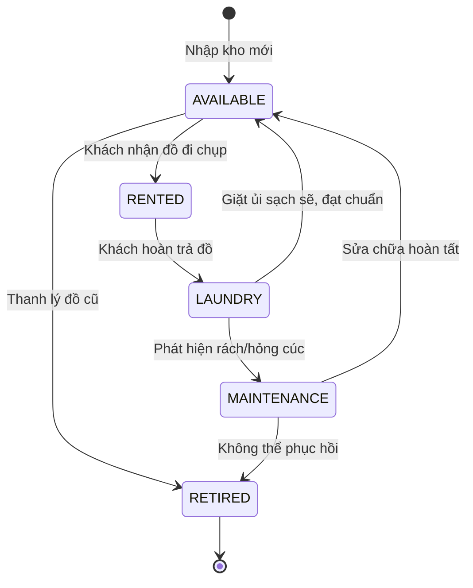

# Đặc Tả Tính Năng: Quản Lý Món Đồ Thực Tế & Vòng Đời Trạng Thái

| Thuộc tính | Giá trị |
|---|---|
| **ID** | `CAT-003` |
| **Tên tính năng** | Quản lý từng món đồ thực tế (Item Instance) và vòng đời trạng thái |
| **Module** | CAT (Catalog) |
| **Phạm vi** | CRM, SERVER |
| **Ưu tiên** | P0 - MVP |
| **Trạng thái** | 📝 SPEC |
| **Người phụ trách** | Backend Lead / CRM Dev |
| **Ngày bắt đầu** | - |
| **Ngày hoàn thành** | - |
| **Phụ thuộc** | `CAT-002` |

---

## 1. Mục Tiêu và Giá Trị Mang Lại
Trong dịch vụ cho thuê đồ, một mẫu váy Size S có thể có 3 chiếc thực tế được treo tại cửa hàng. Tính năng này quản lý từng chiếc váy/chiếc máy ảnh vật lý cụ thể (mỗi món có mã Barcode/Mã đồ riêng) và theo dõi chính xác trạng thái vật lý (sẵn sàng, đang thuê, giặt ủi, sửa chữa, thanh lý) để phục vụ việc xếp lịch cho thuê không bao giờ bị trùng.

## 2. Người Dùng Liên Quan
- [x] **Nhân viên cửa hàng**: Quét mã đồ khi giao đồ cho khách, chuyển trạng thái sang giặt ủi sau khi nhận lại, chuyển sang sửa chữa nếu bị bung cúc/sờn chỉ.
- [x] **Admin**: Theo dõi số lần cho thuê của từng chiếc váy để có kế hoạch bảo dưỡng hoặc thanh lý.

## 3. Luồng Chính (Happy Path)
1. Sau khi tạo biến thể (ví dụ: Váy Lụa Trắng - Size S), nhân viên nhấn "Thêm đồ thực tế vào kho".
2. Hệ thống tự động sinh mã Barcode duy nhất (ví dụ: `CK-DR-001-S-01`).
3. Nhân viên dán tem barcode lên mác váy, lưu món đồ với trạng thái ban đầu là `AVAILABLE` (Sẵn sàng).
4. Vòng đời trạng thái của một món đồ diễn ra như sau:
   - Khi giao cho khách: chuyển sang `RENTED` (Đang thuê).
   - Khi khách trả đồ: chuyển sang `LAUNDRY` (Giặt ủi).
   - Sau khi tiệm giặt sấy xong: nhân viên kiểm tra chất lượng và chuyển lại `AVAILABLE`.
   - Nếu phát hiện hư hỏng: chuyển sang `MAINTENANCE` (Sửa chữa).
   - Đồ quá cũ sau nhiều lần thuê: chuyển sang `RETIRED` (Ngừng cho thuê).



## 4. Luồng Ngoại Lệ và Trường Hợp Biên
- **Cố tình xếp lịch cho món đồ đang ở trạng thái `MAINTENANCE` hoặc `RETIRED`**: Hệ thống báo lỗi và không cho phép gán món đồ này vào đơn thuê mới.
- **Trùng mã Barcode vật lý**: Báo lỗi `409 Conflict`.

## 5. Quy Tắc Nghiệp Vụ
- **BR-01**: Trạng thái hợp lệ gồm: `AVAILABLE`, `RENTED`, `LAUNDRY`, `MAINTENANCE`, `RETIRED`.
- **BR-02**: Chỉ những món đồ ở trạng thái `AVAILABLE` mới đủ điều kiện phân bổ cho các đơn thuê mới.
- **BR-03**: Hệ thống tự động tăng biến đếm `rental_count` mỗi khi món đồ hoàn thành 1 lượt thuê.

## 6. Giao Diện & Đa Ngôn Ngữ (UI & i18n)
- **Màn hình**: Tab "Kho đồ thực tế" trong chi tiết sản phẩm CRM; bảng danh sách từng chiếc đồ kèm Tag màu trạng thái trực quan, nút thao tác đổi trạng thái nhanh.
- **Component dùng chung**: `DataTable`, `ConfirmModal`.
- **Keys i18n (`vi.json` / `en.json`)**:
```json
{
  "productItem": {
    "itemCode": "Mã đồ vật lý",
    "status": "Trạng thái đồ",
    "rentalCount": "Số lần đã thuê",
    "status_AVAILABLE": "Sẵn sàng",
    "status_RENTED": "Đang cho thuê",
    "status_LAUNDRY": "Đang giặt ủi",
    "status_MAINTENANCE": "Đang sửa chữa",
    "status_RETIRED": "Ngừng cho thuê",
    "changeStatus": "Chuyển trạng thái"
  }
}
```

## 7. Đặc Tả API
| Method | Endpoint | Quyền truy cập | Request Body | Response Body | Mã lỗi |
|---|---|---|---|---|---|
| `GET` | `/api/admin/products/{productId}/items` | `STAFF`, `ADMIN` | Không | `ApiResponse<List<ProductItemResponse>>` | 404 |
| `POST` | `/api/admin/product-variants/{variantId}/items` | `STAFF`, `ADMIN` | `CreateItemRequest` | `ApiResponse<ProductItemResponse>` | 400, 409 |
| `PATCH`| `/api/admin/product-items/{itemId}/status` | `STAFF`, `ADMIN` | `UpdateItemStatusRequest` | `ApiResponse<ProductItemResponse>` | 400, 404 |

## 8. Thay Đổi Cơ Sở Dữ Liệu
- **File Migration Flyway**: `V1_4__create_product_items.sql`
```sql
CREATE TABLE `product_items` (
    `id` BIGINT AUTO_INCREMENT PRIMARY KEY,
    `variant_id` BIGINT NOT NULL,
    `item_code` VARCHAR(50) NOT NULL UNIQUE,
    `status` VARCHAR(30) NOT NULL DEFAULT 'AVAILABLE',
    `rental_count` INT NOT NULL DEFAULT 0,
    `note` VARCHAR(255),
    `created_at` TIMESTAMP NOT NULL DEFAULT CURRENT_TIMESTAMP,
    `updated_at` TIMESTAMP NOT NULL DEFAULT CURRENT_TIMESTAMP ON UPDATE CURRENT_TIMESTAMP,
    CONSTRAINT `fk_items_variant` FOREIGN KEY (`variant_id`) REFERENCES `product_variants` (`id`) ON DELETE CASCADE,
    INDEX `idx_items_code` (`item_code`),
    INDEX `idx_items_status` (`status`)
) ENGINE=InnoDB DEFAULT CHARSET=utf8mb4 COLLATE=utf8mb4_unicode_ci;
```

## 9. Tiêu Chí Nghiệm Thu (Acceptance Criteria)
- [ ] **Kịch bản 1**: Thêm 2 chiếc váy vật lý cho biến thể Size S, sinh mã `CK-DR-001-S-01` và `CK-DR-001-S-02`, trạng thái mặc định `AVAILABLE`.
- [ ] **Kịch bản 2**: Chuyển trạng thái từ `RENTED` sang `LAUNDRY` khi khách trả đồ, lịch sử và trạng thái cập nhật chính xác.

## 10. Kế Hoạch Test
- **Unit Test**: Test chuyển trạng thái hợp lệ và bất hợp lệ (ví dụ: từ RETIRED không thể nhảy sang RENTED).
- **Integration Test**: Kiểm tra truy vấn danh sách món đồ khả dụng.
- **Mục tiêu Coverage**: $\ge 80\%$.

## 11. Checklist Hoàn Thành (Definition of Done)
- [ ] Logic trạng thái được kiểm soát chặt bằng Enum Java và TypeScript.
- [ ] Giao diện CRM đổi trạng thái nhanh có xác nhận qua ConfirmModal.
- [ ] i18n đầy đủ cho tất cả nhãn trạng thái.
- [ ] Test coverage $\ge 80\%$.
- [ ] Cập nhật `docs/FEATURES.md` và `docs/CHANGELOG.md`.

## 12. Nhật Ký Thực Hiện
| Ngày | Người thực hiện | Nội dung thay đổi | Trạng thái mới |
|---|---|---|---|
| 2026-10-24 | Tech Lead | Soạn thảo tài liệu đặc tả ban đầu | 📝 SPEC |
