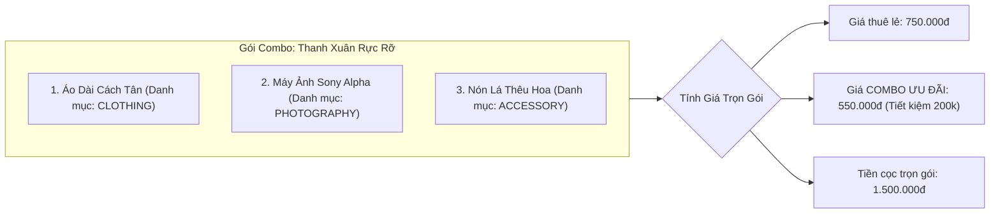
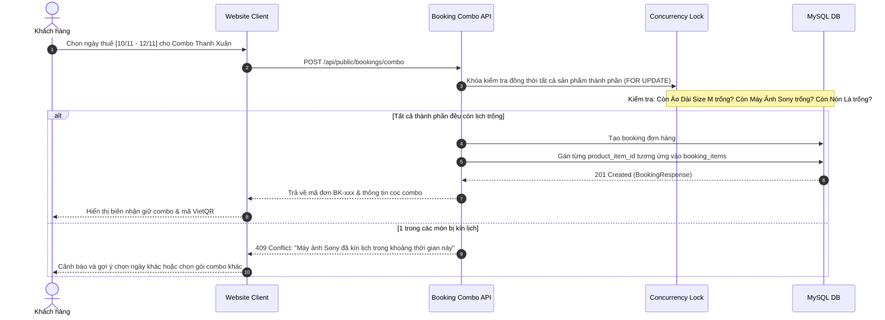

# Đặc Tả Tính Năng: Quản Lý Gói Combo (Váy + Máy Ảnh + Phụ Kiện)

| Thuộc tính | Giá trị |
|---|---|
| **ID** | `CAT-004` |
| **Tên tính năng** | Quản lý gói combo trọn gói (Váy + Máy ảnh + Phụ kiện) với giá ưu đãi |
| **Module** | CAT (Catalog & Products) |
| **Phạm vi** | CRM, SERVER, CLIENT |
| **Ưu tiên** | P1 - Vận hành cốt lõi |
| **Trạng thái** | 📝 SPEC |
| **Người phụ trách** | Fullstack Dev & Tech Lead |
| **Ngày bắt đầu** | 2026-10-25 |
| **Ngày hoàn thành** | 2026-10-25 |
| **Phụ thuộc** | `CAT-001`, `CAT-002`, `BOK-001`, `BOK-002` |

---

## Mục Lục
1. [Mục Tiêu và Giá Trị Mang Lại](#1-mục-tiêu-và-giá-trị-mang-lại)
2. [Người Dùng Liên Quan](#2-người-dùng-liên-quan)
3. [Luồng Nghiệp Vụ Chính (Happy Path)](#3-luồng-nghiệp-vụ-chính-happy-path)
4. [Luồng Ngoại Lệ và Trường Hợp Biên](#4-luồng-ngoại-lệ-và-trường-hợp-biên)
5. [Quy Tắc Nghiệp Vụ (Business Rules)](#5-quy-tắc-nghiệp-vụ-business-rules)
6. [Giao Diện & Đa Ngôn Ngữ (UI & i18n)](#6-giao-diện--đa-ngôn-ngữ-ui--i18n)
7. [Đặc Tả API Backend](#7-đặc-tả-api-backend)
8. [Thay Đổi Cơ Sở Dữ Liệu](#8-thay-đổi-cơ-sở-dữ-liệu)
9. [Tiêu Chí Nghiệm Thu (Acceptance Criteria)](#9-tiêu-chí-nghiệm-thu-acceptance-criteria)
10. [Kế Hoạch Kiểm Thử](#10-kế-hoạch-kiểm-thử)
11. [Checklist Hoàn Thành (Definition of Done)](#11-checklist-hoàn-thành-definition-of-done)

---

## 1. Mục Tiêu và Giá Trị Mang Lại
- **Gia tăng giá trị trung bình mỗi đơn thuê (AOV - Average Order Value)**: Thay vì khách chỉ thuê một chiếc váy đơn lẻ, tiệm đóng gói thành combo trọn gói tiện lợi (ví dụ: *Combo Nàng Thơ = Váy Dạ Hội Lụa + Máy Ảnh Du Lịch Sony + Giỏ Hoa/Băng Đô*) với giá ưu đãi tiết kiệm từ 15% - 25% so với thuê lẻ từng món.
- **Tiện lợi tối đa cho khách đi chụp ảnh ngoại cảnh**: Khách hàng (đặc biệt là học sinh, sinh viên chụp kỷ yếu hoặc cặp đôi du lịch) không cần phải tìm tiệm thuê máy ảnh riêng; nhận và trả tất cả thiết bị tại một địa chỉ duy nhất.
- **Khóa an toàn đồng thời đa sản phẩm (Multi-resource Atomic Lock)**: Đảm bảo khi khách đặt thuê 1 combo, toàn bộ các món đồ thành phần đều phải còn trống lịch và được khóa đồng thời trong 1 giao dịch duy nhất, không bao giờ xảy ra tình trạng có váy nhưng thiếu máy ảnh.

---

## 2. Người Dùng Liên Quan
- [x] **Khách hàng**: Dễ dàng lựa chọn và đặt thuê các set đồ phối sẵn hoàn chỉnh với mức giá trọn gói ưu đãi.
- [x] **Nhân viên & Admin**: Tạo gói combo, thiết lập mức giá thuê & cọc ưu đãi, quản lý các sản phẩm thành phần trong từng gói trên CRM.

---

## 3. Luồng Nghiệp Vụ Chính (Happy Path)

### 3.1. Cấu Trúc Thành Phần Gói Combo



### 3.2. Sơ Đồ Trình Tự Đặt Thuê Combo Đa Sản Phẩm



---

## 4. Luồng Ngoại Lệ và Trường Hợp Biên

| Tình huống ngoại lệ | Xử lý của hệ thống | Phản hồi giao diện |
|---|---|---|
| **1 trong các món đồ của combo bị kín lịch** | Giao dịch rollback ngay lập tức, không giữ đồ dở dang | Hiển thị thông báo chi tiết: *"Món đồ [Tên sản phẩm] trong combo đã kín lịch trong khoảng thời gian đã chọn. Vui lòng chọn dải ngày khác."* |
| **Admin vô hiệu hóa combo khi đã có đơn đặt** | Các đơn đặt trước vẫn có hiệu lực bình thường; chỉ ẩn combo khỏi danh sách công khai trên Client | Client không còn hiển thị combo, đơn cũ trong CRM vẫn truy xuất đầy đủ thông tin |
| **Thay đổi sản phẩm trong combo** | Chỉ áp dụng cho các lượt đặt đơn mới; đơn cũ giữ nguyên cấu trúc thành phần tại thời điểm đặt | CRM lưu snapshot các món đồ trong `booking_items` độc lập |

---

## 5. Quy Tắc Nghiệp Vụ (Business Rules)

- **BR-01 (Số lượng thành phần tối thiểu)**: Một gói combo bắt buộc phải chứa ít nhất **2 sản phẩm khác nhau** (thông thường kết hợp giữa Trang phục + Máy ảnh hoặc Trang phục + Phụ kiện).
- **BR-02 (Quy tắc đệm giặt ủi theo từng món độc lập)**: Khi đặt combo, ngày đệm an toàn `bufferDays` được tính độc lập cho từng món đồ theo danh mục của nó (`BOK-002`):
  - Trang phục: Tự động cộng thêm `bufferDays = 1` ngày sau ngày trả để giặt hấp.
  - Máy ảnh: `bufferDays = 0` ngày (kiểm tra pin và thẻ nhớ giao ngay).
- **BR-03 (Toàn vẹn đơn hàng - Atomic Transaction)**: Toàn bộ quá trình giữ chỗ các món đồ trong combo phải nằm trong 1 Transaction cơ sở dữ liệu `@Transactional`. Nếu bất kỳ món đồ nào hết slot, toàn bộ đơn bị hủy bỏ (All or Nothing).

---

## 6. Giao Diện & Đa Ngôn Ngữ (UI & i18n)

### 6.1. Thiết Kế Màn Hình Quản Lý Combo CRM (`crm/src/pages/combos/CombosPage.tsx`)
- **PageHeader**: "Quản Lý Gói Combo", nút `[ + Tạo Gói Combo Mới ]`.
- **Bảng Danh Sách (`DataTable`)**:
  - Cột: Ảnh đại diện, Tên Combo, Danh sách sản phẩm thành phần (hiển thị dạng các Tag nhỏ kèm icon), Giá thuê combo, Tiền cọc, Trạng thái (`ACTIVE` / `INACTIVE`), Thao tác (Sửa, Xóa).
- **Modal Tạo / Sửa Combo (`ComboFormModal`)**:
  - Tên gói combo, Slug URL, Mô tả ngắn, Ảnh bìa.
  - Khung chọn sản phẩm thành phần: Tìm kiếm và thêm sản phẩm kèm số lượng.
  - Ô nhập Giá thuê ưu đãi và Tiền cọc trọn gói.

### 6.2. Bộ Từ Điển Đa Ngôn Ngữ (`vi.json` / `en.json`)

```json
{
  "combo": {
    "title": "Gói Combo Trọn Gói",
    "subtitle": "Set đồ thuê ưu đãi phối sẵn trang phục, máy ảnh và phụ kiện",
    "addBtn": "Tạo gói combo mới",
    "comboName": "Tên gói combo",
    "includedItems": "Sản phẩm trong gói",
    "comboRentalPrice": "Giá thuê combo",
    "comboDepositPrice": "Tiền cọc combo",
    "originalPrice": "Giá thuê gốc",
    "savings": "Tiết kiệm",
    "createSuccess": "Tạo gói combo thành công",
    "updateSuccess": "Cập nhật gói combo thành công",
    "itemConflict": "Món đồ {item} trong combo đã kín lịch trong dải ngày này"
  }
}
```

---

## 7. Đặc Tả API Backend

### 7.1. Danh Sách Endpoint

| Method | Endpoint | Quyền hạn | Mục đích |
|---|---|---|---|
| `GET` | `/api/public/combos` | `PUBLIC` | Khách xem danh sách các gói combo ưu đãi |
| `GET` | `/api/public/combos/{idOrSlug}` | `PUBLIC` | Xem chi tiết gói combo và các món đi kèm |
| `GET` | `/api/admin/combos` | `STAFF`, `ADMIN` | Quản lý danh sách combo trên CRM |
| `POST` | `/api/admin/combos` | `ROLE_ADMIN` | Tạo gói combo mới |
| `PUT` | `/api/admin/combos/{id}` | `ROLE_ADMIN` | Cập nhật gói combo |
| `DELETE` | `/api/admin/combos/{id}` | `ROLE_ADMIN` | Xóa hoặc ẩn gói combo |

### 7.2. Chi Tiết Request & Response DTOs

#### A. POST `/api/admin/combos`
- **Request Body**:
```json
{
  "name": "Combo Nàng Thơ Chụp Ngoại Cảnh",
  "slug": "combo-nang-tho-chup-ngoai-canh",
  "description": "Bao gồm 1 đầm dạ hội kim sa trắng, 1 máy ảnh Sony RX100 và 1 giỏ hoa lụa chụp ảnh",
  "imageUrl": "https://cdn.chickiestudio.com/combos/nang-tho.jpg",
  "rentalPrice": 550000.00,
  "depositPrice": 1500000.00,
  "productIds": [12, 45, 88],
  "isActive": true
}
```
- **Response Success (201 Created)**:
```json
{
  "code": 201,
  "message": "Tạo gói combo thành công",
  "data": {
    "id": 3,
    "name": "Combo Nàng Thơ Chụp Ngoại Cảnh",
    "slug": "combo-nang-tho-chup-ngoai-canh",
    "rentalPrice": 550000.00,
    "depositPrice": 1500000.00,
    "itemsCount": 3,
    "isActive": true
  }
}
```

---

## 8. Thay Đổi Cơ Sở Dữ Liệu

### 8.1. File Migration Flyway: `V17__create_combos_table.sql`

```sql
-- Migration V17: Bảng quản lý gói combo trọn gói (CAT-004)
CREATE TABLE `combos` (
    `id` BIGINT AUTO_INCREMENT PRIMARY KEY,
    `name` VARCHAR(150) NOT NULL,
    `slug` VARCHAR(150) NOT NULL UNIQUE,
    `description` TEXT NULL,
    `image_url` VARCHAR(255) NULL,
    `rental_price` DECIMAL(12,2) NOT NULL,
    `deposit_price` DECIMAL(12,2) NOT NULL,
    `is_active` BOOLEAN NOT NULL DEFAULT TRUE,
    `created_at` TIMESTAMP NOT NULL DEFAULT CURRENT_TIMESTAMP,
    `updated_at` TIMESTAMP NOT NULL DEFAULT CURRENT_TIMESTAMP ON UPDATE CURRENT_TIMESTAMP,
    INDEX `idx_combos_slug` (`slug`),
    INDEX `idx_combos_active` (`is_active`)
) ENGINE=InnoDB DEFAULT CHARSET=utf8mb4 COLLATE=utf8mb4_unicode_ci;

CREATE TABLE `combo_products` (
    `id` BIGINT AUTO_INCREMENT PRIMARY KEY,
    `combo_id` BIGINT NOT NULL,
    `product_id` BIGINT NOT NULL,
    `created_at` TIMESTAMP NOT NULL DEFAULT CURRENT_TIMESTAMP,
    CONSTRAINT `fk_combo_rel_combo` FOREIGN KEY (`combo_id`) REFERENCES `combos` (`id`) ON DELETE CASCADE,
    CONSTRAINT `fk_combo_rel_product` FOREIGN KEY (`product_id`) REFERENCES `products` (`id`) ON DELETE CASCADE,
    UNIQUE KEY `uk_combo_product` (`combo_id`, `product_id`)
) ENGINE=InnoDB DEFAULT CHARSET=utf8mb4 COLLATE=utf8mb4_unicode_ci;
```

---

## 9. Tiêu Chí Nghiệm Thu (Acceptance Criteria)

### Kịch bản 1: Tạo gói combo hiển thị trên Client
- **Given**: Admin tạo combo "Váy Lụa + Máy Ảnh" với giá 500.000 đ trên CRM.
- **When**: Khách hàng mở trang web Client mục Combo.
- **Then**: Gói combo hiển thị đầy đủ hình ảnh, danh sách sản phẩm thành phần và mức tiết kiệm so với giá lẻ.

### Kịch bản 2: Khóa an toàn đồng thời khi đặt combo
- **Given**: Máy ảnh trong combo chỉ còn duy nhất 1 chiếc.
- **When**: 2 khách hàng đồng thời đặt combo có chứa chiếc máy ảnh đó cùng ngày.
- **Then**: Khóa bi quan bảo vệ giao dịch, chỉ 1 đơn thành công, khách còn lại nhận thông báo lịch máy ảnh đã kín.

---

## 10. Kế Hoạch Kiểm Thử
- **Unit & Concurrency Tests**:
  - `ComboServiceTest`: Test tạo combo, tính tổng giá lẻ so với giá combo.
  - `ComboBookingConcurrencyTest`: Test khóa nhiều tài nguyên đồng thời trong 1 transaction an toàn không bị Deadlock.
- **Frontend Test (Vitest)**:
  - `CombosPage.test.tsx`: Render bảng danh sách combo, test modal tạo combo.
- **Mục tiêu Coverage**: $\ge 85\%$.

---

## 11. Checklist Hoàn Thành (Definition of Done)
- [ ] Soạn thảo và phê duyệt tài liệu đặc tả `CAT-004` (đã xong).
- [ ] Cập nhật bảng theo dõi trong [docs/FEATURES.md](../../FEATURES.md).
- [ ] Tái sử dụng UI components: `DataTable`, `Modal`, `StatusBadge`.
- [ ] Không sử dụng inline CSS, 100% tuân thủ CSS Modules / SCSS / Tailwind.
- [ ] Kiểm thử tự động đạt độ bao phủ $\ge 80\%$.
- [ ] Ghi nhận thay đổi vào `CHANGELOG.md`.
