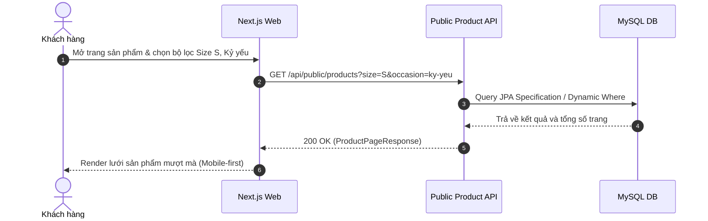

# Đặc Tả Tính Năng: Hiển Thị Danh Sách Sản Phẩm & Bộ Lọc Đa Chiều Trên Client

| Thuộc tính | Giá trị |
|---|---|
| **ID** | `CAT-005` |
| **Tên tính năng** | Hiển thị danh sách sản phẩm và bộ lọc đa chiều phía Client |
| **Module** | CAT (Catalog) |
| **Phạm vi** | CLIENT, SERVER |
| **Ưu tiên** | P0 - MVP |
| **Trạng thái** | 📝 SPEC |
| **Người phụ trách** | Frontend Lead / Fullstack Dev |
| **Ngày bắt đầu** | - |
| **Ngày hoàn thành** | - |
| **Phụ thuộc** | `CAT-001`, `CAT-002` |

---

## 1. Mục Tiêu và Giá Trị Mang Lại
Cung cấp cho khách hàng (chủ yếu là học sinh, sinh viên, giới trẻ truy cập bằng điện thoại di động) một trang duyệt sản phẩm trực quan, tốc độ tải siêu nhanh, hỗ trợ lọc theo danh mục, size, dịp chụp và khoảng giá để tìm mẫu váy/máy ảnh ưng ý chỉ trong vài thao tác chạm.

## 2. Người Dùng Liên Quan
- [x] **Khách hàng**: Duyệt ảnh váy/máy ảnh, lọc theo nhu cầu cụ thể (ví dụ: tìm váy trắng Size S chụp kỷ yếu giá dưới 300k).

## 3. Luồng Chính (Happy Path)
1. Khách hàng truy cập trang `/products` (hoặc `/danh-muc/[slug]`).
2. Next.js Server Component gọi `GET /api/public/products` với các query params trên URL.
3. Server trả về danh sách sản phẩm kèm metadata phân trang.
4. Giao diện render dạng lưới thẻ sản phẩm (Product Grid Card) chuẩn SEO.
5. Người dùng tương tác với thanh lọc (Bộ lọc Drawer trên Mobile, Sidebar trên Desktop):
   - Chọn Danh mục: Váy thiết kế.
   - Chọn Dịp: Chụp kỷ yếu.
   - Chọn Size: S.
   - Chọn Khoảng giá: 100.000đ - 300.000đ.
6. URL tự động cập nhật qua query string (ví dụ: `?category=vay-thiet-ke&size=S&occasion=ky-yeu`).
7. Next.js tự động re-fetch và cập nhật danh sách sản phẩm tương ứng mà không làm giật lag trang.



## 4. Luồng Ngoại Lệ và Trường Hợp Biên
- **Không có sản phẩm nào khớp bộ lọc**: Hiển thị trạng thái rỗng (Empty State) với gợi ý "Xóa bộ lọc để xem toàn bộ sản phẩm".
- **Lỗi mạng**: Hiển thị nút "Thử lại" thân thiện.

## 5. Quy Tắc Nghiệp Vụ
- **BR-01**: Chỉ hiển thị các sản phẩm có `status = ACTIVE` và danh mục tương ứng đang active.
- **BR-02**: Giá hiển thị trên card là giá thuê cơ bản theo ngày của sản phẩm.
- **BR-03**: Trang sản phẩm phải hỗ trợ Server-Side Rendering (SSR) để bot tìm kiếm Google cào dữ liệu SEO.

## 6. Giao Diện & Đa Ngôn Ngữ (UI & i18n)
- **Màn hình**: Product Grid 2 cột trên điện thoại, 4 cột trên Desktop. Bộ lọc dạng Drawer trượt từ dưới lên trên Mobile.
- **Component dùng chung**: `ProductCard`, `FilterDrawer`, `SkeletonGrid`, `EmptyState`.
- **Keys i18n (`vi.json` / `en.json`)**:
```json
{
  "catalog": {
    "filterTitle": "Bộ Lọc Tìm Kiếm",
    "filterCategory": "Danh mục",
    "filterSize": "Kích cỡ",
    "filterOccasion": "Dịp sử dụng",
    "filterPrice": "Khoảng giá thuê",
    "sortBy": "Sắp xếp theo",
    "sortNewest": "Mới nhất",
    "sortPriceAsc": "Giá tăng dần",
    "sortPriceDesc": "Giá giảm dần",
    "emptyMessage": "Không tìm thấy sản phẩm phù hợp",
    "clearFilter": "Xóa bộ lọc"
  }
}
```

## 7. Đặc Tả API
| Method | Endpoint | Quyền truy cập | Query Params | Response Body | Mã lỗi |
|---|---|---|---|---|---|
| `GET` | `/api/public/products` | Public | `page, size, categorySlug, sizeName, occasion, minPrice, maxPrice, sort` | `ApiResponse<Page<ProductSummaryResponse>>` | 400, 500 |

## 8. Thay Đổi Cơ Sở Dữ Liệu
- Sử dụng bảng `products`, `product_variants`, `categories` đã tạo.
- Bổ sung Index hỗ trợ tìm kiếm:
```sql
CREATE INDEX `idx_products_filter` ON `products` (`category_id`, `status`, `rental_price`);
```

## 9. Tiêu Chí Nghiệm Thu (Acceptance Criteria)
- [ ] **Kịch bản 1 - Lọc sản phẩm theo Size**:
  - **Given**: Khách hàng đang ở trang danh sách sản phẩm.
  - **When**: Chọn lọc theo Size "M".
  - **Then**: Danh sách cập nhật chỉ hiển thị những sản phẩm có biến thể Size M.
- [ ] **Kịch bản 2 - Không có kết quả**:
  - **Given**: Chọn khoảng giá không có đồ nào (ví dụ 10.000đ - 20.000đ).
  - **When**: Bộ lọc áp dụng.
  - **Then**: Màn hình hiển thị EmptyState và nút "Xóa bộ lọc".

## 10. Kế Hoạch Test
- **Unit Test**: Test Specification dynamic query tại Backend Spring Data JPA.
- **UI Test**: Test bộ lọc cập nhật query params URL và test 4 trạng thái UI (loading skeleton, empty, error, success).
- **Mục tiêu Coverage**: $\ge 80\%$.

## 11. Checklist Hoàn Thành (Definition of Done)
- [ ] Tối ưu hóa ảnh bằng `next/image` tránh layout shift (CLS < 0.1).
- [ ] URL query đồng bộ 2 chiều với trạng thái bộ lọc.
- [ ] Đầy đủ key i18n cho cả tiếng Việt và tiếng Anh.
- [ ] Test coverage $\ge 80\%$.
- [ ] Cập nhật `docs/FEATURES.md` và `docs/CHANGELOG.md`.

## 12. Nhật Ký Thực Hiện
| Ngày | Người thực hiện | Nội dung thay đổi | Trạng thái mới |
|---|---|---|---|
| 2026-10-24 | Tech Lead | Soạn thảo tài liệu đặc tả ban đầu | 📝 SPEC |
