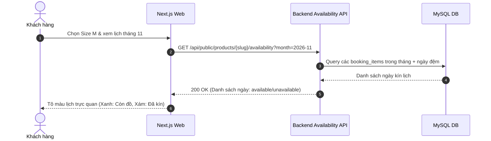

# Đặc Tả Tính Năng: Chi Tiết Sản Phẩm & Kiểm Tra Lịch Trống Trên Client

| Thuộc tính | Giá trị |
|---|---|
| **ID** | `CAT-006` |
| **Tên tính năng** | Chi tiết sản phẩm, bảng thông số kích cỡ & lịch trống (Availability Calendar) |
| **Module** | CAT (Catalog) |
| **Phạm vi** | CLIENT, SERVER |
| **Ưu tiên** | P0 - MVP |
| **Trạng thái** | 📝 SPEC |
| **Người phụ trách** | Frontend Lead / Fullstack Dev |
| **Ngày bắt đầu** | - |
| **Ngày hoàn thành** | - |
| **Phụ thuộc** | `CAT-002`, `CAT-003` |

---

## 1. Mục Tiêu và Giá Trị Mang Lại
Cung cấp trang chi tiết sản phẩm đầy đủ thông tin nhất: ảnh mẫu mặc thực tế, bảng hướng dẫn chọn size chuẩn xác (tránh trường hợp thuê về không vừa), và đặc biệt là bộ lịch trực quan hiển thị ngày nào còn đồ trống để khách chủ động chọn lịch chụp ảnh mà không phải nhắn tin hỏi shop thủ công.

## 2. Người Dùng Liên Quan
- [x] **Khách hàng**: Xem kỹ từng góc ảnh của váy/máy ảnh, đối chiếu số đo 3 vòng, chọn ngày chụp ảnh còn lịch trống để đặt thuê.

## 3. Luồng Chính (Happy Path)
1. Khách hàng truy cập `/products/[slug]`.
2. Next.js Server Component render thông tin sản phẩm và album ảnh carousel.
3. Khách hàng chọn Biến thể mong muốn (ví dụ: Size M - Màu Đỏ).
4. Hệ thống hiển thị lịch chọn ngày (`RentalDatePicker`):
   - Client gọi API `GET /api/public/products/{slug}/availability?variantId={id}&month=2026-11`.
   - Server kiểm tra toàn bộ `product_items` thuộc biến thể đó đối chiếu với các đơn đặt trong tháng (đã cộng ngày đệm giặt ủi).
   - Ngày nào còn ít nhất 1 món đồ rảnh $\rightarrow$ Hiển thị màu xanh (Khả dụng).
   - Ngày nào tất cả các món đồ đã kín lịch $\rightarrow$ Bị disable (Mờ, không bấm được).
5. Khách hàng chọn ngày thuê (ví dụ: từ 05/11 đến 06/11).
6. Hệ thống tính toán tổng tiền thuê dự kiến và làm nổi bật nút "Đặt thuê ngay" để chuyển sang bước checkout (`BOK-001`).



## 4. Luồng Ngoại Lệ và Trường Hợp Biên
- **Tất cả các món đồ của biến thể đang bảo dưỡng (`MAINTENANCE`)**: Lịch hiển thị thông báo "Tạm hết đồ trong tháng này" và gợi ý sang Size khác.
- **Khách cố tình chọn ngày trong quá khứ**: Bị chặn ngay trên component lịch.

## 5. Quy Tắc Nghiệp Vụ
- **BR-01**: Một ngày được coi là "Kín lịch" (Unavailable) khi số lượng món đồ thực tế của biến thể đó đang được đặt trong ngày đó (hoặc trong ngày đệm giặt ủi) bằng hoặc vượt quá tổng số món đồ `AVAILABLE` của biến thể.
- **BR-02**: Cho phép chọn ngày thuê tối thiểu trước 1 ngày (không cho thuê gấp trước 2 tiếng nếu chưa cấu hình).

## 6. Giao Diện & Đa Ngôn Ngữ (UI & i18n)
- **Màn hình**: Image Carousel vuốt chạm trên mobile, bảng chọn Size có popover "Bảng thông số số đo", Lịch tháng trực quan, thanh CTA cố định dưới đáy màn hình điện thoại (Sticky Bottom Bar).
- **Component dùng chung**: `ImageGallery`, `AvailabilityCalendar`, `SizeGuideModal`, `Button`.
- **Keys i18n (`vi.json` / `en.json`)**:
```json
{
  "productDetail": {
    "sizeGuide": "Bảng quy đổi kích cỡ",
    "selectDate": "Chọn ngày thuê đồ",
    "available": "Còn đồ",
    "booked": "Đã kín lịch",
    "pricePerDay": "đ / ngày",
    "depositRequired": "Tiền cọc giữ đồ: {amount} đ",
    "rentNowButton": "Đặt thuê ngay"
  }
}
```

## 7. Đặc Tả API
| Method | Endpoint | Quyền truy cập | Query Params | Response Body | Mã lỗi |
|---|---|---|---|---|---|
| `GET` | `/api/public/products/{slug}` | Public | Không | `ApiResponse<ProductDetailResponse>` | 404 |
| `GET` | `/api/public/products/{slug}/availability` | Public | `variantId, month` | `ApiResponse<ProductAvailabilityResponse>` | 400, 404 |

## 8. Thay Đổi Cơ Sở Dữ Liệu
- Sử dụng các bảng `products`, `product_variants`, `product_items` và `bookings`.
- Đánh index bổ trợ tìm kiếm lịch trống:
```sql
CREATE INDEX `idx_booking_items_dates` ON `booking_items` (`product_item_id`, `rental_start_date`, `rental_end_date`);
```

## 9. Tiêu Chí Nghiệm Thu (Acceptance Criteria)
- [ ] **Kịch bản 1 - Xem lịch trống**:
  - **Given**: Biến thể Váy Size S có 2 chiếc thực tế, ngày 10/11 mới có 1 đơn đặt.
  - **When**: Khách mở lịch tháng 11 xem ngày 10/11.
  - **Then**: Ngày 10/11 vẫn hiển thị trạng thái "Còn đồ" (màu xanh) cho khách chọn tiếp.
- [ ] **Kịch bản 2 - Ngày đã kín đồ**:
  - **Given**: Cả 2 chiếc váy Size S đều đã có đơn đặt vào ngày 12/11.
  - **When**: Khách xem ngày 12/11.
  - **Then**: Ngày 12/11 bị làm mờ, không thể click chọn.

## 10. Kế Hoạch Test
- **Unit Test**: Test thuật toán tính toán ngày trống có tính cả ngày đệm giặt ủi (`bufferDays`).
- **UI Test**: Test tương tác đổi biến thể thì lịch tự cập nhật lại trạng thái khả dụng.
- **Mục tiêu Coverage**: $\ge 80\%$.

## 11. Checklist Hoàn Thành (Definition of Done)
- [ ] `generateMetadata` chuẩn SEO (OG Image, description, title).
- [ ] UI Mobile responsive mượt mà với thanh Sticky CTA.
- [ ] Đầy đủ i18n cho các chuỗi hiển thị và chú thích lịch.
- [ ] Test coverage $\ge 80\%$.
- [ ] Cập nhật `docs/FEATURES.md` và `docs/CHANGELOG.md`.

## 12. Nhật Ký Thực Hiện
| Ngày | Người thực hiện | Nội dung thay đổi | Trạng thái mới |
|---|---|---|---|
| 2026-10-24 | Tech Lead | Soạn thảo tài liệu đặc tả ban đầu | 📝 SPEC |
