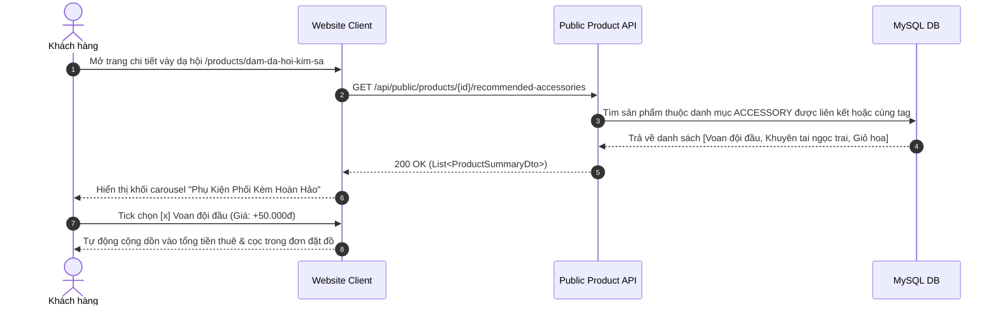

# Đặc Tả Tính Năng: Gợi Ý Sản Phẩm Phụ Kiện Đi Kèm (Cross-Selling)

| Thuộc tính | Giá trị |
|---|---|
| **ID** | `CAT-007` |
| **Tên tính năng** | Gợi ý sản phẩm phụ kiện đi kèm thông minh trên Website Client |
| **Module** | CAT (Catalog & Merchandising) |
| **Phạm vi** | CLIENT, SERVER |
| **Ưu tiên** | P1 - Bán chéo gia tăng giá trị |
| **Trạng thái** | 📝 SPEC |
| **Người phụ trách** | Fullstack Dev & UI/UX Specialist |
| **Ngày bắt đầu** | 2026-10-25 |
| **Ngày hoàn thành** | 2026-10-25 |
| **Phụ thuộc** | `CAT-001`, `CAT-002`, `CAT-006` |

---

## Mục Lục
1. [Mục Tiêu và Giá Trị Mang Lại](#1-mục-tiêu-và-giá-trị-mang-lại)
2. [Người Dùng Liên Quan](#2-người-dùng-liên-quan)
3. [Luồng Nghiệp Vụ Chính (Happy Path)](#3-luồng-nghiệp-vụ-chính-happy-path)
4. [Luồng Ngoại Lệ và Trường Hợp Biên](#4-luồng-ngoại-lệ-và-trường-hợp-biên)
5. [Quy Tắc Nghiệp Vụ (Business Rules)](#5-quy-tắc-nghiệp-vụ-business-rules)
6. [Giao Diện & Đa Ngôn Ngữ (UI & i18n)](#6-giao-diện--đa-ngôn-ngữ-ui--i18n)
7. [Đặc Tả API Backend](#7-đặc-tả-api-backend)
8. [Thay Đổi Cơ Sở Dữ Liệu](#8-thay-đổi-cơ-sở-dữ-liệu)
9. [Tiêu Chí Nghiệm Thu (Acceptance Criteria)](#9-tiêu-chí-nghiệm-thu-acceptance-criteria)
10. [Kế Hoạch Kiểm Thử](#10-kế-hoạch-kiểm-thử)
11. [Checklist Hoàn Thành (Definition of Done)](#11-checklist-hoàn-thành-definition-of-done)

---

## 1. Mục Tiêu và Giá Trị Mang Lại
- **Gia tăng doanh thu trên mỗi lượt thuê (Cross-selling)**: Khách thuê váy thường cần thêm phụ kiện (giỏ hoa mây, nón lá, cài tóc, cà vạt, voan trùm đầu) hoặc máy ảnh du lịch để có trọn bộ chụp ảnh đẹp.
- **Tiện lợi 1 chạm (Add-to-booking convenience)**: Khách hàng có thể chọn nhanh phụ kiện đi kèm ngay trong form đặt thuê váy mà không cần phải mở nhiều trang trình duyệt.
- **Gợi ý theo ngữ cảnh trang phục (Contextual Recommendation)**: Váy dạ hội gợi ý phụ kiện vương miện/khuyên tai; Áo dài gợi ý nón lá/giỏ mây; Đồ kỷ yếu gợi ý phụ kiện cử nhân và hoa tươi.

---

## 2. Người Dùng Liên Quan
- [x] **Khách hàng**: Được gợi ý các phụ kiện ăn ý với mẫu váy đã chọn; bấm thêm vào đơn chỉ bằng 1 checkbox.
- [x] **Admin**: Thiết lập quan hệ sản phẩm gợi ý hoặc để hệ thống tự động gợi ý phụ kiện thuộc danh mục `ACCESSORY` cùng phong cách.

---

## 3. Luồng Nghiệp Vụ Chính (Happy Path)



---

## 4. Luồng Ngoại Lệ và Trường Hợp Biên
- **Phụ kiện đi kèm bị hết slot trong khoảng ngày thuê**: Checkbox phụ kiện bị mờ đi (disabled) kèm ghi chú *"Hết đồ ngày này"*.
- **Sản phẩm chưa có phụ kiện liên kết thủ công**: Hệ thống tự động fallback lấy top 4 phụ kiện bán chạy nhất của tiệm.

---

## 5. Quy Tắc Nghiệp Vụ (Business Rules)
- **BR-01**: Sản phẩm gợi ý phụ kiện phải thuộc danh mục có `category_type = 'ACCESSORY'`.
- **BR-02**: Khi khách chọn thêm phụ kiện, phụ kiện đó được tạo thành một dòng `booking_item` riêng biệt trong đơn hàng và áp dụng quy tắc kiểm tra lịch trống độc lập (`BOK-002`).

---

## 6. Giao Diện & Đa Ngôn Ngữ (UI & i18n)
- **Component**: `RelatedAccessoriesSection` trên trang chi tiết sản phẩm và `AddonCheckboxGroup` trong Modal đặt hàng.
- **Keys i18n**:
```json
{
  "crossSell": {
    "sectionTitle": "Phụ Kiện Phối Kèm Hoàn Hảo",
    "addToBooking": "Thuê kèm (+{price} đ)",
    "outOfStock": "Hết phụ kiện ngày này"
  }
}
```

---

## 7. Đặc Tả API Backend
- `GET /api/public/products/{id}/recommended-accessories`: Trả về danh sách các phụ kiện gợi ý.
- Response: `List<ProductSummaryDto>`.

---

## 8. Thay Đổi Cơ Sở Dữ Liệu
- Tạo bảng liên kết `product_related_accessories` (Migration Flyway `V19__create_product_related_accessories.sql`):
```sql
CREATE TABLE `product_related_accessories` (
    `product_id` BIGINT NOT NULL,
    `accessory_product_id` BIGINT NOT NULL,
    PRIMARY KEY (`product_id`, `accessory_product_id`),
    CONSTRAINT `fk_rel_main_prod` FOREIGN KEY (`product_id`) REFERENCES `products` (`id`) ON DELETE CASCADE,
    CONSTRAINT `fk_rel_acc_prod` FOREIGN KEY (`accessory_product_id`) REFERENCES `products` (`id`) ON DELETE CASCADE
);
```

---

## 9. Tiêu Chí Nghiệm Thu (Acceptance Criteria)
- **Given**: Khách xem chi tiết Áo Dài.
- **When**: Cuộn xuống dưới nút Đặt thuê.
- **Then**: Thấy khối gợi ý phụ kiện Nón Lá và Giỏ Mây; khi tích chọn, tổng tiền thuê cập nhật tức thì.

---

## 10. Kế Hoạch Kiểm Thử
- **Unit Test**: `ProductRecommendationServiceTest`.
- **Frontend Test**: `RelatedAccessoriesSection.test.tsx`.
- **Coverage**: $\ge 85\%$.

---

## 11. Checklist Hoàn Thành (Definition of Done)
- [ ] Tài liệu đặc tả `CAT-007` hoàn thành.
- [ ] Cập nhật `FEATURES.md` và `CHANGELOG.md`.
