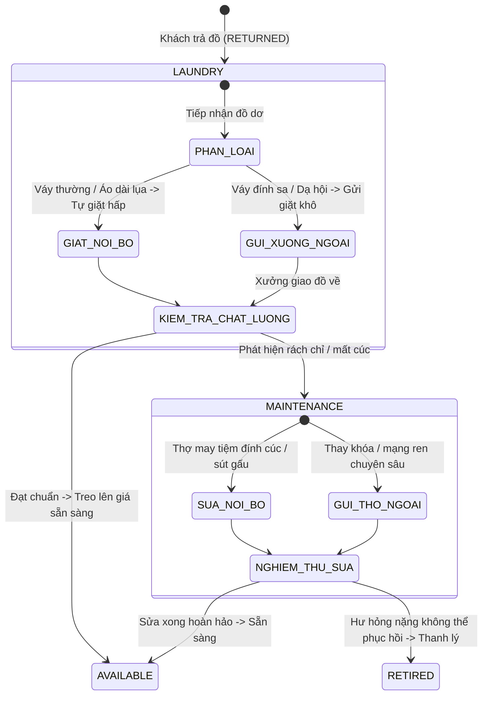
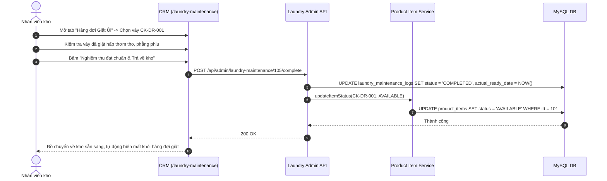

# Đặc Tả Tính Năng: Hàng Đợi Giặt Ủi & Sửa Chữa Trang Phục

| Thuộc tính | Giá trị |
|---|---|
| **ID** | `CAT-008` |
| **Tên tính năng** | Hàng đợi quản lý giặt ủi, là hấp và sửa chữa trang phục sau khi khách trả đồ |
| **Module** | CAT (Catalog & Logistics) |
| **Phạm vi** | CRM, SERVER |
| **Ưu tiên** | P1 - Vận hành cốt lõi |
| **Trạng thái** | 📝 SPEC |
| **Người phụ trách** | Fullstack Dev & Tech Lead |
| **Ngày bắt đầu** | 2026-10-25 |
| **Ngày hoàn thành** | 2026-10-25 |
| **Phụ thuộc** | `CAT-003`, `BOK-003`, `BOK-006`, `PAY-003` |

---

## Mục Lục
1. [Mục Tiêu và Giá Trị Mang Lại](#1-mục-tiêu-và-giá-trị-mang-lại)
2. [Người Dùng Liên Quan](#2-người-dùng-liên-quan)
3. [Luồng Nghiệp Vụ Chính (Happy Path)](#3-luồng-nghiệp-vụ-chính-happy-path)
4. [Luồng Ngoại Lệ và Trường Hợp Biên](#4-luồng-ngoại-lệ-và-trường-hợp-biên)
5. [Quy Tắc Nghiệp Vụ (Business Rules)](#5-quy-tắc-nghiệp-vụ-business-rules)
6. [Giao Diện & Đa Ngôn Ngữ (UI & i18n)](#6-giao-diện--đa-ngôn-ngữ-ui--i18n)
7. [Đặc Tả API Backend](#7-đặc-tả-api-backend)
8. [Thay Đổi Cơ Sở Dữ Liệu](#8-thay-đổi-cơ-sở-dữ-liệu)
9. [Tiêu Chí Nghiệm Thu (Acceptance Criteria)](#9-tiêu-chí-nghiệm-thu-acceptance-criteria)
10. [Kế Hoạch Kiểm Thử](#10-kế-hoạch-kiểm-thử)
11. [Checklist Hoàn Thành (Definition of Done)](#11-checklist-hoàn-thành-definition-of-done)

---

## 1. Mục Tiêu và Giá Trị Mang Lại
- **Chuẩn hóa khâu hậu cần trang phục (Garment Care Operations)**: Sau khi khách trả đồ, trang phục không thể lập tức treo lên giá cho khách tiếp theo mà bắt buộc phải qua quy trình: phân loại độ bẩn, giặt hấp/giặt khô, là ủi phẳng phiu hoặc đính lại cúc/sửa đường may sờn chỉ.
- **Theo dõi tiến độ gửi giặt ngoài (Outsource Laundry Tracking)**: Đối với váy dạ hội đính đá cao cấp hoặc áo dài tơ tằm thêu tay cần gửi các tiệm giặt khô chuyên nghiệp bên ngoài, hệ thống theo dõi: Tên xưởng giặt, ngày gửi, ngày hẹn lấy, chi phí giặt và chất lượng nghiệm thu.
- **Cảnh báo khẩn cấp nguy cơ trễ lịch thuê kế tiếp (Conflict Alert)**: Phát hiện và cảnh báo ngay lập tức những món đồ đang nằm trong hàng đợi giặt/sửa nhưng đã có lịch khách đặt thuê trong vòng 24h - 48h tới, giúp nhân viên ưu tiên giặt hỏa tốc (Rush Laundry) hoặc chủ động đổi món đồ khác (`BOK-006`) cho khách.

---

## 2. Người Dùng Liên Quan
- [x] **Nhân viên kho & giặt là**: Phân loại váy trả về, lập phiếu gửi giặt/sửa, kiểm tra chất lượng nghiệm thu (Quality Check) trước khi bấm đưa đồ về trạng thái `AVAILABLE`.
- [x] **Admin (Chủ shop)**: Kiểm soát chi phí giặt là và sửa chữa trang phục hàng tháng, đánh giá độ bền của từng mẫu váy và hiệu quả của các xưởng giặt liên kết.

---

## 3. Luồng Nghiệp Vụ Chính (Happy Path)

### 3.1. Vòng Đời Xử Lý Hàng Đợi Giặt Ủi & Sửa Chữa



### 3.2. Sơ Đồ Trình Tự Nghiệm Thu Đưa Đồ Về Sẵn Sàng



---

## 4. Luồng Ngoại Lệ và Trường Hợp Biên

| Tình huống ngoại lệ | Xử lý của hệ thống | Phản hồi giao diện |
|---|---|---|
| **Đồ đang giặt có khách hẹn lấy trong 24h tới** | Món đồ có đơn thuê tiếp theo sắp bắt đầu (`rental_start_date <= TODAY + 1`) | Gắn thẻ viền đỏ nhấp nháy `CẦN GIẶT GẤP (RUSH)` trên hàng đợi; hiển thị nút nhanh: `[ Đổi món đồ khác cho khách tiếp theo ]` trỏ sang `BOK-006` |
| **Xưởng giặt làm mất hoặc làm cháy váy** | Đồ bị biến dạng không thể khắc phục được | Nhân viên bấm "Không thể phục hồi", nhập biên bản đền bù của xưởng giặt. Món đồ chuyển thẳng sang `RETIRED` |
| **Sau khi giặt xong phát hiện vải bị rách sờn** | Đồ chưa đạt chuẩn để giao khách | Nhân viên không bấm hoàn tất giặt mà bấm "Chuyển sang sửa chữa". Hệ thống chuyển trạng thái item sang `MAINTENANCE` và tạo log sửa chữa |

---

## 5. Quy Tắc Nghiệp Vụ (Business Rules)

- **BR-01 (Tự động vào hàng đợi giặt)**: Khi đơn thuê chuyển sang trạng thái `RETURNED` (`BOK-003`), toàn bộ các món đồ trang phục (`CLOTHING`) trong đơn tự động được tạo 1 bản ghi trong hàng đợi `laundry_maintenance_logs` với `task_type = 'LAUNDRY_IN_HOUSE'` và trạng thái `IN_PROGRESS`.
- **BR-02 (Quy chuẩn ngày hẹn giặt)**:
  - Giặt hấp nội bộ: Mặc định hẹn xong sau **24 giờ** kể từ lúc tiếp nhận.
  - Gửi xưởng giặt khô ngoài: Mặc định hẹn xong sau **48 giờ** kể từ lúc tiếp nhận.
- **BR-03 (Bắt buộc người nghiệm thu chất lượng)**: Khi chuyển đồ từ `LAUNDRY` hoặc `MAINTENANCE` về lại `AVAILABLE`, hệ thống bắt buộc ghi nhận tên nhân viên nghiệm thu (`inspected_by`) để quy trách nhiệm nếu đồ giao cho khách sau bị bẩn/nhăn.
- **BR-04 (Hạch toán chi phí giặt sửa)**: Các chi phí giặt hấp ngoài và chi phí sửa chữa được lưu vết để làm căn cứ tính chi phí vận hành kho hàng tháng.

---

## 6. Giao Diện & Đa Ngôn Ngữ (UI & i18n)

### 6.1. Thiết Kế Màn Hình Hàng Đợi (`crm/src/pages/laundry/LaundryMaintenancePage.tsx`)
- **Bộ Thẻ Thống Kê Tổng Quan (`StatCard`)**:
  - `Đang giặt ủi`: Số lượng trang phục đang giặt hấp (nội bộ + xưởng ngoài).
  - `Đang sửa chữa`: Số lượng trang phục đang đính cúc, mạng ren.
  - `Cần xử lý gấp`: Số lượng đồ có lịch thuê trong 48h tới (Màu đỏ cảnh báo).
  - `Hoàn tất tuần này`: Số lượt trang phục đã nghiệm thu về kho.
- **Thanh Tabs Chuyển Đổi**:
  - `[ Hàng đợi Giặt Ủi (12) ]` | `[ Hàng đợi Sửa Chữa (3) ]` | `[ Cảnh Báo Xung Đột Lịch (2) ]`.
- **Bảng Dữ Liệu Hàng Đợi (`DataTable`)**:
  - Cột: Món đồ (Barcode, Tên váy, Biến thể), Phương thức (Giặt nội bộ / Gửi xưởng), Nơi xử lý (Tên xưởng), Ngày gửi, Hạn dự kiến hoàn thành, Cảnh báo lịch tới (Đơn tiếp theo ngày nào), Thao tác nhanh:
    - Nút `[ Nghiệm thu đạt chuẩn ]` (xanh lá).
    - Nút `[ Chuyển sửa chữa ]` (cam).
    - Nút `[ Ghi chú / Chi phí ]`.
- **Modals**:
  - `SendToVendorModal`: Form gửi đồ ra xưởng giặt/thợ may ngoài (Tên đơn vị, Ngày hẹn, Chi phí dự kiến).
  - `InspectQualityModal`: Form nghiệm thu chất lượng trước khi trả về giá treo đồ.

### 6.2. Bộ Từ Điển Đa Ngôn Ngữ (`vi.json` / `en.json`)

```json
{
  "laundry": {
    "title": "Hàng Đợi Giặt Ủi & Sửa Chữa",
    "subtitle": "Quản lý quy trình chăm sóc, là hấp và phục hồi trang phục sau thuê",
    "tabLaundry": "Hàng đợi giặt ủi",
    "tabMaintenance": "Hàng đợi sửa chữa",
    "tabConflict": "Cảnh báo trùng lịch kế tiếp",
    "kpiInLaundry": "Đang giặt ủi",
    "kpiInMaintenance": "Đang sửa chữa",
    "kpiUrgent": "Cần xử lý gấp (<48h)",
    "kpiCompletedThisWeek": "Đã về kho tuần này",
    "typeInHouse": "Giặt hấp tại tiệm",
    "typeOutsource": "Gửi xưởng giặt khô ngoài",
    "typeRepairInHouse": "Tự sửa tại tiệm",
    "typeRepairOutsource": "Gửi thợ may ngoài",
    "vendorName": "Đơn vị xử lý",
    "sentDate": "Ngày tiếp nhận",
    "expectedDate": "Dự kiến hoàn thành",
    "nextBookingWarning": "Có khách đặt ngày {date} ({hours}h tới)",
    "actionComplete": "Nghiệm thu đạt chuẩn",
    "actionSendVendor": "Gửi xưởng ngoài",
    "actionTransferRepair": "Chuyển sửa chữa",
    "actionRetire": "Thanh lý đồ hỏng",
    "inspectNote": "Ghi chú nghiệm thu (độ phẳng, mùi hương, sạch vết ố)",
    "completeSuccess": "Đã nghiệm thu và đưa món đồ {barcode} về kho sẵn sàng",
    "retireSuccess": "Đã chuyển món đồ {barcode} sang ngừng cho thuê"
  }
}
```

---

## 7. Đặc Tả API Backend

### 7.1. Danh Sách Endpoint

| Method | Endpoint | Quyền hạn | Mục đích |
|---|---|---|---|
| `GET` | `/api/admin/laundry-maintenance/queue` | `STAFF`, `ADMIN` | Lấy danh sách đồ trong hàng đợi (lọc theo type, urgent) |
| `POST` | `/api/admin/laundry-maintenance/send-vendor` | `STAFF`, `ADMIN` | Ghi nhận gửi đồ ra tiệm giặt/may bên ngoài |
| `POST` | `/api/admin/laundry-maintenance/{id}/complete` | `STAFF`, `ADMIN` | Nghiệm thu đạt chuẩn và chuyển đồ về `AVAILABLE` |
| `POST` | `/api/admin/laundry-maintenance/{id}/transfer-repair` | `STAFF`, `ADMIN` | Chuyển đồ từ giặt sang sửa chữa (`MAINTENANCE`) |
| `POST` | `/api/admin/laundry-maintenance/{id}/retire` | `ADMIN` | Báo hỏng thải loại món đồ (`RETIRED`) |
| `GET` | `/api/admin/laundry-maintenance/conflicts` | `STAFF`, `ADMIN` | Lấy danh sách đồ đang giặt có nguy cơ trễ lịch thuê kế tiếp |

### 7.2. Chi Tiết Request & Response DTOs

#### A. GET `/api/admin/laundry-maintenance/queue?taskType=LAUNDRY`
- **Response Success (200 OK)**:
```json
{
  "code": 200,
  "message": "SUCCESS",
  "data": [
    {
      "id": 45,
      "itemId": 101,
      "barcode": "CK-DR-001",
      "productName": "Váy Dạ Hội Kim Sa Trắng",
      "variantName": "Size S - Trắng",
      "taskType": "LAUNDRY_OUTSOURCE",
      "vendorName": "Xưởng Giặt Cao Cấp Hà Nội",
      "sentDate": "2026-10-25",
      "expectedReadyDate": "2026-10-27",
      "cost": 80000.00,
      "status": "IN_PROGRESS",
      "nextBooking": {
        "bookingCode": "BK20261028-002",
        "rentalStartDate": "2026-10-28",
        "hoursUntilStart": 64,
        "isUrgent": false
      }
    }
  ]
}
```

#### B. POST `/api/admin/laundry-maintenance/45/complete`
- **Request Body**:
```json
{
  "inspectedBy": "thao_staff",
  "qualityNote": "Váy đã tẩy sạch vết rượu vang, là phẳng không nhăn, cúc đính chắc chắn."
}
```
- **Response Success (200 OK)**:
```json
{
  "code": 200,
  "message": "Nghiệm thu trang phục thành công, đồ đã sẵn sàng cho thuê",
  "data": {
    "itemId": 101,
    "barcode": "CK-DR-001",
    "itemStatus": "AVAILABLE",
    "completedAt": "2026-10-25T21:52:00"
  }
}
```

---

## 8. Thay Đổi Cơ Sở Dữ Liệu

### 8.1. File Migration Flyway: `V15__create_laundry_maintenance_logs_table.sql`

```sql
-- Migration V15: Bảng quản lý hàng đợi giặt ủi và sửa chữa trang phục (CAT-008)
CREATE TABLE `laundry_maintenance_logs` (
    `id` BIGINT AUTO_INCREMENT PRIMARY KEY,
    `product_item_id` BIGINT NOT NULL,
    `task_type` VARCHAR(30) NOT NULL, -- LAUNDRY_IN_HOUSE, LAUNDRY_OUTSOURCE, REPAIR_IN_HOUSE, REPAIR_OUTSOURCE
    `vendor_name` VARCHAR(100) NULL,
    `issue_description` VARCHAR(500) NULL,
    `sent_date` DATE NOT NULL,
    `expected_ready_date` DATE NOT NULL,
    `actual_ready_date` TIMESTAMP NULL,
    `cost` DECIMAL(12,2) NOT NULL DEFAULT 0.00,
    `status` VARCHAR(30) NOT NULL DEFAULT 'IN_PROGRESS', -- IN_PROGRESS, COMPLETED, UNREPAIRABLE
    `inspected_by` VARCHAR(50) NULL,
    `quality_note` VARCHAR(255) NULL,
    `created_by` VARCHAR(50) NOT NULL,
    `created_at` TIMESTAMP NOT NULL DEFAULT CURRENT_TIMESTAMP,
    `updated_at` TIMESTAMP NOT NULL DEFAULT CURRENT_TIMESTAMP ON UPDATE CURRENT_TIMESTAMP,
    CONSTRAINT `fk_laundry_item` FOREIGN KEY (`product_item_id`) REFERENCES `product_items` (`id`),
    INDEX `idx_laundry_item` (`product_item_id`),
    INDEX `idx_laundry_status_dates` (`status`, `expected_ready_date`)
) ENGINE=InnoDB DEFAULT CHARSET=utf8mb4 COLLATE=utf8mb4_unicode_ci;
```

---

## 9. Tiêu Chí Nghiệm Thu (Acceptance Criteria)

### Kịch bản 1: Món đồ tự động vào hàng đợi khi khách trả
- **Given**: Khách trả đơn thuê `BK-001` chứa chiếc váy `CK-DR-001`.
- **When**: Nhân viên bấm xác nhận "Nhận trả đồ" trên màn hình đơn hàng.
- **Then**: Trạng thái váy đổi sang `LAUNDRY`, hệ thống tự sinh 1 bản ghi trong `laundry_maintenance_logs`, xuất hiện ngay trong tab "Hàng đợi Giặt Ủi".

### Kịch bản 2: Cảnh báo khẩn cấp khi đồ giặt có lịch thuê sát nút
- **Given**: Chiếc váy `CK-DR-002` đang trong hàng đợi giặt với ngày hẹn lấy là 28/10. Có khách đặt thuê chiếc váy này vào ngày 28/10.
- **When**: Nhân viên mở trang Hàng đợi Giặt Ủi.
- **Then**: Dòng của chiếc váy `CK-DR-002` được gắn nhãn đỏ `CẦN GIẶT GẤP`, hiển thị cảnh báo chỉ còn dưới 24h và gợi ý nút điều phối đổi đồ.

### Kịch bản 3: Nghiệm thu đạt chuẩn đưa đồ về kho sẵn sàng
- **Given**: Váy đã giặt xong và đạt tiêu chuẩn chất lượng.
- **When**: Nhân viên bấm "Nghiệm thu đạt chuẩn" kèm ghi chú.
- **Then**: Bản ghi log giặt ủi chuyển sang `COMPLETED`, món đồ vật lý đổi trạng thái sang `AVAILABLE`, và lịch Availability Client (`CAT-006`) lập tức hiển thị chiếc váy này có thể nhận đơn mới.

---

## 10. Kế Hoạch Kiểm Thử
- **Unit Test Backend**:
  - `LaundryMaintenanceServiceTest`: Kiểm tra chuyển trạng thái hợp lệ, kiểm tra logic phát hiện nguy cơ trễ lịch thuê kế tiếp.
  - `LaundryControllerTest`: Kiểm tra các quyền truy cập `ROLE_STAFF` và `ROLE_ADMIN` (riêng hành động retire cấm staff).
- **Frontend Test (Vitest)**:
  - `LaundryMaintenancePage.test.tsx`: Render các thẻ KPI, chuyển đổi Tabs hàng đợi, kích hoạt modal nghiệm thu.
- **Playwright E2E**:
  - Nhận trả đồ ở CRM Orders $\rightarrow$ Mở trang Laundry Queue $\rightarrow$ Nghiệm thu hoàn tất $\rightarrow$ Kiểm tra kho đồ cập nhật trạng thái `AVAILABLE`.
- **Mục tiêu Coverage**: $\ge 85\%$.

---

## 11. Checklist Hoàn Thành (Definition of Done)
- [ ] Soạn thảo và phê duyệt tài liệu đặc tả `CAT-008` (đã xong).
- [ ] Cập nhật bảng theo dõi trong [docs/FEATURES.md](../../FEATURES.md).
- [ ] Tái sử dụng các UI components: `DataTable`, `Tabs`, `StatCard`, `StatusBadge`, `Modal`.
- [ ] Không sử dụng inline CSS, 100% tuân thủ CSS Modules / SCSS / Tailwind.
- [ ] Kiểm thử tự động đạt độ bao phủ $\ge 80\%$.
- [ ] Ghi nhận thay đổi vào `CHANGELOG.md`.
