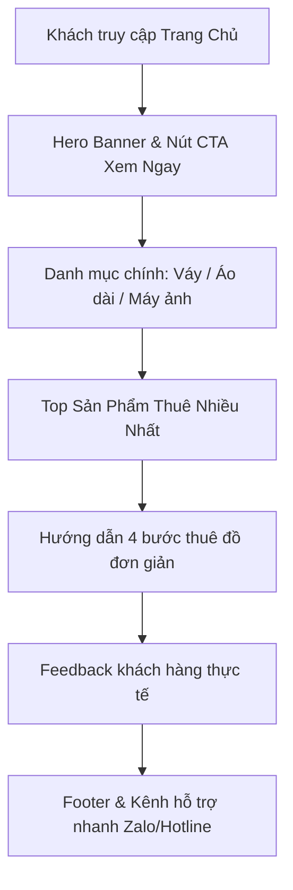

# Đặc Tả Tính Năng: Trang Chủ Website Phía Client

| Thuộc tính | Giá trị |
|---|---|
| **ID** | `CNT-001` |
| **Tên tính năng** | Trang chủ website Chickie Studio (Landing Page Mobile-First) |
| **Module** | CNT (Content & SEO) |
| **Phạm vi** | CLIENT, SERVER |
| **Ưu tiên** | P0 - MVP |
| **Trạng thái** | 📝 SPEC |
| **Người phụ trách** | Frontend Lead / UI/UX Designer |
| **Ngày bắt đầu** | - |
| **Ngày hoàn thành** | - |
| **Phụ thuộc** | `CAT-001`, `CAT-005` |

---

## 1. Mục Tiêu và Giá Trị Mang Lại
Xây dựng bộ mặt thương hiệu trực tuyến của Chickie Studio: thu hút học sinh, sinh viên và khách trẻ ngay từ cái nhìn đầu tiên với hình ảnh váy áo lung linh, giới thiệu dịch vụ nổi bật (cho thuê váy thiết kế, áo dài, combo máy ảnh du lịch) và điều hướng khách tìm đồ nhanh chóng.

## 2. Người Dùng Liên Quan
- [x] **Khách hàng**: Xem xu hướng váy mới, xem ảnh khách hàng chụp thực tế, nắm rõ quy trình thuê đồ và liên hệ tư vấn.

## 3. Luồng Chính (Happy Path)
1. Khách truy cập vào tên miền chính (ví dụ: `chickiestudio.vn`).
2. Next.js Server Component thực hiện SSR, tải trước nội dung trang chủ:
   - **Hero Banner**: Ảnh chất lượng cao tối ưu qua `next/image` (`priority = true`), slogan bắt mắt và nút CTA "Khám Phá Ngay".
   - **Danh Mục Nổi Bật**: Các thẻ tròn/vuông dẫn thẳng vào Váy thiết kế, Áo dài, Combo máy ảnh.
   - **Top Sản Phẩm Thuê Nhiều**: Carousel danh sách các mẫu váy hot nhất tuần/tháng.
   - **Quy Trình Thuê 4 Bước**: Trực quan hóa quy trình: Chọn đồ $\rightarrow$ Đặt cọc $\rightarrow$ Nhận đồ $\rightarrow$ Trả đồ & Hoàn cọc.
   - **Feedback Khách Hàng**: Hình ảnh khách mặc đồ chụp kỷ yếu kèm đánh giá tích cực.
   - **Floating Action Buttons**: Nút chat Zalo, Hotline gọi nhanh luôn ghim góc dưới màn hình.



## 4. Luồng Ngoại Lệ và Trường Hợp Biên
- **Dữ liệu sản phẩm hot đang rỗng**: Section tự động chuyển sang hiển thị các sản phẩm mới nhất thay vì để trống.

## 5. Quy Tắc Nghiệp Vụ
- **BR-01**: Bắt buộc đạt chuẩn Core Web Vitals (LCP < 2.5s, CLS < 0.1, FID/INP < 200ms) trên mạng 4G di động.
- **BR-02**: Mọi hình ảnh banner và sản phẩm bắt buộc phải có thuộc tính `alt` tiếng Việt chuẩn SEO.

## 6. Giao Diện & Đa Ngôn Ngữ (UI & i18n)
- **Màn hình**: Responsive Mobile-First, giao diện tone màu pastel thanh lịch (Hồng phấn / Be kem / Trắng).
- **Component dùng chung**: `HeroSection`, `CategorySlider`, `ProductCard`, `ProcessSteps`, `FloatingContact`.
- **Keys i18n (`vi.json` / `en.json`)**:
```json
{
  "home": {
    "heroTitle": "Tỏa Sáng Trong Mọi Khoảnh Khắc",
    "heroSubtitle": "Cho thuê váy thiết kế, áo dài kỷ yếu & combo máy ảnh xịn xò tại Hà Nội",
    "exploreButton": "Khám Phá Mẫu Mới",
    "featuredCategories": "Danh Mục Nổi Bật",
    "topRentals": "Mẫu Váy Được Thuê Nhiều Nhất",
    "howItWorksTitle": "Quy Trình Thuê Đồ Siêu Dễ Dàng",
    "step1": "Chọn mẫu & size phù hợp",
    "step2": "Đặt lịch & chuyển khoản cọc",
    "step3": "Nhận đồ xinh & đi chụp ảnh",
    "step4": "Trả đồ & nhận lại tiền cọc"
  }
}
```

## 7. Đặc Tả API
| Method | Endpoint | Quyền truy cập | Mục đích | Response Body |
|---|---|---|---|---|
| `GET` | `/api/public/home/featured` | Public | Lấy banner, top category, top sản phẩm | `ApiResponse<HomeFeaturedResponse>` |

## 8. Thay Đổi Cơ Sở Dữ Liệu
- Tận dụng dữ liệu từ bảng `categories` và `products`.

## 9. Tiêu Chí Nghiệm Thu (Acceptance Criteria)
- [ ] **Kịch bản 1 - Tải trang chủ mượt mà**:
  - **Given**: Truy cập trang chủ từ điện thoại di động.
  - **When**: Tải trang xong.
  - **Then**: Hero banner hiển thị sắc nét không giật layout, bấm CTA cuộn mượt đến danh sách sản phẩm.
- [ ] **Kịch bản 2 - Nút liên hệ nhanh**:
  - **Given**: Khách cần tư vấn gấp.
  - **When**: Nhấn vào icon Zalo nổi góc màn hình.
  - **Then**: Tự động mở ứng dụng Zalo dẫn tới tài khoản chính thức của Chickie Studio.

## 10. Kế Hoạch Test
- **UI Test**: Test render toàn bộ các sections, kiểm tra tính responsive trên viewport Mobile (375px) và Desktop (1440px).
- **Lighthouse Test**: Đạt điểm hiệu năng (Performance) $\ge 90$ và SEO $\ge 90$.
- **Mục tiêu Coverage**: $\ge 80\%$.

## 11. Checklist Hoàn Thành (Definition of Done)
- [ ] Server Component SSR hoàn toàn cho trang chủ.
- [ ] Đầy đủ metadata SEO (OpenGraph, Twitter card).
- [ ] i18n đầy đủ tiếng Việt và tiếng Anh.
- [ ] Test coverage $\ge 80\%$.
- [ ] Cập nhật `docs/FEATURES.md` và `docs/CHANGELOG.md`.

## 12. Nhật Ký Thực Hiện
| Ngày | Người thực hiện | Nội dung thay đổi | Trạng thái mới |
|---|---|---|---|
| 2026-10-24 | Tech Lead | Soạn thảo tài liệu đặc tả ban đầu | 📝 SPEC |
