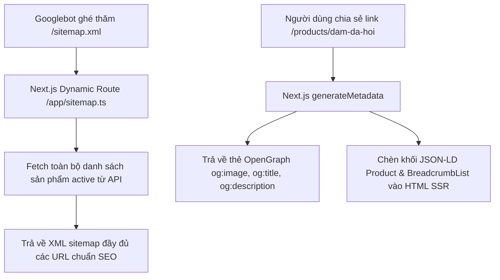

# Đặc Tả Tính Năng: Cấu Hình SEO Metadata, Sitemap XML & Dữ Liệu Có Cấu Trúc

| Thuộc tính | Giá trị |
|---|---|
| **ID** | `CNT-003` |
| **Tên tính năng** | Tối ưu hóa SEO kỹ thuật: Metadata động, Open Graph, Sitemap XML tự động và Schema JSON-LD |
| **Module** | CNT (Content & SEO) |
| **Phạm vi** | CLIENT |
| **Ưu tiên** | P2 - Tăng trưởng tìm kiếm tự nhiên |
| **Trạng thái** | 📝 SPEC |
| **Người phụ trách** | Frontend Lead & SEO Specialist |
| **Ngày bắt đầu** | 2026-10-25 |
| **Ngày hoàn thành** | 2026-10-25 |
| **Phụ thuộc** | `CAT-005`, `CAT-006`, `CNT-001` |

---

## Mục Lục
1. [Mục Tiêu và Giá Trị Mang Lại](#1-mục-tiêu-và-giá-trị-mang-lại)
2. [Người Dùng Liên Quan](#2-người-dùng-liên-quan)
3. [Luồng Nghiệp Vụ Chính (Happy Path)](#3-luồng-nghiệp-vụ-chính-happy-path)
4. [Luồng Ngoại Lệ và Trường Hợp Biên](#4-luồng-ngoại-lệ-và-trường-hợp-biên)
5. [Quy Tắc Nghiệp Vụ (Business Rules)](#5-quy-tắc-nghiệp-vụ-business-rules)
6. [Giao Diện & Đa Ngôn Ngữ (UI & i18n)](#6-giao-diện--đa-ngôn-ngữ-ui--i18n)
7. [Đặc Tả Kỹ Thuật Next.js & API](#7-đặc-tả-kỹ-thuật-nextjs--api)
8. [Thay Đổi Cơ Sở Dữ Liệu](#8-thay-đổi-cơ-sở-dữ-liệu)
9. [Tiêu Chí Nghiệm Thu (Acceptance Criteria)](#9-tiêu-chí-nghiệm-thu-acceptance-criteria)
10. [Kế Hoạch Kiểm Thử](#10-kế-hoạch-kiểm-thử)
11. [Checklist Hoàn Thành (Definition of Done)](#11-checklist-hoàn-thành-definition-of-done)

---

## 1. Mục Tiêu và Giá Trị Mang Lại
- **Tối ưu hóa thứ hạng Google (Top SEO Search)**: Khi khách hàng tìm kiếm các từ khóa hot như *"thuê váy thiết kế hà nội"*, *"thuê áo dài kỷ yếu"*, *"thuê máy ảnh chụp ngoại cảnh"*, website Chickie Studio sẽ xuất hiện ở top đầu kết quả tìm kiếm tự nhiên.
- **Tối ưu hóa chia sẻ mạng xã hội (Open Graph & Twitter Card)**: Khi gửi link váy qua Zalo, Messenger hoặc Facebook, liên kết sẽ hiển thị ảnh thẻ card sắc nét, tiêu đề thu hút và giá thuê rõ ràng.
- **Dữ liệu có cấu trúc Schema.org JSON-LD**: Giúp Google hiểu rõ cửa hàng vật lý (`ClothingStore`), sản phẩm (`Product` kèm giá và tình trạng còn hàng), các bài đánh giá và câu hỏi thường gặp (`FAQPage`).
- **Sitemap XML & Robots.txt tự động**: Tự động sinh `sitemap.xml` cập nhật các sản phẩm mới thêm mỗi ngày để Googlebot lập chỉ mục ngay lập tức.

---

## 2. Người Dùng Liên Quan
- [x] **Khách hàng tiềm năng**: Tìm thấy website tiệm trên Google tìm kiếm tự nhiên mà không cần tiệm tốn tiền chạy quảng cáo.
- [x] **Googlebot & Facebook Crawler**: Thu thập dữ liệu trang web chuẩn xác, nhanh chóng.

---

## 3. Luồng Kỹ Thuật Triển Khai Trong Next.js 14 App Router

---

## 4. Luồng Ngoại Lệ và Trường Hợp Biên
- **Sản phẩm đã bị xóa hoặc ẩn**: Trả về mã HTTP `404` và loại bỏ khỏi `sitemap.xml` để tránh lỗi 404 trong Google Search Console.
- **Trang chưa có ảnh đại diện**: Fallback lấy ảnh bìa thương hiệu mặc định của tiệm (`og-default.jpg`).

---

## 5. Quy Tắc Nghiệp Vụ (Business Rules)
- **BR-01**: Thẻ tiêu đề (`<title>`) theo định dạng chuẩn: `[Tên Sản Phẩm] - Thuê Đồ Thiết Kế Chickie Studio Hà Nội`.
- **BR-02**: Thẻ `canonical` bắt buộc phải trỏ về URL gốc chuẩn không có query parameter rác.
- **BR-03**: Schema JSON-LD bắt buộc phải hợp lệ 100% theo chuẩn kiểm tra của Google Rich Results Test.

---

## 6. Giao Diện & Đa Ngôn Ngữ (UI & i18n)
- Hỗ trợ thẻ `hreflang` chuyển đổi song ngữ giữa phiên bản tiếng Việt (`vi`) và tiếng Anh (`en`) theo cấu trúc [`CNT-007`](file:///e:/chickie-studio/docs/features/content-seo/CNT-007-da-ngon-ngu-vi-en-client.md).

---

## 7. Đặc Tả Kỹ Thuật Next.js & API
- File `client/src/app/sitemap.ts`: Hàm sinh sitemap động.
- File `client/src/app/robots.ts`: Cấu hình cho phép bot thu thập dữ liệu và chặn các route `/admin`, `/api`.
- Hàm `generateMetadata({ params })` trong trang chi tiết `[slug]/page.tsx`.

---

## 8. Thay Đổi Cơ Sở Dữ Liệu
- Không yêu cầu bảng mới. Tận dụng trường `slug`, `name`, `description`, `images` của bảng `products` và `categories`.

---

## 9. Tiêu Chí Nghiệm Thu (Acceptance Criteria)
- **Given**: Truy cập đường dẫn `/sitemap.xml`.
- **When**: Kiểm tra nội dung trả về.
- **Then**: Trả về XML hợp lệ chứa đầy đủ link trang chủ, các trang chính sách và toàn bộ URL sản phẩm.
- **Rich Results Test**: Đạt 0 lỗi đối với schema `Product` và `ClothingStore`.

---

## 10. Kế Hoạch Kiểm Thử
- **E2E Test**: Kiểm tra mã nguồn HTML SSR chứa đúng các thẻ meta `og:title`, `og:image` và JSON-LD.
- **Coverage**: $\ge 85\%$.

---

## 11. Checklist Hoàn Thành (Definition of Done)
- [ ] Tài liệu đặc tả `CNT-003` hoàn thành.
- [ ] Cập nhật `FEATURES.md` và `CHANGELOG.md`.
