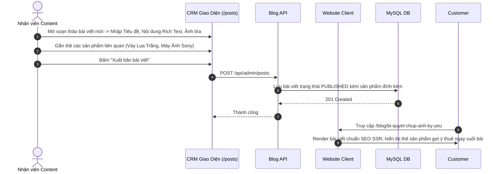

# Đặc Tả Tính Năng: Blog Chia Sẻ Kinh Nghiệm Chụp Ảnh & Chọn Đồ

| Thuộc tính | Giá trị |
|---|---|
| **ID** | `CNT-004` |
| **Tên tính năng** | Blog cẩm nang chia sẻ kinh nghiệm chụp ảnh, phối đồ ngoại cảnh & Quản lý bài viết trên CRM |
| **Module** | CNT (Content & SEO) |
| **Phạm vi** | CLIENT, CRM, SERVER |
| **Ưu tiên** | P2 - Marketing nội dung (Content Marketing) |
| **Trạng thái** | 📝 SPEC |
| **Người phụ trách** | Fullstack Dev & UI/UX Specialist |
| **Ngày bắt đầu** | 2026-10-25 |
| **Ngày hoàn thành** | 2026-10-25 |
| **Phụ thuộc** | `AUTH-002`, `CNT-003` |

---

## Mục Lục
1. [Mục Tiêu và Giá Trị Mang Lại](#1-mục-tiêu-và-giá-trị-mang-lại)
2. [Người Dùng Liên Quan](#2-người-dùng-liên-quan)
3. [Luồng Nghiệp Vụ Chính (Happy Path)](#3-luồng-nghiệp-vụ-chính-happy-path)
4. [Luồng Ngoại Lệ và Trường Hợp Biên](#4-luồng-ngoại-lệ-và-trường-hợp-biên)
5. [Quy Tắc Nghiệp Vụ (Business Rules)](#5-quy-tắc-nghiệp-vụ-business-rules)
6. [Giao Diện & Đa Ngôn Ngữ (UI & i18n)](#6-giao-diện--đa-ngôn-ngữ-ui--i18n)
7. [Đặc Tả API Backend](#7-đặc-tả-api-backend)
8. [Thay Đổi Cơ Sở Dữ Liệu](#8-thay-đổi-cơ-sở-dữ-liệu)
9. [Tiêu Chí Nghiệm Thu (Acceptance Criteria)](#9-tiêu-chí-nghiệm-thu-acceptance-criteria)
10. [Kế Hoạch Kiểm Thử](#10-kế-hoạch-kiểm-thử)
11. [Checklist Hoàn Thành (Definition of Done)](#11-checklist-hoàn-thành-definition-of-done)

---

## 1. Mục Tiêu và Giá Trị Mang Lại
- **Thu hút lượng truy cập tự nhiên khổng lồ (Inbound Organic Traffic)**: Các bài viết hướng dẫn mẹo chụp ảnh (ví dụ: *"Top 10 địa điểm chụp cúc họa mi đẹp nhất Hà Nội"*, *"Bí quyết chọn áo dài kỷ yếu tôn dáng cho nàng nấm lùn"*, *"Hướng dẫn chỉnh thông số máy ảnh Sony chụp ngoại cảnh"*) thu hút hàng chục nghìn lượt đọc của các bạn trẻ mỗi mùa.
- **Dẫn dắt chuyển đổi thuê đồ trực tiếp (Product Tagging)**: Trong nội dung bài viết có thể gắn tag trực tiếp các mẫu váy hoặc máy ảnh của tiệm; khách đọc bài ưng ý có thể bấm thuê ngay bên dưới bài viết.
- **Công cụ soạn thảo trực quan Rich Text Editor trên CRM**: Cho phép nhân viên biên tập nội dung, chèn ảnh, đề mục H2/H3 và định dạng bài viết chuyên nghiệp.

---

## 2. Người Dùng Liên Quan
- [x] **Độc giả / Khách hàng**: Đọc cẩm nang hữu ích trên Client và xem các set đồ được gợi ý trong bài.
- [x] **Nhân viên & Admin**: Viết bài, xuất bản bài viết hoặc lên lịch đăng bài trên CRM.

---

## 3. Luồng Nghiệp Vụ Chính (Happy Path)



---

## 4. Luồng Ngoại Lệ và Trường Hợp Biên
- **Bài viết ở trạng thái Bản nháp (`DRAFT`)**: Chỉ hiển thị trên CRM cho người viết xem trước, tuyệt đối không xuất hiện trên Client công khai.

---

## 5. Quy Tắc Nghiệp Vụ (Business Rules)
- **BR-01**: Mỗi bài viết có 1 `slug` duy nhất chuẩn SEO (không dấu, cách nhau bằng gạch ngang `-`).
- **BR-02**: Cho phép gắn tối đa **6 sản phẩm liên quan** vào mỗi bài viết để hiển thị khối "Trang phục gợi ý trong bài viết".

---

## 6. Giao Diện & Đa Ngôn Ngữ (UI & i18n)
- **Client**: Trang danh sách `/blog`, trang chi tiết `/blog/[slug]` với typography thanh lịch phong cách tạp chí thời trang, mục lục tự động Table of Contents bên cạnh.
- **CRM**: Trang quản lý bài viết `/posts`, trình soạn thảo Markdown / Rich Text.
- **Keys i18n**: Namespace `blog.*`.

---

## 7. Đặc Tả API Backend
- `GET /api/public/posts`: Danh sách bài viết công khai (phân trang, tag).
- `GET /api/public/posts/{slug}`: Chi tiết bài viết kèm sản phẩm liên quan.
- `POST /api/admin/posts`: Tạo bài viết mới.
- `PUT /api/admin/posts/{id}`: Cập nhật bài viết.
- `DELETE /api/admin/posts/{id}`: Xóa bài viết.

---

## 8. Thay Đổi Cơ Sở Dữ Liệu
- Tạo bảng `posts` và `post_products` (Migration Flyway `V25__create_posts_table.sql`):
```sql
CREATE TABLE `posts` (
    `id` BIGINT AUTO_INCREMENT PRIMARY KEY,
    `title` VARCHAR(255) NOT NULL,
    `slug` VARCHAR(255) NOT NULL UNIQUE,
    `thumbnail_url` VARCHAR(255) NOT NULL,
    `summary` VARCHAR(500) NOT NULL,
    `content` LONGTEXT NOT NULL,
    `status` VARCHAR(20) NOT NULL DEFAULT 'PUBLISHED', -- DRAFT, PUBLISHED, ARCHIVED
    `views_count` INT NOT NULL DEFAULT 0,
    `author_name` VARCHAR(100) NOT NULL,
    `created_at` TIMESTAMP NOT NULL DEFAULT CURRENT_TIMESTAMP,
    `updated_at` TIMESTAMP NOT NULL DEFAULT CURRENT_TIMESTAMP ON UPDATE CURRENT_TIMESTAMP,
    INDEX `idx_posts_slug` (`slug`),
    INDEX `idx_posts_status` (`status`)
);
```

---

## 9. Tiêu Chí Nghiệm Thu (Acceptance Criteria)
- **Given**: Bài viết được xuất bản trên CRM.
- **When**: Truy cập URL trên Client.
- **Then**: Trang render mượt mà, ảnh sắc nét, hiển thị danh sách váy gợi ý thuê kèm nút đặt thuê trực tiếp.

---

## 10. Kế Hoạch Kiểm Thử
- **Unit Test**: `PostServiceTest`.
- **Coverage**: $\ge 85\%$.

---

## 11. Checklist Hoàn Thành (Definition of Done)
- [ ] Tài liệu đặc tả `CNT-004` hoàn thành.
- [ ] Cập nhật `FEATURES.md` và `CHANGELOG.md`.
