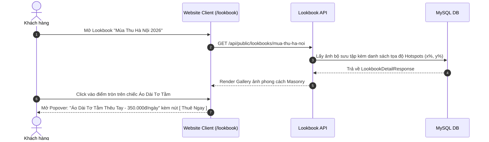

# Đặc Tả Tính Năng: Lookbook Bộ Sưu Tập Phối Đồ Theo Mùa

| Thuộc tính | Giá trị |
|---|---|
| **ID** | `CNT-005` |
| **Tên tính năng** | Lookbook bộ sưu tập phối đồ thời trang theo mùa & Mua sắm qua ảnh (Shoppable Lookbook) |
| **Module** | CNT (Content & Visuals) |
| **Phạm vi** | CLIENT, CRM, SERVER |
| **Ưu tiên** | P2 - Trải nghiệm thị giác & Cảm hứng thời trang |
| **Trạng thái** | 📝 SPEC |
| **Người phụ trách** | Fullstack Dev & UI/UX Specialist |
| **Ngày bắt đầu** | 2026-10-25 |
| **Ngày hoàn thành** | 2026-10-25 |
| **Phụ thuộc** | `CAT-002`, `CAT-005` |

---

## Mục Lục
1. [Mục Tiêu và Giá Trị Mang Lại](#1-mục-tiêu-và-giá-trị-mang-lại)
2. [Người Dùng Liên Quan](#2-người-dùng-liên-quan)
3. [Luồng Nghiệp Vụ Chính (Happy Path)](#3-luồng-nghiệp-vụ-chính-happy-path)
4. [Luồng Ngoại Lệ và Trường Hợp Biên](#4-luồng-ngoại-lệ-và-trường-hợp-biên)
5. [Quy Tắc Nghiệp Vụ (Business Rules)](#5-quy-tắc-nghiệp-vụ-business-rules)
6. [Giao Diện & Đa Ngôn Ngữ (UI & i18n)](#6-giao-diện--đa-ngôn-ngữ-ui--i18n)
7. [Đặc Tả API Backend](#7-đặc-tả-api-backend)
8. [Thay Đổi Cơ Sở Dữ Liệu](#8-thay-đổi-cơ-sở-dữ-liệu)
9. [Tiêu Chí Nghiệm Thu (Acceptance Criteria)](#9-tiêu-chí-nghiệm-thu-acceptance-criteria)
10. [Kế Hoạch Kiểm Thử](#10-kế-hoạch-kiểm-thử)
11. [Checklist Hoàn Thành (Definition of Done)](#11-checklist-hoàn-thành-definition-of-done)

---

## 1. Mục Tiêu và Giá Trị Mang Lại
- **Truyền cảm hứng thời trang thị giác đỉnh cao**: Khách hàng thuê đồ chụp ảnh rất cần nhìn thấy hình ảnh "lên dáng" thực tế trong bối cảnh ngoại cảnh (ví dụ: bối cảnh phố cổ Hà Nội, hồ Tây hoàng hôn, studio cổ điển, vườn cúc họa mi).
- **Shoppable Lookbook (Gắn điểm ghim tương tác - Hotspots)**: Trên mỗi bức ảnh lookbook nghệ thuật có các điểm ghim tròn nhỏ (Hotspot dots). Khi khách rê chuột hoặc bấm vào điểm ghim trên váy, hệ thống hiển thị popover thông tin sản phẩm và nút "Thuê ngay chiếc váy này".

---

## 2. Người Dùng Liên Quan
- [x] **Khách hàng**: Lướt xem bộ sưu tập ảnh theo phong cách (Vintage, Nàng thơ, Cá tính, Kỷ yếu).
- [x] **Admin**: Tải ảnh bộ sưu tập, kéo thả điểm ghim Hotspot lên trang phục trên ảnh.

---

## 3. Luồng Nghiệp Vụ Chính (Happy Path)



---

## 4. Luồng Ngoại Lệ và Trường Hợp Biên
- **Ảnh không gắn Hotspot**: Hoạt động như một album ảnh nghệ thuật thông thường (LightBox phóng to).

---

## 5. Quy Tắc Nghiệp Vụ (Business Rules)
- **BR-01**: Tọa độ Hotspot được lưu dưới dạng phần trăm tương đối: `coordinate_x` (0 - 100%), `coordinate_y` (0 - 100%) để responsive hoàn hảo trên mọi kích thước màn hình từ điện thoại đến máy tính.

---

## 6. Giao Diện & Đa Ngôn Ngữ (UI & i18n)
- **Client**: Trang `/lookbook`, layout lưới so le (Masonry Grid), hiệu ứng hover phóng to nhẹ, component `ImageHotspot`.
- **CRM**: Trang quản lý `/lookbooks` với công cụ click vào ảnh để gắn sản phẩm.
- **Keys i18n**: Namespace `lookbook.*`.

---

## 7. Đặc Tả API Backend
- `GET /api/public/lookbooks`: Danh sách các bộ sưu tập.
- `GET /api/public/lookbooks/{slug}`: Chi tiết bộ sưu tập kèm ảnh và hotspots.
- `POST /api/admin/lookbooks`: Tạo mới Lookbook.
- `POST /api/admin/lookbooks/{id}/items`: Thêm ảnh và gán hotspots.

---

## 8. Thay Đổi Cơ Sở Dữ Liệu
- Tạo bảng `lookbooks` và `lookbook_items` (Migration Flyway `V26__create_lookbooks_table.sql`):
```sql
CREATE TABLE `lookbooks` (
    `id` BIGINT AUTO_INCREMENT PRIMARY KEY,
    `title` VARCHAR(150) NOT NULL,
    `slug` VARCHAR(150) NOT NULL UNIQUE,
    `cover_image_url` VARCHAR(255) NOT NULL,
    `description` TEXT NULL,
    `season` VARCHAR(30) NULL, -- SPRING, SUMMER, AUTUMN, WINTER, GRADUATION
    `is_active` BOOLEAN NOT NULL DEFAULT TRUE,
    `created_at` TIMESTAMP NOT NULL DEFAULT CURRENT_TIMESTAMP
);

CREATE TABLE `lookbook_items` (
    `id` BIGINT AUTO_INCREMENT PRIMARY KEY,
    `lookbook_id` BIGINT NOT NULL,
    `image_url` VARCHAR(255) NOT NULL,
    `caption` VARCHAR(255) NULL,
    `hotspots` JSON NULL, -- [{"x": 45.2, "y": 60.1, "productId": 10}]
    `sort_order` INT NOT NULL DEFAULT 0,
    CONSTRAINT `fk_lookbook_rel` FOREIGN KEY (`lookbook_id`) REFERENCES `lookbooks` (`id`) ON DELETE CASCADE
);
```

---

## 9. Tiêu Chí Nghiệm Thu (Acceptance Criteria)
- **Given**: Khách xem ảnh Lookbook trên điện thoại.
- **When**: Bấm vào điểm ghim tròn trên váy.
- **Then**: Popover mở ra đúng vị trí ghim, hiển thị tên váy và giá thuê chính xác.

---

## 10. Kế Hoạch Kiểm Thử
- **Unit Test**: `LookbookServiceTest`.
- **Frontend Test**: `ImageHotspot.test.tsx`.
- **Coverage**: $\ge 85\%$.

---

## 11. Checklist Hoàn Thành (Definition of Done)
- [ ] Tài liệu đặc tả `CNT-005` hoàn thành.
- [ ] Cập nhật `FEATURES.md` và `CHANGELOG.md`.
