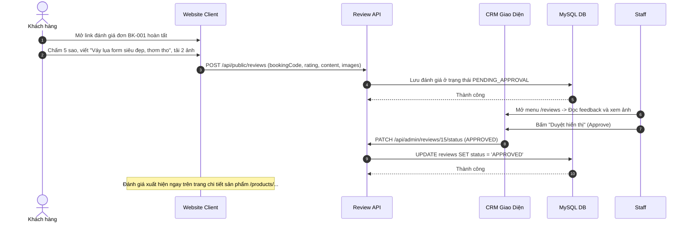

# Đặc Tả Tính Năng: Thu Thập & Hiển Thị Đánh Giá Kèm Ảnh Thực Tế

| Thuộc tính | Giá trị |
|---|---|
| **ID** | `CNT-006` |
| **Tên tính năng** | Hệ thống thu thập, kiểm duyệt và hiển thị đánh giá (Reviews) kèm ảnh khách mặc thực tế |
| **Module** | CNT (Content & Social Proof) |
| **Phạm vi** | CLIENT, CRM, SERVER |
| **Ưu tiên** | P2 - Xây dựng uy tín & Tăng tỷ lệ chuyển đổi |
| **Trạng thái** | 📝 SPEC |
| **Người phụ trách** | Fullstack Dev & UI/UX Specialist |
| **Ngày bắt đầu** | 2026-10-25 |
| **Ngày hoàn thành** | 2026-10-25 |
| **Phụ thuộc** | `BOK-003`, `CAT-006` |

---

## Mục Lục
1. [Mục Tiêu và Giá Trị Mang Lại](#1-mục-tiêu-và-giá-trị-mang-lại)
2. [Người Dùng Liên Quan](#2-người-dùng-liên-quan)
3. [Luồng Nghiệp Vụ Chính (Happy Path)](#3-luồng-nghiệp-vụ-chính-happy-path)
4. [Luồng Ngoại Lệ và Trường Hợp Biên](#4-luồng-ngoại-lệ-và-trường-hợp-biên)
5. [Quy Tắc Nghiệp Vụ (Business Rules)](#5-quy-tắc-nghiệp-vụ-business-rules)
6. [Giao Diện & Đa Ngôn Ngữ (UI & i18n)](#6-giao-diện--đa-ngôn-ngữ-ui--i18n)
7. [Đặc Tả API Backend](#7-đặc-tả-api-backend)
8. [Thay Đổi Cơ Sở Dữ Liệu](#8-thay-đổi-cơ-sở-dữ-liệu)
9. [Tiêu Chí Nghiệm Thu (Acceptance Criteria)](#9-tiêu-chí-nghiệm-thu-acceptance-criteria)
10. [Kế Hoạch Kiểm Thử](#10-kế-hoạch-kiểm-thử)
11. [Checklist Hoàn Thành (Definition of Done)](#11-checklist-hoàn-thành-definition-of-done)

---

## 1. Mục Tiêu và Giá Trị Mang Lại
- **Bằng chứng xã hội chân thực nhất (Social Proof)**: Khách thuê đồ online sợ nhất là "ảnh mạng một đằng, đồ thật một nẻo". Xem ảnh feedback thật do khách đã thuê trước đó mặc đi chụp ảnh ngoại cảnh sẽ xóa bỏ 100% sự đắn đo của khách mới.
- **Xác thực người thuê thật (Verified Renter)**: Chỉ những khách hàng đã hoàn thành đơn thuê (`COMPLETED`) mới được cấp quyền viết đánh giá có gắn huy hiệu "Đã thuê đồ tại Chickie".
- **Hệ thống kiểm duyệt nội dung (Moderation System)**: Nhân viên tiệm duyệt nội dung trên CRM trước khi đánh giá được hiển thị công khai trên website.

---

## 2. Người Dùng Liên Quan
- [x] **Khách hàng đã thuê đồ**: Nhận link mời đánh giá sau khi hoàn tất đơn, chấm sao 1-5, viết cảm nhận và tải lên 1 - 4 ảnh chụp thực tế.
- [x] **Admin / Nhân viên CRM**: Duyệt đánh giá, ghim đánh giá hay lên đầu hoặc phản hồi lời cảm ơn tới khách hàng.

---

## 3. Luồng Nghiệp Vụ Chính (Happy Path)



---

## 4. Luồng Ngoại Lệ và Trường Hợp Biên
- **Đánh giá spam hoặc chứa từ ngữ phản cảm**: Nhân viên CRM bấm "Từ chối" (`REJECTED`) và nhập lý do.
- **Khách chưa thuê hoặc đơn bị hủy**: Hệ thống chặn không cho gửi đánh giá với mã đơn này.

---

## 5. Quy Tắc Nghiệp Vụ (Business Rules)
- **BR-01**: Mỗi đơn thuê hoàn tất chỉ được gửi đánh giá tối đa **1 lần**.
- **BR-02**: Đánh giá được tính vào điểm sao trung bình của sản phẩm chỉ sau khi đã được duyệt (`APPROVED`).

---

## 6. Giao Diện & Đa Ngôn Ngữ (UI & i18n)
- **Client**: Khối `ProductReviewsSection` trên trang chi tiết sản phẩm với thanh thống kê phân bổ sao, bộ lọc "Có ảnh", gallery ảnh feedback dạng popup Lightbox.
- **CRM**: Trang `/reviews` quản lý duyệt đánh giá.
- **Keys i18n**: Namespace `review.*`.

---

## 7. Đặc Tả API Backend
- `GET /api/public/products/{id}/reviews`: Lấy danh sách đánh giá đã duyệt.
- `POST /api/public/reviews`: Khách gửi đánh giá kèm ảnh.
- `GET /api/admin/reviews`: CRM lấy danh sách chờ duyệt.
- `PATCH /api/admin/reviews/{id}/status`: Duyệt hoặc từ chối đánh giá.

---

## 8. Thay Đổi Cơ Sở Dữ Liệu
- Tạo bảng `reviews` (Migration Flyway `V27__create_reviews_table.sql`):
```sql
CREATE TABLE `reviews` (
    `id` BIGINT AUTO_INCREMENT PRIMARY KEY,
    `product_id` BIGINT NOT NULL,
    `booking_id` BIGINT NOT NULL,
    `customer_name` VARCHAR(100) NOT NULL,
    `customer_phone` VARCHAR(20) NOT NULL,
    `rating` INT NOT NULL, -- 1 đến 5 sao
    `comment` TEXT NOT NULL,
    `images` JSON NULL, -- mảng URLs ảnh
    `status` VARCHAR(20) NOT NULL DEFAULT 'PENDING_APPROVAL', -- PENDING_APPROVAL, APPROVED, REJECTED
    `admin_reply` TEXT NULL,
    `is_pinned` BOOLEAN NOT NULL DEFAULT FALSE,
    `created_at` TIMESTAMP NOT NULL DEFAULT CURRENT_TIMESTAMP,
    INDEX `idx_reviews_product` (`product_id`, `status`),
    INDEX `idx_reviews_booking` (`booking_id`)
);
```

---

## 9. Tiêu Chí Nghiệm Thu (Acceptance Criteria)
- **Given**: Khách gửi đánh giá 5 sao kèm 2 ảnh.
- **When**: Nhân viên duyệt trên CRM.
- **Then**: Đánh giá xuất hiện ngay trên trang chi tiết sản phẩm; điểm sao trung bình của sản phẩm tự động cập nhật.

---

## 10. Kế Hoạch Kiểm Thử
- **Unit Test**: `ReviewServiceTest` (tính toán trung bình sao, chặn đơn chưa hoàn tất).
- **Frontend Test**: `ProductReviewsSection.test.tsx`.
- **Coverage**: $\ge 85\%$.

---

## 11. Checklist Hoàn Thành (Definition of Done)
- [ ] Tài liệu đặc tả `CNT-006` hoàn thành.
- [ ] Cập nhật `FEATURES.md` và `CHANGELOG.md`.
