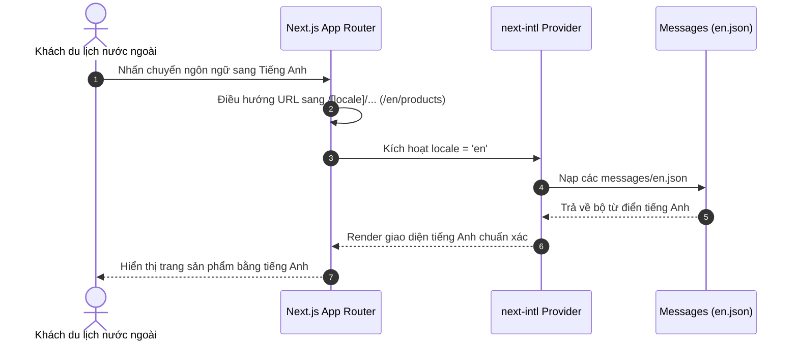

# Đặc Tả Tính Năng: Hạ Tầng Đa Ngôn Ngữ (i18n) Phía Client

| Thuộc tính | Giá trị |
|---|---|
| **ID** | `CNT-007` |
| **Tên tính năng** | Hạ tầng đa ngôn ngữ (Tiếng Việt & Tiếng Anh) phía Client với next-intl |
| **Module** | CNT (Content & SEO) |
| **Phạm vi** | CLIENT |
| **Ưu tiên** | P0 - MVP |
| **Trạng thái** | ✅ DONE |
| **Người phụ trách** | Frontend Lead / Senior Web Dev |
| **Ngày bắt đầu** | 2026-10-25 |
| **Ngày hoàn thành** | 2026-10-25 |
| **Phụ thuộc** | Không |

---

## 1. Mục Tiêu và Giá Trị Mang Lại
Thiết lập nền tảng đa ngôn ngữ toàn diện cho website Chickie Studio bằng thư viện `next-intl`. Hỗ trợ song ngữ Tiếng Việt (mặc định) và Tiếng Anh (cho du khách nước ngoài muốn thuê áo dài hoặc váy chụp ảnh tại Hà Nội), tối ưu hóa SEO quốc tế qua thuộc tính `hreflang` và cấu trúc URL phân tách theo locale.

## 2. Người Dùng Liên Quan
- [x] **Khách hàng trong nước**: Trải nghiệm website thuần tiếng Việt gần gũi.
- [x] **Khách du lịch quốc tế / Người nước ngoài**: Chuyển sang tiếng Anh để xem mẫu, chọn size và đặt thuê áo dài dễ dàng.

## 3. Luồng Chính (Happy Path)
1. Người dùng truy cập đường dẫn mặc định `chickiestudio.vn/`.
2. Hệ thống Next.js middleware tự động nhận diện ngôn ngữ trình duyệt (Accept-Language) hoặc điều hướng về `/vi`.
3. Người dùng nhấn vào nút chuyển đổi ngôn ngữ (Language Switcher) trên Header:
   - Chọn cờ Anh (EN) $\rightarrow$ Đường dẫn chuyển thành `/en/...`.
4. Toàn bộ chuỗi văn bản trên giao diện (menu, card sản phẩm, form đặt thuê, thông báo lỗi) lập tức hiển thị bằng tiếng Anh từ file `src/i18n/messages/en.json`.
5. Thuộc tính `<html lang="en">` được cập nhật tương ứng cho bot tìm kiếm.



## 4. Luồng Ngoại Lệ và Trường Hợp Biên
- **Truy cập locale không hợp lệ (ví dụ `/fr/products`)**: Middleware tự động chuyển hướng về locale mặc định `/vi/products`.
- **Thiếu key ngôn ngữ**: Kiểm thử tự động sẽ báo lỗi ngay khi build CI nếu `en.json` thiếu key so với `vi.json`.

## 5. Quy Tắc Nghiệp Vụ
- **BR-01**: Tiếng Việt (`vi`) là ngôn ngữ mặc định.
- **BR-02**: Tuyệt đối cấm hardcode bất kỳ chuỗi hiển thị nào trong mã nguồn JSX/TSX.
- **BR-03**: Mọi key thêm mới bắt buộc phải được khai báo đồng thời trong cả 2 file `vi.json` và `en.json`.

## 6. Giao Diện & Đa Ngôn Ngữ (UI & i18n)
- **Màn hình**: Nút chuyển đổi ngôn ngữ (Dropdown hoặc Pill Switcher) đặt ở Header và Footer.
- **Component dùng chung**: `LanguageSwitcher`.
- **Cấu trúc namespace trong `messages/`**:
```text
src/i18n/messages/
├── vi.json     # common, navigation, home, product, booking, tracking, errors
└── en.json     # cùng cấu trúc namespace và keys 100%
```

## 7. Tiêu Chí Nghiệm Thu (Acceptance Criteria)
- [x] **Kịch bản 1 - Chuyển đổi ngôn ngữ**:
  - **Given**: Đang ở trang chi tiết váy `/vi/products/vay-lua-trang`.
  - **When**: Chọn ngôn ngữ English.
  - **Then**: Chuyển sang `/en/products/vay-lua-trang`, các nhãn đổi thành "Rental Price", "Rent Now", "Size Guide".
- [x] **Kịch bản 2 - Kiểm tra đồng bộ key tự động**:
  - **Given**: File test `i18n.test.ts`.
  - **When**: Chạy `npm run test`.
  - **Then**: Kiểm tra cấu trúc key của `vi.json` và `en.json` khớp nhau hoàn toàn, không thiếu key nào.

## 8. Kế Hoạch Test
- **Unit Test**: Test script so sánh đệ quy toàn bộ keys giữa 2 file JSON ngôn ngữ (`src/i18n/i18n.test.ts`), test cấu hình request (`src/i18n/request.test.ts`), test điều hướng middleware (`src/middleware.test.ts`), test component `LanguageSwitcher` (`src/components/ui/LanguageSwitcher/LanguageSwitcher.test.tsx`), test `I18nProvider` (`src/components/providers/I18nProvider.test.tsx`).
- **UI Test**: Test Playwright E2E (`client/e2e/i18n.spec.ts`) kiểm tra chuyển đổi VI/EN trên Header & Footer, kiểm tra thuộc tính `html lang` và điều hướng locale không hợp lệ.
- **Mục tiêu Coverage**: $\ge 80\%$ (Đạt: Lines 96.03%, Branches 84.69%).

## 9. Checklist Hoàn Thành (Definition of Done)
- [x] Cấu hình Next.js App Router với `[locale]` phân tầng chuẩn.
- [x] Đầy đủ bộ từ điển tiếng Việt và tiếng Anh ban đầu.
- [x] Test đối soát key tự động chạy trong CI/CD.
- [x] Cập nhật `docs/FEATURES.md` và `docs/CHANGELOG.md`.

## 10. Nhật Ký Thực Hiện
| Ngày | Người thực hiện | Nội dung thay đổi | Trạng thái mới |
|---|---|---|---|
| 2026-10-24 | Tech Lead | Soạn thảo tài liệu đặc tả ban đầu | 📝 SPEC |
| 2026-10-25 | Frontend Team | Triển khai next-intl, LanguageSwitcher, routing [locale], unit tests & Playwright E2E test | ✅ DONE |
