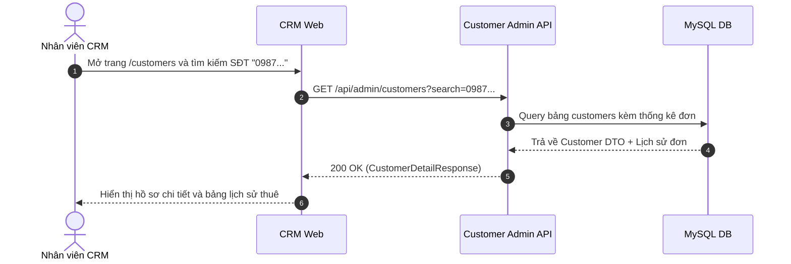

# Đặc Tả Tính Năng: Quản Lý Khách Hàng & Lịch Sử Thuê Đồ Trên CRM

| Thuộc tính | Giá trị |
|---|---|
| **ID** | `CUS-001` |
| **Tên tính năng** | Quản lý danh sách khách hàng và lịch sử thuê đồ tập trung |
| **Module** | CUS (Customer) |
| **Phạm vi** | CRM, SERVER |
| **Ưu tiên** | P0 - MVP |
| **Trạng thái** | 📝 SPEC |
| **Người phụ trách** | Fullstack Dev |
| **Ngày bắt đầu** | - |
| **Ngày hoàn thành** | - |
| **Phụ thuộc** | `AUTH-001`, `BOK-001` |

---

## 1. Mục Tiêu và Giá Trị Mang Lại
Tự động lưu trữ và quản lý tập trung thông tin khách hàng từ các đơn đặt online hoặc tại quầy. Giúp nhân viên nhận diện khách quen (VIP), xem lại kích cỡ đồ và số đo lần trước khách từng mặc vừa, cũng như tra cứu lịch sử giữ gìn đồ đạc của khách trong những lần thuê trước.

## 2. Người Dùng Liên Quan
- [x] **Nhân viên & Admin**: Tra cứu thông tin khách hàng khi khách gọi điện, xem lại lịch sử các đơn hàng trước đó.

## 3. Luồng Chính (Happy Path)
1. Khi khách hàng gửi đơn đặt thuê (`BOK-001`), server kiểm tra số điện thoại:
   - Nếu số điện thoại đã có: cập nhật tên/địa chỉ và liên kết `customer_id` vào đơn mới.
   - Nếu số điện thoại mới: tự động tạo bản ghi mới trong bảng `customers`.
2. Nhân viên mở CRM `/customers`, hệ thống hiển thị danh sách dạng `DataTable`: Họ tên, SĐT, Số lần đã thuê, Tổng chi tiêu, Ngày tạo.
3. Nhân viên click vào một khách hàng để xem chi tiết:
   - Thông tin cá nhân và ghi chú số đo.
   - Bảng lịch sử toàn bộ các đơn hàng khách từng đặt (Mã đơn, Ngày thuê, Tên váy, Trạng thái, Tổng tiền).
4. Nhân viên có thể chỉnh sửa thông tin liên hệ hoặc bổ sung ghi chú.



## 4. Luồng Ngoại Lệ và Trường Hợp Biên
- **Khách hàng thay đổi số điện thoại**: Admin có quyền cập nhật SĐT với điều kiện SĐT mới chưa bị trùng trong hệ thống.

## 5. Quy Tắc Nghiệp Vụ
- **BR-01**: Số điện thoại là trường duy nhất dùng để định danh khách hàng trên toàn hệ thống.
- **BR-02**: Tổng chi tiêu (`total_spent`) và số lần thuê (`total_orders`) chỉ được cộng dồn từ những đơn có trạng thái `COMPLETED`.

## 6. Giao Diện & Đa Ngôn Ngữ (UI & i18n)
- **Màn hình**: Trang danh sách `/customers` với thanh tìm kiếm nhanh, Drawer hiển thị hồ sơ chi tiết và tab "Lịch sử đơn thuê".
- **Component dùng chung**: `DataTable`, `FilterBar`, `FormField`.
- **Keys i18n (`vi.json` / `en.json`)**:
```json
{
  "customer": {
    "title": "Quản Lý Khách Hàng",
    "name": "Họ và tên",
    "phone": "Số điện thoại",
    "totalOrders": "Số đơn thuê",
    "totalSpent": "Tổng chi tiêu",
    "orderHistory": "Lịch sử thuê đồ",
    "customerNotes": "Ghi chú số đo & sở thích"
  }
}
```

## 7. Đặc Tả API
| Method | Endpoint | Quyền truy cập | Params | Response Body | Mã lỗi |
|---|---|---|---|---|---|
| `GET` | `/api/admin/customers` | `STAFF`, `ADMIN` | `page, size, search` | `ApiResponse<Page<CustomerSummaryResponse>>` | 401 |
| `GET` | `/api/admin/customers/{id}` | `STAFF`, `ADMIN` | Path variable | `ApiResponse<CustomerDetailResponse>` | 401, 404 |
| `PUT` | `/api/admin/customers/{id}` | `STAFF`, `ADMIN` | `UpdateCustomerRequest` | `ApiResponse<CustomerDetailResponse>` | 400, 404, 409 |

## 8. Thay Đổi Cơ Sở Dữ Liệu
- **File Migration Flyway**: `V1_6__create_customers_table.sql`
```sql
CREATE TABLE `customers` (
    `id` BIGINT AUTO_INCREMENT PRIMARY KEY,
    `full_name` VARCHAR(100) NOT NULL,
    `phone` VARCHAR(20) NOT NULL UNIQUE,
    `email` VARCHAR(100),
    `address` VARCHAR(255),
    `note` TEXT,
    `total_orders` INT NOT NULL DEFAULT 0,
    `total_spent` DECIMAL(12,2) NOT NULL DEFAULT 0.00,
    `created_at` TIMESTAMP NOT NULL DEFAULT CURRENT_TIMESTAMP,
    `updated_at` TIMESTAMP NOT NULL DEFAULT CURRENT_TIMESTAMP ON UPDATE CURRENT_TIMESTAMP,
    INDEX `idx_customers_phone` (`phone`),
    INDEX `idx_customers_name` (`full_name`)
) ENGINE=InnoDB DEFAULT CHARSET=utf8mb4 COLLATE=utf8mb4_unicode_ci;
```

## 9. Tiêu Chí Nghiệm Thu (Acceptance Criteria)
- [ ] **Kịch bản 1 - Tự động tạo khách mới**:
  - **Given**: SĐT `0911222333` chưa từng thuê đồ.
  - **When**: Khách đặt đơn thành công ở Client.
  - **Then**: Bảng `customers` tự sinh bản ghi mới với SĐT trên.
- [ ] **Kịch bản 2 - Khách cũ đặt tiếp**:
  - **Given**: Khách hàng đã có trong DB.
  - **When**: Đặt thêm đơn mới với cùng SĐT.
  - **Then**: Đơn mới được gắn trực tiếp vào ID khách cũ, không sinh bản ghi trùng lặp.

## 10. Kế Hoạch Test
- **Unit Test**: Test logic tìm kiếm hoặc tạo mới khách hàng `findOrCreateCustomer()`.
- **UI Test**: Test `DataTable` danh sách khách hàng và mở Drawer lịch sử đơn.
- **Mục tiêu Coverage**: $\ge 80\%$.

## 11. Checklist Hoàn Thành (Definition of Done)
- [ ] Xử lý chống trùng lặp dữ liệu khách hàng theo SĐT.
- [ ] Tái sử dụng `DataTable` và Drawer.
- [ ] Đầy đủ i18n cho tiếng Việt và tiếng Anh.
- [ ] Test coverage $\ge 80\%$.
- [ ] Cập nhật `docs/FEATURES.md` và `docs/CHANGELOG.md`.

## 12. Nhật Ký Thực Hiện
| Ngày | Người thực hiện | Nội dung thay đổi | Trạng thái mới |
|---|---|---|---|
| 2026-10-24 | Tech Lead | Soạn thảo tài liệu đặc tả ban đầu | 📝 SPEC |
