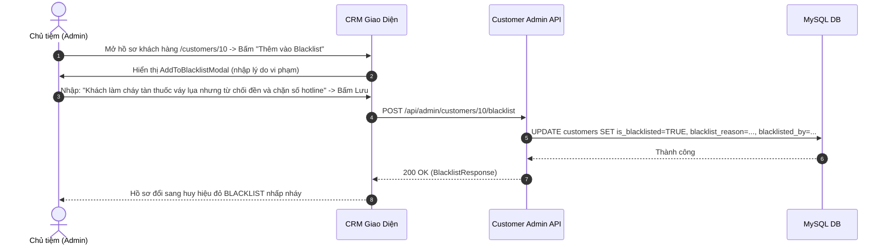
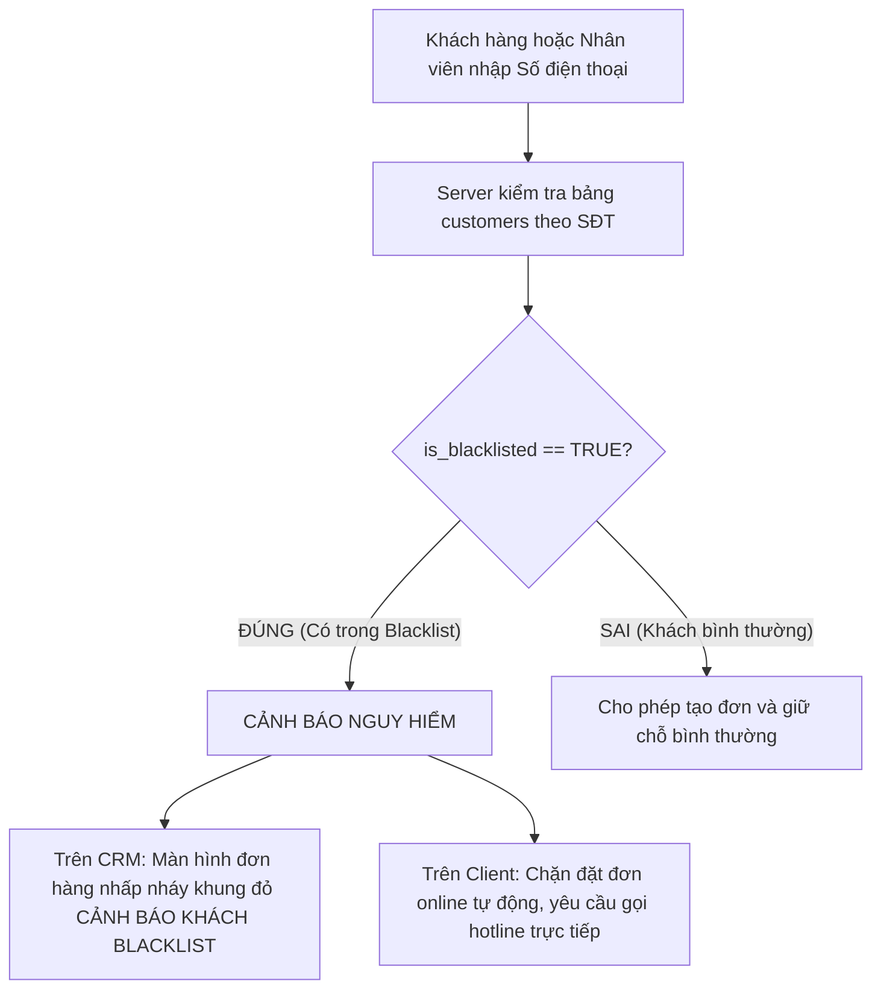

# Đặc Tả Tính Năng: Ghi Chú Nội Bộ & Danh Sách Đen (Blacklist)

| Thuộc tính | Giá trị |
|---|---|
| **ID** | `CUS-002` |
| **Tên tính năng** | Ghi chú nội bộ khách hàng & Quản lý danh sách đen (Customer Notes & Blacklist Management) |
| **Module** | CUS (Customer) |
| **Phạm vi** | CRM, SERVER |
| **Ưu tiên** | P1 - Vận hành cốt lõi |
| **Trạng thái** | 📝 SPEC |
| **Người phụ trách** | Fullstack Dev & Tech Lead |
| **Ngày bắt đầu** | 2026-10-25 |
| **Ngày hoàn thành** | 2026-10-25 |
| **Phụ thuộc** | `CUS-001`, `BOK-001`, `PAY-003` |

---

## Mục Lục
1. [Mục Tiêu và Giá Trị Mang Lại](#1-mục-tiêu-và-giá-trị-mang-lại)
2. [Người Dùng Liên Quan](#2-người-dùng-liên-quan)
3. [Luồng Nghiệp Vụ Chính (Happy Path)](#3-luồng-nghiệp-vụ-chính-happy-path)
4. [Luồng Ngoại Lệ và Trường Hợp Biên](#4-luồng-ngoại-lệ-và-trường-hợp-biên)
5. [Quy Tắc Nghiệp Vụ (Business Rules)](#5-quy-tắc-nghiệp-vụ-business-rules)
6. [Giao Diện & Đa Ngôn Ngữ (UI & i18n)](#6-giao-diện--đa-ngôn-ngữ-ui--i18n)
7. [Đặc Tả API Backend](#7-đặc-tả-api-backend)
8. [Thay Đổi Cơ Sở Dữ Liệu](#8-thay-đổi-cơ-sở-dữ-liệu)
9. [Tiêu Chí Nghiệm Thu (Acceptance Criteria)](#9-tiêu-chí-nghiệm-thu-acceptance-criteria)
10. [Kế Hoạch Kiểm Thử](#10-kế-hoạch-kiểm-thử)
11. [Checklist Hoàn Thành (Definition of Done)](#11-checklist-hoàn-thành-definition-of-done)

---

## 1. Mục Tiêu và Giá Trị Mang Lại
- **Bảo vệ tài sản cửa hàng & phòng chống gian lận**: Ngành cho thuê trang phục dạ hội thiết kế và thiết bị máy ảnh luôn tiềm ẩn rủi ro khách bùng đồ, mang đồ đi cầm cố hoặc làm rách nát rồi từ chối đền bù. Tính năng Blacklist giúp nhận diện ngay các khách hàng rủi ro cao để từ chối phục vụ hoặc yêu cầu đặt cọc 100% giá trị đồ.
- **Cải thiện chất lượng dịch vụ cá nhân hóa qua Ghi chú nội bộ**: Nhân viên dễ dàng lưu lại các thông tin hữu ích về thói quen của khách (ví dụ: *"Khách chuộng tone màu pastel"*, *"Số đo ngực 86 - eo 64 vừa khít size S"*, *"Khách quen hay đến muộn sau 19h"*) giúp ca làm việc sau tư vấn đồ vừa vặn và chu đáo hơn.
- **Cảnh báo tức thì trên mọi màn hình liên quan**: Bất cứ khi nào nhân viên mở đơn hàng, tạo đơn mới tại quầy hoặc khách gõ số điện thoại đặt online, hệ thống tự động kiểm tra cờ Blacklist để đưa ra cảnh báo đỏ nổi bật.

---

## 2. Người Dùng Liên Quan
- [x] **Nhân viên cửa hàng**: Xem cờ cảnh báo khi tư vấn đơn, thêm ghi chú trải nghiệm phục vụ sau khi khách trả đồ.
- [x] **Admin (Chủ tiệm)**: Có đặc quyền đưa khách hàng vào Danh sách đen hoặc gỡ khỏi danh sách đen khi khách đã giải quyết xong tranh chấp/bồi thường.

---

## 3. Luồng Nghiệp Vụ Chính (Happy Path)

### 3.1. Luồng Đưa Khách Vào Danh Sách Đen (Blacklist Flow)



### 3.2. Luồng Kiểm Tra Cảnh Báo Khi Khách Đặt Đơn



---

## 4. Luồng Ngoại Lệ và Trường Hợp Biên

| Tình huống ngoại lệ | Xử lý của hệ thống | Phản hồi giao diện |
|---|---|---|
| **Khách bị Blacklist cố tình đặt đơn trên Client** | Server phát hiện số điện thoại nằm trong Blacklist | Chặn request tạo đơn `POST /api/public/bookings`, trả về `403 FORBIDDEN`: *"Số điện thoại này hiện không thể đặt giữ chỗ trực tuyến. Quý khách vui lòng liên hệ trực tiếp hotline cửa hàng."* |
| **Khách đã đền bù thiệt hại và muốn thuê lại** | Chỉ Admin mới có quyền bấm "Gỡ Blacklist" kèm ghi chú giải trình | Hệ thống xóa cờ Blacklist, chuyển trạng thái khách về bình thường và lưu vết lịch sử gỡ phạt |
| **Nhân viên cố tình đưa khách vào Blacklist** | Nhân viên quầy không có quyền đưa/gỡ Blacklist | Nút bấm bị ẩn trên giao diện; nếu cố tình gọi API thì Spring Security chặn mã `403` |

---

## 5. Quy Tắc Nghiệp Vụ (Business Rules)

- **BR-01 (Định danh chuẩn xác qua SĐT)**: Trạng thái Blacklist được gắn chặt với số điện thoại (`phone`). Nếu khách dùng tên khác nhưng cùng số điện thoại, hệ thống vẫn nhận diện chính xác 100%.
- **BR-02 (Phân quyền bảo mật)**:
  - Thêm ghi chú nội bộ (`customer_notes`): Cả `ROLE_STAFF` và `ROLE_ADMIN` đều có quyền tạo. Ghi chú nội bộ tuyệt đối **không bao giờ hiển thị ra ngoài website Client**.
  - Đưa vào / Gỡ khỏi Blacklist: Chỉ duy nhất `ROLE_ADMIN` mới có quyền thực hiện.
- **BR-03 (Bắt buộc lý do vi phạm)**: Khi đưa khách vào Blacklist, trường lý do (`blacklist_reason`) bắt buộc phải có độ dài tối thiểu 10 ký tự để minh bạch nguyên nhân.

---

## 6. Giao Diện & Đa Ngôn Ngữ (UI & i18n)

### 6.1. Thiết Kế Component CRM
- **Huy Hiệu Cảnh Báo (`BlacklistBadge`)**:
  - Huy hiệu màu đỏ đậm kèm icon đầu lâu / khiên cảnh báo: `[ ⛔ KHÁCH BLACKLIST ]`.
  - Tooltip hiển thị: Người đưa vào danh sách đen, ngày vi phạm, lý do chi tiết.
- **Khối Ghi Chú Nội Bộ (`CustomerNotesTimeline`)**:
  - Dòng thời gian hiển thị các ghi chú: Nội dung, người viết (Admin/Nhân viên), thời gian tạo.
  - Ô nhập nhanh ghi chú kèm nút `[ Thêm Ghi Chú ]`.
- **Modals**:
  - `AddToBlacklistModal`: Form xác nhận đưa vào danh sách đen kèm ô nhập lý do bắt buộc.
  - `RemoveBlacklistModal`: Form xác nhận gỡ phạt kèm lý do hoàn cọc/bồi thường.

### 6.2. Bộ Từ Điển Đa Ngôn Ngữ (`vi.json` / `en.json`)

```json
{
  "customerBlacklist": {
    "badgeTitle": "Khách Hàng Danh Sách Đen",
    "addToBlacklistBtn": "Đưa vào Blacklist",
    "removeFromBlacklistBtn": "Gỡ khỏi Blacklist",
    "reasonLabel": "Lý do đưa vào Blacklist",
    "reasonPlaceholder": "Nhập lý do chi tiết (ví dụ: bùng cọc, làm hỏng đồ từ chối bồi thường)...",
    "addSuccess": "Đã thêm khách hàng vào danh sách đen cảnh báo",
    "removeSuccess": "Đã gỡ khách hàng khỏi danh sách đen",
    "notesTitle": "Ghi Chú Nội Bộ",
    "addNotePlaceholder": "Nhập ghi chú số đo, sở thích hoặc lưu ý về khách...",
    "addNoteBtn": "Lưu ghi chú",
    "addNoteSuccess": "Thêm ghi chú nội bộ thành công",
    "clientBlockedNotice": "Số điện thoại này tạm thời không thể đặt đơn trực tuyến. Quý khách vui lòng liên hệ hotline."
  }
}
```

---

## 7. Đặc Tả API Backend

### 7.1. Danh Sách Endpoint

| Method | Endpoint | Quyền hạn | Mục đích |
|---|---|---|---|
| `POST` | `/api/admin/customers/{id}/blacklist` | `ROLE_ADMIN` | Đưa khách hàng vào danh sách đen |
| `DELETE` | `/api/admin/customers/{id}/blacklist` | `ROLE_ADMIN` | Gỡ khách hàng khỏi danh sách đen |
| `POST` | `/api/admin/customers/{id}/notes` | `STAFF`, `ADMIN` | Thêm ghi chú nội bộ cho khách |
| `GET` | `/api/admin/customers/{id}/notes` | `STAFF`, `ADMIN` | Lấy danh sách ghi chú nội bộ |

### 7.2. Chi Tiết Request & Response DTOs

#### A. POST `/api/admin/customers/10/blacklist`
- **Request Body**:
```json
{
  "reason": "Khách thuê váy dạ hội làm rách tà lớn và từ chối bồi thường, đã chặn số điện thoại cửa hàng."
}
```
- **Response Success (200 OK)**:
```json
{
  "code": 200,
  "message": "Đã đưa khách hàng vào danh sách đen cảnh báo",
  "data": {
    "customerId": 10,
    "phone": "0987654321",
    "isBlacklisted": true,
    "blacklistReason": "Khách thuê váy dạ hội làm rách tà lớn và từ chối bồi thường...",
    "blacklistedBy": "admin_chickie",
    "blacklistedAt": "2026-10-25T21:55:00"
  }
}
```

#### B. POST `/api/admin/customers/10/notes`
- **Request Body**:
```json
{
  "content": "Khách thích váy màu be / pastel, số đo eo 62cm mặc size XS vừa khít."
}
```
- **Response Success (201 Created)**:
```json
{
  "code": 201,
  "message": "Thêm ghi chú nội bộ thành công",
  "data": {
    "id": 25,
    "customerId": 10,
    "content": "Khách thích váy màu be / pastel...",
    "createdBy": "linh_staff",
    "createdAt": "2026-10-25T21:56:00"
  }
}
```

---

## 8. Thay Đổi Cơ Sở Dữ Liệu

### 8.1. File Migration Flyway: `V18__add_blacklist_and_customer_notes.sql`

```sql
-- Migration V18: Thêm trường Blacklist vào bảng customers và tạo bảng ghi chú nội bộ (CUS-002)
ALTER TABLE `customers`
    ADD COLUMN `is_blacklisted` BOOLEAN NOT NULL DEFAULT FALSE AFTER `note`,
    ADD COLUMN `blacklist_reason` VARCHAR(500) NULL AFTER `is_blacklisted`,
    ADD COLUMN `blacklisted_at` TIMESTAMP NULL AFTER `blacklist_reason`,
    ADD COLUMN `blacklisted_by` VARCHAR(50) NULL AFTER `blacklisted_at`;

CREATE INDEX `idx_customers_blacklist` ON `customers` (`phone`, `is_blacklisted`);

CREATE TABLE `customer_notes` (
    `id` BIGINT AUTO_INCREMENT PRIMARY KEY,
    `customer_id` BIGINT NOT NULL,
    `content` TEXT NOT NULL,
    `created_by` VARCHAR(50) NOT NULL,
    `created_at` TIMESTAMP NOT NULL DEFAULT CURRENT_TIMESTAMP,
    CONSTRAINT `fk_notes_customer` FOREIGN KEY (`customer_id`) REFERENCES `customers` (`id`) ON DELETE CASCADE,
    INDEX `idx_notes_customer` (`customer_id`)
) ENGINE=InnoDB DEFAULT CHARSET=utf8mb4 COLLATE=utf8mb4_unicode_ci;
```

---

## 9. Tiêu Chí Nghiệm Thu (Acceptance Criteria)

### Kịch bản 1: Cảnh báo đỏ khi xem đơn của khách Blacklist
- **Given**: Khách hàng `0987654321` đã bị đưa vào danh sách đen do bùng cọc.
- **When**: Nhân viên mở trang chi tiết đơn hàng của khách này trên CRM.
- **Then**: Đầu trang hiển thị banner đỏ nhấp nháy: `CẢNH BÁO: KHÁCH HÀNG NẰM TRONG DANH SÁCH ĐEN` kèm lý do chi tiết.

### Kịch bản 2: Chặn khách Blacklist đặt đơn tự động trên Client
- **Given**: Khách hàng có số điện thoại nằm trong Blacklist cố tình nhập thông tin đặt váy trên Client.
- **When**: Khách bấm "Xác nhận đặt đơn".
- **Then**: Hệ thống từ chối tạo đơn với lỗi 403, hiển thị thông báo hướng dẫn gọi hotline và không ghi nhận đơn vào hệ thống.

---

## 10. Kế Hoạch Kiểm Thử
- **Backend Unit & Integration Tests**:
  - `CustomerBlacklistServiceTest`: Kiểm tra gán cờ `is_blacklisted`, kiểm tra phân quyền chỉ Admin mới được gỡ/thêm.
  - `BookingServiceBlacklistValidationTest`: Kiểm tra chặn tạo đơn online khi số điện thoại bị Blacklist.
- **Frontend Test (Vitest)**:
  - `CustomerBlacklistBadge.test.tsx`: Render badge đỏ, kiểm tra hiển thị lý do vi phạm.
  - `CustomerNotesTimeline.test.tsx`: Thêm ghi chú mới và render danh sách theo thứ tự thời gian.
- **Mục tiêu Coverage**: $\ge 85\%$.

---

## 11. Checklist Hoàn Thành (Definition of Done)
- [ ] Soạn thảo và phê duyệt tài liệu đặc tả `CUS-002` (đã xong).
- [ ] Cập nhật bảng theo dõi trong [docs/FEATURES.md](../../FEATURES.md).
- [ ] Tái sử dụng UI components: `DataTable`, `Modal`, `StatusBadge`, `ConfirmModal`.
- [ ] Không sử dụng inline CSS, 100% tuân thủ CSS Modules / SCSS / Tailwind.
- [ ] Kiểm thử tự động đạt độ bao phủ $\ge 80\%$.
- [ ] Ghi nhận thay đổi vào `CHANGELOG.md`.
