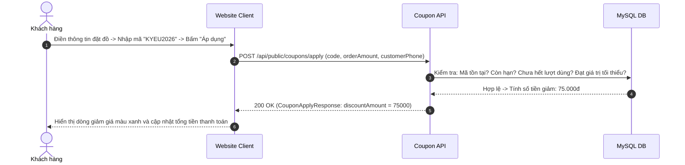

# Đặc Tả Tính Năng: Quản Lý Mã Giảm Giá & Voucher Khuyến Mãi

| Thuộc tính | Giá trị |
|---|---|
| **ID** | `CUS-003` |
| **Tên tính năng** | Quản lý mã giảm giá, voucher khuyến mãi và áp dụng tự động trên Client |
| **Module** | CUS (Customer & Promotions) |
| **Phạm vi** | CRM, SERVER, CLIENT |
| **Ưu tiên** | P2 - Tiếp thị & Kích cầu |
| **Trạng thái** | 📝 SPEC |
| **Người phụ trách** | Fullstack Dev & Tech Lead |
| **Ngày bắt đầu** | 2026-10-25 |
| **Ngày hoàn thành** | 2026-10-25 |
| **Phụ thuộc** | `BOK-001`, `PAY-001` |

---

## Mục Lục
1. [Mục Tiêu và Giá Trị Mang Lại](#1-mục-tiêu-và-giá-trị-mang-lại)
2. [Người Dùng Liên Quan](#2-người-dùng-liên-quan)
3. [Luồng Nghiệp Vụ Chính (Happy Path)](#3-luồng-nghiệp-vụ-chính-happy-path)
4. [Luồng Ngoại Lệ và Trường Hợp Biên](#4-luồng-ngoại-lệ-và-trường-hợp-biên)
5. [Quy Tắc Nghiệp Vụ (Business Rules)](#5-quy-tắc-nghiệp-vụ-business-rules)
6. [Giao Diện & Đa Ngôn Ngữ (UI & i18n)](#6-giao-diện--đa-ngôn-ngữ-ui--i18n)
7. [Đặc Tả API Backend](#7-đặc-tả-api-backend)
8. [Thay Đổi Cơ Sở Dữ Liệu](#8-thay-đổi-cơ-sở-dữ-liệu)
9. [Tiêu Chí Nghiệm Thu (Acceptance Criteria)](#9-tiêu-chí-nghiệm-thu-acceptance-criteria)
10. [Kế Hoạch Kiểm Thử](#10-kế-hoạch-kiểm-thử)
11. [Checklist Hoàn Thành (Definition of Done)](#11-checklist-hoàn-thành-definition-of-done)

---

## 1. Mục Tiêu và Giá Trị Mang Lại
- **Công cụ Marketing thúc đẩy chuyển đổi**: Cho phép tạo các chiến dịch khuyến mãi theo mùa (ví dụ: `KYEU2026` giảm 15%, `CHICKIEVIP` giảm 50.000đ cho khách quen, `TET2027` miễn phí thuê máy ảnh).
- **Hỗ trợ 2 hình thức giảm giá chuẩn**:
  1. Giảm theo phần trăm (`PERCENTAGE`): ví dụ giảm 10%, tối đa 100.000đ.
  2. Giảm số tiền cố định (`FIXED_AMOUNT`): ví dụ giảm thẳng 50.000đ trên tổng đơn.
- **Kiểm soát chặt chẽ ngân sách**: Giới hạn tổng số lượt sử dụng toàn hệ thống, giới hạn 1 mã/1 số điện thoại khách hàng, và thời hạn hiệu lực rõ ràng.

---

## 2. Người Dùng Liên Quan
- [x] **Khách hàng**: Nhập mã coupon khi đặt thuê đồ để nhận chiết khấu ngay lập tức.
- [x] **Admin (Chủ shop)**: Tạo, tạm dừng hoặc xóa mã giảm giá trên CRM.

---

## 3. Luồng Nghiệp Vụ Chính (Happy Path)



---

## 4. Luồng Ngoại Lệ và Trường Hợp Biên
- **Mã hết hạn hoặc hết lượt dùng**: Báo lỗi rõ ràng: *"Mã giảm giá đã hết lượt sử dụng"* hoặc *"Mã đã hết hạn hiệu lực"*.
- **Giá trị đơn chưa đạt mức tối thiểu**: Báo lỗi: *"Đơn hàng cần đạt tối thiểu 500.000đ để sử dụng mã này"*.

---

## 5. Quy Tắc Nghiệp Vụ (Business Rules)
- **BR-01**: Mã giảm giá chỉ áp dụng giảm trừ vào **Tiền thuê đồ** (`total_rental_price`), tuyệt đối **không được giảm trừ vào Tiền cọc** (`total_deposit_price`) để bảo đảm an toàn quỹ tài sản.
- **BR-02**: Mỗi đơn hàng chỉ được sử dụng tối đa **1 mã giảm giá**.

---

## 6. Giao Diện & Đa Ngôn Ngữ (UI & i18n)
- **Client**: Khung nhập mã voucher trong `BookingForm` kèm nút "Áp dụng" và badge hiển thị số tiền đã giảm.
- **CRM**: Trang `/coupons` quản lý danh sách voucher (Mã, Mức giảm, Lượt dùng/Giới hạn, Hạn dùng, Trạng thái).
- **Keys i18n**: Namespace `coupon.*`.

---

## 7. Đặc Tả API Backend
- `POST /api/public/coupons/apply`: Khách kiểm tra và áp dụng mã voucher.
- `GET /api/admin/coupons`: Admin xem danh sách voucher.
- `POST /api/admin/coupons`: Tạo mã voucher mới.
- `PATCH /api/admin/coupons/{id}/status`: Bật/Tắt kích hoạt mã.

---

## 8. Thay Đổi Cơ Sở Dữ Liệu
- Tạo bảng `coupons` và `coupon_usages` (Migration Flyway `V23__create_coupons_table.sql`):
```sql
CREATE TABLE `coupons` (
    `id` BIGINT AUTO_INCREMENT PRIMARY KEY,
    `code` VARCHAR(50) NOT NULL UNIQUE,
    `discount_type` VARCHAR(20) NOT NULL, -- PERCENTAGE, FIXED_AMOUNT
    `discount_value` DECIMAL(12,2) NOT NULL,
    `max_discount_amount` DECIMAL(12,2) NULL,
    `min_order_amount` DECIMAL(12,2) NOT NULL DEFAULT 0.00,
    `usage_limit` INT NOT NULL DEFAULT 100,
    `used_count` INT NOT NULL DEFAULT 0,
    `start_date` TIMESTAMP NOT NULL,
    `end_date` TIMESTAMP NOT NULL,
    `is_active` BOOLEAN NOT NULL DEFAULT TRUE,
    `created_at` TIMESTAMP NOT NULL DEFAULT CURRENT_TIMESTAMP,
    INDEX `idx_coupons_code` (`code`)
);
```

---

## 9. Tiêu Chí Nghiệm Thu (Acceptance Criteria)
- **Given**: Mã `GIAM10` giảm 10% tối đa 50k, đơn thuê 400k.
- **When**: Khách nhập mã và bấm Áp dụng.
- **Then**: Tiền thuê giảm 40k, tiền cọc giữ nguyên 100%.

---

## 10. Kế Hoạch Kiểm Thử
- **Unit Test**: `CouponServiceTest` (test tính toán %, test hết lượt, test hạn dùng).
- **Coverage**: $\ge 85\%$.

---

## 11. Checklist Hoàn Thành (Definition of Done)
- [ ] Tài liệu đặc tả `CUS-003` hoàn thành.
- [ ] Cập nhật `FEATURES.md` và `CHANGELOG.md`.
