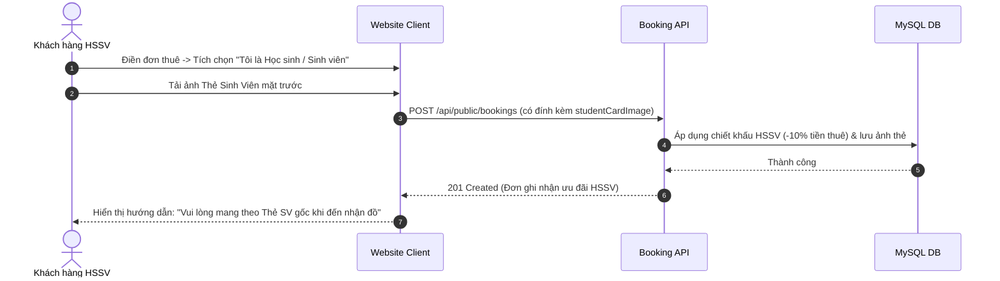

# Đặc Tả Tính Năng: Chính Sách Ưu Đãi Học Sinh - Sinh Viên

| Thuộc tính | Giá trị |
|---|---|
| **ID** | `CUS-004` |
| **Tên tính năng** | Chính sách ưu đãi giảm giá và hỗ trợ cọc cho Học sinh - Sinh viên |
| **Module** | CUS (Customer & Student Policy) |
| **Phạm vi** | CRM, SERVER, CLIENT |
| **Ưu tiên** | P2 - Định vị phân khúc mục tiêu |
| **Trạng thái** | 📝 SPEC |
| **Người phụ trách** | Fullstack Dev & Tech Lead |
| **Ngày bắt đầu** | 2026-10-25 |
| **Ngày hoàn thành** | 2026-10-25 |
| **Phụ thuộc** | `CUS-001`, `PAY-001` |

---

## Mục Lục
1. [Mục Tiêu và Giá Trị Mang Lại](#1-mục-tiêu-và-giá-trị-mang-lại)
2. [Người Dùng Liên Quan](#2-người-dùng-liên-quan)
3. [Luồng Nghiệp Vụ Chính (Happy Path)](#3-luồng-nghiệp-vụ-chính-happy-path)
4. [Luồng Ngoại Lệ và Trường Hợp Biên](#4-luồng-ngoại-lệ-và-trường-hợp-biên)
5. [Quy Tắc Nghiệp Vụ (Business Rules)](#5-quy-tắc-nghiệp-vụ-business-rules)
6. [Giao Diện & Đa Ngôn Ngữ (UI & i18n)](#6-giao-diện--đa-ngôn-ngữ-ui--i18n)
7. [Đặc Tả API Backend](#7-đặc-tả-api-backend)
8. [Thay Đổi Cơ Sở Dữ Liệu](#8-thay-đổi-cơ-sở-dữ-liệu)
9. [Tiêu Chí Nghiệm Thu (Acceptance Criteria)](#9-tiêu-chí-nghiệm-thu-acceptance-criteria)
10. [Kế Hoạch Kiểm Thử](#10-kế-hoạch-kiểm-thử)
11. [Checklist Hoàn Thành (Definition of Done)](#11-checklist-hoàn-thành-definition-of-done)

---

## 1. Mục Tiêu và Giá Trị Mang Lại
- **Thu hút phân khúc khách hàng cốt lõi**: Khách hàng chính của Chickie Studio là học sinh cấp 3, sinh viên các trường đại học tại Hà Nội có nhu cầu chụp ảnh kỷ yếu, chụp ngoại cảnh nhưng ngân sách có hạn.
- **Chính sách ưu đãi kép**:
  1. Giảm ngay 10% tiền thuê đồ khi xuất trình Thẻ Học sinh - Sinh viên còn hạn.
  2. Hỗ trợ chính sách cọc linh hoạt: Cho phép đặt cọc bằng CCCD/Thẻ Sinh viên kèm 30% tiền mặt thay vì bắt buộc cọc 100% tiền mặt.

---

## 2. Người Dùng Liên Quan
- [x] **Học sinh - Sinh viên**: Tải ảnh chụp thẻ HSSV khi đặt thuê đồ để nhận giá ưu đãi.
- [x] **Nhân viên quầy**: Đối chiếu thẻ HSSV gốc khi khách đến lấy đồ và xác nhận áp dụng ưu đãi.

---

## 3. Luồng Nghiệp Vụ Chính (Happy Path)

---

## 4. Luồng Ngoại Lệ và Trường Hợp Biên
- **Ảnh thẻ HSSV bị mờ hoặc thẻ hết hạn**: Nhân viên quầy có quyền hủy mã giảm giá HSSV khi khách đến nhận đồ nếu không xuất trình được thẻ hợp lệ.

---

## 5. Quy Tắc Nghiệp Vụ (Business Rules)
- **BR-01**: Mỗi thẻ HSSV được áp dụng tối đa 1 bộ đồ cho chính chủ sở hữu thẻ (không áp dụng giảm giá cho cả nhóm nếu chỉ có 1 thẻ).
- **BR-02**: Không áp dụng đồng thời với các chương trình khuyến mãi mã giảm giá voucher khác (`CUS-003`).

---

## 6. Giao Diện & Đa Ngôn Ngữ (UI & i18n)
- **Giao diện**: Checkbox "Ưu đãi Học sinh - Sinh viên" trong Booking form kèm khung tải ảnh thẻ sinh viên.
- **Keys i18n**: Namespace `studentPolicy.*`.

---

## 7. Đặc Tả API Backend
- Tích hợp trường `is_student_discount: true` và `student_card_image_url` vào `CreateBookingRequest` và `BookingResponse`.

---

## 8. Thay Đổi Cơ Sở Dữ Liệu
- Thêm trường `is_student_discount BOOLEAN DEFAULT FALSE`, `student_card_image_url VARCHAR(255)` vào bảng `bookings` (Migration Flyway `V24__add_student_discount_fields.sql`).

---

## 9. Tiêu Chí Nghiệm Thu (Acceptance Criteria)
- **Given**: Khách tích chọn ưu đãi HSSV và tải ảnh thẻ sinh viên.
- **When**: Gửi đơn.
- **Then**: Tiền thuê tự động giảm 10%, đơn hàng trên CRM có huy hiệu `[ HSSV ]` kèm link xem ảnh thẻ sinh viên.

---

## 10. Kế Hoạch Kiểm Thử
- **Unit Test**: `BookingServiceStudentDiscountTest`.
- **Coverage**: $\ge 85\%$.

---

## 11. Checklist Hoàn Thành (Definition of Done)
- [ ] Tài liệu đặc tả `CUS-004` hoàn thành.
- [ ] Cập nhật `FEATURES.md` và `CHANGELOG.md`.
