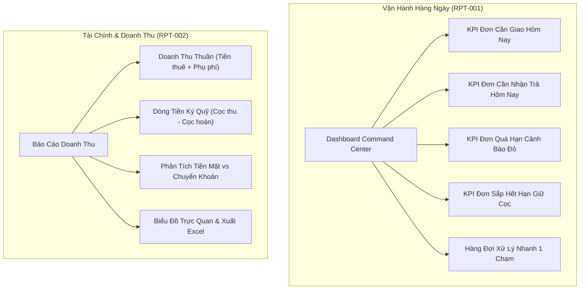

# Module Dashboard & Report (Báo Cáo & Điều Hành) - Chickie Studio

Thư mục lưu trữ toàn bộ các hồ sơ đặc tả kỹ thuật chi tiết (**SPEC**) thuộc Module **RPT** của dự án Chickie Studio.

---

## 1. Danh Sách Tính Năng Module RPT

| Mã ID | Tên Tính Năng | Phạm Vi | Ưu Tiên | Trạng Thái | Link Đặc Tả |
|---|---|---|---|:---:|---|
| `RPT-001` | Dashboard cảnh báo: đơn mới, sắp giao, sắp trả, quá hạn | CRM, SERVER | P1 | 📝 SPEC | [RPT-001](RPT-001-dashboard-canh-bao-van-hanh.md) |
| `RPT-002` | Báo cáo doanh thu theo ngày / tuần / tháng | CRM, SERVER | P1 | 📝 SPEC | [RPT-002](RPT-002-bao-cao-doanh-thu-dong-tien.md) |
| `RPT-003` | Thống kê sản phẩm thuê nhiều & tỉ lệ sử dụng kho đồ | CRM, SERVER | P2 | ⬜ TODO | - |

---

## 2. Kiến Trúc Vận Hành & Báo Cáo

