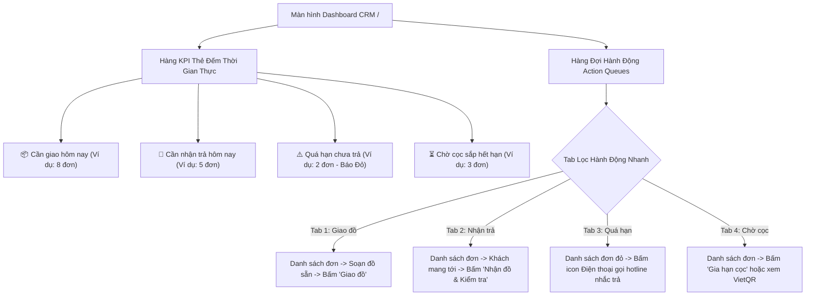
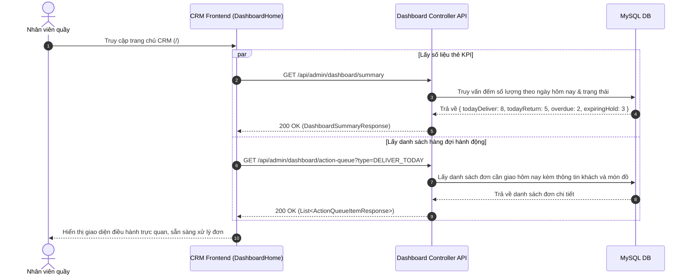

# Đặc Tả Tính Năng: Dashboard Cảnh Báo Vận Hành Hàng Ngày

| Thuộc tính | Giá trị |
|---|---|
| **ID** | `RPT-001` |
| **Tên tính năng** | Dashboard trung tâm điều hành & Cảnh báo vận hành hàng ngày (Command Center) |
| **Module** | RPT (Dashboard & Báo Cáo) |
| **Phạm vi** | CRM, SERVER |
| **Ưu tiên** | P1 - Vận hành cốt lõi |
| **Trạng thái** | 📝 SPEC |
| **Người phụ trách** | Fullstack Dev & Tech Lead |
| **Ngày bắt đầu** | 2026-10-25 |
| **Ngày hoàn thành** | 2026-10-25 |
| **Phụ thuộc** | `BOK-003`, `BOK-004`, `BOK-007` |

---

## Mục Lục
1. [Mục Tiêu và Giá Trị Mang Lại](#1-mục-tiêu-và-giá-trị-mang-lại)
2. [Người Dùng Liên Quan](#2-người-dùng-liên-quan)
3. [Luồng Nghiệp Vụ Chính (Happy Path)](#3-luồng-nghiệp-vụ-chính-happy-path)
4. [Luồng Ngoại Lệ và Trường Hợp Biên](#4-luồng-ngoại-lệ-và-trường-hợp-biên)
5. [Quy Tắc Nghiệp Vụ (Business Rules)](#5-quy-tắc-nghiệp-vụ-business-rules)
6. [Giao Diện & Đa Ngôn Ngữ (UI & i18n)](#6-giao-diện--đa-ngôn-ngữ-ui--i18n)
7. [Đặc Tả API Backend](#7-đặc-tả-api-backend)
8. [Thay Đổi Cơ Sở Dữ Liệu](#8-thay-đổi-cơ-sở-dữ-liệu)
9. [Tiêu Chí Nghiệm Thu (Acceptance Criteria)](#9-tiêu-chí-nghiệm-thu-acceptance-criteria)
10. [Kế Hoạch Kiểm Thử](#10-kế-hoạch-kiểm-thử)
11. [Checklist Hoàn Thành (Definition of Done)](#11-checklist-hoàn-thành-definition-of-done)

---

## 1. Mục Tiêu và Giá Trị Mang Lại
- **Bảng điều khiển trung tâm (Command Center) đầu mỗi ngày làm việc**: Nhân viên khi mở hệ thống CRM vào buổi sáng sẽ nhìn thấy ngay lập tức danh sách các đầu việc khẩn cấp cần thực hiện trong ngày mà không phải tự lùng sục trong bảng đơn hàng.
- **Giảm thiểu tối đa tình trạng trễ hẹn giao/nhận**: Hệ thống tự động phân loại các đơn:
  1. **Cần giao đồ hôm nay**: Đã cọc hoặc xác nhận, khách sẽ đến tiệm lấy hoặc tiệm cần ship đồ.
  2. **Cần nhận trả hôm nay**: Khách hẹn trả đồ trong ngày, cần chuẩn bị nhân sự kiểm đếm và hoàn cọc.
  3. **Quá hạn trả đồ (Overdue)**: Cảnh báo đỏ nguy cấp các đơn khách giữ đồ quá thời hạn cam kết để nhân viên gọi điện nhắc nhở kịp thời.
  4. **Chờ cọc sắp hết hạn**: Các đơn đặt online sắp bị Background Scheduler hủy tự động nếu khách không chuyển khoản cọc.
- **Thao tác nhanh 1 chạm (Quick Actions)**: Cho phép bấm gọi hotline khách hàng, mở modal bàn giao đồ, hoặc gia hạn cọc trực tiếp ngay trên Dashboard.

---

## 2. Người Dùng Liên Quan
- [x] **Nhân viên cửa hàng**: Nắm rõ khối lượng công việc trong ca: bao nhiêu váy cần là ủi sẵn để giao, bao nhiêu khách sẽ ghé trả đồ.
- [x] **Admin (Chủ cửa hàng)**: Giám sát toàn bộ nhịp độ vận hành tiệm, kiểm tra tức thì số lượng đơn quá hạn để chỉ đạo nhân viên xử lý rủi ro mất mát trang phục/thiết bị.

---

## 3. Luồng Nghiệp Vụ Chính (Happy Path)

### 3.1. Cấu Trúc Khối Điều Hành Trên Dashboard



### 3.2. Sơ Đồ Trình Tự Lấy Dữ Liệu Dashboard



---

## 4. Luồng Ngoại Lệ và Trường Hợp Biên

| Tình huống ngoại lệ | Xử lý của hệ thống | Phản hồi giao diện |
|---|---|---|
| **Không có đơn nào cần xử lý trong ngày** | Các chỉ số đếm bằng 0 | Hiển thị `EmptyState` thân thiện: *"Tuyệt vời! Hiện không có đơn nào cần xử lý gấp. Hãy kiểm tra lại kho đồ và chuẩn bị cho các đợt khách tới!"* |
| **Đơn quá hạn tăng cao đột biến ($\ge 5$ đơn)** | Có dấu hiệu khách giữ đồ dài ngày bất thường | Banner cảnh báo đỏ nổi bật trên đầu Dashboard: *"Cảnh báo: Đang có X đơn thuê quá hạn trả chưa được giải quyết. Vui lòng rà soát danh sách liên hệ khách hàng ngay."* |
| **Mất kết nối mạng / Lỗi Server** | Request API bị timeout hoặc lỗi 500 | Hiển thị `ErrorState` kèm nút "Tải lại dữ liệu" mà không làm crash toàn bộ giao diện CRM |

---

## 5. Quy Tắc Nghiệp Vụ (Business Rules)

- **BR-01 (Định nghĩa Đơn Cần Giao Hôm Nay)**:
  Bao gồm các đơn thỏa mãn:
  - Trạng thái là `CONFIRMED` hoặc `DEPOSITED`.
  - Ngày nhận đồ `rental_start_date` bằng đúng ngày hiện tại của hệ thống (`LocalDate.now()`).
- **BR-02 (Định nghĩa Đơn Cần Trả Hôm Nay)**:
  Bao gồm các đơn thỏa mãn:
  - Trạng thái là `DELIVERED` (khách đang giữ đồ).
  - Ngày hẹn trả `rental_end_date` bằng đúng ngày hiện tại của hệ thống (`LocalDate.now()`).
- **BR-03 (Định nghĩa Đơn Quá Hạn - Overdue)**:
  Bao gồm các đơn thỏa mãn:
  - Trạng thái là `DELIVERED` hoặc `OVERDUE`.
  - Ngày hẹn trả `rental_end_date < LocalDate.now()`.
- **BR-04 (Định nghĩa Đơn Chờ Cọc Sắp Hết Hạn)**:
  Bao gồm các đơn thỏa mãn:
  - Trạng thái là `PENDING`.
  - Có thời gian giữ chỗ `hold_expires_at` nằm trong khoảng từ `NOW()` đến `NOW() + 30 phút`.
- **BR-05 (Cơ chế Auto-refresh)**: Dữ liệu trên Dashboard tự động làm mới ngầm (Silent Refetch) định kỳ mỗi **60 giây** qua TanStack Query (`refetchInterval: 60000`) để nhân viên luôn thấy dữ liệu mới nhất mà không cần F5 trình duyệt.

---

## 6. Giao Diện & Đa Ngôn Ngữ (UI & i18n)

### 6.1. Thiết Kế Màn Hình Dashboard (`crm/src/pages/DashboardHome.tsx`)
- **Hàng 1: Bộ 4 thẻ KPI (`StatCard`)**:
  - `Box 1 - Xanh Dương`: Đơn cần giao hôm nay (Icon xe giao hàng / hộp quà).
  - `Box 2 - Tím Pastel`: Đơn cần nhận trả hôm nay (Icon mũi tên hoàn trả).
  - `Box 3 - Đỏ Cảnh Báo`: Đơn quá hạn chưa trả (Icon tam giác chấm than nhấp nháy khi $>0$).
  - `Box 4 - Vàng Cam`: Đơn chờ cọc sắp hết hạn (Icon đồng hồ cát).
- **Hàng 2: Khối Hàng Đợi Hành Động (`ActionQueueSection`)**:
  - Thanh Tabs chuyển đổi: `[ Cần giao hôm nay (8) ]` | `[ Cần trả hôm nay (5) ]` | `[ Quá hạn (2) ]` | `[ Sắp hết hạn cọc (3) ]`.
  - Bảng danh sách rút gọn: Mã đơn, Khách hàng & SĐT, Món đồ thuê (Tên váy, size, màu, mã barcode), Giờ hẹn / Hạn chót, Thao tác nhanh (Nút Giao đồ, Nút Nhận trả, Nút Gọi điện `tel:`).

### 6.2. Bộ Từ Điển Đa Ngôn Ngữ (`vi.json` / `en.json`)

```json
{
  "dashboard": {
    "title": "Bảng Điều Hành Trung Tâm",
    "subtitle": "Tổng quan vận hành và các đầu việc cần xử lý trong ngày",
    "kpiDeliverToday": "Cần giao hôm nay",
    "kpiReturnToday": "Cần nhận trả hôm nay",
    "kpiOverdue": "Đơn quá hạn chưa trả",
    "kpiExpiringHold": "Chờ cọc sắp hết hạn",
    "tabDeliverToday": "Đơn cần giao ({count})",
    "tabReturnToday": "Đơn cần trả ({count})",
    "tabOverdue": "Đơn quá hạn ({count})",
    "tabExpiringHold": "Sắp hết hạn cọc ({count})",
    "actionDeliver": "Bàn giao đồ",
    "actionReturn": "Nhận trả & Hoàn cọc",
    "actionCall": "Gọi điện",
    "actionExtend": "Gia hạn cọc",
    "itemsCount": "{count} món",
    "allCleared": "Không có đầu việc nào cần xử lý trong mục này"
  }
}
```

---

## 7. Đặc Tả API Backend

### 7.1. Danh Sách Endpoint

| Method | Endpoint | Quyền hạn | Mục đích |
|---|---|---|---|
| `GET` | `/api/admin/dashboard/summary` | `STAFF`, `ADMIN` | Lấy 4 chỉ số thống kê KPI cho các thẻ đầu trang |
| `GET` | `/api/admin/dashboard/action-queue` | `STAFF`, `ADMIN` | Lấy danh sách hàng đợi các đơn cần xử lý theo loại |

### 7.2. Chi Tiết Request & Response DTOs

#### A. GET `/api/admin/dashboard/summary`
- **Response Success (200 OK)**:
```json
{
  "code": 200,
  "message": "SUCCESS",
  "data": {
    "todayDate": "2026-10-25",
    "todayDeliverCount": 8,
    "todayReturnCount": 5,
    "overdueCount": 2,
    "expiringHoldCount": 3,
    "totalActiveRentals": 24
  }
}
```

#### B. GET `/api/admin/dashboard/action-queue?type=DELIVER_TODAY`
- **Query Params**: `type=DELIVER_TODAY` | `RETURN_TODAY` | `OVERDUE` | `EXPIRING_HOLD`
- **Response Success (200 OK)**:
```json
{
  "code": 200,
  "message": "SUCCESS",
  "data": [
    {
      "bookingId": 105,
      "bookingCode": "BK20261025-001",
      "customerName": "Nguyễn Mai Anh",
      "customerPhone": "0987654321",
      "status": "DEPOSITED",
      "deliveryMethod": "PICKUP_STORE",
      "rentalStartDate": "2026-10-25",
      "rentalEndDate": "2026-10-27",
      "items": [
        {
          "bookingItemId": 301,
          "productName": "Váy Dạ Hội Kim Sa Trắng",
          "variantName": "Size S - Trắng",
          "barcode": "CK-DR-001"
        }
      ],
      "totalRentalPrice": 500000.00,
      "totalDepositPrice": 1000000.00,
      "isRentalPaid": false
    }
  ]
}
```

---

## 8. Thay Đổi Cơ Sở Dữ Liệu
- Tận dụng triệt để các bảng hiện có: `bookings`, `booking_items`, `product_items`.
- Các câu query của Dashboard đều đã có index tối ưu từ các migration trước:
  - `idx_bookings_dates` (`rental_start_date`, `rental_end_date`)
  - `idx_bookings_status` (`status`)
  - `idx_bookings_hold_cleanup` (`status`, `hold_expires_at`)

---

## 9. Tiêu Chí Nghiệm Thu (Acceptance Criteria)

### Kịch bản 1: Thẻ KPI hiển thị đúng số lượng đơn giao và trả hôm nay
- **Given**: Trong database có 3 đơn có `rental_start_date = hôm nay` (đã cọc) và 2 đơn có `rental_end_date = hôm nay` (đang thuê).
- **When**: Nhân viên truy cập Dashboard.
- **Then**: Thẻ "Cần giao hôm nay" hiển thị số 3, thẻ "Cần nhận trả hôm nay" hiển thị số 2.

### Kịch bản 2: Bấm nút bàn giao đồ trực tiếp từ hàng đợi
- **Given**: Đơn `BK-001` xuất hiện trong Tab "Cần giao hôm nay".
- **When**: Nhân viên bấm nút "Bàn giao đồ" và xác nhận mã váy.
- **Then**: Đơn chuyển sang `DELIVERED`, biến mất khỏi tab "Cần giao" và thẻ đếm tự động giảm đi 1 đơn mà không cần F5 lại trang.

---

## 10. Kế Hoạch Kiểm Thử
- **Backend Unit & Integration Tests**:
  - `DashboardServiceTest`: Kiểm tra hàm đếm các chỉ số với nhiều điều kiện trạng thái và khoảng ngày.
  - `DashboardControllerTest`: Kiểm tra các giá trị enum `type` của action-queue.
- **Frontend Test (Vitest)**:
  - `DashboardHome.test.tsx`: Render đúng 4 `StatCard`, click chuyển tab lọc dữ liệu chính xác, kiểm tra hiển thị `EmptyState`.
- **Playwright E2E**:
  - Truy cập trang chủ CRM sau khi đăng nhập, kiểm tra render đầy đủ các chỉ số thống kê và bảng hàng đợi hành động.
- **Mục tiêu Coverage**: $\ge 85\%$.

---

## 11. Checklist Hoàn Thành (Definition of Done)
- [ ] Soạn thảo và phê duyệt tài liệu đặc tả `RPT-001` (đã xong).
- [ ] Cập nhật bảng theo dõi trong [docs/FEATURES.md](../../FEATURES.md).
- [ ] Tái sử dụng các UI components: `StatCard`, `DataTable`, `Tabs`, `Button`, `EmptyState`.
- [ ] Không sử dụng inline CSS, 100% tuân thủ CSS Modules / SCSS / Tailwind.
- [ ] Kiểm thử tự động đạt độ bao phủ $\ge 80\%$.
- [ ] Ghi nhận thay đổi vào `CHANGELOG.md`.
