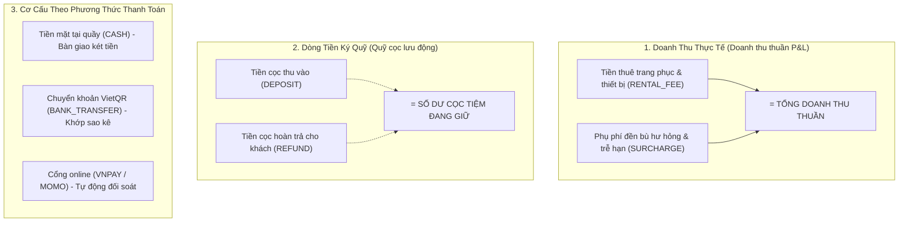
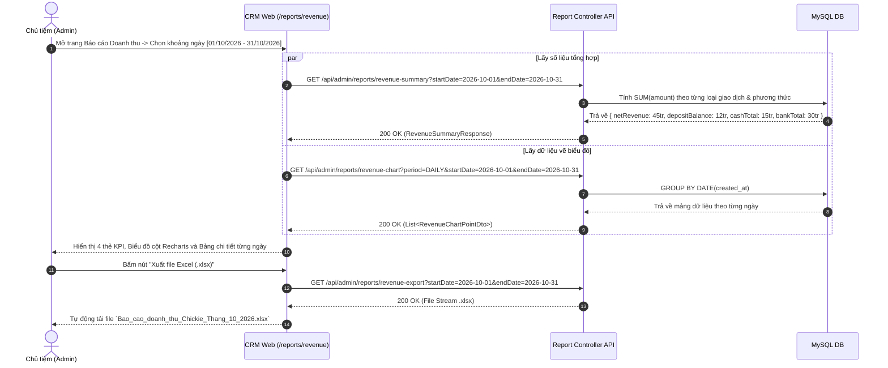

# Đặc Tả Tính Năng: Báo Cáo Doanh Thu & Dòng Tiền Thuê - Cọc

| Thuộc tính | Giá trị |
|---|---|
| **ID** | `RPT-002` |
| **Tên tính năng** | Báo cáo doanh thu & Dòng tiền thuê - cọc (Revenue & Deposit Cashflow Report) |
| **Module** | RPT (Dashboard & Báo Cáo) |
| **Phạm vi** | CRM, SERVER |
| **Ưu tiên** | P1 - Vận hành cốt lõi |
| **Trạng thái** | 📝 SPEC |
| **Người phụ trách** | Fullstack Dev & Tech Lead |
| **Ngày bắt đầu** | 2026-10-25 |
| **Ngày hoàn thành** | 2026-10-25 |
| **Phụ thuộc** | `PAY-001`, `PAY-002`, `PAY-003` |

---

## Mục Lục
1. [Mục Tiêu và Giá Trị Mang Lại](#1-mục-tiêu-và-giá-trị-mang-lại)
2. [Người Dùng Liên Quan](#2-người-dùng-liên-quan)
3. [Luồng Nghiệp Vụ Chính (Happy Path)](#3-luồng-nghiệp-vụ-chính-happy-path)
4. [Luồng Ngoại Lệ và Trường Hợp Biên](#4-luồng-ngoại-lệ-và-trường-hợp-biên)
5. [Quy Tắc Nghiệp Vụ (Business Rules)](#5-quy-tắc-nghiệp-vụ-business-rules)
6. [Giao Diện & Đa Ngôn Ngữ (UI & i18n)](#6-giao-diện--đa-ngôn-ngữ-ui--i18n)
7. [Đặc Tả API Backend](#7-đặc-tả-api-backend)
8. [Thay Đổi Cơ Sở Dữ Liệu](#8-thay-đổi-cơ-sở-dữ-liệu)
9. [Tiêu Chí Nghiệm Thu (Acceptance Criteria)](#9-tiêu-chí-nghiệm-thu-acceptance-criteria)
10. [Kế Hoạch Kiểm Thử](#10-kế-hoạch-kiểm-thử)
11. [Checklist Hoàn Thành (Definition of Done)](#11-checklist-hoàn-thành-definition-of-done)

---

## 1. Mục Tiêu và Giá Trị Mang Lại
- **Minh bạch hóa tài chính cho cửa hàng dịch vụ cho thuê**: Đặc thù tiệm thuê váy/máy ảnh là luôn có một lượng tiền cọc rất lớn lưu động trong tài khoản của tiệm. Báo cáo giúp phân tách rạch ròi giữa **Doanh thu thực tế của tiệm** và **Tiền cọc của khách đang ký quỹ**, tránh việc chủ shop nhầm lẫn tiền cọc là lợi nhuận để chi tiêu sai mục đích.
- **Theo dõi xu hướng kinh doanh theo chu kỳ**: Cung cấp biểu đồ trực quan biến động doanh thu theo Ngày, Tuần, Tháng; nhận diện rõ các ngày cuối tuần và các tháng mùa cao điểm (mùa kỷ yếu tháng 10-12, mùa cưới, mùa Tết).
- **Đối soát quỹ tiền mặt và chuyển khoản**: Tách số liệu thanh toán Tiền mặt tại quầy để nhân viên kiểm đếm bàn giao két tiền cuối ca làm việc, và đối soát với sao kê ngân hàng VietQR/cổng thanh toán.
- **Hỗ trợ xuất báo cáo (Export Excel / CSV)**: Cho phép tải file báo cáo chi tiết để phục vụ kế toán thuế và quản trị tài chính nội bộ.

---

## 2. Người Dùng Liên Quan
- [x] **Admin (Chủ cửa hàng)**: Toàn quyền truy cập mọi khoảng thời gian báo cáo, xem biểu đồ tăng trưởng, xem cơ cấu doanh thu theo từng danh mục đồ và xuất file Excel.
- [x] **Nhân viên (Staff)**: Được cấp quyền xem tóm tắt doanh thu trong ca làm việc hôm nay để kiểm quỹ tiền mặt bàn giao ca, không được xem báo cáo lịch sử các tháng trước.

---

## 3. Luồng Nghiệp Vụ Chính (Happy Path)

### 3.1. Phân Rã Ba Trụ Cột Tài Chính Cốt Lõi



### 3.2. Sơ Đồ Trình Tự Xem & Xuất Báo Cáo



---

## 4. Luồng Ngoại Lệ và Trường Hợp Biên

| Tình huống ngoại lệ | Xử lý của hệ thống | Phản hồi giao diện |
|---|---|---|
| **Khoảng ngày chọn không có giao dịch nào** | Tổng doanh thu và số lượt thuê bằng 0 | Biểu đồ hiển thị đường ngang giá trị 0đ, bảng dữ liệu hiển thị `EmptyState`: *"Không có phát sinh giao dịch trong khoảng thời gian này"* |
| **Giao dịch bị hủy nhầm (`VOID`)** | Các bản ghi có `status = 'VOID'` | Hệ thống tự động loại trừ 100% các bản ghi này khỏi mọi công thức cộng dồn để bảo đảm tính chuẩn xác kế toán |
| **Khoảng ngày chọn quá rộng ($> 1$ năm)** | Gây nặng tải truy vấn database | Server giới hạn khoảng thời gian tối đa mỗi lần truy vấn chi tiết theo ngày là **365 ngày**; nếu trên 1 năm thì tự động gom nhóm theo Tháng (`MONTHLY`) |

---

## 5. Quy Tắc Nghiệp Vụ (Business Rules)

- **BR-01 (Công thức tính toán chuẩn)**:
  - **Doanh thu thuần**:
    $$\text{Net Revenue} = \sum_{\text{SUCCESS}} \text{Amount (RENTAL\_FEE)} + \sum_{\text{SUCCESS}} \text{Amount (SURCHARGE)}$$
  - **Số dư cọc tiệm đang giữ trong kỳ**:
    $$\text{Holding Deposit} = \sum_{\text{SUCCESS}} \text{Amount (DEPOSIT)} - \sum_{\text{SUCCESS}} \text{Amount (REFUND)}$$
  - **Tổng dòng tiền thực thu vào két/tài khoản (Gross Cash In)**:
    $$\text{Cash In} = \sum \text{RENTAL\_FEE} + \sum \text{SURCHARGE} + \sum \text{DEPOSIT}$$
- **BR-02 (Phân quyền bảo mật tài chính)**:
  - `ROLE_ADMIN`: Xem không giới hạn toàn bộ báo cáo doanh thu theo dải ngày tùy chọn, xuất file Excel/CSV.
  - `ROLE_STAFF`: Chỉ được phép xem tổng kết doanh thu và tiền mặt của ngày hôm nay (`CURRENT_DATE`) để đối soát két tiền; không có quyền xem báo cáo lịch sử các tháng trước hoặc xuất file.
- **BR-03 (Loại trừ tuyệt đối giao dịch hủy)**: Mọi câu truy vấn báo cáo tài chính đều bắt buộc có mệnh đề điều kiện `WHERE status = 'SUCCESS'`.

---

## 6. Giao Diện & Đa Ngôn Ngữ (UI & i18n)

### 6.1. Thiết Kế Màn Hình Báo Cáo CRM (`crm/src/pages/reports/RevenueReportPage.tsx`)
- **Thanh điều hướng đỉnh (Top Controls)**:
  - Bộ chọn dải ngày `DateRangePicker` kèm các preset nhanh: `[ Hôm nay ]`, `[ 7 ngày qua ]`, `[ Tháng này ]`, `[ Tháng trước ]`.
  - Bộ chọn chu kỳ hiển thị biểu đồ: `[ Theo Ngày ]`, `[ Theo Tuần ]`, `[ Theo Tháng ]`.
  - Nút hành động: `[ Xuất Excel (.xlsx) ]` (icon download).
- **Khu vực Thẻ KPI (KPI Summary Cards)**:
  - Thẻ 1: **Doanh thu thuần** (màu xanh lá phong cách tài chính, hiển thị % tăng/giảm so với kỳ trước).
  - Thẻ 2: **Số dư cọc đang giữ** (màu xanh dương).
  - Thẻ 3: **Tiền mặt tại quầy** (màu vàng kim).
  - Thẻ 4: **Chuyển khoản & Cổng online** (màu tím).
- **Khu vực Biểu Đồ Doanh Thu (`RevenueChart`)**:
  - Tái sử dụng component `RevenueChart` có sẵn trong `crm/src/components/common/RevenueChart/`.
  - Biểu đồ kết hợp cột (Cột xanh: Tiền thuê, Cột cam: Phụ phí) và đường (Đường tím: Quỹ cọc).
- **Bảng Chi Tiết Theo Ngày (`DataTable`)**:
  - Các cột: Ngày, Số đơn hoàn tất, Tiền thuê, Phụ phí hư hỏng/trễ, Cọc thu vào, Cọc đã hoàn, Thực thu trong ngày.

### 6.2. Bộ Từ Điển Đa Ngôn Ngữ (`vi.json` / `en.json`)

```json
{
  "report": {
    "title": "Báo Cáo Doanh Thu & Dòng Tiền",
    "subtitle": "Theo dõi doanh thu thực tế, tiền cọc lưu động và đối soát tài chính",
    "netRevenue": "Doanh thu thuần",
    "holdingDeposit": "Quỹ cọc đang giữ",
    "cashRevenue": "Tiền mặt tại quầy",
    "bankRevenue": "Chuyển khoản / VietQR",
    "onlineRevenue": "Cổng online (VNPay/MoMo)",
    "presetToday": "Hôm nay",
    "preset7Days": "7 ngày qua",
    "presetThisMonth": "Tháng này",
    "presetLastMonth": "Tháng trước",
    "periodDaily": "Theo ngày",
    "periodWeekly": "Theo tuần",
    "periodMonthly": "Theo tháng",
    "exportExcel": "Xuất Excel",
    "exportSuccess": "Tải báo cáo thành công",
    "dateCol": "Ngày",
    "ordersCountCol": "Số lượt thuê",
    "rentalTotalCol": "Tiền thuê",
    "surchargeCol": "Phụ phí",
    "depositInCol": "Cọc thu vào",
    "refundOutCol": "Cọc đã hoàn",
    "netTotalCol": "Thực thu trong ngày"
  }
}
```

---

## 7. Đặc Tả API Backend

### 7.1. Danh Sách Endpoint

| Method | Endpoint | Quyền hạn | Mục đích |
|---|---|---|---|
| `GET` | `/api/admin/reports/revenue-summary` | `STAFF`, `ADMIN` | Lấy các chỉ số KPI tổng hợp theo khoảng ngày |
| `GET` | `/api/admin/reports/revenue-chart` | `ADMIN` | Lấy chuỗi dữ liệu vẽ biểu đồ doanh thu theo chu kỳ |
| `GET` | `/api/admin/reports/revenue-details` | `ADMIN` | Lấy dữ liệu phân rã chi tiết theo từng ngày cho bảng |
| `GET` | `/api/admin/reports/revenue-export` | `ADMIN` | Xuất file Excel `.xlsx` chứa toàn bộ dữ liệu báo cáo |

### 7.2. Chi Tiết Request & Response DTOs

#### A. GET `/api/admin/reports/revenue-summary`
- **Query Params**: `startDate=2026-10-01&endDate=2026-10-31`
- **Response Success (200 OK)**:
```json
{
  "code": 200,
  "message": "SUCCESS",
  "data": {
    "startDate": "2026-10-01",
    "endDate": "2026-10-31",
    "totalNetRevenue": 48500000.00,
    "totalRentalIncome": 46200000.00,
    "totalSurchargeIncome": 2300000.00,
    "totalDepositCollected": 35000000.00,
    "totalDepositRefunded": 28000000.00,
    "holdingDepositBalance": 7000000.00,
    "cashTotal": 18200000.00,
    "bankTransferTotal": 30300000.00,
    "totalOrdersCompleted": 96
  }
}
```

#### B. GET `/api/admin/reports/revenue-chart?period=DAILY&startDate=2026-10-20&endDate=2026-10-25`
- **Response Success (200 OK)**:
```json
{
  "code": 200,
  "message": "SUCCESS",
  "data": [
    {
      "label": "2026-10-20",
      "rentalIncome": 2500000.00,
      "surchargeIncome": 150000.00,
      "depositCollected": 2000000.00,
      "depositRefunded": 1500000.00,
      "completedOrders": 5
    },
    {
      "label": "2026-10-21",
      "rentalIncome": 3800000.00,
      "surchargeIncome": 0.00,
      "depositCollected": 3000000.00,
      "depositRefunded": 2000000.00,
      "completedOrders": 8
    }
  ]
}
```

---

## 8. Thay Đổi Cơ Sở Dữ Liệu
- Hệ thống tận dụng bảng `payments` được định nghĩa trong migration `V13__create_payments_table.sql`.
- Để các truy vấn tổng hợp `SUM(amount)` và `GROUP BY DATE(created_at)` đạt tốc độ dưới 50ms khi hệ thống có hàng vạn giao dịch, chỉ mục tối ưu đã được thiết lập:
  - `idx_payments_type_status` (`transaction_type`, `status`)
  - `idx_payments_created_at` (`created_at`)

---

## 9. Tiêu Chí Nghiệm Thu (Acceptance Criteria)

### Kịch bản 1: Phân tách chính xác giữa doanh thu và tiền cọc
- **Given**: Trong tháng 10/2026, tiệm có:
  - 10 giao dịch thu tiền thuê tổng cộng 15.000.000 đ.
  - 2 giao dịch thu phụ phí giặt vết ố tổng cộng 300.000 đ.
  - 10 giao dịch thu cọc tổng cộng 20.000.000 đ.
  - 8 giao dịch hoàn cọc tổng cộng 16.000.000 đ.
- **When**: Admin mở trang báo cáo tháng 10.
- **Then**: 
  - Doanh thu thuần hiển thị chính xác: $15.000.000 + 300.000 = 15.300.000 \text{ đ}$.
  - Quỹ cọc đang giữ hiển thị chính xác: $20.000.000 - 16.000.000 = 4.000.000 \text{ đ}$.

### Kịch bản 2: Nhân viên bị giới hạn phạm vi báo cáo
- **Given**: Tài khoản đăng nhập có quyền `ROLE_STAFF`.
- **When**: Nhân viên cố gắng truy cập trang `/reports/revenue` hoặc gọi API lấy dữ liệu tháng trước.
- **Then**: Hệ thống chuyển hướng về trang báo cáo ca hôm nay hoặc trả về mã lỗi `403 FORBIDDEN`.

### Kịch bản 3: Xuất file Excel thành công
- **Given**: Admin chọn khoảng ngày từ 01/10/2026 đến 25/10/2026 và bấm "Xuất Excel".
- **When**: Trình duyệt nhận response file stream.
- **Then**: File `.xlsx` được tải về máy tính với đầy đủ định dạng số tiền VND, tiêu đề cửa hàng Chickie Studio và chi tiết các dòng giao dịch.

---

## 10. Kế Hoạch Kiểm Thử
- **Backend Unit & Integration Tests**:
  - `RevenueReportServiceTest`: Kiểm tra các câu truy vấn tổng hợp, kiểm tra loại trừ bản ghi `VOID`, kiểm tra phân quyền RBAC.
  - `RevenueExportServiceTest`: Kiểm tra sinh file Excel bằng Apache POI đảm bảo không bị lỗi tràn bộ nhớ hoặc rỗng sheet.
- **Frontend Test (Vitest)**:
  - `RevenueReportPage.test.tsx`: Render các thẻ KPI, test chuyển đổi preset dải ngày, test gọi API xuất file.
- **Playwright E2E**:
  - Kịch bản đăng nhập tài khoản Admin, mở menu Báo cáo doanh thu, đổi dải ngày, kiểm tra các con số thống kê và tải file thành công.
- **Mục tiêu Coverage**: $\ge 85\%$.

---

## 11. Checklist Hoàn Thành (Definition of Done)
- [ ] Soạn thảo và phê duyệt tài liệu đặc tả `RPT-002` (đã xong).
- [ ] Cập nhật bảng theo dõi trong [docs/FEATURES.md](../../FEATURES.md).
- [ ] Tái sử dụng component `RevenueChart` và `DataTable`.
- [ ] Không sử dụng inline CSS, 100% tuân thủ CSS Modules / SCSS / Tailwind.
- [ ] Kiểm thử tự động đạt độ bao phủ $\ge 80\%$.
- [ ] Ghi nhận thay đổi vào `CHANGELOG.md`.
