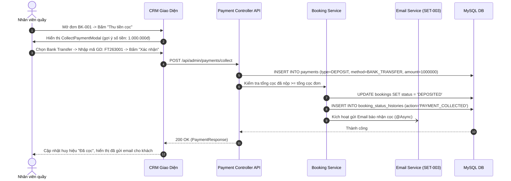

# Đặc Tả Tính Năng: Ghi Nhận Tiền Cọc & Thanh Toán Trên CRM

| Thuộc tính | Giá trị |
|---|---|
| **ID** | `PAY-001` |
| **Tên tính năng** | Ghi nhận tiền cọc & thanh toán tiền thuê bằng Tiền mặt / Chuyển khoản trên CRM |
| **Module** | PAY (Payment & Deposit) |
| **Phạm vi** | CRM, SERVER |
| **Ưu tiên** | P1 - Vận hành cốt lõi |
| **Trạng thái** | 📝 SPEC |
| **Người phụ trách** | Fullstack Dev & Tech Lead |
| **Ngày bắt đầu** | 2026-10-25 |
| **Ngày hoàn thành** | 2026-10-25 |
| **Phụ thuộc** | `BOK-003`, `BOK-004` |

---

## Mục Lục
1. [Mục Tiêu và Giá Trị Mang Lại](#1-mục-tiêu-và-giá-trị-mang-lại)
2. [Người Dùng Liên Quan](#2-người-dùng-liên-quan)
3. [Luồng Nghiệp Vụ Chính (Happy Path)](#3-luồng-nghiệp-vụ-chính-happy-path)
4. [Luồng Ngoại Lệ và Trường Hợp Biên](#4-luồng-ngoại-lệ-và-trường-hợp-biên)
5. [Quy Tắc Nghiệp Vụ (Business Rules)](#5-quy-tắc-nghiệp-vụ-business-rules)
6. [Giao Diện & Đa Ngôn Ngữ (UI & i18n)](#6-giao-diện--đa-ngôn-ngữ-ui--i18n)
7. [Đặc Tả API Backend](#7-đặc-tả-api-backend)
8. [Thay Đổi Cơ Sở Dữ Liệu](#8-thay-đổi-cơ-sở-dữ-liệu)
9. [Tiêu Chí Nghiệm Thu (Acceptance Criteria)](#9-tiêu-chí-nghiệm-thu-acceptance-criteria)
10. [Kế Hoạch Kiểm Thử](#10-kế-hoạch-kiểm-thử)
11. [Checklist Hoàn Thành (Definition of Done)](#11-checklist-hoàn-thành-definition-of-done)

---

## 1. Mục Tiêu và Giá Trị Mang Lại
- **Chính xác hóa quản lý tài chính tiệm thuê đồ**: Tách bạch rõ ràng giữa hai dòng tiền: **Tiền thuê đồ** (Doanh thu thực tế) và **Tiền cọc** (Tiền ký quỹ của khách, sẽ hoàn trả khi trả đồ nguyên vẹn).
- **Loại bỏ tình trạng sót tiền / lệch sổ**: Nhân viên ghi nhận ngay lập tức khi nhận tiền mặt tại quầy hoặc nhận thông báo biến động số dư ngân hàng qua App/SMS; hệ thống lưu vết mã giao dịch ngân hàng (`bank_transaction_id`) để đối soát cuối ngày.
- **Tự động chuyển trạng thái đơn hàng**: Khi nhân viên xác nhận đã thu đủ tiền cọc, đơn tự động nhảy từ `PENDING` $\rightarrow$ `DEPOSITED`, đồng thời vô hiệu hóa hạn giữ chỗ tạm thời (`BOK-007`).

---

## 2. Người Dùng Liên Quan
- [x] **Nhân viên thu ngân / Lễ tân**: Thao tác lập phiếu thu tiền mặt hoặc xác nhận chuyển khoản cho khách, xuất hóa đơn / biên lai điện tử.
- [x] **Admin (Chủ cửa hàng)**: Đối chiếu doanh thu và dòng tiền cọc theo ca làm việc, duyệt hủy các phiếu thu do nhân viên nhập sai số tiền.

---

## 3. Luồng Nghiệp Vụ Chính (Happy Path)

### 3.1. Luồng Thu Tiền Cọc & Tiền Thuê Trên CRM
1. Khách hàng tới tiệm lấy đồ hoặc chuyển khoản cọc qua VietQR.
2. Nhân viên mở chi tiết đơn hàng trên CRM (`/orders/{id}`).
3. Tại khối **"Thanh toán & Cọc"**, nhân viên bấm nút **"Thu tiền cọc"** hoặc **"Thu tiền thuê"**.
4. Popup `CollectPaymentModal` hiển thị với các trường:
   - Loại thu: `DEPOSIT` (Tiền cọc) hoặc `RENTAL_FEE` (Tiền thuê).
   - Số tiền cần thu (gợi ý mặc định số tiền còn thiếu).
   - Hình thức thanh toán: `CASH` (Tiền mặt) hoặc `BANK_TRANSFER` (Chuyển khoản).
   - Mã tham chiếu ngân hàng / Nội dung sao kê (nếu chọn Chuyển khoản).
   - Ghi chú nội bộ.
5. Nhân viên kiểm tra và bấm "Xác nhận thu tiền".
6. Server lưu bản ghi vào bảng `payments`, cập nhật trạng thái đơn sang `DEPOSITED` (nếu đã đủ cọc), ghi nhận Audit Trail `booking_status_histories` và bất đồng bộ kích hoạt gửi **Email xác nhận nhận cọc thành công** (`deposit-received.html` theo `SET-003`) cho khách. *(Chưa gửi qua Zalo hay SMS)*.
7. Giao diện CRM hiển thị thông báo thành công và cập nhật khối thanh toán (Đã cọc: 100%, Đã trả tiền thuê: 100%).



---

## 4. Luồng Ngoại Lệ và Trường Hợp Biên

| Tình huống ngoại lệ | Xử lý của hệ thống | Phản hồi giao diện |
|---|---|---|
| **Thu thiếu tiền cọc (Khách chỉ cọc trước 1 phần)** | Hệ thống vẫn ghi nhận phiếu thu với số tiền thực tế nhận được. Tổng tiền cọc chưa đạt $\rightarrow$ Đơn vẫn giữ `PENDING` nhưng gắn nhãn cảnh báo `Cọc 1 phần (50%)` | CRM hiển thị thanh tiến trình cọc màu vàng cam: *Đã thu 500.000đ / 1.000.000đ (Còn thiếu 500.000đ)* |
| **Nhập sai số tiền phiếu thu** | Không cho sửa trực tiếp bản ghi thanh toán (nguyên tắc kế toán bất biến). Chỉ tài khoản `ROLE_ADMIN` mới có quyền bấm nút "Hủy phiếu thu" (`Void Payment`) kèm lý do | CRM mở modal xác nhận hủy phiếu thu, tạo bản ghi đối ứng `VOID` và cập nhật lại số dư còn thiếu của đơn hàng |
| **Thu tiền vượt quá tổng giá trị đơn** | Hệ thống chặn nếu số tiền nhập vào vượt quá số tiền còn lại phải thu | Hiển thị lỗi form: *"Số tiền thu không được vượt quá số tiền cần thanh toán còn lại (Tối đa: X đ)"* |

---

## 5. Quy Tắc Nghiệp Vụ (Business Rules)

- **BR-01 (Điều kiện chuyển sang `DEPOSITED`)**: Đơn hàng chỉ được chuyển từ `PENDING` sang `DEPOSITED` khi tổng số tiền thu loại `DEPOSIT` (đã loại trừ các phiếu hủy) lớn hơn hoặc bằng `total_deposit_price` của đơn hàng.
- **BR-02 (Tách biệt tiền cọc và tiền thuê)**: Tiền cọc không được cộng gộp vào doanh thu thuê đồ trong báo cáo tài chính P&L. Tiền cọc được hạch toán riêng vào quỹ ký quỹ phải trả (Tài khoản công nợ tạm giữ).
- **BR-03 (Bất biến kế toán - Immutability)**: Mọi phiếu thu khi đã tạo ở trạng thái `SUCCESS` tuyệt đối không được phép chỉnh sửa số tiền hoặc phương thức thanh toán. Nếu nhân viên nhập sai, chỉ Admin được quyền Hủy phiếu thu (`VOID`), hệ thống sẽ lưu vết ai hủy và vào lúc nào.
- **BR-04 (Quyền hạn)**:
  - `ROLE_STAFF`: Tạo phiếu thu tiền mặt/chuyển khoản, in biên lai, xem lịch sử thanh toán.
  - `ROLE_ADMIN`: Toàn quyền nhân viên + quyền Hủy phiếu thu (`Void Payment`).

---

## 6. Giao Diện & Đa Ngôn Ngữ (UI & i18n)

### 6.1. Thiết Kế Component CRM
- **`PaymentSummaryCard`**: Khối hiển thị tóm tắt tình trạng tài chính của đơn:
  - Tổng tiền thuê: `1.200.000 đ` (Đã thu: `1.200.000 đ` - 100%).
  - Tiền cọc giữ đồ: `2.000.000 đ` (Đã thu: `2.000.000 đ` - Đang giữ cọc).
  - Phụ phí phát sinh (nếu có): `0 đ`.
- **`CollectPaymentModal`**:
  - Chọn Radio: Tiền mặt (`CASH`) / Chuyển khoản VietQR (`BANK_TRANSFER`).
  - Ô nhập `CurrencyField` (tự format `1,000,000 đ`).
  - Ô nhập mã chuẩn chi / mã tham chiếu ngân hàng.
- **`PaymentReceiptDrawer`**: Xem lại chi tiết biên lai kèm nút In phiếu thu cho khách.

### 6.2. Bộ Từ Điển Đa Ngôn Ngữ (`vi.json` / `en.json`)

```json
{
  "payment": {
    "title": "Thanh Toán & Cọc",
    "collectDeposit": "Thu tiền cọc",
    "collectRental": "Thu tiền thuê",
    "depositRequired": "Tiền cọc quy định",
    "depositPaid": "Đã đặt cọc",
    "rentalTotal": "Tổng tiền thuê",
    "rentalPaid": "Đã thanh toán tiền thuê",
    "remainingDue": "Còn phải thu",
    "methodCash": "Tiền mặt tại quầy",
    "methodBank": "Chuyển khoản ngân hàng",
    "refCode": "Mã tham chiếu GD",
    "refCodePlaceholder": "Nhập mã giao dịch ngân hàng / 6 số cuối sao kê",
    "receiptTitle": "Phiếu Thu Tiền",
    "voidPayment": "Hủy phiếu thu",
    "voidReasonPlaceholder": "Nhập lý do hủy phiếu thu (bắt buộc)...",
    "collectSuccess": "Ghi nhận thu tiền thành công {amount} đ",
    "voidSuccess": "Hủy phiếu thu thành công"
  }
}
```

---

## 7. Đặc Tả API Backend

### 7.1. Danh Sách Endpoint

| Method | Endpoint | Quyền hạn | Mục đích |
|---|---|---|---|
| `POST` | `/api/admin/payments/collect` | `STAFF`, `ADMIN` | Ghi nhận thu tiền (cọc hoặc tiền thuê) |
| `GET` | `/api/admin/payments/booking/{bookingId}` | `STAFF`, `ADMIN` | Lấy danh sách lịch sử phiếu thu/chi của đơn |
| `POST` | `/api/admin/payments/{id}/void` | `ADMIN` | Hủy phiếu thu nhập sai (chỉ Admin) |

### 7.2. Chi Tiết Request & Response DTOs

#### A. POST `/api/admin/payments/collect`
- **Request Body**:
```json
{
  "bookingId": 105,
  "transactionType": "DEPOSIT",
  "paymentMethod": "BANK_TRANSFER",
  "amount": 1000000.00,
  "bankTransactionId": "FT2630018902",
  "note": "Khách chuyển khoản cọc qua VietQR Techcombank"
}
```
- **Response Success (200 OK)**:
```json
{
  "code": 200,
  "message": "Ghi nhận thanh toán thành công",
  "data": {
    "paymentId": 201,
    "paymentCode": "PAY-20261101-001",
    "bookingId": 105,
    "bookingCode": "BK20261101-001",
    "transactionType": "DEPOSIT",
    "paymentMethod": "BANK_TRANSFER",
    "amount": 1000000.00,
    "status": "SUCCESS",
    "bankTransactionId": "FT2630018902",
    "createdBy": "linh_staff",
    "createdAt": "2026-10-25T21:42:00",
    "bookingStatus": "DEPOSITED"
  }
}
```

#### B. POST `/api/admin/payments/{id}/void`
- **Request Body**:
```json
{
  "reason": "Nhân viên bấm nhầm số tiền từ 500k thành 5000k"
}
```
- **Response Success (200 OK)**:
```json
{
  "code": 200,
  "message": "Hủy phiếu thu thành công",
  "data": {
    "paymentId": 201,
    "status": "VOID",
    "voidedBy": "admin_chickie",
    "voidedAt": "2026-10-25T21:45:00"
  }
}
```

---

## 8. Thay Đổi Cơ Sở Dữ Liệu

### 8.1. File Migration Flyway: `V13__create_payments_table.sql`

```sql
-- Migration V13: Quản lý giao dịch thanh toán và dòng tiền cọc (PAY-001 & PAY-002)
CREATE TABLE `payments` (
    `id` BIGINT AUTO_INCREMENT PRIMARY KEY,
    `payment_code` VARCHAR(50) NOT NULL UNIQUE,
    `booking_id` BIGINT NOT NULL,
    `transaction_type` VARCHAR(30) NOT NULL, -- DEPOSIT, RENTAL_FEE, SURCHARGE, REFUND
    `payment_method` VARCHAR(30) NOT NULL,   -- CASH, BANK_TRANSFER, VNPAY, MOMO
    `amount` DECIMAL(12,2) NOT NULL,
    `status` VARCHAR(30) NOT NULL DEFAULT 'SUCCESS', -- PENDING, SUCCESS, FAILED, VOID
    `bank_transaction_id` VARCHAR(100) NULL,
    `note` VARCHAR(500) NULL,
    `created_by` VARCHAR(50) NOT NULL,
    `voided_by` VARCHAR(50) NULL,
    `void_reason` VARCHAR(255) NULL,
    `voided_at` TIMESTAMP NULL,
    `created_at` TIMESTAMP NOT NULL DEFAULT CURRENT_TIMESTAMP,
    `updated_at` TIMESTAMP NOT NULL DEFAULT CURRENT_TIMESTAMP ON UPDATE CURRENT_TIMESTAMP,
    CONSTRAINT `fk_payments_booking` FOREIGN KEY (`booking_id`) REFERENCES `bookings` (`id`),
    INDEX `idx_payments_booking` (`booking_id`),
    INDEX `idx_payments_code` (`payment_code`),
    INDEX `idx_payments_type_status` (`transaction_type`, `status`),
    INDEX `idx_payments_created_at` (`created_at`)
) ENGINE=InnoDB DEFAULT CHARSET=utf8mb4 COLLATE=utf8mb4_unicode_ci;
```

---

## 9. Tiêu Chí Nghiệm Thu (Acceptance Criteria)

### Kịch bản 1: Thu đủ tiền cọc tự động chuyển đơn sang DEPOSITED
- **Given**: Đơn `BK-001` có trạng thái `PENDING`, yêu cầu tiền cọc 1.000.000 đ.
- **When**: Nhân viên ghi nhận thu tiền cọc chuyển khoản 1.000.000 đ.
- **Then**: Server tạo bản ghi `payments` với mã `PAY-xxx`, trạng thái đơn tự động chuyển sang `DEPOSITED`, bảng `booking_status_histories` ghi nhận lượt cập nhật.

### Kịch bản 2: Nhân viên không thể tự ý hủy phiếu thu
- **Given**: Nhân viên đăng nhập với tài khoản có role `ROLE_STAFF`.
- **When**: Nhân viên cố gắng gọi API `POST /api/admin/payments/201/void`.
- **Then**: Hệ thống trả về lỗi `403 FORBIDDEN` ("Chỉ quản trị viên mới có quyền hủy phiếu thu").

### Kịch bản 3: Admin hủy phiếu thu thành công
- **Given**: Admin phát hiện phiếu thu bị sai sót số tiền.
- **When**: Admin nhập lý do và bấm xác nhận hủy.
- **Then**: Bản ghi `payments` chuyển sang `VOID`, trạng thái đơn được tính toán lại số dư thực tế, tiền cọc chưa đủ sẽ đưa đơn về trạng thái chờ cọc.

---

## 10. Kế Hoạch Kiểm Thử
- **Unit Test Backend**:
  - `PaymentServiceTest`: Kiểm tra tính toán tổng tiền đã thu, logic chuyển trạng thái đơn hàng khi cọc đủ, validation vượt mức cho phép.
  - `PaymentControllerTest`: Kiểm tra phân quyền Admin/Staff cho hành động Void.
- **Frontend Test (Vitest)**:
  - `CollectPaymentModal.test.tsx`: Form nhập tiền, định dạng currency, chuyển đổi giữa Tiền mặt và Chuyển khoản.
  - `PaymentSummaryCard.test.tsx`: Hiển thị chính xác các tỷ lệ thanh toán và nút thao tác.
- **Playwright E2E**:
  - Kịch bản đăng nhập CRM, mở đơn hàng, thu cọc chuyển khoản, kiểm tra trạng thái đơn đổi sang `DEPOSITED` ngay trên giao diện.
- **Mục tiêu Coverage**: $\ge 85\%$ cả dòng lệnh và nhánh điều kiện.

---

## 11. Checklist Hoàn Thành (Definition of Done)
- [ ] Soạn thảo và phê duyệt tài liệu đặc tả `PAY-001` (đã xong).
- [ ] Cập nhật bảng theo dõi trong [docs/FEATURES.md](../../FEATURES.md).
- [ ] Không sử dụng inline CSS, 100% tuân thủ CSS Modules / SCSS / Tailwind.
- [ ] Kiểm thử tự động đạt độ bao phủ $\ge 80\%$.
- [ ] Test E2E Playwright pass 100%.
- [ ] Ghi nhận thay đổi vào `CHANGELOG.md`.
