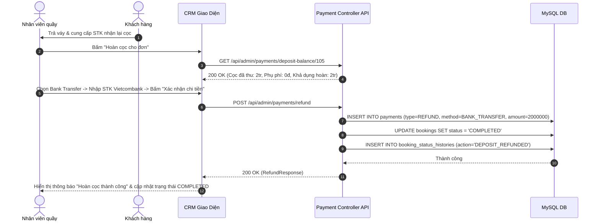

# Đặc Tả Tính Năng: Quy Trình Hoàn Trả Tiền Cọc Cho Khách Hàng

| Thuộc tính | Giá trị |
|---|---|
| **ID** | `PAY-002` |
| **Tên tính năng** | Quy trình kiểm tra đồ & Hoàn trả tiền cọc cho khách hàng (Deposit Refund Process) |
| **Module** | PAY (Payment & Deposit) |
| **Phạm vi** | CRM, SERVER |
| **Ưu tiên** | P1 - Vận hành cốt lõi |
| **Trạng thái** | 📝 SPEC |
| **Người phụ trách** | Fullstack Dev & Tech Lead |
| **Ngày bắt đầu** | 2026-10-25 |
| **Ngày hoàn thành** | 2026-10-25 |
| **Phụ thuộc** | `PAY-001`, `PAY-003`, `BOK-003`, `BOK-004` |

---

## Mục Lục
1. [Mục Tiêu và Giá Trị Mang Lại](#1-mục-tiêu-và-giá-trị-mang-lại)
2. [Người Dùng Liên Quan](#2-người-dùng-liên-quan)
3. [Luồng Nghiệp Vụ Chính (Happy Path)](#3-luồng-nghiệp-vụ-chính-happy-path)
4. [Luồng Ngoại Lệ và Trường Hợp Biên](#4-luồng-ngoại-lệ-và-trường-hợp-biên)
5. [Quy Tắc Nghiệp Vụ (Business Rules)](#5-quy-tắc-nghiệp-vụ-business-rules)
6. [Giao Diện & Đa Ngôn Ngữ (UI & i18n)](#6-giao-diện--đa-ngôn-ngữ-ui--i18n)
7. [Đặc Tả API Backend](#7-đặc-tả-api-backend)
8. [Thay Đổi Cơ Sở Dữ Liệu](#8-thay-đổi-cơ-sở-dữ-liệu)
9. [Tiêu Chí Nghiệm Thu (Acceptance Criteria)](#9-tiêu-chí-nghiệm-thu-acceptance-criteria)
10. [Kế Hoạch Kiểm Thử](#10-kế-hoạch-kiểm-thử)
11. [Checklist Hoàn Thành (Definition of Done)](#11-checklist-hoàn-thành-definition-of-done)

---

## 1. Mục Tiêu và Giá Trị Mang Lại
- **Chuẩn hóa quy trình hoàn cọc công bằng và minh bạch**: Đảm bảo khách hàng nhận lại tiền cọc nhanh chóng ngay sau khi nhân viên kiểm tra váy/máy ảnh trả về nguyên vẹn, tạo trải nghiệm uy tín và thiện cảm.
- **Tự động khấu trừ phụ phí hư hại hoặc trễ hạn**: Tự động tính toán số tiền cọc thực hoàn = `Tiền cọc đã nộp - Tổng phụ phí phạt`, tránh việc nhân viên tính nhẩm sai sót gây thất thoát ngân quỹ của tiệm.
- **Khép kín vòng đời đơn hàng**: Sau khi hoàn tất thủ tục trả cọc, đơn chuyển sang trạng thái cuối cùng `COMPLETED`, giải phóng trách nhiệm dân sự của hai bên.

---

## 2. Người Dùng Liên Quan
- [x] **Khách hàng thuê đồ**: Nhận lại tiền cọc bằng tiền mặt tại chỗ hoặc qua số tài khoản ngân hàng đã cung cấp; nhận biên nhận hoàn cọc điện tử.
- [x] **Nhân viên cửa hàng**: Thực hiện thủ tục kiểm đếm trang phục, lập phiếu chi hoàn cọc và xác nhận giao dịch.
- [x] **Admin (Chủ shop)**: Kiểm soát dòng tiền xuất quỹ hoàn cọc hàng ngày.

---

## 3. Luồng Nghiệp Vụ Chính (Happy Path)

### 3.1. Luồng Hoàn Cọc Khi Trả Đồ Nguyên Vẹn
1. Khách hàng mang đồ đến trả tại tiệm, đơn chuyển sang trạng thái `RETURNED`.
2. Nhân viên kiểm tra trang phục: đồ không rách, không ố bẩn nặng, đầy đủ phụ kiện đi kèm.
3. Nhân viên bấm nút **"Hoàn trả cọc"** trên màn hình chi tiết đơn `/orders/{id}`.
4. Hệ thống mở popup `RefundDepositModal` với các thông số tự động:
   - Tổng cọc đã thu: `2.000.000 đ`.
   - Phụ phí phát sinh: `0 đ`.
   - Số tiền thực hoàn: `2.000.000 đ`.
   - Hình thức hoàn: Chọn Tiền mặt hoặc Chuyển khoản (nhập STK, Tên ngân hàng, Tên chủ tài khoản).
5. Nhân viên xác nhận chi tiền $\rightarrow$ Server ghi nhận bản ghi giao dịch `payments` loại `REFUND`.
6. Trạng thái đơn tự động đổi sang `COMPLETED`, lưu vết Audit Trail `booking_status_histories`.
7. Hệ thống xuất phiếu chi hoàn tiền và gửi thông báo hoàn cọc thành công cho khách.



---

## 4. Luồng Ngoại Lệ và Trường Hợp Biên

| Tình huống ngoại lệ | Xử lý của hệ thống | Phản hồi giao diện |
|---|---|---|
| **Có phát sinh phụ phí hư hại hoặc trễ hạn** | Khách trả trễ 1 ngày (phí 150.000đ) và làm mất nơ cài áo (phí 50.000đ). Tổng phụ phí = 200.000đ | Số tiền hoàn được tự động khấu trừ: `2.000.000đ - 200.000đ = 1.800.000đ`. Phiếu chi thể hiện rõ ràng các dòng khấu trừ |
| **Phụ phí vượt quá số tiền cọc** | Khách làm vỡ ống kính máy ảnh (đền bù 3.500.000đ mà cọc chỉ có 2.000.000đ) | Số tiền hoàn về 0đ (giữ lại 100% cọc). Hệ thống tự sinh khoản thu thêm bổ sung `SURCHARGE_BALANCE = 1.500.000đ` yêu cầu khách thanh toán thêm trước khi Complete đơn |
| **Đơn chưa ở trạng thái RETURNED** | Khách chưa mang đồ về tiệm hoặc đơn vẫn đang `DELIVERED` | Nút "Hoàn trả cọc" bị vô hiệu hóa (disabled), hiển thị tooltip cảnh báo: *"Chỉ có thể hoàn cọc sau khi đã tiếp nhận đồ trả về kho"* |

---

## 5. Quy Tắc Nghiệp Vụ (Business Rules)

- **BR-01 (Điều kiện tiên quyết hoàn cọc)**: Đơn hàng bắt buộc phải ở trạng thái `RETURNED` thì mới được phép thực hiện thủ tục hoàn cọc.
- **BR-02 (Giới hạn mức hoàn cọc tối đa)**: Số tiền hoàn cọc không được vượt quá số dư cọc khả dụng:
  $$\text{Max Refund Amount} = \sum \text{Deposit Paid} - \sum \text{Previous Refunds} - \sum \text{Unpaid Damages}$$
- **BR-03 (Chuyển trạng thái kết thúc)**: Khi hoàn tất cọc (hoàn 100% hoặc hoàn phần còn lại sau khi đã khấu trừ hết phụ phí), đơn tự động chuyển sang `COMPLETED`.
- **BR-04 (Lưu vết tài khoản thụ hưởng)**: Nếu hoàn cọc bằng hình thức Chuyển khoản (`BANK_TRANSFER`), bắt buộc phải nhập số tài khoản, mã ngân hàng và tên người nhận trong trường ghi chú/metadata để phục vụ đối soát ngân quỹ.

---

## 6. Giao Diện & Đa Ngôn Ngữ (UI & i18n)

### 6.1. Thiết Kế Component CRM
- **`RefundDepositModal`**:
  - Khối tóm tắt:
    - Tiền cọc đã nộp: `2,000,000 đ`
    - Khấu trừ phụ phí đền bù / trễ hạn: `- 200,000 đ` (Xem chi tiết phụ phí)
    - **Thực hoàn cho khách**: `1,800,000 đ` (màu xanh lá nổi bật)
  - Chọn phương thức hoàn tiền:
    - [x] Chuyển khoản (Gợi ý mã VietQR hoặc copy STK nhanh)
    - [ ] Tiền mặt tại quầy
  - Trường nhập ngân hàng, số tài khoản, tên chủ thẻ.
- **`RefundReceipt`**: Mẫu phiếu chi hoàn cọc xuất PDF/in trực tiếp.

### 6.2. Bộ Từ Điển Đa Ngôn Ngữ (`vi.json` / `en.json`)

```json
{
  "refund": {
    "title": "Hoàn Trả Tiền Cọc",
    "depositOriginal": "Tiền cọc ban đầu",
    "damageDeduction": "Khấu trừ hư tổn & trễ hạn",
    "netRefundAmount": "Số tiền thực hoàn cho khách",
    "refundMethod": "Hình thức hoàn tiền",
    "bankName": "Ngân hàng thụ hưởng",
    "accountNumber": "Số tài khoản nhận",
    "accountHolder": "Tên chủ tài khoản",
    "note": "Ghi chú hoàn cọc",
    "confirmRefundBtn": "Xác nhận hoàn cọc & Đóng đơn",
    "refundSuccess": "Đã hoàn trả thành công {amount} đ cho khách hàng",
    "insufficientDeposit": "Tiền cọc không đủ bù phụ phí hư tổn, khách cần thanh toán thêm"
  }
}
```

---

## 7. Đặc Tả API Backend

### 7.1. Danh Sách Endpoint

| Method | Endpoint | Quyền hạn | Mục đích |
|---|---|---|---|
| `GET` | `/api/admin/payments/deposit-balance/{bookingId}` | `STAFF`, `ADMIN` | Lấy chi tiết số dư cọc và phụ phí cần khấu trừ |
| `POST` | `/api/admin/payments/refund` | `STAFF`, `ADMIN` | Thực hiện hoàn cọc và hoàn tất đơn thuê |

### 7.2. Chi Tiết Request & Response DTOs

#### A. GET `/api/admin/payments/deposit-balance/{bookingId}`
- **Response Success (200 OK)**:
```json
{
  "code": 200,
  "message": "SUCCESS",
  "data": {
    "bookingId": 105,
    "bookingCode": "BK20261105-001",
    "totalDepositCollected": 2000000.00,
    "totalPreviousRefunded": 0.00,
    "totalDamagesFee": 200000.00,
    "netAvailableRefund": 1800000.00,
    "customerName": "Nguyễn Mai Anh",
    "customerPhone": "0987654321"
  }
}
```

#### B. POST `/api/admin/payments/refund`
- **Request Body**:
```json
{
  "bookingId": 105,
  "refundAmount": 1800000.00,
  "paymentMethod": "BANK_TRANSFER",
  "bankName": "Techcombank",
  "bankAccountNumber": "1903456789012",
  "bankAccountHolder": "NGUYEN MAI ANH",
  "note": "Đã khấu trừ 200k tiền giặt hấp vết bẩn cà phê"
}
```
- **Response Success (200 OK)**:
```json
{
  "code": 200,
  "message": "Hoàn tiền cọc và hoàn tất đơn hàng thành công",
  "data": {
    "paymentId": 302,
    "paymentCode": "PAY-REF-20261105-001",
    "bookingId": 105,
    "transactionType": "REFUND",
    "amount": 1800000.00,
    "bookingStatus": "COMPLETED",
    "refundedAt": "2026-10-25T21:45:00"
  }
}
```

---

## 8. Thay Đổi Cơ Sở Dữ Liệu
- Tận dụng bảng `payments` được tạo từ `PAY-001` (`V13__create_payments_table.sql`) với `transaction_type = 'REFUND'`.
- Lưu trữ thông tin ngân hàng thụ hưởng của khách trong cột `note` dạng JSON hoặc cấu trúc định dạng rõ ràng: `STK: 1903456789012 - Techcombank - NGUYEN MAI ANH`.

---

## 9. Tiêu Chí Nghiệm Thu (Acceptance Criteria)

### Kịch bản 1: Hoàn cọc 100% nguyên vẹn
- **Given**: Đơn `BK-001` đang ở trạng thái `RETURNED`, đã cọc 2.000.000 đ, không có phụ phí.
- **When**: Nhân viên bấm xác nhận hoàn cọc 2.000.000 đ tiền mặt.
- **Then**: Hệ thống tạo bản ghi chi tiền loại `REFUND`, trạng thái đơn chuyển sang `COMPLETED`, món đồ vật lý được trả về trạng thái khả dụng cho đơn sau.

### Kịch bản 2: Hoàn cọc sau khi tự động khấu trừ phụ phí
- **Given**: Đơn `BK-002` có tiền cọc 1.500.000 đ, phát sinh phụ phí trễ hạn 200.000 đ.
- **When**: Nhân viên mở popup hoàn cọc.
- **Then**: Giao diện hiển thị mặc định số tiền thực hoàn là 1.300.000 đ; khi hoàn tất, đơn chuyển sang `COMPLETED` và lưu vết khấu trừ rõ ràng trong Audit Trail.

---

## 10. Kế Hoạch Kiểm Thử
- **Unit Test Backend**:
  - `PaymentRefundServiceTest`: Kiểm tra công thức khấu trừ, chặn hoàn cọc khi vượt quá số dư cọc khả dụng, kiểm tra chuyển trạng thái `COMPLETED`.
- **Frontend Test (Vitest)**:
  - `RefundDepositModal.test.tsx`: Kiểm tra hiển thị đúng các dòng khấu trừ phụ phí và validation thông tin tài khoản ngân hàng.
- **Playwright E2E**:
  - Luồng nhận trả đồ $\rightarrow$ mở modal hoàn cọc $\rightarrow$ xác nhận chi tiền $\rightarrow$ kiểm tra đơn hoàn tất và lịch sử thanh toán cập nhật phiếu chi.
- **Mục tiêu Coverage**: $\ge 85\%$.

---

## 11. Checklist Hoàn Thành (Definition of Done)
- [ ] Soạn thảo và phê duyệt tài liệu đặc tả `PAY-002` (đã xong).
- [ ] Cập nhật bảng theo dõi trong [docs/FEATURES.md](../../FEATURES.md).
- [ ] Không sử dụng inline CSS, tuân thủ UI/UX rules.
- [ ] Kiểm thử tự động đạt độ bao phủ $\ge 80\%$.
- [ ] Ghi nhận thay đổi vào `CHANGELOG.md`.
