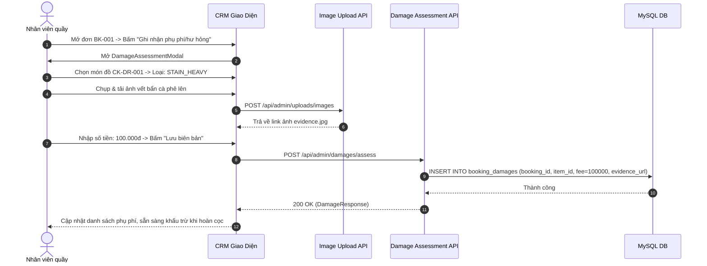

# Đặc Tả Tính Năng: Thu Phụ Phí Trả Trễ Hạn & Đền Bù Hư Hỏng Đồ

| Thuộc tính | Giá trị |
|---|---|
| **ID** | `PAY-003` |
| **Tên tính năng** | Biểu phí & Quy trình thu phụ phí trả trễ hạn, hư hỏng trang phục và thiết bị |
| **Module** | PAY (Payment & Deposit) |
| **Phạm vi** | CRM, SERVER |
| **Ưu tiên** | P1 - Vận hành cốt lõi |
| **Trạng thái** | 📝 SPEC |
| **Người phụ trách** | Fullstack Dev & Tech Lead |
| **Ngày bắt đầu** | 2026-10-25 |
| **Ngày hoàn thành** | 2026-10-25 |
| **Phụ thuộc** | `PAY-001`, `PAY-002`, `BOK-003`, `BOK-004` |

---

## Mục Lục
1. [Mục Tiêu và Giá Trị Mang Lại](#1-mục-tiêu-và-giá-trị-mang-lại)
2. [Người Dùng Liên Quan](#2-người-dùng-liên-quan)
3. [Luồng Nghiệp Vụ Chính (Happy Path)](#3-luồng-nghiệp-vụ-chính-happy-path)
4. [Luồng Ngoại Lệ và Trường Hợp Biên](#4-luồng-ngoại-lệ-và-trường-hợp-biên)
5. [Quy Tắc Nghiệp Vụ (Business Rules)](#5-quy-tắc-nghiệp-vụ-business-rules)
6. [Giao Diện & Đa Ngôn Ngữ (UI & i18n)](#6-giao-diện--đa-ngôn-ngữ-ui--i18n)
7. [Đặc Tả API Backend](#7-đặc-tả-api-backend)
8. [Thay Đổi Cơ Sở Dữ Liệu](#8-thay-đổi-cơ-sở-dữ-liệu)
9. [Tiêu Chí Nghiệm Thu (Acceptance Criteria)](#9-tiêu-chí-nghiệm-thu-acceptance-criteria)
10. [Kế Hoạch Kiểm Thử](#10-kế-hoạch-kiểm-thử)
11. [Checklist Hoàn Thành (Definition of Done)](#11-checklist-hoàn-thành-definition-of-done)

---

## 1. Mục Tiêu và Giá Trị Mang Lại
- **Chuẩn hóa khung biểu phí đền bù**: Xóa bỏ tình trạng nhân viên quầy tự phán đoán hoặc ước lượng tùy ý gây tranh cãi và mất lòng khách hàng khi đồ bị hỏng, rách hay trả muộn.
- **Minh bạch bằng chứng hình ảnh (Evidence-based)**: Nhân viên chụp ảnh vết ố, chỗ rách hoặc lỗi máy ảnh trực tiếp trên CRM và gửi kèm biên nhận cho khách, đảm bảo tính khách quan 100%.
- **Liên kết trực tiếp vào luồng hoàn cọc**: Các khoản phụ phí được tự động tổng hợp để hệ thống trừ trực tiếp vào số tiền hoàn cọc của khách hàng tại `PAY-002`.

---

## 2. Người Dùng Liên Quan
- [x] **Khách hàng**: Nắm rõ chính sách bồi thường; được xem ảnh chụp đối chứng hiện trạng hư hỏng rõ ràng.
- [x] **Nhân viên cửa hàng**: Thao tác ghi nhận phụ phí nhanh theo danh mục chuẩn, tải ảnh chụp bằng chứng từ điện thoại lên CRM.
- [x] **Admin (Chủ shop)**: Cấu hình khung giá đền bù chuẩn và xử lý các trường hợp khiếu nại mức phạt.

---

## 3. Luồng Nghiệp Vụ Chính (Happy Path)

### 3.1. Các Loại Phụ Phí Chuẩn
| Mã loại | Tên phụ phí | Cách tính mặc định |
|---|---|---|
| `LATE_RETURN` | Phạt trả đồ trễ hạn | $\text{Số ngày trễ} \times 50\% \text{ giá thuê 1 ngày}$ |
| `STAIN_HEAVY` | Vết bẩn nặng cần giặt khô tẩy điểm | $50.000 \text{ đ} - 150.000 \text{ đ}$ / vết |
| `TORN_SEAM` | Đứt chỉ, sút gấu váy, mất cúc áo | $30.000 \text{ đ} - 80.000 \text{ đ}$ / lỗi |
| `LOST_ACCESSORY` | Mất phụ kiện đi kèm (nơ, cà vạt, dây thắt lưng) | $50.000 \text{ đ} - 200.000 \text{ đ}$ / món |
| `MAJOR_DAMAGE` | Rách vải không thể vá, cháy tàn thuốc | $50\% - 100\% \text{ giá trị niêm yết trang phục}$ |
| `HARDWARE_DAMAGE` | Hư hỏng thiết bị máy ảnh, lens trầy xước | Thẩm định chi phí bảo hành của hãng |

### 3.2. Sơ Đồ Trình Tự Ghi Nhận Hư Hỏng



---

## 4. Luồng Ngoại Lệ và Trường Hợp Biên

| Tình huống ngoại lệ | Xử lý của hệ thống | Phản hồi giao diện |
|---|---|---|
| **Khách hàng khiếu nại mức phạt** | Nhân viên không tự ý sửa mức phí. Đơn được gắn cờ `DISPUTED` để chuyển cho Admin duyệt | CRM hiển thị nút "Yêu cầu Admin xem xét" kèm hộp thoại ghi chú khiếu nại của khách |
| **Nhân viên chọn nhầm món đồ bị hỏng** | Cho phép xóa bản ghi biên bản hư hỏng trước khi đơn hoàn tất `COMPLETED` | Admin hoặc nhân viên tạo biên bản bấm "Xóa" kèm xác nhận cảnh báo |
| **Khoản phụ phí lớn hơn toàn bộ tiền cọc** | Tiền cọc bị khấu trừ sạch về 0đ. Hệ thống tự động tạo thêm một yêu cầu thu tiền mặt/chuyển khoản bổ sung | CRM hiển thị cảnh báo đỏ: *"Khách hàng cần nộp thêm [X] đ ngoài số tiền cọc đã giữ"* |

---

## 5. Quy Tắc Nghiệp Vụ (Business Rules)

- **BR-01 (Công thức tự động tính phí trễ hạn)**:
  Nếu ngày trả thực tế > ngày hẹn trả:
  $$\text{Days Late} = \text{Actual Return Date} - \text{Rental End Date}$$
  $$\text{Late Fee} = \text{Days Late} \times \left( \frac{\text{Total Rental Price}}{\text{Rental Days}} \times 0.5 \right)$$
- **BR-02 (Bắt buộc ảnh đối chứng)**: Mọi khoản phụ phí hư hỏng vật lý (ngoại trừ phí trễ hạn tự động) có giá trị từ **100.000 đ** trở lên bắt buộc phải có ít nhất 1 ảnh chụp hiện trạng đính kèm (`evidence_image_url`).
- **BR-03 (Tự động nạp vào khấu trừ hoàn cọc)**: Toàn bộ phụ phí chưa thanh toán của đơn sẽ được nạp trực tiếp vào phương trình tính hoàn cọc của `PAY-002`.

---

## 6. Giao Diện & Đa Ngôn Ngữ (UI & i18n)

### 6.1. Thiết Kế Component CRM
- **`DamageListCard`**: Khối hiển thị trong trang chi tiết đơn hàng:
  - Bảng danh sách các khoản phạt: Loại lỗi, món đồ bị ảnh hưởng, ảnh thumbnail bằng chứng (click phóng to `ImagePreviewModal`), số tiền phạt, người lập biên bản.
  - Nút `+ Thêm biên bản hư hại / phụ phí`.
- **`AddDamageModal`**:
  - Chọn món đồ trong đơn hàng (Dropdown).
  - Chọn danh mục phụ phí (Select).
  - Khung tải ảnh kéo thả `ImageUploader`.
  - Ô nhập số tiền đền bù `CurrencyField`.

### 6.2. Bộ Từ Điển Đa Ngôn Ngữ (`vi.json` / `en.json`)

```json
{
  "damage": {
    "title": "Biên Bản Phụ Phí & Hư Hỏng",
    "addBtn": "Ghi nhận phụ phí / Hư hại",
    "itemSelect": "Chọn món đồ bị ảnh hưởng",
    "damageType": "Loại phụ phí",
    "feeAmount": "Số tiền phụ phí / Đền bù",
    "evidencePhoto": "Ảnh chụp hiện trạng bằng chứng",
    "lateReturn": "Trả đồ trễ hạn",
    "stainHeavy": "Ố bẩn nặng cần giặt khô tẩy điểm",
    "tornSeam": "Đứt chỉ, sút gấu, bung cúc",
    "lostAccessory": "Mất phụ kiện đi kèm",
    "majorDamage": "Hư hỏng nặng không thể sửa",
    "hardwareDamage": "Hư hỏng máy ảnh / phụ kiện điện tử",
    "assessSuccess": "Ghi nhận phụ phí thành công"
  }
}
```

---

## 7. Đặc Tả API Backend

### 7.1. Danh Sách Endpoint

| Method | Endpoint | Quyền hạn | Mục đích |
|---|---|---|---|
| `POST` | `/api/admin/damages/assess` | `STAFF`, `ADMIN` | Ghi nhận biên bản hư hỏng / phụ phí |
| `GET` | `/api/admin/damages/booking/{bookingId}` | `STAFF`, `ADMIN` | Lấy danh sách các khoản phụ phí của đơn |
| `DELETE` | `/api/admin/damages/{id}` | `ADMIN` | Hủy khoản phụ phí do lập nhầm |

### 7.2. Chi Tiết Request & Response DTOs

#### A. POST `/api/admin/damages/assess`
- **Request Body**:
```json
{
  "bookingId": 105,
  "bookingItemId": 310,
  "damageType": "STAIN_HEAVY",
  "feeAmount": 100000.00,
  "description": "Vết ố trà sữa lớn ở tà áo trước, cần đem giặt khô chuyên dụng",
  "evidenceImageUrl": "https://cdn.chickiestudio.com/evidence/20261105_stain_01.jpg"
}
```
- **Response Success (200 OK)**:
```json
{
  "code": 200,
  "message": "Ghi nhận biên bản hư hại thành công",
  "data": {
    "id": 12,
    "bookingId": 105,
    "damageType": "STAIN_HEAVY",
    "feeAmount": 100000.00,
    "description": "Vết ố trà sữa lớn ở tà áo trước",
    "evidenceImageUrl": "https://cdn.chickiestudio.com/evidence/20261105_stain_01.jpg",
    "createdBy": "thao_staff",
    "createdAt": "2026-10-25T21:48:00"
  }
}
```

---

## 8. Thay Đổi Cơ Sở Dữ Liệu

### 8.1. File Migration Flyway: `V14__create_booking_damages_table.sql`

```sql
-- Migration V14: Bảng quản lý biên bản phụ phí hư hỏng và phạt trễ hạn (PAY-003)
CREATE TABLE `booking_damages` (
    `id` BIGINT AUTO_INCREMENT PRIMARY KEY,
    `booking_id` BIGINT NOT NULL,
    `booking_item_id` BIGINT NULL,
    `damage_type` VARCHAR(50) NOT NULL, -- LATE_RETURN, STAIN_HEAVY, TORN_SEAM, LOST_ACCESSORY, MAJOR_DAMAGE, HARDWARE_DAMAGE
    `fee_amount` DECIMAL(12,2) NOT NULL,
    `description` VARCHAR(500) NULL,
    `evidence_image_url` VARCHAR(255) NULL,
    `created_by` VARCHAR(50) NOT NULL,
    `created_at` TIMESTAMP NOT NULL DEFAULT CURRENT_TIMESTAMP,
    `updated_at` TIMESTAMP NOT NULL DEFAULT CURRENT_TIMESTAMP ON UPDATE CURRENT_TIMESTAMP,
    CONSTRAINT `fk_damages_booking` FOREIGN KEY (`booking_id`) REFERENCES `bookings` (`id`),
    CONSTRAINT `fk_damages_item` FOREIGN KEY (`booking_item_id`) REFERENCES `booking_items` (`id`),
    INDEX `idx_damages_booking` (`booking_id`)
) ENGINE=InnoDB DEFAULT CHARSET=utf8mb4 COLLATE=utf8mb4_unicode_ci;
```

---

## 9. Tiêu Chí Nghiệm Thu (Acceptance Criteria)

### Kịch bản 1: Tự động gợi ý phụ phí trễ hạn khi khách trả muộn
- **Given**: Đơn hẹn trả ngày 20/11, khách mang trả vào ngày 22/11 (trễ 2 ngày). Giá thuê đơn là 600.000 đ/2 ngày (300.000 đ/ngày).
- **When**: Nhân viên mở popup phụ phí.
- **Then**: Hệ thống tự động tính và gợi ý loại `LATE_RETURN` với số tiền phạt $2 \text{ ngày} \times 150.000 \text{ đ} = 300.000 \text{ đ}$.

### Kịch bản 2: Ghi nhận vết ố kèm ảnh bằng chứng
- **Given**: Nhân viên phát hiện vết ố rượu vang trên đầm dạ hội.
- **When**: Nhân viên chụp ảnh, upload lên CRM và nhập phí giặt tẩy 150.000 đ.
- **Then**: Biên bản được lưu vào hệ thống, hiển thị trên chi tiết đơn và tự động chuyển sang trừ vào tiền cọc ở màn hình hoàn cọc.

---

## 10. Kế Hoạch Kiểm Thử
- **Unit Test Backend**:
  - `DamageAssessmentServiceTest`: Kiểm tra công thức tính phí trễ hạn, validation bắt buộc ảnh bằng chứng khi số tiền $\ge 100.000$ đ.
- **Frontend Test (Vitest)**:
  - `AddDamageModal.test.tsx`: Form nhập liệu, gọi API upload ảnh và xử lý phản hồi thành công.
- **Mục tiêu Coverage**: $\ge 85\%$.

---

## 11. Checklist Hoàn Thành (Definition of Done)
- [ ] Soạn thảo và phê duyệt tài liệu đặc tả `PAY-003` (đã xong).
- [ ] Cập nhật bảng theo dõi trong [docs/FEATURES.md](../../FEATURES.md).
- [ ] Không sử dụng inline CSS, 100% tuân thủ CSS Modules / SCSS / Tailwind.
- [ ] Kiểm thử tự động đạt độ bao phủ $\ge 80\%$.
- [ ] Ghi nhận thay đổi vào `CHANGELOG.md`.
