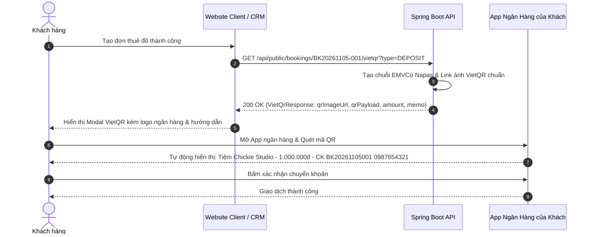

# Đặc Tả Tính Năng: Sinh Mã VietQR Động Theo Từng Đơn Hàng

| Thuộc tính | Giá trị |
|---|---|
| **ID** | `PAY-004` |
| **Tên tính năng** | Sinh mã VietQR động Napas 247 theo đơn hàng (Dynamic VietQR Generation) |
| **Module** | PAY (Payment & Deposit) |
| **Phạm vi** | CLIENT, CRM, SERVER |
| **Ưu tiên** | P1 - Vận hành cốt lõi |
| **Trạng thái** | 📝 SPEC |
| **Người phụ trách** | Fullstack Dev & Tech Lead |
| **Ngày bắt đầu** | 2026-10-25 |
| **Ngày hoàn thành** | 2026-10-25 |
| **Phụ thuộc** | `BOK-001`, `PAY-001` |

---

## Mục Lục
1. [Mục Tiêu và Giá Trị Mang Lại](#1-mục-tiêu-và-giá-trị-mang-lại)
2. [Người Dùng Liên Quan](#2-người-dùng-liên-quan)
3. [Luồng Nghiệp Vụ Chính (Happy Path)](#3-luồng-nghiệp-vụ-chính-happy-path)
4. [Luồng Ngoại Lệ và Trường Hợp Biên](#4-luồng-ngoại-lệ-và-trường-hợp-biên)
5. [Quy Tắc Nghiệp Vụ (Business Rules)](#5-quy-tắc-nghiệp-vụ-business-rules)
6. [Giao Diện & Đa Ngôn Ngữ (UI & i18n)](#6-giao-diện--đa-ngôn-ngữ-ui--i18n)
7. [Đặc Tả API Backend](#7-đặc-tả-api-backend)
8. [Thay Đổi Cơ Sở Dữ Liệu](#8-thay-đổi-cơ-sở-dữ-liệu)
9. [Tiêu Chí Nghiệm Thu (Acceptance Criteria)](#9-tiêu-chí-nghiệm-thu-acceptance-criteria)
10. [Kế Hoạch Kiểm Thử](#10-kế-hoạch-kiểm-thử)
11. [Checklist Hoàn Thành (Definition of Done)](#11-checklist-hoàn-thành-definition-of-done)

---

## 1. Mục Tiêu và Giá Trị Mang Lại
- **Trải nghiệm thanh toán 1 chạm (Zero-effort payment)**: Khách hàng chỉ cần mở ứng dụng ngân hàng bất kỳ (Vietcombank, Techcombank, MB, BIDV, MoMo...) quét mã VietQR là toàn bộ thông tin: **Số tài khoản tiệm**, **Số tiền cọc chính xác**, và **Cú pháp nội dung chuyển khoản** đều được điền tự động.
- **Loại bỏ 100% sai sót nội dung chuyển khoản**: Khách không phải tự gõ số tiền hay nội dung chuyển khoản thủ công, hạn chế tuyệt đối việc gõ sai số tiền hoặc quên ghi mã đơn hàng khiến nhân viên không biết tiền của ai.
- **Tiện ích đa nền tảng**: Hoạt động đồng bộ trên cả Website Client (cho khách cọc online) và CRM Quản trị (cho nhân viên giơ mã cho khách quét tại quầy).

---

## 2. Người Dùng Liên Quan
- [x] **Khách hàng**: Quét mã QR trên màn hình điện thoại hoặc máy tính để chuyển cọc siêu tốc trong vòng 10 giây.
- [x] **Nhân viên cửa hàng**: Bấm hiển thị mã QR trên màn hình CRM hoặc in mã QR đính kèm phiếu bàn giao đồ cho khách quét thanh toán.
- [x] **Admin (Chủ shop)**: Cấu hình thông tin tài khoản ngân hàng nhận tiền của tiệm (Tên ngân hàng, Số tài khoản, Tên chủ thẻ).

---

## 3. Luồng Nghiệp Vụ Chính (Happy Path)

### 3.1. Luồng Sinh & Quét Mã VietQR



### 3.2. Cấu Trúc Nội Dung Chuyển Khoản Chuẩn Hóa
Cú pháp nội dung chuyển khoản được sinh tự động theo quy chuẩn:
$$\text{MEMO} = \text{CHICKIE } + [\text{Mã đơn}] + \text{ } + [\text{4 số cuối SĐT}]$$
*Ví dụ*: `CHICKIE BK20261105001 4321`

---

## 4. Luồng Ngoại Lệ và Trường Hợp Biên

| Tình huống ngoại lệ | Xử lý của hệ thống | Phản hồi giao diện |
|---|---|---|
| **Khách tự sửa số tiền hoặc xóa nội dung chuyển khoản trong App ngân hàng** | Khách cố tình giảm tiền chuyển khoản hoặc sửa nội dung | Nhân viên khi đối soát sao kê tài khoản ngân hàng sẽ tìm kiếm theo số tiền hoặc số điện thoại để đối chiếu thủ công trên CRM |
| **Mất kết nối mạng tới dịch vụ sinh ảnh QR bên ngoài** | Không gọi được các dịch vụ QuickLink QR ngoài | Server tích hợp thuật toán sinh chuỗi chuẩn **EMVCo QR Code Payload** nội bộ và Client dùng thư viện `qrcode.react` tự render SVG cục bộ |
| **Khách đã thanh toán đủ tiền cọc** | Đơn đã ở trạng thái `DEPOSITED` trở lên | Màn hình VietQR tự động chuyển sang chế độ thanh toán tiền thuê còn lại (`type=RENTAL_REMAINING`) thay vì hiển thị tiền cọc |

---

## 5. Quy Tắc Nghiệp Vụ (Business Rules)

- **BR-01 (Chuẩn định dạng VietQR Napas 247)**: Mã QR bắt buộc phải tương thích 100% với chuẩn Napas/EMVCo, đảm bảo quét được bởi hơn 40 ngân hàng tại Việt Nam và các ví điện tử hỗ trợ VietQR.
- **BR-02 (Cấu hình tài khoản an toàn)**: Thông tin tài khoản nhận tiền của tiệm được cấu hình qua biến môi trường hoặc bảng cấu hình `shop_settings`:
  - `VIETQR_BANK_CODE`: Mã BIN ngân hàng (ví dụ: `970407` cho Techcombank, `970436` cho Vietcombank).
  - `VIETQR_ACCOUNT_NUMBER`: Số tài khoản nhận tiền.
  - `VIETQR_ACCOUNT_NAME`: Tên chủ tài khoản in hoa không dấu.
- **BR-03 (Bảo mật số tiền)**: Số tiền nhúng trong mã QR được tính toán bởi Server dựa trên dữ liệu thật của đơn trong database, không nhận số tiền tùy ý truyền từ frontend để tránh bị giả mạo thông tin.

---

## 6. Giao Diện & Đa Ngôn Ngữ (UI & i18n)

### 6.1. Thiết Kế Component VietQR
- **`VietQrModal` (Client & CRM)**:
  - Khung viền phong cách Luxury sang trọng với logo VietQR và Napas 247.
  - Ảnh mã QR kích thước lớn, tương phản cao, dễ quét ngay cả trong điều kiện ánh sáng yếu.
  - Khối thông tin chi tiết kèm nút **"Sao chép" (Copy to clipboard)** 1 chạm:
    - Số tài khoản ngân hàng.
    - Số tiền chính xác.
    - Cú pháp nội dung chuyển khoản.
  - Hướng dẫn 3 bước ngắn gọn kèm đồng hồ đếm ngược hạn cọc.

### 6.2. Bộ Từ Điển Đa Ngôn Ngữ (`vi.json` / `en.json`)

```json
{
  "vietqr": {
    "title": "Chuyển Khoản Qua VietQR",
    "subtitle": "Mở ứng dụng ngân hàng bất kỳ để quét mã thanh toán tức thì",
    "scanGuide": "Quét mã để tự động điền số tiền và nội dung chuyển khoản",
    "bank": "Ngân hàng",
    "accountNumber": "Số tài khoản",
    "accountName": "Chủ tài khoản",
    "amount": "Số tiền cần chuyển",
    "transferContent": "Nội dung chuyển khoản",
    "copy": "Sao chép",
    "copied": "Đã sao chép vào bộ nhớ tạm",
    "notice": "Vui lòng giữ nguyên nội dung chuyển khoản để hệ thống xác nhận nhanh nhất"
  }
}
```

---

## 7. Đặc Tả API Backend

### 7.1. Danh Sách Endpoint

| Method | Endpoint | Quyền hạn | Mục đích |
|---|---|---|---|
| `GET` | `/api/public/bookings/{code}/vietqr` | `PUBLIC` | Lấy dữ liệu VietQR cho khách trên Client |
| `GET` | `/api/admin/bookings/{id}/vietqr` | `STAFF`, `ADMIN` | Lấy dữ liệu VietQR cho nhân viên trên CRM |

### 7.2. Chi Tiết Response DTO

#### A. GET `/api/public/bookings/BK20261105-001/vietqr?type=DEPOSIT`
- **Response Success (200 OK)**:
```json
{
  "code": 200,
  "message": "SUCCESS",
  "data": {
    "bookingCode": "BK20261105-001",
    "bankCode": "TCB",
    "bankName": "Techcombank",
    "bankBin": "970407",
    "accountNumber": "1903456789012",
    "accountName": "TIEM CHO THUE CHICKIE STUDIO",
    "amount": 1000000.00,
    "memo": "CHICKIE BK20261105001 4321",
    "qrImageUrl": "https://img.vietqr.io/image/970407-1903456789012-compact2.png?amount=1000000&addInfo=CHICKIE%20BK20261105001%204321&accountName=TIEM%20CHO%20THUE%20CHICKIE%20STUDIO",
    "emvcoPayload": "00020101021238580010A00000072701280006970407011419034567890120208QRIBFTTA5303704540710000005802VN62280824CHICKIE BK20261105001 43216304ABCD"
  }
}
```

---

## 8. Thay Đổi Cơ Sở Dữ Liệu
- Không cần tạo thêm bảng mới; cấu hình thông tin ngân hàng tiệm được lưu trong biến môi trường `application.yml`:

```yaml
app:
  payment:
    vietqr:
      bank-bin: "970407"
      bank-code: "TCB"
      bank-name: "Techcombank"
      account-number: "1903456789012"
      account-name: "TIEM CHO THUE CHICKIE STUDIO"
      template: "compact2"
```

---

## 9. Tiêu Chí Nghiệm Thu (Acceptance Criteria)

### Kịch bản 1: Sinh mã VietQR đặt cọc chính xác trên Client
- **Given**: Khách hàng tạo đơn thuê có tiền cọc là 1.200.000 đ.
- **When**: Màn hình xác nhận mở popup VietQR.
- **Then**: Mã QR hiển thị đúng số tiền 1.200.000 đ, số tài khoản tiệm và nội dung chứa đúng mã đơn hàng của khách.

### Kịch bản 2: Nút sao chép 1 chạm hoạt động trơn tru
- **Given**: Khách sử dụng điện thoại và muốn tự mở App ngân hàng để chuyển khoản.
- **When**: Khách bấm nút "Sao chép" cạnh Số tài khoản hoặc Nội dung chuyển khoản.
- **Then**: Hệ thống sao chép nội dung vào Clipboard và hiển thị thông báo "Đã sao chép" trong 2 giây.

---

## 10. Kế Hoạch Kiểm Thử
- **Unit Test Backend**:
  - `VietQrServiceTest`: Kiểm tra giải thuật sinh chuỗi chuẩn Napas EMVCo, kiểm tra chuẩn hóa nội dung chuyển khoản không dấu.
- **Frontend Test (Vitest)**:
  - `VietQrModal.test.tsx`: Render mã QR, kiểm tra sự kiện sao chép Clipboard (`navigator.clipboard.writeText`).
- **Mục tiêu Coverage**: $\ge 85\%$.

---

## 11. Checklist Hoàn Thành (Definition of Done)
- [ ] Soạn thảo và phê duyệt tài liệu đặc tả `PAY-004` (đã xong).
- [ ] Cập nhật bảng theo dõi trong [docs/FEATURES.md](../../FEATURES.md).
- [ ] Tích hợp trơn tru vào modal đặt đơn Client và modal thu tiền CRM.
- [ ] Không sử dụng inline CSS, 100% tuân thủ CSS Modules / SCSS / Tailwind.
- [ ] Kiểm thử tự động đạt độ bao phủ $\ge 80\%$.
- [ ] Ghi nhận thay đổi vào `CHANGELOG.md`.
