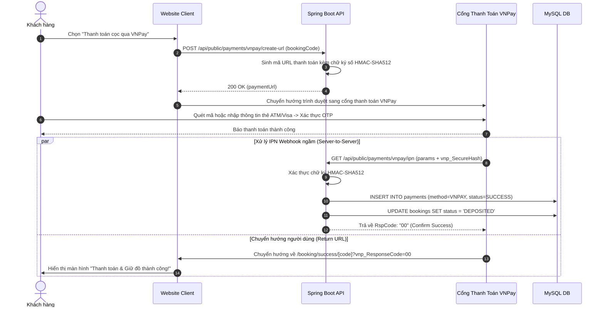

# Đặc Tả Tính Năng: Tích Hợp Cổng Thanh Toán Trực Tuyến VNPay & MoMo

| Thuộc tính | Giá trị |
|---|---|
| **ID** | `PAY-005` |
| **Tên tính năng** | Tích hợp cổng thanh toán trực tuyến VNPay / MoMo tự động xác nhận qua IPN |
| **Module** | PAY (Payment & Deposit) |
| **Phạm vi** | SERVER, CLIENT |
| **Ưu tiên** | P2 - Tăng trưởng & Tự động hóa |
| **Trạng thái** | 📝 SPEC |
| **Người phụ trách** | Fullstack Dev & Tech Lead |
| **Ngày bắt đầu** | 2026-10-25 |
| **Ngày hoàn thành** | 2026-10-25 |
| **Phụ thuộc** | `PAY-001`, `BOK-001`, `BOK-003` |

---

## Mục Lục
1. [Mục Tiêu và Giá Trị Mang Lại](#1-mục-tiêu-và-giá-trị-mang-lại)
2. [Người Dùng Liên Quan](#2-người-dùng-liên-quan)
3. [Luồng Nghiệp Vụ Chính (Happy Path)](#3-luồng-nghiệp-vụ-chính-happy-path)
4. [Luồng Ngoại Lệ và Trường Hợp Biên](#4-luồng-ngoại-lệ-và-trường-hợp-biên)
5. [Quy Tắc Nghiệp Vụ (Business Rules)](#5-quy-tắc-nghiệp-vụ-business-rules)
6. [Giao Diện & Đa Ngôn Ngữ (UI & i18n)](#6-giao-diện--đa-ngôn-ngữ-ui--i18n)
7. [Đặc Tả API Backend](#7-đặc-tả-api-backend)
8. [Thay Đổi Cơ Sở Dữ Liệu](#8-thay-đổi-cơ-sở-dữ-liệu)
9. [Tiêu Chí Nghiệm Thu (Acceptance Criteria)](#9-tiêu-chí-nghiệm-thu-acceptance-criteria)
10. [Kế Hoạch Kiểm Thử](#10-kế-hoạch-kiểm-thử)
11. [Checklist Hoàn Thành (Definition of Done)](#11-checklist-hoàn-thành-definition-of-done)

---

## 1. Mục Tiêu và Giá Trị Mang Lại
- **Tự động hóa 100% việc xác nhận thanh toán**: Thay vì nhân viên phải túc trực kiểm tra tin nhắn ngân hàng và bấm xác nhận cọc thủ công trên CRM, cổng thanh toán VNPay gửi tín hiệu máy chủ (IPN Webhook) xác nhận tức thì trong vòng 1-2 giây.
- **Đa dạng hóa phương thức thanh toán**: Cho phép khách hàng chi trả tiền cọc hoặc thanh toán toàn bộ đơn thuê bằng thẻ ATM nội địa, thẻ quốc tế (Visa, Mastercard, JCB) hoặc quét ví điện tử MoMo/VNPAY-QR.
- **Tối ưu trải nghiệm cho khách hàng đặt đồ ban đêm / ngoài giờ hành chính**: Khách đặt lúc 23:00 vẫn được khóa giữ đồ ngay lập tức mà không phải chờ tiệm mở cửa sáng hôm sau.

---

## 2. Người Dùng Liên Quan
- [x] **Khách hàng**: Chọn cổng VNPay / MoMo để thanh toán trực tuyến an toàn được bảo hộ bởi ngân hàng.
- [x] **Chủ tiệm (Admin)**: Quản lý đối soát doanh thu tự động trên cổng thanh toán Merchant portal; tiền tự động về tài khoản doanh nghiệp.

---

## 3. Luồng Nghiệp Vụ Chính (Happy Path)

### 3.1. Sơ Đồ Trình Tự Thanh Toán & Xác Nhận IPN



---

## 4. Luồng Ngoại Lệ và Trường Hợp Biên

| Tình huống ngoại lệ | Xử lý của hệ thống | Phản hồi giao diện |
|---|---|---|
| **Chữ ký số giả mạo (Invalid Checksum)** | Kẻ xấu cố tình thay đổi số tiền hoặc giả lập request IPN | Server phát hiện mã băm HMAC-SHA512 không khớp, từ chối xử lý, trả về `{ "RspCode": "97", "Message": "Invalid Checksum" }` và ghi log cảnh báo an ninh |
| **Khách hủy thanh toán tại cổng VNPay** | Khách bấm nút "Hủy giao dịch" trên trang VNPay | Cổng trả về mã lỗi (`vnp_ResponseCode != 00`), Client hiển thị: *"Giao dịch chưa hoàn tất. Quý khách có thể thanh toán lại hoặc chuyển khoản qua VietQR"* |
| **Giao dịch trùng lặp (Duplicate IPN)** | VNPay gửi lại request IPN nhiều lần do mạng chập chờn | Server kiểm tra mã giao dịch `vnp_TransactionNo` trong DB. Nếu đã ghi nhận thành công từ trước, trả về ngay `{ "RspCode": "02", "Message": "Order already confirmed" }` mà không cộng tiền 2 lần (Idempotent) |

---

## 5. Quy Tắc Nghiệp Vụ (Business Rules)

- **BR-01 (Bảo mật chữ ký số HMAC-SHA512)**: Mọi URL thanh toán gửi đi và mọi request IPN nhận về đều bắt buộc phải được mã hóa và xác thực toàn vẹn dữ liệu bằng thuật toán `HmacSHA512` với khóa bí mật `vnp_HashSecret`.
- **BR-02 (Tính chất lũy kế / Idempotency)**: Endpoint IPN phải bảo đảm an toàn khi nhận nhiều request giống nhau, không làm sai lệch trạng thái đơn hàng.
- **BR-03 (Bảo toàn số tiền)**: Số tiền gửi sang cổng thanh toán bắt buộc phải nhân với 100 theo quy định của VNPay:
  $$\text{vnp\_Amount} = \text{Amount} \times 100$$
- **BR-04 (Thời gian hết hạn phiên thanh toán)**: Phiên thanh toán tại cổng được thiết lập tối đa **15 phút**. Nếu quá 15 phút khách không nhập OTP, giao dịch tự động hủy.

---

## 6. Giao Diện & Đa Ngôn Ngữ (UI & i18n)

### 6.1. Thiết Kế Component Client
- **Lựa chọn phương thức thanh toán**:
  - `RadioGroup`:
    - [ ] Chuyển khoản ngân hàng 24/7 (VietQR miễn phí)
    - [x] Cổng thanh toán trực tuyến VNPay (Hỗ trợ thẻ ATM, Visa, Mastercard, VNPAY-QR)
    - [ ] Ví điện tử MoMo
- **Nút hành động**: `[ Thanh toán an toàn qua VNPay ]` (kèm icon bảo mật SSL 256-bit).

### 6.2. Bộ Từ Điển Đa Ngôn Ngữ (`vi.json` / `en.json`)

```json
{
  "onlinePayment": {
    "vnpayOption": "Cổng VNPay (Thẻ ATM nội địa, Visa, Mastercard, VNPAY-QR)",
    "momoOption": "Ví điện tử MoMo",
    "redirectingNotice": "Đang chuyển hướng sang cổng thanh toán an toàn...",
    "paymentSuccessTitle": "Thanh toán trực tuyến thành công!",
    "paymentFailedTitle": "Thanh toán không thành công",
    "retryPaymentBtn": "Thanh toán lại",
    "switchVietQrBtn": "Chuyển sang quét mã VietQR"
  }
}
```

---

## 7. Đặc Tả API Backend

### 7.1. Danh Sách Endpoint

| Method | Endpoint | Quyền hạn | Mục đích |
|---|---|---|---|
| `POST` | `/api/public/payments/vnpay/create-url` | `PUBLIC` | Tạo URL chuyển hướng sang cổng VNPay |
| `GET` | `/api/public/payments/vnpay/ipn` | `PUBLIC` (Webhook) | Tiếp nhận thông báo kết quả giao dịch tự động từ VNPay |
| `GET` | `/api/public/payments/vnpay/return` | `PUBLIC` | Xử lý dữ liệu trả về khi khách thanh toán xong và quay lại web |

### 7.2. Chi Tiết Request & Response DTOs

#### A. POST `/api/public/payments/vnpay/create-url`
- **Request Body**:
```json
{
  "bookingCode": "BK20261105-001",
  "paymentType": "DEPOSIT",
  "bankCode": ""
}
```
- **Response Success (200 OK)**:
```json
{
  "code": 200,
  "message": "Tạo URL thanh toán thành công",
  "data": {
    "paymentUrl": "https://sandbox.vnpayment.vn/paymentv2/vpcpay.html?vnp_Amount=100000000&vnp_Command=pay&vnp_CreateDate=20261105214000&vnp_CurrCode=VND&vnp_IpAddr=127.0.0.1&vnp_Locale=vn&vnp_OrderInfo=Thanh+toan+coc+don+BK20261105-001&vnp_OrderType=other&vnp_ReturnUrl=https%3A%2F%2Fchickiestudio.com%2Fpayment%2Fvnpay-return&vnp_TmnCode=CHICKIE1&vnp_TxnRef=BK20261105001_1729867200&vnp_Version=2.1.0&vnp_SecureHash=a1b2c3d4e5..."
  }
}
```

#### B. GET `/api/public/payments/vnpay/ipn`
- **Phản hồi chuẩn VNPay yêu cầu**:
```json
{
  "RspCode": "00",
  "Message": "Confirm Success"
}
```

---

## 8. Thay Đổi Cơ Sở Dữ Liệu
- Tận dụng bảng `payments` được tạo từ `PAY-001`. Cột `payment_method` nhận giá trị `'VNPAY'`, cột `bank_transaction_id` lưu `vnp_TransactionNo` từ cổng trả về.

---

## 9. Tiêu Chí Nghiệm Thu (Acceptance Criteria)

### Kịch bản 1: Tạo liên kết thanh toán chính xác
- **Given**: Đơn thuê có số tiền cọc là 1.000.000 đ.
- **When**: Khách hàng chọn phương thức VNPay và bấm Thanh toán.
- **Then**: Server tạo ra URL chứa tham số `vnp_Amount=100000000`, mã băm `vnp_SecureHash` hợp lệ và khách chuyển hướng đến đúng trang thanh toán của VNPay.

### Kịch bản 2: Webhook IPN tự động xác nhận đơn thành công
- **Given**: Khách hoàn tất thanh toán thành công trên VNPay.
- **When**: VNPay bắn request IPN kèm `vnp_ResponseCode=00` và chữ ký hợp lệ.
- **Then**: Đơn hàng tự động đổi trạng thái sang `DEPOSITED`, bản ghi `payments` được ghi nhận `SUCCESS`, Audit Trail lưu vết `changed_by = 'VNPAY_IPN'`.

---

## 10. Kế Hoạch Kiểm Thử
- **Unit Test Backend**:
  - `VNPayServiceTest`: Kiểm tra giải thuật băm HMAC-SHA512 với chuỗi tham số sắp xếp theo alphabet.
  - `VNPayIpnControllerTest`: Kiểm tra các trường hợp mã lỗi: Sai checksum (97), Đơn không tìm thấy (01), Đơn đã xử lý rồi (02).
- **Mục tiêu Coverage**: $\ge 85\%$.

---

## 11. Checklist Hoàn Thành (Definition of Done)
- [ ] Soạn thảo và phê duyệt tài liệu đặc tả `PAY-005` (đã xong).
- [ ] Cập nhật bảng theo dõi trong [docs/FEATURES.md](../../FEATURES.md).
- [ ] Tích hợp trơn tru vào client và CRM.
- [ ] Không sử dụng inline CSS, 100% tuân thủ CSS Modules / SCSS / Tailwind.
- [ ] Kiểm thử tự động đạt độ bao phủ $\ge 80\%$.
- [ ] Ghi nhận thay đổi vào `CHANGELOG.md`.
