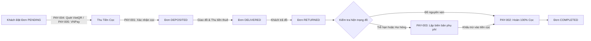

# Module Payment (Thanh Toán & Tiền Cọc) - Chickie Studio

Thư mục lưu trữ toàn bộ các hồ sơ đặc tả kỹ thuật chi tiết (**SPEC**) thuộc Module **PAY** của dự án Chickie Studio.

---

## 1. Danh Sách Tính Năng Module PAY

| Mã ID | Tên Tính Năng | Phạm Vi | Ưu Tiên | Trạng Thái | Link Đặc Tả |
|---|---|---|---|:---:|---|
| `PAY-001` | Ghi nhận cọc và thanh toán tiền mặt/CK trên CRM | CRM, SERVER | P1 | 📝 SPEC | [PAY-001](PAY-001-ghi-nhan-coc-thanh-toan-crm.md) |
| `PAY-002` | Quy trình hoàn trả tiền cọc cho khách hàng | CRM, SERVER | P1 | 📝 SPEC | [PAY-002](PAY-002-quy-trinh-hoan-tra-tien-coc.md) |
| `PAY-003` | Thu phụ phí trả trễ hạn và hư hỏng đồ | CRM, SERVER | P1 | 📝 SPEC | [PAY-003](PAY-003-thu-phu-phi-tre-han-hu-hong.md) |
| `PAY-004` | Sinh mã VietQR động theo từng đơn hàng | CLIENT, CRM | P1 | 📝 SPEC | [PAY-004](PAY-004-sinh-ma-vietqr-dong.md) |
| `PAY-005` | Tích hợp cổng thanh toán online VNPay / MoMo | SERVER, CLIENT | P2 | 📝 SPEC | [PAY-005](PAY-005-tich-hop-cong-thanh-toan-online.md) |

---

## 2. Kiến Trúc Luồng Tiền & Vòng Đời Thanh Toán

---

## 3. Cơ Sở Dữ Liệu Liên Quan
- `payments`: Quản lý các giao dịch thu tiền cọc, thu tiền thuê, phụ phí và chi hoàn cọc (`V13__create_payments_table.sql`).
- `booking_damages`: Quản lý biên bản hư hỏng, ảnh chụp hiện trạng đối chứng và phạt trễ hạn (`V14__create_booking_damages_table.sql`).
