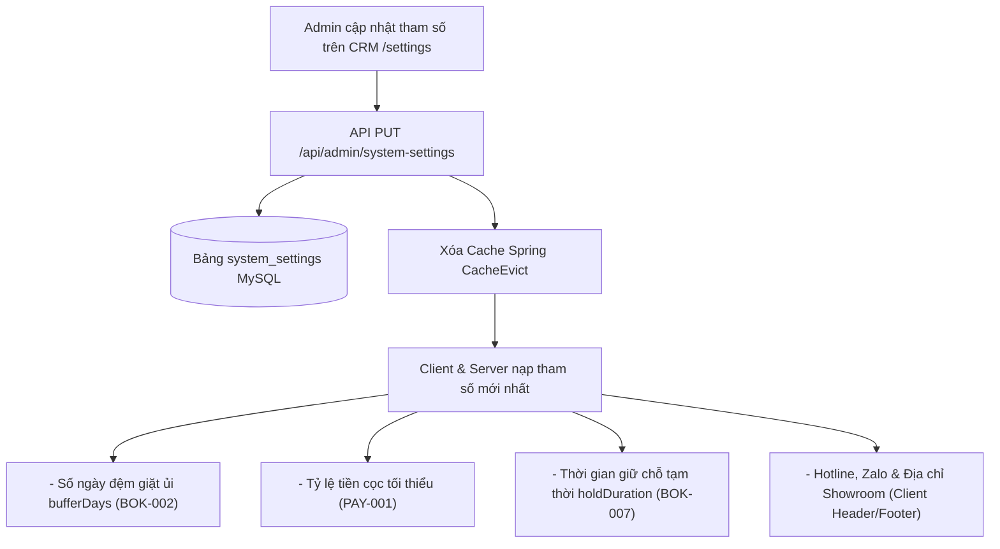

# Module System Setting (Cấu Hình Hệ Thống) - Chickie Studio

Thư mục lưu trữ toàn bộ các hồ sơ đặc tả kỹ thuật chi tiết (**SPEC**) thuộc Module **SET** của dự án Chickie Studio.

---

## 1. Danh Sách Tính Năng Module SET

| Mã ID | Tên Tính Năng | Phạm Vi | Ưu Tiên | Trạng Thái | Link Đặc Tả |
|---|---|---|---|:---:|---|
| `SET-001` | Cấu hình thông tin shop, số ngày đệm giặt ủi, tỉ lệ cọc | CRM, SERVER | P1 | 📝 SPEC | [SET-001](SET-001-cau-hinh-thong-tin-shop-tham-so.md) |
| `SET-002` | Cấu hình nội dung banner & thông điệp trang chủ | CRM, SERVER | P2 | ⬜ TODO | - |
| `SET-003` | Tích hợp gửi thông báo nhắc lịch qua Zalo ZNS / SMS | SERVER | P2 | ⬜ TODO | - |

---

## 2. Kiến Trúc Cấu Hình Hệ Thống

