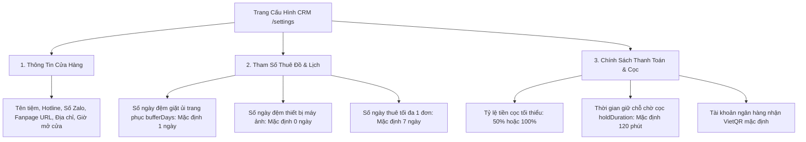
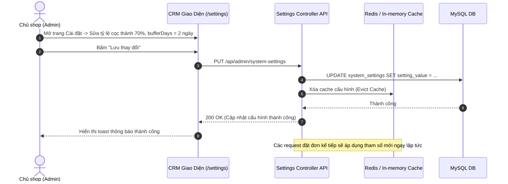

# Đặc Tả Tính Năng: Cấu Hình Tham Số Cửa Hàng & Vận Hành

| Thuộc tính | Giá trị |
|---|---|
| **ID** | `SET-001` |
| **Tên tính năng** | Cấu hình thông tin cửa hàng, tỷ lệ cọc %, số ngày đệm giặt ủi và tham số vận hành |
| **Module** | SET (System Setting) |
| **Phạm vi** | CRM, SERVER, CLIENT |
| **Ưu tiên** | P1 - Vận hành cốt lõi |
| **Trạng thái** | 📝 SPEC |
| **Người phụ trách** | Fullstack Dev & Tech Lead |
| **Ngày bắt đầu** | 2026-10-25 |
| **Ngày hoàn thành** | 2026-10-25 |
| **Phụ thuộc** | `AUTH-002`, `BOK-002`, `BOK-007`, `PAY-001` |

---

## Mục Lục
1. [Mục Tiêu và Giá Trị Mang Lại](#1-mục-tiêu-và-giá-trị-mang-lại)
2. [Người Dùng Liên Quan](#2-người-dùng-liên-quan)
3. [Luồng Nghiệp Vụ Chính (Happy Path)](#3-luồng-nghiệp-vụ-chính-happy-path)
4. [Luồng Ngoại Lệ và Trường Hợp Biên](#4-luồng-ngoại-lệ-và-trường-hợp-biên)
5. [Quy Tắc Nghiệp Vụ (Business Rules)](#5-quy-tắc-nghiệp-vụ-business-rules)
6. [Giao Diện & Đa Ngôn Ngữ (UI & i18n)](#6-giao-diện--đa-ngôn-ngữ-ui--i18n)
7. [Đặc Tả API Backend](#7-đặc-tả-api-backend)
8. [Thay Đổi Cơ Sở Dữ Liệu](#8-thay-đổi-cơ-sở-dữ-liệu)
9. [Tiêu Chí Nghiệm Thu (Acceptance Criteria)](#9-tiêu-chí-nghiệm-thu-acceptance-criteria)
10. [Kế Hoạch Kiểm Thử](#10-kế-hoạch-kiểm-thử)
11. [Checklist Hoàn Thành (Definition of Done)](#11-checklist-hoàn-thành-definition-of-done)

---

## 1. Mục Tiêu và Giá Trị Mang Lại
- **Tập trung hóa toàn bộ tham số vận hành của tiệm**: Loại bỏ việc "hardcode" các hằng số nghiệp vụ trong mã nguồn (như số ngày đệm giặt ủi, thời gian giữ cọc tạm thời, tỷ lệ cọc tối thiểu, hotline, địa chỉ showroom).
- **Linh hoạt thích ứng theo mùa kinh doanh**: Vào mùa cao điểm (kỷ yếu tháng 10-12 hoặc cận Tết), chủ shop có thể điều chỉnh thời gian giữ chỗ cọc từ 120 phút rút xuống còn 30 phút, hoặc nâng tỷ lệ cọc từ 50% lên 70% chỉ bằng 1 thao tác lưu trên giao diện CRM mà không cần khởi động lại máy chủ.
- **Đồng bộ hóa dữ liệu thời gian thực (Dynamic Configuration)**: Các thay đổi cài đặt lập tức tác động lên thuật toán tính lịch trống (`BOK-002`), bộ quét hủy đơn quá hạn (`BOK-007`) và thông tin liên hệ hiển thị ở Header/Footer Client (`CNT-001`, `CNT-002`).

---

## 2. Người Dùng Liên Quan
- [x] **Admin (Chủ tiệm)**: Toàn quyền truy cập và chỉnh sửa toàn bộ các nhóm cấu hình hệ thống trên CRM (`/settings`).
- [x] **Khách hàng & Khách vãng lai**: Được hưởng lợi từ các chính sách cọc minh bạch và luôn nhìn thấy số hotline, địa chỉ tiệm chính xác trên website Client.

---

## 3. Luồng Nghiệp Vụ Chính (Happy Path)

### 3.1. Các Phân Nhóm Cấu Hình Hệ Thống



### 3.2. Sơ Đồ Trình Tự Cập Nhật Cấu Hình



---

## 4. Luồng Ngoại Lệ và Trường Hợp Biên

| Tình huống ngoại lệ | Xử lý của hệ thống | Phản hồi giao diện |
|---|---|---|
| **Nhập tỷ lệ cọc bất hợp lý ($< 10\%$ hoặc $> 100\%$)** | Hệ thống chặn validation tầng DTO | Báo lỗi form: *"Tỷ lệ tiền cọc phải nằm trong khoảng từ 10% đến 100%"* |
| **Nhân viên (Staff) cố tình vào trang cài đặt** | Bị chặn bởi `RoleGuard` | Chuyển hướng sang trang 403 Forbidden |
| **Thay đổi ngày đệm khi đã có đơn đặt trước** | Các đơn đã tạo trước đó vẫn giữ nguyên khoảng thời gian đệm cũ; tham số mới chỉ áp dụng cho các đơn đặt từ thời điểm lưu | Hiển thị hộp thoại xác nhận: *"Thay đổi này sẽ áp dụng cho tất cả đơn hàng mới được tạo sau thời điểm này."* |

---

## 5. Quy Tắc Nghiệp Vụ (Business Rules)

- **BR-01 (Đặc quyền Quản trị tối cao)**: Endpoint cập nhật `PUT /api/admin/system-settings` chỉ cho phép tài khoản có vai trò `ROLE_ADMIN`.
- **BR-02 (Bộ nhớ đệm tốc độ cao)**: Các cài đặt tham số vận hành được cache ở tầng Backend (Spring Cache) và tự động xóa cache khi Admin cập nhật (`@CacheEvict`) để tránh query DB liên tục mỗi khi có khách xem sản phẩm.
- **BR-03 (Công khai thông tin công cộng)**: Endpoint `GET /api/public/system-settings/general` chỉ trả về thông tin tiệm (tên, hotline, địa chỉ, giờ mở cửa) và các tham số công khai; tuyệt đối không để lộ các thiết lập bảo mật nội bộ.
- **BR-04 (Giá trị mặc định an toàn - Fallback)**: Nếu cơ sở dữ liệu bị trống một tham số nào đó, hệ thống tự động fallback về giá trị mặc định mã hóa sẵn trong code (ví dụ `bufferDays = 1`, `holdMinutes = 120`).

---

## 6. Giao Diện & Đa Ngôn Ngữ (UI & i18n)

### 6.1. Thiết Kế Màn Hình Cài Đặt CRM (`crm/src/pages/settings/SystemSettingsPage.tsx`)
- **Khối 1: Thông tin tiệm & Liên hệ**:
  - Tên cửa hàng, Hotline, Hotline phản ánh khiếu nại, Số Zalo chat, Link Facebook Page, Địa chỉ showroom, Giờ mở cửa hàng ngày.
- **Khối 2: Tham số lịch thuê & Kho**:
  - `NumberField`: Số ngày đệm giặt ủi trang phục (Ngày).
  - `NumberField`: Số ngày đệm kiểm tra máy ảnh (Ngày).
  - `NumberField`: Số ngày thuê tối đa cho 1 lượt đơn.
- **Khối 3: Tham số thanh toán & Giữ chỗ**:
  - `Slider` / `NumberField`: Tỷ lệ cọc tối thiểu (`%`).
  - `NumberField`: Thời gian đếm ngược giữ chỗ tạm thời (`Phút`).
- **Thanh nút lưu dính đáy (Sticky Save Bar)**: Nút `[ Hủy thay đổi ]` và `[ Lưu Cấu Hình ]`.

### 6.2. Bộ Từ Điển Đa Ngôn Ngữ (`vi.json` / `en.json`)

```json
{
  "settings": {
    "title": "Cài Đặt Hệ Thống & Cửa Hàng",
    "subtitle": "Quản lý tham số vận hành, tỷ lệ cọc và thông tin liên hệ cửa hàng",
    "groupShop": "Thông tin liên hệ & Showroom",
    "groupRental": "Tham số lịch thuê & Đệm giặt ủi",
    "groupPayment": "Quy định cọc & Giữ chỗ",
    "shopName": "Tên thương hiệu",
    "hotline": "Hotline bán hàng / đặt lịch",
    "zalo": "Số Zalo tư vấn",
    "address": "Địa chỉ showroom",
    "openHours": "Giờ mở cửa",
    "clothingBuffer": "Ngày đệm giặt ủi váy / áo dài (ngày)",
    "cameraBuffer": "Ngày đệm kiểm tra máy ảnh (ngày)",
    "depositRate": "Tỷ lệ cọc mặc định (%)",
    "holdDuration": "Thời gian giữ chỗ chờ cọc (phút)",
    "saveBtn": "Lưu thay đổi",
    "saveSuccess": "Cập nhật cấu hình hệ thống thành công"
  }
}
```

---

## 7. Đặc Tả API Backend

### 7.1. Danh Sách Endpoint

| Method | Endpoint | Quyền hạn | Mục đích |
|---|---|---|---|
| `GET` | `/api/public/system-settings/general` | `PUBLIC` | Khách xem thông tin liên hệ & chính sách công khai |
| `GET` | `/api/admin/system-settings` | `ROLE_ADMIN` | Lấy toàn bộ danh mục cấu hình hệ thống |
| `PUT` | `/api/admin/system-settings` | `ROLE_ADMIN` | Cập nhật cấu hình hệ thống |

### 7.2. Chi Tiết Request & Response DTOs

#### A. GET `/api/admin/system-settings`
- **Response Success (200 OK)**:
```json
{
  "code": 200,
  "message": "SUCCESS",
  "data": {
    "shopName": "Chickie Studio - Cho Thuê Váy Thiết Kế & Áo Dài",
    "hotline": "0987654321",
    "zaloPhone": "0987654321",
    "address": "Số 123 Đường Cầu Giấy, Hà Nội",
    "openHours": "09:00 - 21:30 hàng ngày",
    "clothingBufferDays": 1,
    "cameraBufferDays": 0,
    "maxRentalDays": 7,
    "defaultDepositRatePercent": 50,
    "holdDurationMinutes": 120
  }
}
```

#### B. PUT `/api/admin/system-settings`
- **Request Body**:
```json
{
  "shopName": "Chickie Studio - Cho Thuê Váy Thiết Kế & Áo Dài",
  "hotline": "0987654321",
  "zaloPhone": "0987654321",
  "address": "Số 123 Đường Cầu Giấy, Hà Nội",
  "openHours": "09:00 - 21:30 hàng ngày",
  "clothingBufferDays": 2,
  "cameraBufferDays": 0,
  "maxRentalDays": 5,
  "defaultDepositRatePercent": 70,
  "holdDurationMinutes": 60
}
```
- **Response Success (200 OK)**:
```json
{
  "code": 200,
  "message": "Cập nhật cấu hình hệ thống thành công",
  "data": { ... }
}
```

---

## 8. Thay Đổi Cơ Sở Dữ Liệu

### 8.1. File Migration Flyway: `V16__create_system_settings_table.sql`

```sql
-- Migration V16: Bảng lưu trữ cấu hình hệ thống động (SET-001)
CREATE TABLE `system_settings` (
    `setting_key` VARCHAR(100) PRIMARY KEY,
    `setting_value` TEXT NOT NULL,
    `data_type` VARCHAR(20) NOT NULL DEFAULT 'STRING', -- STRING, INTEGER, DECIMAL, BOOLEAN, JSON
    `description` VARCHAR(255) NULL,
    `updated_by` VARCHAR(50) NULL,
    `updated_at` TIMESTAMP NOT NULL DEFAULT CURRENT_TIMESTAMP ON UPDATE CURRENT_TIMESTAMP
) ENGINE=InnoDB DEFAULT CHARSET=utf8mb4 COLLATE=utf8mb4_unicode_ci;

-- Khởi tạo các tham số mặc định chuẩn của tiệm
INSERT INTO `system_settings` (`setting_key`, `setting_value`, `data_type`, `description`) VALUES
('shop.name', 'Chickie Studio - Cho Thuê Váy Thiết Kế & Áo Dài', 'STRING', 'Tên thương hiệu tiệm'),
('shop.hotline', '0987654321', 'STRING', 'Hotline hỗ trợ khách hàng'),
('shop.zalo', '0987654321', 'STRING', 'Số điện thoại Zalo tư vấn'),
('shop.address', 'Số 123 Đường Cầu Giấy, Hà Nội', 'STRING', 'Địa chỉ cửa hàng'),
('shop.open_hours', '09:00 - 21:30 hàng ngày', 'STRING', 'Thời gian mở cửa'),
('rental.clothing_buffer_days', '1', 'INTEGER', 'Số ngày đệm giặt ủi trang phục'),
('rental.camera_buffer_days', '0', 'INTEGER', 'Số ngày đệm kiểm tra máy ảnh'),
('rental.max_days', '7', 'INTEGER', 'Số ngày thuê tối đa cho 1 lượt'),
('payment.deposit_rate_percent', '50', 'INTEGER', 'Tỷ lệ cọc mặc định (%)'),
('booking.hold_duration_minutes', '120', 'INTEGER', 'Thời gian giữ chỗ tạm thời (phút)');
```

---

## 9. Tiêu Chí Nghiệm Thu (Acceptance Criteria)

### Kịch bản 1: Cập nhật tham số ngày đệm giặt ủi
- **Given**: Admin đổi `rental.clothing_buffer_days` từ 1 ngày sang 2 ngày.
- **When**: Khách hàng kiểm tra lịch trống một mẫu váy trên Client (`CAT-006`).
- **Then**: Hệ thống tự động tính ngày đệm mới là 2 ngày sau ngày khách trước trả đồ.

### Kịch bản 2: Bảo mật phân quyền Admin
- **Given**: Tài khoản đăng nhập với role `ROLE_STAFF`.
- **When**: Cố tình gửi request `PUT /api/admin/system-settings`.
- **Then**: Hệ thống trả về `403 FORBIDDEN` và giữ nguyên toàn bộ cấu hình cũ.

---

## 10. Kế Hoạch Kiểm Thử
- **Backend Unit Test**: `SystemSettingServiceTest` (kiểm tra lấy setting theo key, kiểm tra chuyển đổi kiểu dữ liệu, kiểm tra xóa cache).
- **Frontend Test (Vitest)**: `SystemSettingsPage.test.tsx` (kiểm tra form binding, validation giới hạn số, thông báo thành công).
- **Mục tiêu Coverage**: $\ge 85\%$.

---

## 11. Checklist Hoàn Thành (Definition of Done)
- [ ] Soạn thảo và phê duyệt tài liệu đặc tả `SET-001` (đã xong).
- [ ] Cập nhật bảng theo dõi trong [docs/FEATURES.md](../../FEATURES.md).
- [ ] Tái sử dụng component nhập liệu và modal chuẩn.
- [ ] Không sử dụng inline CSS, 100% tuân thủ CSS Modules / SCSS / Tailwind.
- [ ] Kiểm thử tự động đạt độ bao phủ $\ge 80\%$.
- [ ] Ghi nhận thay đổi vào `CHANGELOG.md`.
