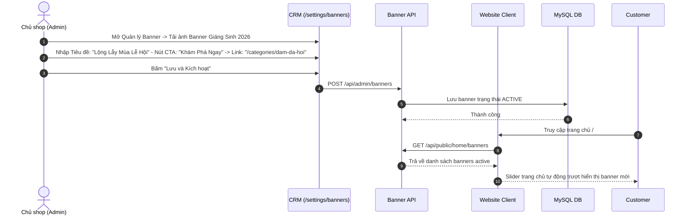

# Đặc Tả Tính Năng: Cấu Hình Banner & Thông Điệp Trang Chủ

| Thuộc tính | Giá trị |
|---|---|
| **ID** | `SET-002` |
| **Tên tính năng** | Cấu hình nội dung banner trượt, câu slogan và thông điệp nổi bật trang chủ |
| **Module** | SET (System Setting & CMS) |
| **Phạm vi** | CRM, SERVER, CLIENT |
| **Ưu tiên** | P2 - Tiếp thị & Tùy biến giao diện |
| **Trạng thái** | 📝 SPEC |
| **Người phụ trách** | Fullstack Dev & UI/UX Specialist |
| **Ngày bắt đầu** | 2026-10-25 |
| **Ngày hoàn thành** | 2026-10-25 |
| **Phụ thuộc** | `SET-001`, `CNT-001` |

---

## Mục Lục
1. [Mục Tiêu và Giá Trị Mang Lại](#1-mục-tiêu-và-giá-trị-mang-lại)
2. [Người Dùng Liên Quan](#2-người-dùng-liên-quan)
3. [Luồng Nghiệp Vụ Chính (Happy Path)](#3-luồng-nghiệp-vụ-chính-happy-path)
4. [Luồng Ngoại Lệ và Trường Hợp Biên](#4-luồng-ngoại-lệ-và-trường-hợp-biên)
5. [Quy Tắc Nghiệp Vụ (Business Rules)](#5-quy-tắc-nghiệp-vụ-business-rules)
6. [Giao Diện & Đa Ngôn Ngữ (UI & i18n)](#6-giao-diện--đa-ngôn-ngữ-ui--i18n)
7. [Đặc Tả API Backend](#7-đặc-tả-api-backend)
8. [Thay Đổi Cơ Sở Dữ Liệu](#8-thay-đổi-cơ-sở-dữ-liệu)
9. [Tiêu Chí Nghiệm Thu (Acceptance Criteria)](#9-tiêu-chí-nghiệm-thu-acceptance-criteria)
10. [Kế Hoạch Kiểm Thử](#10-kế-hoạch-kiểm-thử)
11. [Checklist Hoàn Thành (Definition of Done)](#11-checklist-hoàn-thành-definition-of-done)

---

## 1. Mục Tiêu và Giá Trị Mang Lại
- **Chủ động thay đổi diện mạo website theo mùa**: Vào các dịp lễ hội (Giáng Sinh, Tết Nguyên Đán, Mùa chụp kỷ yếu, Khai giảng), chủ tiệm có thể tự tải lên các bộ ảnh Banner trượt mới, cập nhật câu slogan truyền cảm hứng và link dẫn tới các bộ sưu tập hot mà không cần nhờ lập trình viên sửa code.
- **Thanh thông báo khẩn cấp (Announcement Bar)**: Chạy dải chữ nổi bật ở đầu trang (ví dụ: *"Ưu đãi kỷ yếu: Giảm 15% cho nhóm từ 5 bạn - Nhập mã KYEU2026"* hoặc *"Tiệm nghỉ Tết từ 28 đến mùng 5"*).

---

## 2. Người Dùng Liên Quan
- [x] **Admin (Chủ tiệm)**: Quản lý banner (thêm ảnh, kéo thả sắp xếp thứ tự hiển thị, bật/tắt hiển thị, gắn link nút kêu gọi hành động CTA).
- [x] **Khách hàng**: Nhìn thấy thông điệp khuyến mãi và bộ sưu tập mới nhất ngay khi vào trang chủ.

---

## 3. Luồng Nghiệp Vụ Chính (Happy Path)



---

## 4. Luồng Ngoại Lệ và Trường Hợp Biên
- **Không có banner nào được kích hoạt**: Trang chủ tự động hiển thị banner tĩnh mặc định của tiệm.

---

## 5. Quy Tắc Nghiệp Vụ (Business Rules)
- **BR-01**: Hỗ trợ 2 phiên bản ảnh cho mỗi banner: Ảnh màn hình ngang Desktop ($1920 \times 800\text{px}$) và Ảnh màn hình dọc Mobile ($800 \times 1000\text{px}$) để hiển thị hoàn hảo trên điện thoại.
- **BR-02**: Cho phép hẹn giờ bắt đầu và kết thúc hiển thị tự động.

---

## 6. Giao Diện & Đa Ngôn Ngữ (UI & i18n)
- **Client**: `HeroCarousel` trên trang chủ kèm hiệu ứng chuyển slide mượt mà.
- **CRM**: Bảng danh sách Banner, hỗ trợ kéo thả đổi thứ tự (`sort_order`).
- **Keys i18n**: Namespace `banner.*`.

---

## 7. Đặc Tả API Backend
- `GET /api/public/home/banners`: Khách lấy danh sách banner đang active.
- `GET /api/admin/banners`: Admin quản lý danh sách.
- `POST /api/admin/banners`: Thêm banner mới.
- `PUT /api/admin/banners/{id}`: Cập nhật banner.
- `DELETE /api/admin/banners/{id}`: Xóa banner.

---

## 8. Thay Đổi Cơ Sở Dữ Liệu
- Tạo bảng `hero_banners` (Migration Flyway `V28__create_hero_banners_table.sql`):
```sql
CREATE TABLE `hero_banners` (
    `id` BIGINT AUTO_INCREMENT PRIMARY KEY,
    `title` VARCHAR(150) NOT NULL,
    `subtitle` VARCHAR(255) NULL,
    `desktop_image_url` VARCHAR(255) NOT NULL,
    `mobile_image_url` VARCHAR(255) NULL,
    `cta_text` VARCHAR(50) NULL,
    `cta_link` VARCHAR(255) NULL,
    `sort_order` INT NOT NULL DEFAULT 0,
    `is_active` BOOLEAN NOT NULL DEFAULT TRUE,
    `start_date` TIMESTAMP NULL,
    `end_date` TIMESTAMP NULL,
    `created_at` TIMESTAMP NOT NULL DEFAULT CURRENT_TIMESTAMP
);
```

---

## 9. Tiêu Chí Nghiệm Thu (Acceptance Criteria)
- **Given**: Thêm banner mới trên CRM.
- **When**: Mở trang chủ Client.
- **Then**: Banner mới xuất hiện trong slider đầu trang với đầy đủ ảnh, tiêu đề và nút bấm chuyển hướng.

---

## 10. Kế Hoạch Kiểm Thử
- **Unit Test**: `HeroBannerServiceTest`.
- **Frontend Test**: `HeroCarousel.test.tsx`.
- **Coverage**: $\ge 85\%$.

---

## 11. Checklist Hoàn Thành (Definition of Done)
- [ ] Tài liệu đặc tả `SET-002` hoàn thành.
- [ ] Cập nhật `FEATURES.md` và `CHANGELOG.md`.
