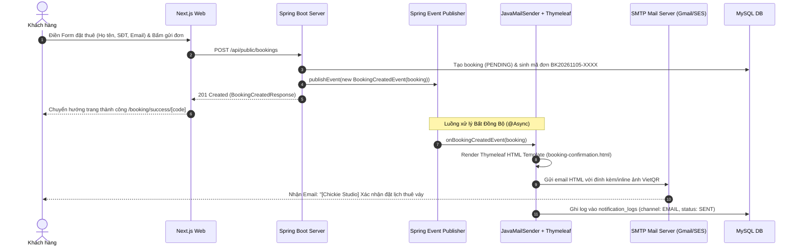

# Đặc Tả Tính Năng: Hệ Thống Thông Báo Qua Email: Xác Nhận Đặt Lịch, Cọc & Nhắc Lịch Thuê

| Thuộc tính | Giá trị |
|---|---|
| **ID** | `SET-003` |
| **Tên tính năng** | Hệ thống gửi thông báo qua Email: Xác nhận đặt lịch, cọc & nhắc lịch thuê (Chưa triển khai Zalo/SMS) |
| **Module** | SET (System Setting & Notification) |
| **Phạm vi** | SERVER, CRM |
| **Ưu tiên** | P1 - Vận hành & Chăm sóc khách hàng tự động |
| **Trạng thái** | 📝 SPEC |
| **Người phụ trách** | Backend Engineer & Fullstack Dev |
| **Ngày bắt đầu** | 2026-10-25 |
| **Ngày hoàn thành** | 2026-10-25 |
| **Phụ thuộc** | `BOK-001`, `BOK-003`, `BOK-007`, `BOK-010`, `PAY-001`, `SET-001` |

---

## Mục Lục
1. [Mục Tiêu và Giá Trị Mang Lại](#1-mục-tiêu-và-giá-trị-mang-lại)
2. [Người Dùng & Tác Nhân Liên Quan](#2-người-dùng--tác-nhân-liên-quan)
3. [Luồng Nghiệp Vụ Chính (Happy Path)](#3-luồng-nghiệp-vụ-chính-happy-path)
4. [Các Kịch Bản Email Tự Động Chi Tiết](#4-các-kịch-bản-email-tự-động-chi-tiết)
5. [Luồng Ngoại Lệ và Xử Lý Lỗi](#5-luồng-ngoại-lệ-và-xử-lý-lỗi)
6. [Quy Tắc Nghiệp Vụ (Business Rules)](#6-quy-tắc-nghiệp-vụ-business-rules)
7. [Giao Diện CRM & Quản Trị](#7-giao-diện-crm--quản-trị)
8. [Đặc Tả Kỹ Thuật & API Backend](#8-đặc-tả-kỹ-thuật--api-backend)
9. [Thay Đổi Cơ Sở Dữ Liệu](#9-thay-đổi-cơ-sở-dữ-liệu)
10. [Tiêu Chí Nghiệm Thu (Acceptance Criteria)](#10-tiêu-chí-nghiệm-thu-acceptance-criteria)
11. [Kế Hoạch Kiểm Thử](#11-kế-hoạch-kiểm-thử)
12. [Checklist Hoàn Thành (Definition of Done)](#12-checklist-hoàn-thành-definition-of-done)

---

## 1. Mục Tiêu và Giá Trị Mang Lại
- **Tự động hóa thông báo 100% qua Email**: Khi khách hàng đặt thuê trực tuyến thành công trên Client (`BOK-001`), một email xác nhận kèm toàn bộ chi tiết đơn hàng, số tiền cọc và mã VietQR thanh toán sẽ lập tức được gửi đến hòm thư của khách.
- **Tập trung kênh Email, hoãn Zalo/SMS**: 
  - Kênh Email có chi phí vận hành 0 đồng (qua SMTP Gmail, Amazon SES, Resend hoặc SendGrid), dễ dàng triển khai ngay lập tức.
  - Định dạng HTML Email sang trọng (Tone màu Burgundy, Gold, Ivory chuẩn thương hiệu Chickie Studio), hiển thị đầy đủ bảng chi tiết sản phẩm, ảnh lookbook, mã QR và hóa đơn - điều mà SMS văn bản thuần túy không đáp ứng được.
  - **Quy định phạm vi**: Hiện tại hệ thống **chưa thực hiện gửi thông báo qua Zalo hay SMS**, toàn bộ thông báo khách hàng được chuẩn hóa và thực hiện qua kênh **Email**.
- **Chăm sóc xuyên suốt vòng đời đơn thuê**: Tự động nhắc lịch nhận đồ, nhắc lịch trả đồ, xác nhận nhận cọc, thông báo hoàn cọc hoặc hủy đơn tự động mà nhân viên không cần gọi điện thủ công.

---

## 2. Người Dùng & Tác Nhân Liên Quan
- [x] **Khách hàng**: Nhận email xác nhận đặt lịch ngay sau khi bấm đặt thuê trên web, nhận email nhắc lịch và hóa đơn điện tử.
- [x] **Hệ thống Server Spring Boot**: Tự động kích hoạt gửi email qua các sự kiện nội bộ (`@Async`, `ApplicationEventPublisher`) hoặc scheduler định kỳ (`@Scheduled`).
- [x] **Nhân viên CRM**: Theo dõi nhật ký gửi email trong chi tiết đơn hàng và có thể bấm gửi lại email (Resend Email) khi khách yêu cầu.

---

## 3. Luồng Nghiệp Vụ Chính (Happy Path)



---

## 4. Các Kịch Bản Email Tự Động Chi Tiết

| Mã kịch bản | Template Thymeleaf | Thời điểm kích hoạt | Tiêu đề Email | Nội dung chính |
|---|---|---|---|---|
| `BOOKING_CONFIRMATION` | `email/booking-confirmation.html` | Ngay khi tạo đơn thành công trên Client (`BOK-001`) | `[Chickie Studio] Xác nhận đơn đặt thuê #[MÃ_ĐƠN] & Hướng dẫn cọc` | - Thông tin khách hàng & Mã đơn.<br>- Bảng sản phẩm thuê (Tên, size, ngày nhận - trả).<br>- Số tiền thuê & số tiền cọc cần chuyển khoản (50%).<br>- Mã **VietQR động** chuyển khoản 1 chạm.<br>- Thời hạn giữ chỗ 60 phút.<br>- Link tra cứu đơn trực tiếp: `/tra-cuu-don?code=...&phone=...`. |
| `DEPOSIT_RECEIVED` | `email/deposit-received.html` | Khi đơn chuyển trạng thái sang `DEPOSITED` (`PAY-001`) | `[Chickie Studio] Đã nhận tiền cọc đơn thuê #[MÃ_ĐƠN] - Slot giữ thành công!` | - Xác nhận đã nhận đủ số tiền cọc.<br>- Giữ slot sản phẩm thành công 100%.<br>- Lời dặn khi đến lấy đồ (mang CCCD, giờ mở cửa showroom 08:30 - 21:30). |
| `PICKUP_REMINDER` | `email/pickup-reminder.html` | 08:00 sáng trước ngày nhận đồ 1 ngày (H-1) | `[Chickie Studio] Nhắc lịch hẹn lấy trang phục ngày mai #[MÃ_ĐƠN]` | - Nhắc ngày giờ nhận đồ.<br>- Địa chỉ Showroom hoặc thông tin đơn vị vận chuyển.<br>- Lưu ý kiểm tra đồ khi nhận. |
| `RETURN_REMINDER` | `email/return-reminder.html` | 08:00 sáng ngày hẹn trả đồ (Day D) | `[Chickie Studio] Nhắc lịch hẹn trả đồ hôm nay #[MÃ_ĐƠN]` | - Nhắc khách chuẩn bị trang phục & phụ kiện đi kèm.<br>- Giờ trả đồ muộn nhất: trước 21:00 tối để tránh phát sinh phụ phí trễ hạn. |
| `RETURN_COMPLETED` | `email/return-completed.html` | Khi khách trả đồ & nhân viên hoàn cọc (`PAY-002`) | `[Chickie Studio] Biên lai quyết toán & Hoàn cọc đơn thuê #[MÃ_ĐƠN]` | - Quyết toán số tiền hoàn cọc.<br>- Biên lai chi tiết phụ phí hư hại/trễ hạn (nếu có).<br>- Lời cảm ơn và link gửi đánh giá trải nghiệm (`CNT-006`). |
| `BOOKING_EXPIRED` | `email/booking-expired.html` | Khi đơn PENDING quá 60 phút bị tự động hủy (`BOK-007`) | `[Chickie Studio] Thông báo hết hạn giữ chỗ đơn thuê #[MÃ_ĐƠN]` | - Thông báo slot đồ đã được mở lại cho khách khác do chưa hoàn tất cọc trong 60 phút.<br>- Nút bấm hỗ trợ đặt lại đơn mới. |
| `FITTING_CONFIRMATION` | `email/fitting-confirmation.html` | Khi khách đặt lịch thử đồ showroom (`BOK-010`) | `[Chickie Studio] Xác nhận lịch hẹn thử đồ tại Showroom Hà Nội` | - Thời gian hẹn, danh sách mẫu váy muốn thử.<br>- Địa chỉ Showroom & Số hotline hỗ trợ. |

---

## 5. Luồng Ngoại Lệ và Xử Lý Lỗi
- **Email không tồn tại hoặc SMTP từ chối**: 
  - Hệ thống bắt ngoại lệ `MailSendException`, ghi nhận trạng thái `FAILED` vào `notification_logs` kèm chi tiết lỗi `error_message`.
  - Không làm gián đoạn luồng đặt đơn thuê hay giao dịch của khách hàng.
- **Lỗi kết nối mạng tới SMTP Server**:
  - Tự động thử lại tối đa 3 lần bằng cơ chế `@Retryable` với thời gian trễ lũy tiến (1s, 5s, 15s).
- **Khách không nhận được email**:
  - Nhân viên trên CRM có thể bấm nút **"Gửi lại email xác nhận"** trong chi tiết đơn hàng để hệ thống gửi lại ngay lập tức.

---

## 6. Quy Tắc Nghiệp Vụ (Business Rules)
- **BR-01 (Kênh thông báo chuẩn)**: Mọi thông báo khách hàng đều được gửi qua **Email**. **TUYỆT ĐỐI CHƯA** gửi qua Zalo hay SMS cho đến khi có yêu cầu mới.
- **BR-02 (Xử lý bất đồng bộ)**: Quá trình render template và gửi mail PHẢI chạy trên Thread Pool bất đồng bộ (`@Async("mailTaskExecutor")`), phản hồi API tạo đơn cho khách hàng dưới 300ms.
- **BR-03 (Bảo mật & Cấu hình)**: Toàn bộ thông tin cấu hình SMTP (Username, App Password, Host, Port) phải lấy từ biến môi trường hoặc bảng `system_settings` (`SET-001`), không được hardcode trong mã nguồn.
- **BR-04 (Kiến trúc mở rộng)**: Thiết kế `NotificationService` theo Strategy Pattern (`NotificationChannel.EMAIL`). Khi dự án cần bật thêm SMS hoặc Zalo trong tương lai, chỉ cần bổ sung `ZaloNotificationChannel` mà không phá vỡ logic hiện tại.

---

## 7. Giao Diện CRM & Quản Trị
- **Màn hình chi tiết đơn thuê `/orders/:id`**:
  - Bổ sung Card **"Lịch sử gửi thông báo"** hiển thị danh sách các email đã gửi tới khách:
    - Loại email (Xác nhận đơn, Báo nhận cọc, Nhắc lịch, v.v.).
    - Địa chỉ email người nhận.
    - Thời gian gửi.
    - Trạng thái: `Thành công (Đã gửi)` (Badge xanh lá) hoặc `Thất bại` (Badge đỏ kèm tooltip lý do).
    - Nút bấm: **"Gửi lại email này"** (Resend).

---

## 8. Đặc Tả Kỹ Thuật & API Backend

### 8.1. API Quản Trị CRM
| Method | Endpoint | Quyền | Request Body | Mô tả |
|---|---|---|---|---|
| `GET` | `/api/admin/bookings/{id}/notifications` | `ADMIN`, `STAFF` | Không | Lấy lịch sử email đã gửi của đơn hàng |
| `POST` | `/api/admin/bookings/{id}/resend-email` | `ADMIN`, `STAFF` | `{ "templateType": "BOOKING_CONFIRMATION" }` | Kích hoạt gửi lại email cụ thể |

### 8.2. Mail Configuration & Service Architecture
```java
@Configuration
@EnableAsync
public class MailConfig {
    @Bean(name = "mailTaskExecutor")
    public Executor mailTaskExecutor() {
        ThreadPoolTaskExecutor executor = new ThreadPoolTaskExecutor();
        executor.setCorePoolSize(2);
        executor.setMaxPoolSize(5);
        executor.setQueueCapacity(100);
        executor.setThreadNamePrefix("ChickieMail-");
        executor.initialize();
        return executor;
    }
}
```

```java
public interface EmailNotificationService {
    void sendBookingConfirmation(Booking booking);
    void sendDepositReceived(Booking booking);
    void sendPickupReminder(Booking booking);
    void sendReturnReminder(Booking booking);
    void sendReturnCompleted(Booking booking);
    void sendBookingExpired(Booking booking);
    void sendFittingConfirmation(FittingAppointment appointment);
}
```

---

## 9. Thay Đổi Cơ Sở Dữ Liệu
- **File Migration Flyway**: `V29__create_notification_logs_table.sql`
```sql
CREATE TABLE `notification_logs` (
    `id` BIGINT AUTO_INCREMENT PRIMARY KEY,
    `booking_id` BIGINT NULL,
    `recipient_email` VARCHAR(255) NOT NULL,
    `recipient_name` VARCHAR(100) NULL,
    `channel` VARCHAR(20) NOT NULL DEFAULT 'EMAIL', -- Hiện tại 100% EMAIL; dự phòng ZALO_ZNS, SMS tương lai
    `template_type` VARCHAR(50) NOT NULL, -- BOOKING_CONFIRMATION, DEPOSIT_RECEIVED, PICKUP_REMINDER, RETURN_REMINDER, RETURN_COMPLETED, BOOKING_EXPIRED, FITTING_CONFIRMATION
    `subject` VARCHAR(255) NOT NULL,
    `status` VARCHAR(20) NOT NULL DEFAULT 'SENT', -- SENT, FAILED
    `provider_message_id` VARCHAR(100) NULL,
    `error_message` TEXT NULL,
    `sent_at` TIMESTAMP NOT NULL DEFAULT CURRENT_TIMESTAMP,
    `created_at` TIMESTAMP NOT NULL DEFAULT CURRENT_TIMESTAMP,
    INDEX `idx_notif_booking` (`booking_id`),
    INDEX `idx_notif_email` (`recipient_email`),
    INDEX `idx_notif_type` (`template_type`)
) ENGINE=InnoDB DEFAULT CHARSET=utf8mb4 COLLATE=utf8mb4_unicode_ci;
```

---

## 10. Tiêu Chí Nghiệm Thu (Acceptance Criteria)
- [ ] **Kịch bản 1 - Khách đặt đơn thuê thành công**:
  - **Given**: Khách hàng nhập email `phuonganh@gmail.com` khi đặt lịch thuê đồ online (`BOK-001`).
  - **When**: Đơn hàng tạo thành công trên server (`PENDING`).
  - **Then**: Hệ thống gửi email `BOOKING_CONFIRMATION` về `phuonganh@gmail.com` chứa mã đơn, số tiền cọc, mã VietQR và link tra cứu. Bản ghi `notification_logs` lưu `channel: EMAIL, status: SENT`. Tuyệt đối không có SMS hay Zalo nào được gửi.
- [ ] **Kịch bản 2 - Thu cọc thành công**:
  - **Given**: Đơn thuê chuyển từ `PENDING` sang `DEPOSITED` trên CRM (`PAY-001`).
  - **When**: Nhân viên xác nhận đã thu cọc.
  - **Then**: Khách nhận được email `DEPOSIT_RECEIVED` báo slot đã giữ thành công.
- [ ] **Kịch bản 3 - Nhân viên gửi lại email trên CRM**:
  - **Given**: Khách hàng báo chưa thấy email hoặc bị thất lạc vào hòm thư Spam.
  - **When**: Nhân viên bấm nút "Gửi lại email" trên CRM.
  - **Then**: Hệ thống lập tức gửi lại email mới và ghi nhận thêm 1 lượt log thành công.

---

## 11. Kế Hoạch Kiểm Thử
- **Unit Test**: 
  - Mock `JavaMailSender` và `SpringTemplateEngine` để kiểm tra logic ánh xạ biến template DTO và tiêu đề email (`EmailNotificationServiceTest` $\ge 85\%$ coverage).
- **Integration Test**: 
  - Sử dụng GreenMail / Wiser embedded SMTP test server để xác thực email được gửi đi với đúng định dạng MIME HTML, subject và người nhận.
- **UI Test (CRM)**:
  - Kiểm tra hiển thị bảng lịch sử thông báo email và nút Resend (`BookingNotificationCard.test.tsx`).

---

## 12. Checklist Hoàn Thành (Definition of Done)
- [x] Tài liệu đặc tả `SET-003` chuẩn hóa kênh Email, loại bỏ Zalo/SMS.
- [x] Cập nhật đồng bộ các spec phụ thuộc (`BOK-001`, `BOK-003`, `BOK-007`, `BOK-010`, `PAY-001`, `SET-001`).
- [x] Cập nhật `docs/FEATURES.md` và `docs/CHANGELOG.md`.
